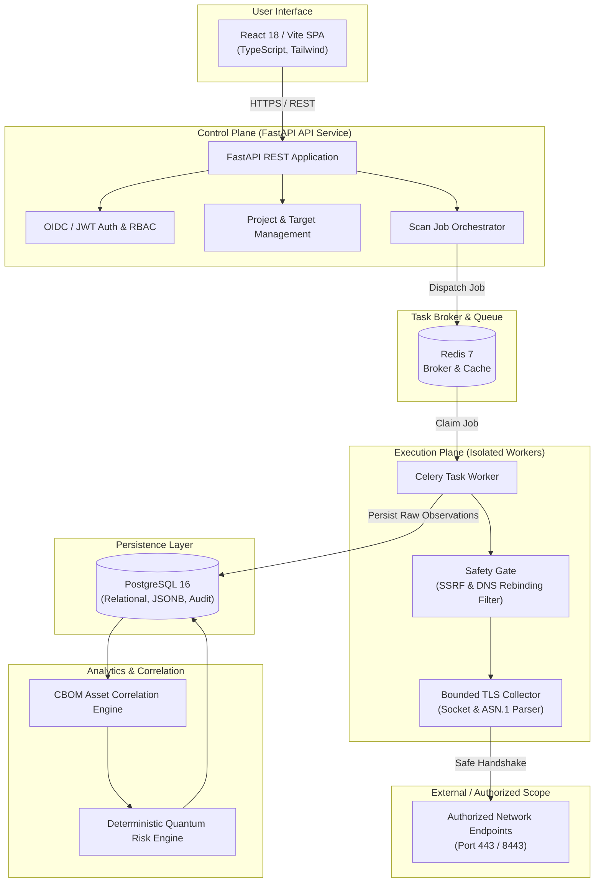

# Quantum Flow Technologies — PQC Discovery & Risk Assessment Platform

[](#16-current-development-status)
[](https://www.python.org/)
[](https://fastapi.tiangolo.com/)
[](https://react.dev/)
[](#11-documentation-index)
[](#license-status)

---

## 1. Project Name

**Quantum Flow Technologies — Post-Quantum Cryptography (PQC) Discovery & Risk Assessment Platform**  
*Repository:* `quantum-flow-pqc-platform`

---

## 2. Project Overview

Quantum Flow is an enterprise cybersecurity platform engineered to help organizations systematically prepare for the post-quantum cryptographic transition. The platform provides continuous, non-destructive discovery of cryptographic assets across public-facing infrastructure, internal services, and application dependencies, normalizes findings into an evidence-backed Cryptographic Bill of Materials (CBOM), and executes deterministic quantum risk assessments to prioritize remediation.

---

## 3. Company Vision & Strategic Context

As articulated by Founder & CEO Nitin M. Jakaty in [*Securing the World’s Cryptography for the Quantum Era*](docs/00-company-vision/PQC_Platform_Vision_and_Roadmap.pdf):

> *"Every organisation that relies on digital trust will have to change its cryptography. We intend to be the company that shows them how... Our approach is clear: We will not invent cryptography. We will build on published standards and proven components, and create our own IP where it matters most: discovery, the cryptographic asset model, risk analysis, migration orchestration, policy controls, integrations and the evidence trail that proves the work was done right."*

The platform aligns with federal and international post-quantum mandates:
- **NIST Post-Quantum Standards:** ML-KEM (FIPS 203), ML-DSA (FIPS 204), and SLH-DSA (FIPS 205).
- **National Policy & Sovereignty:** Department of Science and Technology (DST) February 2026 report on *Implementing a Quantum-Safe Ecosystem in India* and the *National Quantum Mission (NQM)*.
- **Strategic Adoption:** Active initiatives toward adoption as a national reference architecture with the Government of Karnataka and international partners.

---

## 4. Problem Statement

Modern enterprise security architectures rely heavily on classical public-key cryptography—predominantly RSA and Elliptic-Curve Cryptography (ECC)—to secure authentication, digital certificates, data transit, and transactional integrity. 

The advent of a Cryptographically Relevant Quantum Computer (CRQC) poses an existential threat to these algorithms via **Shor’s Algorithm**, which fundamentally breaks the mathematical assumptions underpinning RSA and discrete logarithm/elliptic-curve schemes. Furthermore, **Grover’s Algorithm** reduces the effective security margins of symmetric encryption (AES) and cryptographic hashing.

Enterprises currently face critical transition hurdles:
- **Zero Cryptographic Visibility:** Cryptography is embedded across thousands of endpoints, libraries, cloud services, and legacy appliances without a centralized inventory.
- **Harvest Now, Decrypt Later (HNDL):** Adversaries are actively intercepting and storing encrypted enterprise traffic today to decrypt once quantum computing reaches commercial viability.
- **Compliance & Regulatory Mandates:** Organizations must comply with aggressive federal and international standards (e.g., NIST FIPS 203/204/205, NSA CNSA 2.0, OMB M-23-02) requiring complete cryptographic inventory and PQC migration milestones.
- **Complexity of Migration:** Transitioning to quantum-resistant lattice-based schemes requires assessing key size impacts, protocol compatibility, performance overheads, and dependency chains.

---

## 5. Product Objectives

1. **Automate Cryptographic Discovery:** Systematically identify cryptographic algorithms, key lengths, certificates, and cipher suites across authorized enterprise endpoints.
2. **Establish Single Source of Truth:** Generate a machine-readable, auditable, and versioned Cryptographic Bill of Materials (CBOM) conforming to modern supply-chain standards (CycloneDX 1.6).
3. **Quantify Quantum Risk with Explainability:** Provide transparent, deterministic, and ruleset-versioned risk scores linking every finding directly to empirical observation evidence.
4. **Govern Migration Planning:** Formulate actionable remediation guidance, migration waves, and compatibility roadmaps without disrupting active business operations.
5. **Ensure Continuous Assurance:** Monitor cryptographic agility and compliance over time, detecting regressions, expiring certificates, or deprecated algorithms.

---

## 6. Core Product Capabilities

| Capability | Description |
|---|---|
| **Cryptographic Discovery** | Automated, non-destructive network and TLS inspection of authorized targets to capture protocol versions, cipher suites, key exchange mechanisms, and complete X.509 certificate chains. |
| **Cryptographic Asset Inventory** | Centralized cataloging of cryptographic assets (certificates, public keys, algorithms, protocol endpoints) with distinct identity resolution and lifecycle tracking. |
| **Cryptographic Bill of Materials (CBOM)** | Standardized, exportable inventory schemas (CycloneDX 1.6 / JSON) linking components to their underlying cryptographic algorithms, key parameters, and evidence provenance. |
| **Quantum Risk Assessment** | Deterministic evaluation of discovered assets against quantum attack vectors (Shor's / Grover's), categorizing assets into Post-Quantum Safe, Quantum-Vulnerable, or Deprecated. |
| **PQC Migration Planning** | Risk-prioritized remediation recommendations, compatibility roadmaps, and migration milestone planning aligned with NIST and CNSA 2.0 standards. |
| **Continuous Assurance** | Automated re-scanning, drift detection, certificate rotation tracking, and cryptographic policy compliance verification over time. |

---

## 7. Product Workflow

The platform operates across six continuous lifecycle stages defined in the company roadmap:

$$\textbf{Discover} \longrightarrow \textbf{Inventory} \longrightarrow \textbf{Prioritise} \longrightarrow \textbf{Plan} \longrightarrow \textbf{Migrate} \longrightarrow \textbf{Assure}$$

```mermaid
flowchart LR
    A["1. Discover<br/>(Find certificates, keys,<br/>protocols, crypto in code)"] --> B["2. Inventory<br/>(Build evidence-backed<br/>CBOM asset graph)"]
    B --> C["3. Prioritise<br/>(Score risk by exposure<br/>& confidentiality lifetime)"]
    C --> D["4. Plan<br/>(Dependency-aware<br/>migration packages)"]
    D --> E["5. Migrate<br/>(Controlled PQC and<br/>hybrid changes)"]
    E --> F["6. Assure<br/>(Test, verify & maintain<br/>tamper-evident audit trail)"]
    
    style A fill:#e1f5fe,stroke:#0288d1,stroke-width:2px
    style B fill:#e8f5e9,stroke:#388e3c,stroke-width:2px
    style C fill:#fff3e0,stroke:#f57c00,stroke-width:2px
    style D fill:#f3e5f5,stroke:#7b1fa2,stroke-width:2px
    style E fill:#fce4ec,stroke:#c2185b,stroke-width:2px
    style F fill:#e0f2f1,stroke:#00796b,stroke-width:2px
```



*Note: Initial delivery milestones (Sprints 0–6) focus on establishing the Discover, Inventory, and Prioritise foundation.*

---

## 8. High-Level Architecture

The platform is designed around a **control-plane and execution-plane separation**, ensuring untrusted network inspection is isolated from core data persistence and user-facing APIs.



---

## 9. Proposed Technology Stack

- **Backend API & Control Plane:** Python 3.12+, FastAPI, Pydantic v2
- **Persistence & ORM:** PostgreSQL 16 (Relational models & JSONB evidence envelopes), SQLAlchemy 2.0 (async), Alembic
- **Task Queue & Caching:** Redis 7, Celery 5.3+
- **Frontend Dashboard:** React 18, TypeScript 5.4+, Vite, Tailwind CSS, TanStack Query
- **Cryptographic & Network Tooling:** Python `cryptography` (X.509/ASN.1 parsing), standard `ssl`/`socket` for bounded handshakes
- **Code Quality & CI/CD:** Ruff (formatting and linting), Mypy (strict type checking), Pytest (unit, integration, security), GitHub Actions
- **Containerization:** Docker, Docker Compose

---

## 10. Repository Structure

```text
quantum-flow-pqc-platform/
├── apps/
│   ├── api/                 # FastAPI REST API application (Control plane)
│   ├── worker/              # Celery background workers (Execution plane)
│   └── web/                 # React / Vite / TypeScript web dashboard
├── packages/
│   ├── scanner/             # TLS collector, target validation, SSRF filter
│   ├── cbom/                # CBOM correlation engine & export generators
│   └── risk-engine/         # Deterministic quantum risk scoring engine
├── infra/
│   ├── docker/              # Local Docker Compose and Dockerfile manifests
│   └── scripts/             # Local initialization and database utilities
├── docs/                    # Centralized engineering documentation
│   ├── README.md            # Central documentation index
│   ├── Documentation_Governance.md # Document lifecycle & approval rules
│   ├── REPOSITORY_SETUP_AUDIT.md # Repository audit report
│   ├── 00-company-vision/   # Vision & strategic roadmap documentation
│   ├── 01-product/          # PRD and Product Glossary
│   ├── 02-technical-architecture/ # TRD, SAD, Implementation Blueprint, ADRs
│   ├── 03-database/         # Database Design Document (DDD)
│   ├── 04-api/              # REST API Specifications
│   ├── 05-risk-engine/      # Quantum Risk Assessment Methodology
│   ├── 06-cbom/             # CBOM Asset Correlation Engine Design
│   ├── 07-security/         # Threat Model, Data Governance, Incident Response
│   ├── 08-development/      # Setup Guide, Coding Standards, Testing Strategy, Runbook
│   └── 09-project-management/# Implementation Roadmap, Backlog, Traceability Matrix
├── .editorconfig            # Cross-editor formatting rules
├── .env.example             # Safe environment variable template
├── .gitignore               # Multi-stack git ignore rules
├── CODE_OF_CONDUCT.md       # Contributor code of conduct & ethics
├── CONTRIBUTING.md          # Contributor guidance summary
├── README.md                # Project documentation overview
└── SECURITY.md              # Security policy & responsible disclosure
```

---

## 11. Documentation Index

The complete documentation library is indexed centrally in [`docs/README.md`](docs/README.md):

| Category | Primary Document | Description | Status |
|---|---|---|:---:|
| **00 — Vision** | [`PQC_Platform_Vision_and_Roadmap.pdf`](docs/00-company-vision/PQC_Platform_Vision_and_Roadmap.pdf) | Company vision, roadmap & operating rhythm by Founder & CEO | Approved |
| | [`00-company-vision/README.md`](docs/00-company-vision/README.md) | Vision summary, verification digest & core workflow | Verified |
| **01 — Product** | [`PRD_v1.0.md`](docs/01-product/PRD_v1.0.md) | Product Requirements Document (FR-01 to FR-09) | Draft |
| | [`Glossary.md`](docs/01-product/Glossary.md) | Product & Cryptographic Terminology Glossary | Draft |
| **02 — Architecture** | [`TRD_v1.0.md`](docs/02-technical-architecture/TRD_v1.0.md) | Technical Requirements Document | Draft |
| | [`SAD_v1.0.md`](docs/02-technical-architecture/SAD_v1.0.md) | System Architecture Document | Draft |
| | [`Implementation_Blueprint_v1.0.md`](docs/02-technical-architecture/Implementation_Blueprint_v1.0.md) | Monorepo implementation blueprint & sequence | Draft |
| | [`Architecture_Decisions/`](docs/02-technical-architecture/Architecture_Decisions/README.md) | ADR Governance, Index & [ADR Template](docs/02-technical-architecture/Architecture_Decisions/ADR_TEMPLATE.md) | Maintained |
| **03 — Database** | [`Database_Design_v1.0.md`](docs/03-database/Database_Design_v1.0.md) | Relational database schema & JSONB storage | Draft |
| **04 — API** | [`API_Specification_v1.0.md`](docs/04-api/API_Specification_v1.0.md) | REST API endpoint contracts & error schemas | Draft |
| **05 — Risk Engine** | [`Quantum_Risk_Assessment_Methodology_v1.0.md`](docs/05-risk-engine/Quantum_Risk_Assessment_Methodology_v1.0.md) | Risk scoring formulas & Shor/Grover weights | Draft |
| **06 — CBOM** | [`CBOM_Asset_Correlation_Engine_v1.0.md`](docs/06-cbom/CBOM_Asset_Correlation_Engine_v1.0.md) | Asset correlation, graph modeling & CycloneDX 1.6 | Draft |
| **07 — Security** | [`07-security/README.md`](docs/07-security/README.md) | Overview of 10 security control domains | Maintained |
| | [`Threat_Model_Security_Architecture_v1.0.md`](docs/07-security/Threat_Model_Security_Architecture_v1.0.md) | Comprehensive STRIDE threat model & controls | Draft |
| | [`Data_Governance_and_Retention.md`](docs/07-security/Data_Governance_and_Retention.md) | Data classification, minimization & retention | Draft |
| | [`Incident_Response_Plan.md`](docs/07-security/Incident_Response_Plan.md) | Product security incident handling playbooks | Draft |
| **08 — Development**| [`Setup_Guide.md`](docs/08-development/Setup_Guide.md) | Local developer onboarding & environment setup | Maintained |
| | [`Coding_Standards.md`](docs/08-development/Coding_Standards.md) | Engineering conventions, type hints & style | Maintained |
| | [`Contribution_Guide.md`](docs/08-development/Contribution_Guide.md) | Detailed pull request lifecycle & review conduct | Maintained |
| | [`Testing_Strategy.md`](docs/08-development/Testing_Strategy.md) | Multi-layer testing, synthetic CA, SSRF abuse tests | Draft |
| | [`Deployment_Operations_Runbook.md`](docs/08-development/Deployment_Operations_Runbook.md) | Deployment runbook, health probes, DR & rollbacks | Draft |
| | [`Release_Management_Guide.md`](docs/08-development/Release_Management_Guide.md) | Semantic versioning, release gates & changelogs | Draft |
| **09 — Management** | [`Implementation_Roadmap.md`](docs/09-project-management/Implementation_Roadmap.md) | Sprint 0–7 delivery milestones & criteria | Proposed |
| | [`Development_Backlog.md`](docs/09-project-management/Development_Backlog.md) | 47 engineering tasks (QF-001 to QF-047) | Active |
| | [`Requirements_Traceability_Matrix.md`](docs/09-project-management/Requirements_Traceability_Matrix.md) | End-to-end PRD-to-test traceability matrix | Draft |
| **Governance** | [`Documentation_Governance.md`](docs/Documentation_Governance.md) | Document lifecycle states, review cadences & rules | Draft |
| | [`REPOSITORY_SETUP_AUDIT.md`](docs/REPOSITORY_SETUP_AUDIT.md) | Repository audit report & verification matrix | Maintained |

---

## 12. Local Development Setup Prerequisites

Ensure your system has the required tooling installed:
- Git 2.40+
- Python 3.12+
- Node.js 20+ LTS & `pnpm` (or `npm`)
- Docker Desktop or Docker Engine 25+ with Docker Compose v2

For detailed installation and operating-system-specific instructions (including Windows PowerShell considerations), see [`docs/08-development/Setup_Guide.md`](docs/08-development/Setup_Guide.md).

---

## 13. Environment Configuration

1. Copy the safe configuration template:
   ```powershell
   Copy-Item .env.example .env
   # or on Linux/macOS: cp .env.example .env
   ```
2. Verify local non-production defaults (PostgreSQL on port `5432`, Redis on `6379`, local API on `8000`).
3. **Never place real credentials, production secrets, or private API keys in `.env`.**

---

## 14. Testing and Code Quality Commands

Enforce quality using the testing suite defined in [`docs/08-development/Testing_Strategy.md`](docs/08-development/Testing_Strategy.md):

```powershell
# Format and lint with Ruff
ruff format .
ruff check . --fix

# Static type checking
mypy apps/ packages/

# Run unit and integration tests with coverage
pytest -v --cov=apps --cov=packages

# Frontend verification
cd apps/web
pnpm run lint
pnpm run typecheck
```

---

## 15. Security and Authorised Scanning Notice

> [!CAUTION]
> **Authorised Scanning Notice:**  
> The Quantum Flow scanner is designed exclusively to inspect endpoints, certificates, and infrastructure that an organization owns or has received **explicit, documented legal authorization** to assess.  
> - Scanning unauthorized targets or attempting to bypass network controls is strictly prohibited and violates platform policy and computer misuse legislation.
> - The platform incorporates non-bypassable pre-connection checks blocking private IPv4/IPv6 ranges (RFC 1918), loopback, link-local, and cloud metadata services (`169.254.169.254`).
> - **The platform NEVER collects, handles, or stores private cryptographic keys.**

For security disclosures, review [`SECURITY.md`](SECURITY.md) and the [`Incident Response Plan`](docs/07-security/Incident_Response_Plan.md).

---

## 16. Current Development Status

> [!IMPORTANT]
> **CURRENT REPOSITORY STAGE: SPRINT 0 (ENGINEERING SETUP & ARCHITECTURE BASELINE)**  
> - **Documentation & Specifications:** Complete specifications and governance guides established across `docs/`.
> - **Engineering Standards & Guardrails:** `.gitignore`, `.env.example`, `.editorconfig`, `CODE_OF_CONDUCT.md`, `CONTRIBUTING.md`, and `SECURITY.md` established.
> - **Application Implementation:** **NOT YET STARTED.** Application code (`apps/api/`, `apps/worker/`, `apps/web/`, `packages/scanner/`) has **not** been implemented. 
> - **Operational State:** Scanners, risk scoring engines, CBOM correlation, and background workers are currently in technical design and **are not operational in code**.

---

## 17. Governance & Contribution Guidelines

We maintain high standards of professional conduct, engineering rigor, and ethical research:
- All participants must adhere to the [`CODE_OF_CONDUCT.md`](CODE_OF_CONDUCT.md).
- All non-trivial work requires a linked backlog task (`QF-XXX`).
- Use prefixed branches: `feature/`, `fix/`, `security/`, `docs/`, `chore/`.
- Conventional commit messages are strictly enforced.
- Security-sensitive changes require mandatory CISO / Security Architect review.
- Documentation updates must follow the [`Documentation Governance Guide`](docs/Documentation_Governance.md).

Read [`CONTRIBUTING.md`](CONTRIBUTING.md) and [`docs/08-development/Contribution_Guide.md`](docs/08-development/Contribution_Guide.md) before submitting a pull request.

---

## License Status

This software is a proprietary enterprise product developed by Quantum Flow Technologies. Licensing terms remain undecided pending formal corporate and legal authorization. No open-source license is granted at this stage.
