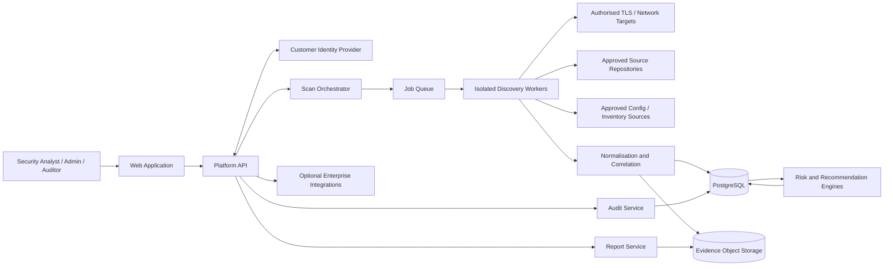
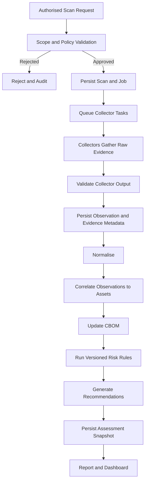
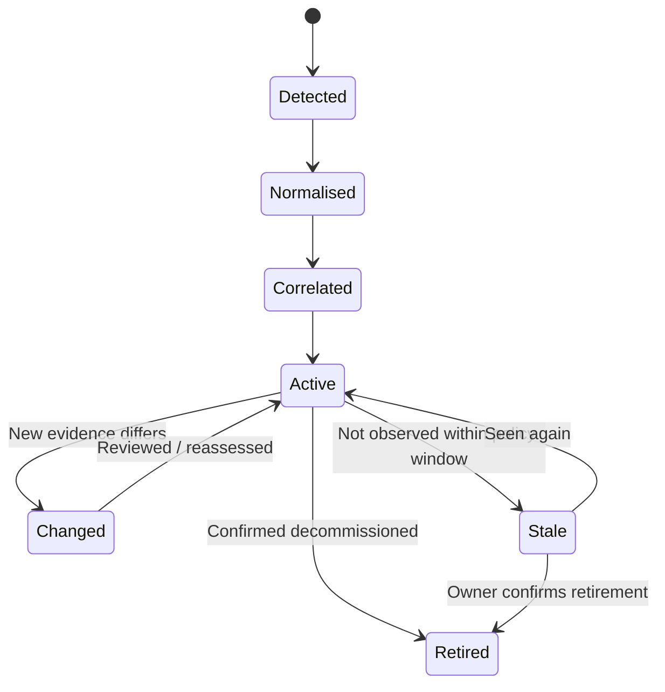
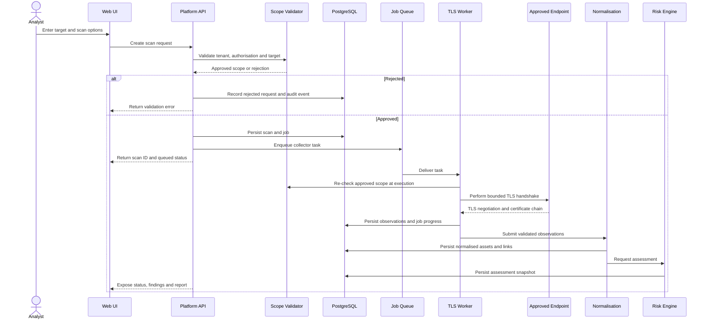
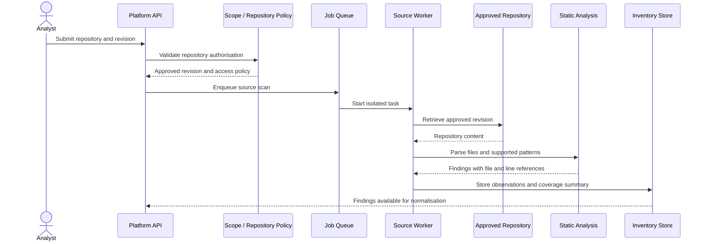
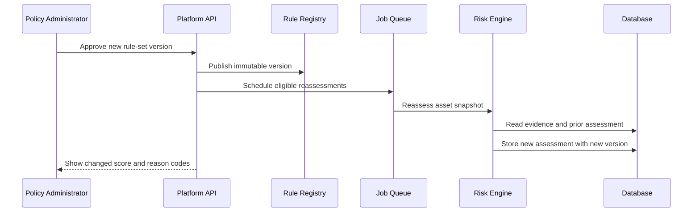
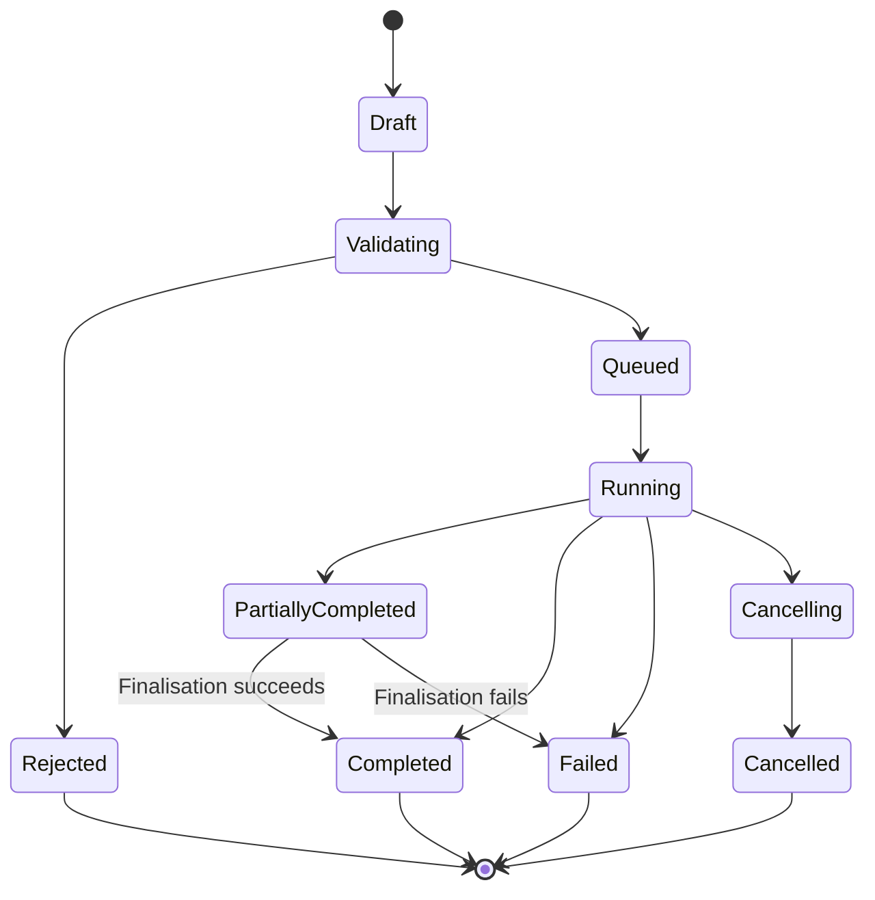
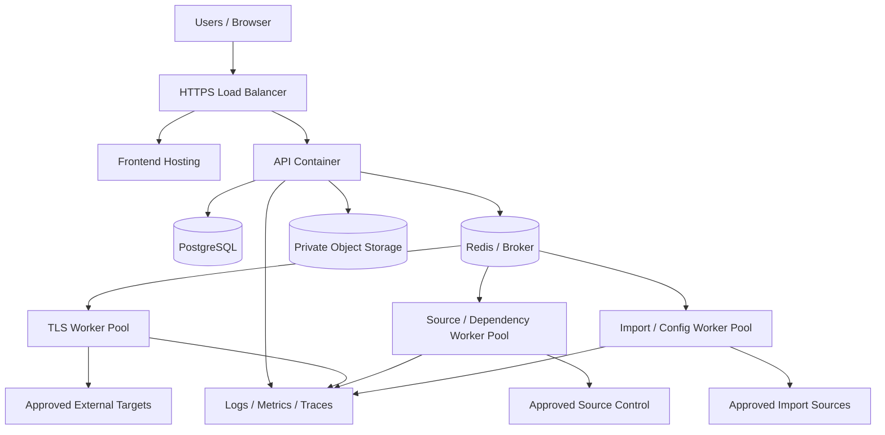

# Quantum Flow Technologies
# PQC Discovery & Risk Assessment Platform
## System Architecture Document (SAD)

**Document ID:** QFT-PQC-SAD-001  
**Version:** 1.0 — Draft  
**Status:** Proposed architecture for technical review  
**Date:** 02 November 2026  
**Owner:** Quantum Flow Technologies — Engineering  
**Reviewers:** Product Owner, CISO, Technical Lead, Security Engineering  
**Related documents:** Product Requirements Document (PRD) v1.0 Draft; Technical Requirements Document (TRD) v1.0 Draft; *PQC Platform Vision and Roadmap*, Version 1.0, October 2026

---

## Document status and interpretation

This document describes a proposed architecture for the PQC Discovery & Risk Assessment Platform. It is an engineering design proposal, not evidence that the platform or any component has already been implemented, tested, certified, or approved.

The architecture follows the company vision's workflow:

**Discover → Inventory → Prioritise → Plan → Migrate → Assure**

The first implementation increment should concentrate on authorised discovery, evidence-backed cryptographic inventory, explainable prioritisation, and reporting. Migration execution and production changes are later capabilities and must remain approval-gated.

Technology choices and deployment topology in this document are proposals. The engineering lead and CISO must approve the open decisions before they are treated as binding.

---

# 1. Purpose

The purpose of this System Architecture Document is to define the major building blocks, responsibilities, interfaces, data flows, trust boundaries, deployment model, security controls, and architectural decisions for the Quantum Flow PQC Discovery & Risk Assessment Platform.

The platform is intended to help organisations understand where cryptography is used, determine which assets may be exposed to future quantum threats, prioritise remediation, and eventually plan and govern migration to post-quantum cryptography (PQC).

A public website scan is one discovery method. It cannot establish a complete enterprise cryptographic inventory because it cannot directly inspect private networks, internal services, source repositories, application binaries, databases, cloud configurations, or cryptographic operations that are not externally observable. The architecture therefore uses multiple pluggable collectors and records the provenance and confidence of every observation.

## 1.1 Architectural outcomes

The architecture should provide:

1. A secure and controlled way to create and execute discovery jobs.
2. Multiple discovery collectors that can be enabled independently.
3. A common evidence and observation model across collectors.
4. Correlation of observations into cryptographic assets without losing original evidence.
5. A versioned, deterministic, explainable quantum-risk assessment engine.
6. A cryptographic bill of materials (CBOM) with source, ownership, confidence, and lifecycle metadata.
7. Recommendations linked to findings, policies, and relevant standards.
8. Reports and APIs suitable for integration into enterprise workflows.
9. A foundation for future migration planning, approvals, controlled execution, rollback, and assurance.
10. Tenant isolation, auditability, data minimisation, and safe-by-default scanning.

## 1.2 Out of scope for this architecture's first release

- Unattended modification of customer production systems.
- Automatic replacement of cryptographic algorithms or certificates.
- Claims that a scan discovers every cryptographic asset in an organisation.
- Claims of NIST certification or regulatory compliance merely because a recommended algorithm appears in a standard.
- Collection or storage of private keys, passwords, tokens, or unrelated customer secrets.
- Unrestricted internet scanning or scanning without documented authorisation.
- Opaque AI-generated risk scores without deterministic evidence and reviewable rules.

---

# 2. Architecture drivers and principles

## 2.1 Key drivers

| Driver | Architectural implication |
|---|---|
| Incomplete visibility from any one scan source | Use multiple collectors and explicitly represent coverage gaps |
| Heterogeneous cryptographic usage | Use a canonical observation and asset schema |
| Evidence must be defensible | Preserve provenance, timestamps, method, collector version, and evidence references |
| Quantum risk is algorithm- and context-dependent | Use rule-based classification, not a single “quantum vulnerable” flag |
| Enterprise confidentiality | Minimise collected data and isolate tenants |
| Long-running discovery | Execute scans asynchronously through controlled workers |
| Extensibility | Add collectors and rules through versioned interfaces |
| Migration is operationally sensitive | Keep discovery and migration execution separate; require approvals and rollback |
| Audit and assurance | Maintain immutable-style audit events and versioned assessment results |

## 2.2 Architecture principles

1. **Evidence before conclusions:** every finding must trace to one or more observations.
2. **Observed is not inferred:** direct network evidence, static source-code matches, imported records, and unknowns must remain distinguishable.
3. **No silent certainty:** confidence and coverage limitations are visible to users.
4. **Least privilege:** each service, worker, and user receives only the permissions it needs.
5. **Authorised scope only:** scan targets must be validated against an approved scope before execution.
6. **Safe defaults:** conservative timeouts, concurrency, request rates, and data retention.
7. **Deterministic risk:** the same evidence and rule-set version should produce the same assessment.
8. **Version everything material:** collectors, normalisation rules, risk rules, policies, and report templates.
9. **Separate control plane and execution plane:** API/UI controls jobs; workers perform bounded discovery.
10. **Human approval for change:** migration actions must not execute unattended in production.
11. **Modular monolith first:** keep the initial platform operationally simple while maintaining clear module boundaries.
12. **Standards-aware, not certification-claiming:** standards inform mapping and recommendations; product claims require separate evidence.

---

# 3. System context

## 3.1 External actors

| Actor | Responsibilities | Typical access |
|---|---|---|
| Platform Administrator | Tenant provisioning, platform configuration, service health | Platform administration |
| Tenant Administrator | Manage organisation users, scan policies, approved scopes, integrations | Tenant administration |
| Security Analyst | Create scans, review findings, investigate evidence, export reports | Discovery and analysis |
| PKI / Infrastructure Owner | Validate certificates, endpoints, ownership, and remediation options | Assigned assets |
| Application / DevOps Owner | Provide repositories, build metadata, and application context | Assigned projects/assets |
| CISO / Risk Owner | Approve policy, risk thresholds, exceptions, and remediation priorities | Risk and governance |
| Auditor / Read-only Reviewer | Review evidence, assessments, approvals, and audit trail | Read-only |
| External Target System | Exposes authorised network/TLS endpoints or approved source/configuration data | No platform login assumed |
| Identity Provider | Authenticates users through a supported identity protocol | Identity federation |
| Notification Provider | Sends job and governance notifications | Outbound integration only |

## 3.2 System boundary

Inside the platform boundary:

- Web application.
- API and identity/authorisation layer.
- Scan orchestration and job state management.
- Discovery collectors and worker runtime.
- Normalisation and asset correlation.
- CBOM and evidence storage.
- Risk assessment and recommendation engines.
- Reporting and audit services.
- Database, object storage, queue, cache, and observability services.

Outside the boundary:

- Customer websites, networks, repositories, cloud accounts, and applications being assessed.
- Customer identity provider.
- Optional ticketing, SIEM, CMDB, and notification systems.
- External standards and reference sources.

The platform must treat all customer targets and imported content as untrusted input.

## 3.3 Context diagram



---

# 4. High-level architecture

## 4.1 Logical layers

### A. Experience layer
Responsible for user interaction:
- Authentication entry point.
- Tenant and project selection.
- Scan configuration and scope confirmation.
- Job progress and status.
- Inventory and CBOM views.
- Risk findings and evidence inspection.
- Recommendations, exceptions, and report export.
- Administrative settings and audit views.

The frontend must not directly connect to target systems or databases. All operations go through authenticated platform APIs.

### B. API and application layer
Responsible for:
- Authentication integration and authorisation.
- Tenant context enforcement.
- Request validation.
- Scan and project lifecycle.
- Policy and scope validation.
- Job submission and status queries.
- Inventory and assessment queries.
- Report requests and exports.
- Audit event creation.
- Rate limits and API versioning.

### C. Orchestration layer
Responsible for:
- Persisting job intent and state.
- Selecting permitted collectors.
- Scheduling bounded jobs.
- Enforcing concurrency and retry policies.
- Dispatching jobs to queues.
- Tracking progress and cancellation.
- Handling worker failures and timeouts.
- Ensuring idempotent job transitions.

### D. Collector execution layer
Responsible for gathering evidence from approved sources:
- Network/TLS collector.
- Certificate-chain collector.
- Source-code collector.
- Dependency and package metadata collector.
- Configuration and infrastructure collector.
- Inventory import collector.

Collectors should be independently versioned and should implement a common contract. A collector must report what it checked, what it did not check, its method, its version, its result status, and any errors.

### E. Intelligence layer
Responsible for:
- Parsing and normalising raw observations.
- Correlating observations into assets.
- Maintaining CBOM relationships.
- Applying deterministic risk rules.
- Producing recommendations.
- Recording rule-set and policy versions.
- Supporting reassessment when evidence or rules change.

### F. Data layer
Responsible for:
- Relational records and relationships.
- Evidence metadata and references.
- Object storage for permitted evidence artefacts and reports.
- Queue and cache state.
- Audit events and retention.

### G. Operations and governance layer
Responsible for:
- Logs, metrics, traces, and alerts.
- Secrets and key management.
- Backup and recovery.
- Deployment and release controls.
- Security monitoring.
- Policy versioning and approvals.

## 4.2 Proposed deployment style

For the initial POC/MVP, use a **modular monolith for the API and domain services**, with **separate asynchronous worker processes** for discovery jobs.

This gives clear code boundaries without the operational cost of premature microservices. The API, orchestrator, collectors, risk engine, and reporting modules can be deployed separately as processes/containers while sharing a versioned codebase and domain contracts.

A later stage may extract high-load or independently governed modules into services when there is measured need.

---

# 5. Component architecture and responsibilities

## 5.1 Component catalogue

| Component | Primary responsibility | Must not do |
|---|---|---|
| Web UI | Present workflows and evidence | Connect directly to target networks |
| API Gateway / API app | Validate requests, authenticate, authorise, route use cases | Run long scans inside request threads |
| Identity Adapter | Verify identity claims and map roles | Trust client-supplied tenant IDs without verification |
| Tenant / Policy Service | Manage tenant, roles, scan policies, and approved scope | Permit cross-tenant access |
| Scope Validator | Validate target, DNS resolution, IP ranges, ports, and authorisation | Treat user-entered domain as automatically authorised |
| Scan Orchestrator | Create and coordinate jobs | Bypass policy checks |
| Queue | Buffer asynchronous work | Be the only source of durable job state |
| Worker Supervisor | Run bounded jobs and report heartbeat/status | Execute arbitrary imported code |
| Collector Plugins | Gather source-specific observations | Write directly to unrelated domain tables |
| Normalisation Service | Convert collector output to canonical schema | Remove original provenance |
| Correlation Service | Link observations to assets | Merge records solely because names look similar |
| CBOM Service | Maintain cryptographic inventory and relationships | Claim complete coverage without evidence |
| Risk Engine | Apply versioned rules to evidence | Hide scoring logic or silently alter past results |
| Recommendation Engine | Map findings to actionable guidance | Recommend unsupported algorithm swaps without context |
| Report Service | Produce human-readable/exportable results | Expose other tenants' information |
| Audit Service | Record security- and governance-relevant events | Allow ordinary users to rewrite audit history |
| Integration Adapter | Exchange approved data with external systems | Export sensitive evidence by default |

## 5.2 Collector plugin contract

Every collector should implement a common conceptual interface:

```python
class Collector:
    collector_id: str
    collector_version: str
    supported_source_types: list[str]

    def validate_config(self, config, scope, policy):
        # Validate configuration without contacting the target.
        ...

    def collect(self, job_context):
        # Yield structured observations and progress events.
        ...

    def health_check(self):
        # Return collector readiness and dependency status.
        ...
```

The concrete implementation may differ, but the contract should require:

- Collector ID and semantic version.
- Source type and collection method.
- Target/scope reference.
- Start/end timestamps.
- Result status: completed, partial, failed, skipped, or unsupported.
- Structured observations.
- Error codes that do not leak secrets.
- Coverage summary and limitations.
- Evidence references.
- Rate and timeout compliance.
- Cancellation support where practical.

Collectors should not decide final risk. They gather evidence; normalisation and assessment components interpret it.

## 5.3 Initial collector set

### Network/TLS collector
- Resolve the hostname under the approved scope policy.
- Validate resolved addresses against blocked network ranges.
- Connect only to approved ports and protocols.
- Use SNI where applicable.
- Record negotiated TLS version and cipher suite.
- Record key-exchange group or mechanism when observable.
- Retrieve and parse the presented certificate chain.
- Record certificate public-key algorithm and parameters.
- Record certificate signature algorithm.
- Capture validity period, issuer, subject, SANs, and chain-validation outcome.
- Record handshake and collection errors.
- Never claim visibility into application-level cryptography from a TLS handshake alone.

### Certificate intelligence collector
- Parse X.509 certificate data.
- Distinguish subject public-key algorithm from certificate signature algorithm.
- Identify key size/curve where available.
- Identify signature hash and signature scheme where available.
- Record issuer, subject, SANs, validity, key usage, extended key usage, and chain links.
- Avoid treating a certificate's signature algorithm as the negotiated TLS cipher suite.

### Source-code collector
- Operate only on an explicitly authorised repository and revision.
- Use static analysis and language-aware patterns where available.
- Record repository, commit, file path, and line range.
- Identify cryptographic library calls, algorithms, key sizes, protocol configuration, and hard-coded configuration references where safely detectable.
- Do not execute untrusted repository code.
- Treat a static match as evidence of code presence, not proof that the code executes in production.

### Dependency collector
- Parse supported lockfiles and package manifests.
- Record package name, ecosystem, version, dependency path, and relevant cryptographic packages.
- Link package findings to repository revision.
- Avoid claiming that a package's presence proves a particular algorithm is actively used.

### Configuration/import collector
- Ingest approved TLS, PKI, cloud, CMDB, or cryptographic inventory exports.
- Validate file type, schema, size, and content.
- Mark imported evidence as `IMPORTED`.
- Preserve source system and import timestamp.
- Do not silently upgrade imported records to directly observed facts.

---

# 6. Core data and evidence architecture

## 6.1 Data lifecycle



## 6.2 Observation versus asset

An **observation** is a piece of evidence produced by a collection activity. An **asset** is a logical cryptographic entity or usage instance inferred or confirmed from one or more observations.

Examples:
- A TLS handshake that negotiates TLS 1.3 and a specific cipher suite is an observation.
- A certificate returned by an endpoint is an observation and may also identify a certificate asset.
- A source-code match for an RSA API is an observation; a cryptographic asset may be created only after normalisation and correlation.
- A single asset can have multiple observations from different dates and collectors.

Do not discard observations after creating an asset. Retain their provenance and relationships so an analyst can inspect why the asset exists.

## 6.3 Canonical observation fields

Minimum fields:

| Field | Description |
|---|---|
| observation_id | Unique identifier |
| tenant_id | Owning tenant |
| scan_id / job_id | Collection activity reference |
| target_id | Approved target reference |
| source_type | Network, certificate, source, dependency, configuration, import |
| collector_id / version | Collector identity and version |
| collection_method | How the evidence was obtained |
| observed_at | Time the observation was made |
| status | Success, partial, failed, skipped, unsupported |
| evidence_type | Certificate, handshake, source match, package, config, etc. |
| evidence_payload | Structured, validated, minimised evidence |
| provenance | Source and collection metadata |
| confidence | Defined confidence value with rationale |
| classification | OBSERVED, INFERRED, IMPORTED, UNKNOWN |
| error_code | Safe machine-readable error |
| evidence_ref | Reference to stored artefact, if applicable |

## 6.4 Canonical cryptographic asset fields

Minimum fields:

- Asset ID and tenant ID.
- Asset type: certificate, endpoint TLS configuration, key usage, algorithm instance, library/dependency, protocol configuration, or imported inventory item.
- Display name and technical identifier.
- Environment and application/service association, if known.
- Owner/team and business criticality, if supplied.
- Algorithm family and algorithm name.
- Parameters: key size, curve, mode, hash, protocol version, or other applicable parameters.
- Usage: key establishment, key transport, digital signature, authentication, encryption, integrity, hashing, or unknown.
- Location: hostname, port, repository, file/line, cloud resource, or imported source.
- First seen and last seen.
- Lifecycle status.
- Evidence references.
- Confidence and classification.
- Risk assessment references.
- Remediation status and exception reference.

Fields not observed must remain null/unknown rather than being guessed.

## 6.5 Evidence storage

Use PostgreSQL for structured metadata and object storage for larger permitted artefacts.

Recommended approach:
- Store structured observations and asset relationships in PostgreSQL.
- Store reports and larger evidence artefacts in private object storage.
- Keep only a stable object reference, checksum, size, content type, retention class, and access metadata in the database.
- Encrypt storage and transport.
- Use short-lived, authorisation-checked download URLs where supported.
- Apply retention and deletion policy by tenant and evidence category.
- Never store private keys or secrets as scan evidence.

---

# 7. CBOM architecture

The CBOM is the platform's structured inventory of cryptographic assets and their relationships.

## 7.1 CBOM capabilities

- Create asset records from normalised observations.
- Link assets to applications, services, repositories, endpoints, certificates, dependencies, and environments.
- Preserve source and confidence.
- Track first-seen/last-seen history.
- Identify duplicate or related assets without destroying original observations.
- Show coverage by collector, environment, and asset category.
- Link each asset to one or more risk assessments.
- Support export and later integration with enterprise inventory systems.

## 7.2 Correlation strategy

Correlation should use deterministic identifiers where possible:
- Certificate fingerprint.
- Endpoint hostname + port + protocol context.
- Repository + commit + file path + line range.
- Package ecosystem + package name + version + dependency path.
- Cloud resource identifier from a trusted import.

When deterministic identifiers are unavailable, use cautious matching rules and preserve the correlation rationale. Ambiguous matches should remain separate or be flagged for human review.

## 7.3 CBOM lifecycle



A lack of recent observations does not prove an asset has been decommissioned. `STALE` and `RETIRED` must be distinct states.

---

# 8. Quantum risk and recommendation architecture

## 8.1 Separation of responsibilities

The risk engine should not be embedded inside collectors. The collector reports what it observed. The normalisation layer identifies the relevant cryptographic primitive and usage. The risk engine applies a versioned policy and produces an explainable assessment.

Recommended processing:

1. Select an asset and its supporting observations.
2. Validate required fields and evidence freshness.
3. Identify algorithm family, parameters, and cryptographic purpose.
4. Map the primitive to relevant quantum threat considerations.
5. Apply policy rules and contextual modifiers.
6. Calculate a provisional score and category.
7. Generate reason codes and evidence links.
8. Generate recommendations from approved guidance.
9. Persist the exact rule-set and policy versions used.

## 8.2 Threat mapping

The assessment must distinguish at least:

- **Shor-relevant public-key cryptography:** RSA, finite-field Diffie–Hellman, and elliptic-curve cryptography are relevant to sufficiently capable fault-tolerant quantum attacks.
- **Grover-relevant symmetric cryptography and hash functions:** quantum search changes security margins differently; it does not mean every symmetric primitive is simply “broken.”
- **Non-cryptographic or unknown findings:** do not force a quantum-vulnerability label when the evidence does not support it.
- **PQC and hybrid configurations:** evaluate algorithm, parameters, protocol integration, implementation maturity, interoperability, and policy status. A PQC algorithm's name alone does not prove a deployment is correctly configured or secure.

## 8.3 Risk assessment output

Each assessment should include:
- Assessment ID and timestamp.
- Asset and observation references.
- Risk engine version.
- Rule-set and policy version.
- Score and category, if approved for use.
- Threat mapping and rationale.
- Evidence quality and freshness.
- Business criticality input and its source.
- Exposure context.
- Recommended actions.
- Assumptions and limitations.
- Reviewer/approval state where required.

## 8.4 Score governance

The 0–1000 scoring scale mentioned for the POC is a product requirement to validate, not an already approved methodology. The exact weights, thresholds, category boundaries, and contextual modifiers require CISO approval.

Until approved:
- Label the score `PROVISIONAL`.
- Display the scoring methodology and version.
- Show contributing factors and reason codes.
- Do not imply that a number is an industry-standard quantum-risk score.
- Keep score thresholds configurable by policy, not hard-coded in UI code.
- Preserve prior assessment snapshots when rules change.

## 8.5 Recommendation engine

Recommendations should be linked to:
- Finding/asset.
- Observed evidence.
- Risk rule and reason code.
- Applicable policy or standard reference.
- Suggested action.
- Prerequisites and dependencies.
- Operational impact and compatibility considerations.
- Validation steps.
- Rollback or contingency guidance where applicable.
- Approval requirement.

Recommendations must distinguish short-term compensating controls from long-term PQC migration. Do not recommend a blanket algorithm replacement without understanding protocol support, client compatibility, key management, certificate lifecycle, vendor support, and operational constraints.

---

# 9. End-to-end sequence flows

## 9.1 Create and execute a TLS discovery scan



Important: scope must be checked both when the scan is created and immediately before network execution. DNS results can change between those points.

## 9.2 Source repository discovery



The worker must not execute repository scripts, install arbitrary dependencies, or run project build steps as part of ordinary static discovery.

## 9.3 Reassessment after rule update



A rule update should create a new assessment snapshot; it should not overwrite the historical result.

---

# 10. API and integration architecture

## 10.1 API conventions

- REST-style versioned API, initially `/api/v1`.
- JSON request and response bodies.
- OpenAPI contract generated from the API implementation.
- Consistent error envelope and machine-readable error codes.
- Pagination for inventory and findings.
- Idempotency keys for job-creation operations where appropriate.
- Correlation/request IDs for support and audit.
- Explicit tenant context derived from verified identity claims and server-side membership.
- Rate limits and payload size limits.
- No long-running scan in a synchronous HTTP request.

## 10.2 Main API domains

| Domain | Example routes | Purpose |
|---|---|---|
| Identity | `/auth/*`, `/me` | Login integration and current user context |
| Tenants | `/tenants`, `/tenants/{id}/members` | Tenant administration |
| Projects | `/projects` | Organise targets and assets |
| Targets | `/targets` | Register and approve targets |
| Scans | `/scans`, `/scans/{id}`, `/scans/{id}/cancel` | Create and track discovery |
| Findings | `/findings`, `/findings/{id}` | Review findings and evidence |
| Assets | `/assets`, `/assets/{id}` | CBOM inventory |
| Assessments | `/assessments`, `/assets/{id}/assessments` | Risk results |
| Recommendations | `/recommendations` | Remediation guidance |
| Reports | `/reports`, `/reports/{id}` | Generate and retrieve reports |
| Policies | `/policies` | Scope and risk policy management |
| Audit | `/audit-events` | Governance and security review |
| Health | `/health/live`, `/health/ready` | Service health |

Exact request and response schemas belong in the separate API Specification document.

## 10.3 Integration boundaries

Potential future integrations:
- SSO / enterprise identity provider.
- CMDB and asset inventory.
- Cloud provider configuration exports.
- Source control providers.
- Ticketing systems.
- SIEM / security analytics.
- Notification systems.

Integrations should be adapter-based. Each integration needs explicit permissions, data mapping, error handling, rate limits, and audit events. Do not make a third-party integration a hard dependency for the core discovery workflow.

---

# 11. Data architecture and persistence

## 11.1 Proposed storage components

| Store | Proposed technology | Data |
|---|---|---|
| Primary relational store | PostgreSQL | Tenants, users, targets, jobs, observations, assets, CBOM, assessments, policies, audit metadata |
| Queue / broker | Redis-backed queue initially | Pending asynchronous tasks and transient coordination |
| Object storage | S3-compatible private storage | Reports and approved larger evidence artefacts |
| Cache | Redis, only where useful | Short-lived cache and rate-limit state |
| Logs / metrics / traces | Central observability platform | Operational telemetry, excluding secrets |

Redis must not be the authoritative store for job history or assessment results. Durable state belongs in PostgreSQL.

## 11.2 Logical entities

Core entities expected in the database design:

- Tenant
- User
- TenantMembership
- Role / Permission
- Project
- Target
- AuthorisationRecord
- ScanPolicy
- Scan
- ScanJob
- CollectorExecution
- Observation
- EvidenceObject
- CryptographicAsset
- AssetObservation
- AssetRelationship
- CBOMSnapshot
- RiskRuleSet
- RiskRule
- RiskAssessment
- RiskFactor
- Recommendation
- Exception / RiskAcceptance
- Report
- AuditEvent
- Integration
- Notification

Detailed columns, indexes, constraints, relationships, and migrations are defined in the separate Database Design document.

## 11.3 Tenant isolation

Every tenant-owned record must carry a tenant ownership relationship. All database access must be tenant-scoped in the service layer and, where feasible, reinforced through PostgreSQL row-level security.

Controls:
- Derive tenant membership from verified identity context.
- Never trust a tenant ID supplied only by the browser.
- Enforce tenant filtering on every read and write.
- Validate object ownership before downloads or exports.
- Include cross-tenant negative tests.
- Keep platform administration privileges separate and audited.
- Ensure background jobs carry a validated tenant context.

---

# 12. Security architecture

## 12.1 Trust boundaries

1. Browser to API.
2. API to database, queue, and object storage.
3. Orchestrator to worker runtime.
4. Worker to customer-controlled target.
5. Worker to source-control or cloud provider.
6. Platform to external integrations.
7. Tenant-to-tenant data boundary.
8. Administrative control plane to execution plane.

Each boundary needs authentication where applicable, authorisation, input validation, transport protection, logging, and failure handling.

## 12.2 Authorised scanning controls

The platform must not treat possession of a domain name as proof of authorisation.

Before a scan:
- Require an explicit target scope and an authorisation record or approved ownership verification process.
- Record who approved the scope, what was approved, and the approval period.
- Restrict hostname, IP, port, protocol, path, repository, and scan method as applicable.
- Support deny lists and tenant-level policy.
- Provide a dry-run/validation stage.
- Enforce limits on concurrency, connection count, duration, and retries.

At execution:
- Resolve DNS and validate every resolved IP.
- Revalidate redirects and any subsequent destinations.
- Block loopback, private, link-local, multicast, reserved, and cloud metadata ranges by default unless a separately authorised private-network connector is explicitly configured.
- Defend against DNS rebinding by validating the address used for the actual connection.
- Do not follow arbitrary redirects outside approved scope.
- Apply strict connect/read timeouts and response-size limits.
- Prevent workers from reaching internal platform control endpoints.
- Record target and policy decisions.

## 12.3 Worker isolation

- Run collectors as non-root users.
- Use container or equivalent process isolation.
- Apply CPU, memory, file-size, and execution-time limits.
- Use read-only filesystems where practical.
- Restrict outbound network access to the approved target set and required dependencies.
- Do not mount platform secrets into general-purpose collector containers.
- Do not execute customer repository code.
- Destroy temporary workspaces after the job.
- Keep worker images minimal and patched.

## 12.4 Identity and access management

Proposed roles:
- Platform Administrator.
- Tenant Administrator.
- Security Analyst.
- Asset Owner.
- Auditor / Read-only.

Use role-based access control, with resource-level permissions for projects and assets where needed. Enforce MFA through the identity provider when available. Privileged actions such as scope approval, risk acceptance, policy changes, and future migration approvals must be auditable.

## 12.5 Secrets and cryptographic material

- Store integration credentials in a dedicated secrets manager.
- Never store secrets in source control, logs, reports, or scan observations.
- Do not request or collect private keys for discovery.
- Encrypt data in transit and at rest.
- Rotate platform and integration credentials.
- Separate platform encryption keys from customer evidence data.
- Restrict access to key-management operations.

## 12.6 Audit events

Audit at minimum:
- Login and authentication failures.
- Tenant and role changes.
- Target registration and authorisation changes.
- Scan creation, cancellation, and completion.
- Collector configuration changes.
- Evidence and asset access where sensitive.
- Risk policy and rule-set changes.
- Risk acceptance and exception approvals.
- Report generation and export.
- Integration configuration changes.
- Administrative actions.

Audit events should include actor, tenant, action, target resource, timestamp, result, request/correlation ID, and relevant before/after metadata where safe. Do not log credentials or full secrets.

---

# 13. Job orchestration and failure handling

## 13.1 Job states

Suggested scan lifecycle:



The exact state machine must be reflected in database constraints and API contracts.

## 13.2 Reliability requirements

- Persist job intent before queue publication.
- Use an outbox or equivalent reliable dispatch pattern to avoid losing jobs between database commit and queue publish.
- Make task handlers idempotent.
- Use bounded retries with exponential backoff and jitter.
- Separate retryable network failures from permanent validation failures.
- Record each collector execution and its result.
- Use heartbeats and stale-job recovery.
- Support cancellation cooperatively.
- Do not retry scope-policy rejection.
- Ensure duplicate queue delivery does not duplicate final assets or corrupt assessments.

## 13.3 Partial results

A scan may complete partially if one collector fails while others succeed. The platform should:
- Show collector-level status.
- Preserve successful observations.
- Identify failed or unsupported checks.
- Avoid representing a partial scan as a complete enterprise inventory.
- Allow controlled retry of failed collectors.
- Include coverage limitations in reports.

---

# 14. Reporting and user experience architecture

## 14.1 Main user workflow

1. User signs in and selects tenant/project.
2. User registers a target or chooses an approved target.
3. User selects discovery methods permitted by policy.
4. Platform validates authorisation and scope.
5. User reviews the scan plan and submits.
6. UI shows queued/running/progress/partial/completed status.
7. User opens findings and inspects evidence.
8. User reviews CBOM assets and coverage.
9. User reviews risk assessment, factors, and confidence.
10. User reviews recommendations and exports a report.

## 14.2 Report structure

A report should contain:
- Organisation/project and scan scope.
- Authorisation/scope reference.
- Scan time and platform/collector versions.
- Executive summary.
- Coverage and limitations.
- Discovered endpoints and certificates.
- Cryptographic assets and observations.
- Risk results and methodology version.
- Evidence references and confidence.
- Recommendations and priorities.
- Unknowns, failures, and unsupported checks.
- Assumptions and disclaimers.

The report must not state “all enterprise cryptography discovered” unless the scope and evidence genuinely support that claim.

---

# 15. Deployment architecture

## 15.1 Proposed environments

- **Local development:** developer workstation with containerised dependencies.
- **CI:** automated lint, type checks, tests, security checks, and build.
- **Development:** shared non-production environment.
- **Staging:** production-like environment for integration and security validation.
- **Production:** isolated tenant-aware environment with monitored services and controlled releases.

## 15.2 Proposed container topology



## 15.3 Network segmentation

- Public ingress should expose only the required web/API endpoints.
- Database, queue, and object storage should remain private.
- Workers should run in a separate execution network or isolated subnet.
- Worker egress should be restricted and policy-controlled.
- Administrative access should use a controlled management path.
- No worker should have unrestricted access to the platform's internal network.

## 15.4 Backup and recovery

- Automated encrypted PostgreSQL backups.
- Point-in-time recovery where supported.
- Object-storage versioning or equivalent protection for important reports/evidence.
- Documented retention and deletion policy.
- Periodic restore tests.
- Queue recovery should be possible from durable job records.
- Define RPO and RTO with the product owner before production launch; do not invent targets in implementation.

---

# 16. Observability and operations

## 16.1 Logs

Use structured logs with:
- Timestamp.
- Service and environment.
- Severity.
- Request/correlation ID.
- Tenant ID where appropriate and safe.
- Scan/job/collector ID.
- Event code.
- Duration and result status.

Never log passwords, tokens, private keys, full credentials, or unrestricted source contents.

## 16.2 Metrics

Suggested metrics:
- API request count, latency, and error rate.
- Active and queued scans.
- Job duration by collector.
- Collector success/partial/failure rates.
- Queue depth and oldest job age.
- Worker utilisation and restarts.
- DNS, connection, and TLS handshake failure rates.
- Number of observations/assets created.
- Assessment processing time.
- Report generation time.
- Rate-limit and scope-policy rejections.

## 16.3 Alerts

Alert on:
- Repeated worker crashes.
- Queue backlog beyond approved operational threshold.
- Database connection exhaustion.
- Unexpected scan volume or egress patterns.
- Cross-tenant access-control test failures.
- Secrets detected in logs.
- Repeated scope-validation failures.
- Backup failures.
- Critical dependency/security advisories.

---

# 17. Quality attributes

| Attribute | Architectural approach | Validation |
|---|---|---|
| Security | Least privilege, scope validation, worker isolation, tenant separation | Threat modelling, SAST/DAST, access-control tests |
| Reliability | Durable job state, idempotency, bounded retries | Failure injection and recovery tests |
| Explainability | Evidence-linked rules and reason codes | Analyst review of assessment trace |
| Extensibility | Collector and rule interfaces | Add a test collector/rule without changing unrelated modules |
| Maintainability | Modular monolith, typed contracts, migrations, API schema | Code review, lint, type checks, architecture tests |
| Performance | Async jobs, pagination, bounded concurrency | Load tests with agreed workload |
| Privacy | Data minimisation, retention, secret exclusion | Data-flow review and retention tests |
| Portability | Containerised services and standard interfaces | Build and deploy in supported environments |
| Auditability | Versioned policy/rules and audit events | Trace sample result end-to-end |
| Usability | Clear scan progress, evidence, coverage and limitations | User acceptance testing |

Numerical service-level targets should be agreed after workload and deployment assumptions are known.

---

# 18. Technology architecture

The following is the proposed baseline from the TRD, subject to engineering approval.

| Layer | Proposed technology | Rationale |
|---|---|---|
| Frontend | React + TypeScript | Typed component-based web application |
| Styling | Tailwind CSS | Consistent UI implementation |
| API/backend | Python + FastAPI | Typed API contracts and Python ecosystem |
| Validation | Pydantic | Request and domain schema validation |
| Relational database | PostgreSQL | Transactional relational inventory |
| ORM/migrations | SQLAlchemy + Alembic | Persistence mapping and schema evolution |
| Async jobs | Celery + Redis initially | Background discovery execution |
| TLS/network | Python `ssl`, OpenSSL-backed tooling | TLS and certificate inspection |
| Certificate parsing | `cryptography` | X.509 and cryptographic metadata parsing |
| Testing | Pytest | Unit and integration testing |
| Containers | Docker | Reproducible service and worker packaging |
| API contract | OpenAPI | Documented, testable API |
| CI/CD | GitHub Actions | Automated engineering checks |

Technology selection does not remove the need to pin versions, review licenses, scan dependencies, generate an SBOM for the platform itself, and manage updates.

---

# 19. Repository and code organisation

Proposed monorepo structure:

```text
quantum-flow-pqc-platform/
├── apps/
│   ├── web/
│   │   ├── src/
│   │   └── tests/
│   └── api/
│       ├── app/
│       │   ├── api/
│       │   ├── auth/
│       │   ├── tenants/
│       │   ├── projects/
│       │   ├── targets/
│       │   ├── scans/
│       │   ├── findings/
│       │   ├── assets/
│       │   ├── assessments/
│       │   ├── reports/
│       │   └── audit/
│       └── tests/
├── workers/
│   ├── supervisor/
│   └── collectors/
│       ├── base/
│       ├── network_tls/
│       ├── certificates/
│       ├── source_code/
│       ├── dependencies/
│       └── configuration/
├── packages/
│   ├── domain-models/
│   ├── normalisation/
│   ├── correlation/
│   ├── cbom/
│   ├── risk-engine/
│   ├── recommendation-engine/
│   └── report-engine/
├── migrations/
├── infrastructure/
│   ├── docker/
│   ├── deployment/
│   └── monitoring/
├── docs/
│   ├── PRD/
│   ├── TRD/
│   ├── SAD/
│   ├── database/
│   ├── api/
│   ├── threat-model/
│   └── decisions/
├── tests/
│   ├── integration/
│   ├── security/
│   └── e2e/
├── .github/
│   └── workflows/
├── docker-compose.yml
├── README.md
└── SECURITY.md
```

The final repository structure should be adapted to the team's conventions. Keep domain contracts independent of the web framework where practical.

---

# 20. Architecture decision records

The following decisions are proposed and should be recorded as formal ADRs after review.

| ADR | Decision | Status | Reason / consequence |
|---|---|---|---|
| ADR-001 | Modular monolith plus separate workers for initial release | Proposed | Reduces operational complexity while retaining module boundaries |
| ADR-002 | PostgreSQL as system of record | Proposed | Strong relational integrity for tenants, jobs, observations, assets, and assessments |
| ADR-003 | Asynchronous scan execution | Proposed | Network and repository discovery are long-running and must not block API requests |
| ADR-004 | Common observation schema | Proposed | Enables multiple collectors to feed a consistent inventory |
| ADR-005 | Separate observations from cryptographic assets | Proposed | Preserves raw evidence and supports correlation over time |
| ADR-006 | Deterministic, versioned risk rules | Proposed | Makes assessments explainable and reproducible |
| ADR-007 | Private object storage for larger evidence/report artefacts | Proposed | Keeps large files out of relational rows while controlling access |
| ADR-008 | Scope validation at creation and execution | Proposed | Reduces unauthorised-scan and DNS-rebinding risk |
| ADR-009 | No production migration execution in discovery MVP | Proposed | Avoids unsafe unattended changes |
| ADR-010 | Tenant context enforced server-side | Proposed | Prevents client-controlled tenant switching and data leakage |

Each ADR should eventually include context, decision, alternatives considered, consequences, owner, date, and approval.

---

# 21. Roadmap alignment

This architecture supports the company roadmap without claiming that future phases are already delivered.

| Roadmap stage | Architecture capability | Expected evidence of completion |
|---|---|---|
| Initial scope and threat model | System boundary, trust boundaries, scope controls, architecture review | Approved scope, threat model, architecture decisions |
| Discovery prototype | TLS and certificate collectors, observation schema, structured findings | Demonstrable authorised endpoint scan with evidence |
| Scanner MVP | Job orchestration, collector framework, CBOM, risk rules, UI/API, reports | End-to-end scan, inventory, explainable assessment, report |
| Inventory and migration plan | Broader collectors, ownership/context, dependency relationships, migration planning | Reviewed CBOM and dependency-aware plan |
| Controlled migration demo | Approval workflow, staged migration, tests, rollback, assurance evidence | Demonstration in a controlled non-production environment |

The platform vision positions discovery, cryptographic asset modelling, CBOM, risk analysis, migration orchestration, policy, integrations, and evidence trail as the product's defensible capabilities. The implementation should therefore prioritise trustworthy discovery and data quality over a dashboard-only demonstration.

---

# 22. Architecture risks and mitigations

| Risk | Impact | Mitigation |
|---|---|---|
| Treating a public TLS scan as full enterprise discovery | False assurance and incomplete risk picture | Label scan coverage and add source/config/import collectors |
| Confusing certificate signature, public key, cipher suite, and key exchange | Incorrect cryptographic classification | Separate typed fields and tests for each concept |
| Overstating confidence from static source matches | Incorrect asset inventory | Mark as inferred and preserve file/line evidence |
| Unauthorised or unsafe target scanning | Legal, operational, and security impact | Authorisation records, scope validation, egress restrictions |
| SSRF or DNS rebinding through scan targets | Access to internal services | Resolve/revalidate, block special ranges, pin validated destination |
| Arbitrary code execution from scanned repositories | Worker compromise | Static-only analysis, no project scripts, isolation |
| Cross-tenant data leakage | Severe confidentiality breach | Tenant-scoped queries, RLS where practical, negative tests |
| Opaque or arbitrary risk score | Loss of trust | CISO-approved rules, versioning, reason codes, provisional label |
| Duplicate or incorrect asset correlation | Misleading CBOM | Deterministic identifiers, cautious matching, review queue |
| Queue loss or duplicate tasks | Missing or duplicated scans | Durable job state, outbox, idempotent workers |
| Evidence retention without limits | Privacy and storage risk | Retention classes, deletion workflows, minimisation |
| Premature microservices | Delivery and operations overhead | Modular monolith until measured scaling need |

---

# 23. Verification and architecture acceptance

The architecture is ready for implementation planning when the following are reviewed and approved:

- [ ] Product scope and initial release boundary confirmed.
- [ ] System context and actors approved.
- [ ] Trust boundaries and data flows reviewed.
- [ ] Authorised scanning and scope verification process approved.
- [ ] Worker isolation and outbound network policy approved.
- [ ] Observation and asset distinction accepted.
- [ ] CBOM data ownership and lifecycle agreed.
- [ ] Risk scoring methodology and provisional/official status agreed by CISO.
- [ ] Tenant isolation strategy reviewed and tested.
- [ ] Job state machine and failure semantics agreed.
- [ ] Evidence storage, retention, and deletion policy agreed.
- [ ] Technology stack and deployment assumptions approved.
- [ ] ADRs assigned owners and approval status.
- [ ] Threat model and security test plan scheduled.
- [ ] API Specification and Database Design work items created.

## 23.1 Minimum architecture proof points

Before calling the architecture validated, demonstrate:

1. An unauthorised or out-of-scope target is rejected.
2. A permitted TLS target can be scanned with bounded network behaviour.
3. TLS version, cipher suite, key exchange, certificate public key, and certificate signature are represented as separate fields.
4. A collector failure produces a visible partial/failed status without losing successful evidence.
5. An observation can be traced to its collector, version, target, time, and evidence.
6. An asset can be traced back to its supporting observations.
7. A risk assessment records its rule-set version and reason codes.
8. A tenant cannot read another tenant's assets, evidence, reports, or jobs.
9. A worker cannot access blocked internal or metadata address ranges.
10. A report includes scope, coverage, limitations, and assessment methodology.

---

# 24. Open decisions requiring stakeholder approval

| ID | Decision | Suggested owner |
|---|---|---|
| OAD-01 | Which deployment environment/cloud is preferred? | CTO / Platform Lead |
| OAD-02 | Which identity provider and SSO protocol are required for MVP? | CTO / Security |
| OAD-03 | Is the first POC single-tenant, or must tenant isolation be present from day one? | Product / CISO |
| OAD-04 | What proof of target authorisation is required for external scans? | CISO / Legal |
| OAD-05 | Which ports, protocols, and scan depth are allowed in the first release? | CISO |
| OAD-06 | Which source-control providers and repository access modes are in scope? | Engineering |
| OAD-07 | Which configuration/CMDB import formats are required first? | Product / Engineering |
| OAD-08 | What evidence retention and deletion periods apply? | Security / Legal |
| OAD-09 | What risk score weights and thresholds are approved? | CISO |
| OAD-10 | What business-criticality and exposure context can customers provide? | Product / Risk |
| OAD-11 | What report formats and customer branding are required? | Product |
| OAD-12 | What are the expected scan volume, concurrency, RPO, and RTO? | CTO / Operations |
| OAD-13 | Which standards and policy references are maintained in the first rule catalogue? | CISO / Research |
| OAD-14 | What is the boundary between MVP recommendations and future migration planning? | Product / CTO |

---

# 25. Related documents and next design artefacts

Recommended document sequence:

1. Product Requirements Document (PRD).
2. Technical Requirements Document (TRD).
3. **System Architecture Document (this document).**
4. Database Design Document (logical ER model, physical schema, indexes, constraints, tenant isolation, migrations).
5. API Specification (OpenAPI contracts, schemas, errors, pagination, authentication).
6. Network/TLS Collector Design.
7. Certificate Intelligence Design.
8. Source and Dependency Scanner Design.
9. CBOM and Correlation Engine Design.
10. Quantum Risk Assessment Methodology and Core Engine Design.
11. Recommendation Engine Design.
12. Threat Model and Security Test Plan.
13. Test Strategy and Release/Deployment Runbooks.

These documents should share stable terminology and IDs. Any change to a major architecture decision should be reflected in the relevant ADR and downstream design documents.

---

# 26. Reference foundation

The architecture is informed by the company-provided *PQC Platform Vision and Roadmap*, Version 1.0, October 2026, especially its workflow, discovery collectors, common evidence model, CBOM, risk analysis, migration governance, security principles, and roadmap.

Standards and references identified in the company vision include:
- NIST FIPS 203 — Module-Lattice-Based Key-Encapsulation Mechanism Standard (ML-KEM).
- NIST FIPS 204 — Module-Lattice-Based Digital Signature Standard (ML-DSA).
- NIST FIPS 205 — Stateless Hash-Based Digital Signature Standard (SLH-DSA).
- NIST SP 800-57 Part 1 — Recommendation for Key Management.
- The company-identified DST Quantum Safe Ecosystem report and National Quantum Mission references.

The engineering team should verify the current edition, status, applicability, and official publication source of each reference before embedding it in product rules or customer reports. This document does not claim that the platform is certified or endorsed by NIST or any government body.

---

# 27. Approval

| Role | Name | Decision | Date |
|---|---|---|---|
| Product Owner | TBD | Pending | TBD |
| CTO / Technical Lead | TBD | Pending | TBD |
| CISO | TBD | Pending | TBD |
| Engineering Lead | TBD | Pending | TBD |

**Document status:** Draft — proposed architecture.  
**Approval condition:** Open decisions, threat model, scope policy, risk methodology, and data governance must be reviewed before production implementation.
