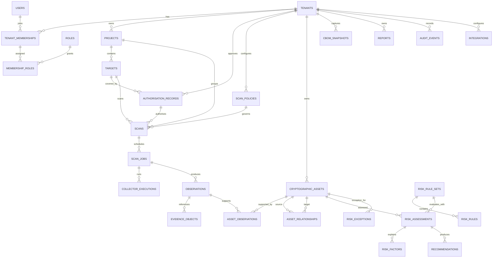
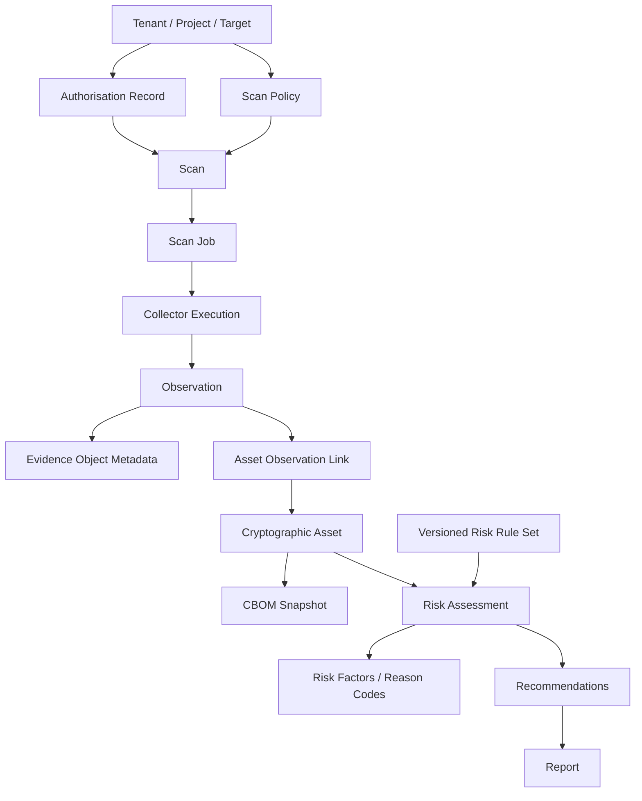
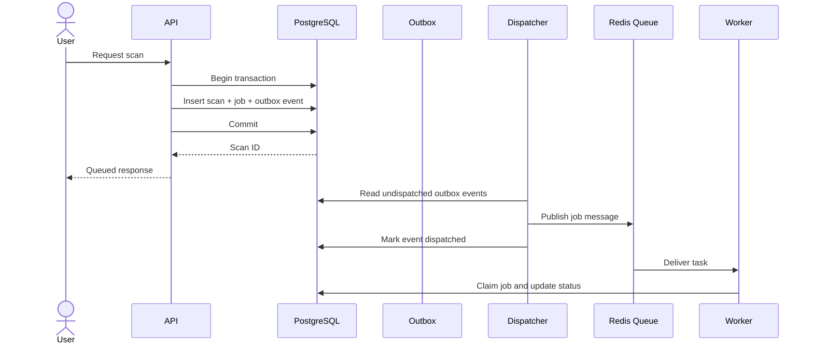
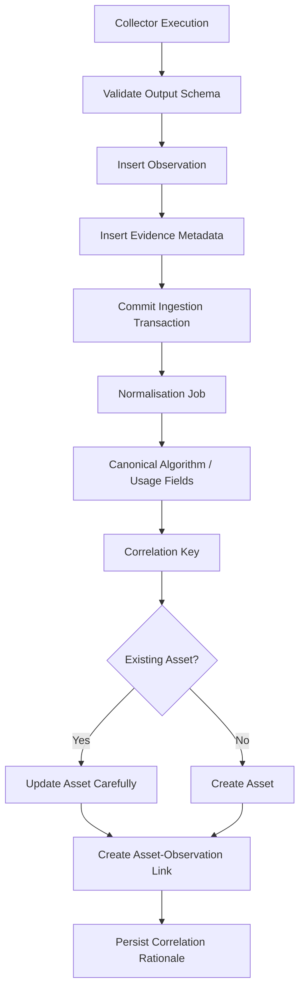
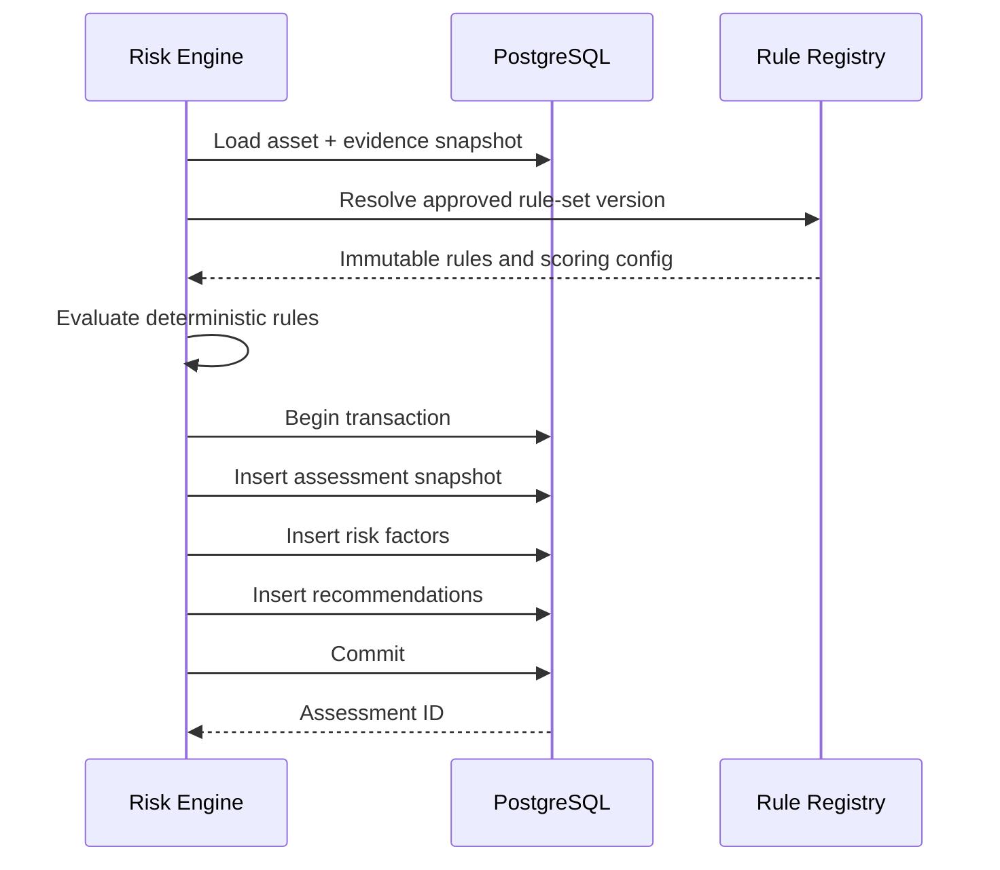

# Quantum Flow Technologies
# PQC Discovery & Risk Assessment Platform
## Database Design Document (DDD)

**Document ID:** QFT-PQC-DBD-001  
**Version:** 1.0 — Draft  
**Status:** Proposed database design for technical review  
**Date:** 02 November 2026  
**Owner:** Quantum Flow Technologies — Engineering  
**Reviewers:** CTO / Technical Lead, Backend Lead, CISO, Product Owner  
**Related documents:** PRD v1.0 Draft; TRD v1.0 Draft; SAD v1.0 Draft; *PQC Platform Vision and Roadmap*, Version 1.0, October 2026

---

## Document status and design assumptions

This document translates the proposed platform architecture into a relational database design. It is a proposed baseline for review, not an implemented or approved production schema.

The design assumes:
- PostgreSQL is the primary relational system of record.
- SQLAlchemy and Alembic are the proposed ORM and migration tools.
- The platform is tenant-aware from its data model onward.
- Long-running scans are asynchronous; durable job state is stored in PostgreSQL.
- Redis may be used as a broker/cache, but is not the source of truth for scans, observations, assets, or assessments.
- Larger evidence artefacts and generated reports may be stored in private object storage; PostgreSQL stores metadata and references.
- Collectors produce observations; normalisation/correlation creates or updates cryptographic assets; risk assessment creates immutable assessment snapshots.
- Private keys and customer secrets are not collected or stored.

All SQL and schema examples are illustrative. The final implementation must be tested against the selected PostgreSQL version, application framework, operational environment, and security review.

---

# 1. Purpose

The purpose of this Database Design Document (DDD) is to define:
1. The logical data model and entity relationships.
2. The proposed physical PostgreSQL schema.
3. Table definitions, columns, data types, keys, constraints, and indexes.
4. Tenant isolation and row-level security strategy.
5. Evidence, observation, asset, CBOM, and assessment persistence.
6. Scan/job lifecycle persistence and reliability patterns.
7. Audit, retention, deletion, and data protection requirements.
8. Migration, seeding, backup, and schema evolution strategy.
9. Database-level acceptance and verification requirements.

The database must support the platform lifecycle:

**Discover → Inventory → Prioritise → Plan → Migrate → Assure**

The initial database scope primarily supports discovery, inventory, prioritisation, reporting, and audit. Future migration planning and controlled migration entities are anticipated but are not fully modelled as executable change workflows in this version.

# 2. Design principles

1. **Tenant ownership is explicit:** every tenant-owned record is associated with a tenant.
2. **Evidence is preserved:** observations are not overwritten when assets are correlated or reassessed.
3. **Assets are logical records:** an asset may be supported by many observations over time.
4. **Assessments are snapshots:** rule changes create new assessments rather than rewriting history.
5. **Provenance is mandatory:** collector, version, target, method, timestamp, and evidence classification are recorded.
6. **Unknown is a valid state:** missing data is not guessed or silently defaulted to a secure value.
7. **Durable state lives in PostgreSQL:** queues and caches are operational components, not authoritative records.
8. **Sensitive payloads are minimised:** secrets and private keys are prohibited; larger artefacts are stored separately with access controls.
9. **Referential integrity is enforced:** foreign keys and check constraints protect core relationships.
10. **Tenant isolation is defence in depth:** application-level scoping is reinforced by PostgreSQL Row-Level Security (RLS) where feasible.
11. **History is retained deliberately:** lifecycle changes, policy changes, and assessments are traceable.
12. **Schema changes are versioned:** all structural changes use reviewed migrations.

# 3. Scope

## 3.1 Included in this design

- Tenant and user membership.
- Role and permission assignments.
- Projects and targets.
- Authorisation records and scan policies.
- Scan requests, jobs, and collector executions.
- Observations and evidence metadata.
- Cryptographic assets and asset relationships.
- CBOM snapshots.
- Risk rule sets, rules, assessments, and contributing factors.
- Recommendations and risk acceptance/exception records.
- Reports and audit events.
- Integration metadata and notifications.
- Retention and deletion metadata.

## 3.2 Not fully modelled in this version

- Detailed migration plans, change tickets, execution steps, rollback artefacts, and assurance attestations.
- Full enterprise CMDB or identity-provider schema.
- Storage of private keys, secrets, or cryptographic key material.
- High-volume raw packet capture or unrestricted source-code archives.
- Billing, subscription, and commercial account entities.

These may be introduced through later, separately reviewed schema extensions.

# 4. Database technology and conventions

## 4.1 Proposed baseline

| Concern | Proposal |
|---|---|
| Database | PostgreSQL |
| Primary key | UUID |
| ORM | SQLAlchemy |
| Migrations | Alembic |
| Time | `TIMESTAMPTZ`, stored in UTC |
| Text encoding | UTF-8 |
| Structured flexible metadata | JSONB, only where schema flexibility is justified |
| Large artefacts | Private object storage, referenced by metadata |
| Queue | Redis-backed worker queue; PostgreSQL remains authoritative |
| Tenant isolation | Tenant-scoped queries plus RLS where feasible |

## 4.2 Naming conventions

- Table names: plural `snake_case`, e.g. `cryptographic_assets`.
- Column names: `snake_case`.
- Primary key: `id`.
- Foreign keys: `<referenced_entity>_id`.
- Timestamps: `created_at`, `updated_at`, and domain-specific event timestamps.
- Boolean columns: `is_...` or `has_...`.
- Status values: controlled strings or PostgreSQL enums. Prefer check constraints or lookup tables when values are expected to evolve frequently.
- All timestamps are timezone-aware.
- UUIDs should be generated by the application or database consistently; do not mix strategies without a reason.

## 4.3 Common audit columns

Most mutable business tables should include:
- `created_at TIMESTAMPTZ NOT NULL`
- `updated_at TIMESTAMPTZ NOT NULL`

Tenant-owned records should include:
- `tenant_id UUID NOT NULL`

Soft deletion should not be applied indiscriminately. Use `deleted_at` only where recoverability or lifecycle policy requires it. Security/audit records should not be casually hard-deleted.

---

# 5. Logical data model

## 5.1 Entity groups

| Domain | Main entities | Purpose |
|---|---|---|
| Identity and tenancy | tenants, users, tenant_memberships, roles, membership_roles | Establish tenant boundary and user access |
| Organisation context | projects, targets, authorisation_records, scan_policies | Organise assets and approved scan scope |
| Discovery execution | scans, scan_jobs, collector_executions | Persist scan intent, orchestration, and execution state |
| Evidence | observations, evidence_objects | Preserve collected facts and evidence references |
| Inventory | cryptographic_assets, asset_observations, asset_relationships, cbom_snapshots | Build and version the CBOM |
| Risk intelligence | risk_rule_sets, risk_rules, risk_assessments, risk_factors | Produce explainable, reproducible assessments |
| Remediation | recommendations, risk_exceptions | Track guidance and approved risk acceptance |
| Reporting and governance | reports, audit_events, notifications | Export results and maintain traceability |
| Integrations | integrations | Store external integration configuration metadata |

## 5.2 Entity relationship diagram — overview



**ERD note:** The diagram is a logical overview. It intentionally omits some foreign keys and join tables for readability. Detailed relationships and constraints are specified below.

## 5.3 Discovery-to-assessment relationship diagram



## 5.4 Cardinality rules

- One tenant can have many projects, users, targets, scans, assets, reports, and audit events.
- A user can belong to multiple tenants through separate membership records.
- One project can contain many targets and scans.
- A target can have many authorisation records over time.
- One scan can create multiple jobs; one job can run multiple collector executions.
- One collector execution can produce many observations.
- One observation can reference zero or more evidence objects.
- One observation can support multiple assets in special cases, and one asset can be supported by many observations. The join table `asset_observations` models this.
- One asset can have multiple risk assessments over time.
- One assessment can contain multiple risk factors and recommendations.
- A CBOM snapshot contains a point-in-time set of assets and metadata.

---

# 6. Physical schema — identity and tenancy

## 6.1 `tenants`

Represents a customer organisation or isolated workspace.

| Column | Type | Null | Description |
|---|---|---:|---|
| id | UUID | No | Primary key |
| name | VARCHAR(200) | No | Tenant display name |
| slug | VARCHAR(100) | No | Unique tenant identifier |
| status | VARCHAR(20) | No | active, suspended, archived |
| settings | JSONB | Yes | Non-secret tenant settings |
| created_at | TIMESTAMPTZ | No | Creation timestamp |
| updated_at | TIMESTAMPTZ | No | Last update |

Constraints:
- `PRIMARY KEY (id)`
- `UNIQUE (slug)`
- `CHECK (status IN ('active','suspended','archived'))`

Indexes:
- Unique index on `slug`.
- Index on `status`.

## 6.2 `users`

Represents a human platform identity. Authentication credentials should normally remain with the identity provider.

| Column | Type | Null | Description |
|---|---|---:|---|
| id | UUID | No | Primary key |
| external_subject | VARCHAR(255) | No | Stable subject from identity provider |
| identity_provider | VARCHAR(100) | No | Provider identifier |
| email | CITEXT or VARCHAR(320) | No | User email |
| display_name | VARCHAR(200) | Yes | Display name |
| status | VARCHAR(20) | No | active, disabled |
| last_login_at | TIMESTAMPTZ | Yes | Last successful login |
| created_at | TIMESTAMPTZ | No | Creation timestamp |
| updated_at | TIMESTAMPTZ | No | Last update |

Constraints:
- `UNIQUE (identity_provider, external_subject)`
- Check status values.
- Email uniqueness policy must be decided: globally unique or unique per identity provider/tenant. Do not assume email is a stable identity key.

Indexes:
- Unique index on `(identity_provider, external_subject)`.
- Optional index on lower-case email for account lookup.

## 6.3 `tenant_memberships`

Connects users to tenants.

| Column | Type | Null | Description |
|---|---|---:|---|
| id | UUID | No | Primary key |
| tenant_id | UUID | No | Tenant FK |
| user_id | UUID | No | User FK |
| status | VARCHAR(20) | No | invited, active, suspended, removed |
| invited_by_user_id | UUID | Yes | Inviter |
| joined_at | TIMESTAMPTZ | Yes | Acceptance timestamp |
| created_at | TIMESTAMPTZ | No | Creation timestamp |
| updated_at | TIMESTAMPTZ | No | Last update |

Constraints:
- FK `tenant_id → tenants.id`
- FK `user_id → users.id`
- FK `invited_by_user_id → users.id`
- `UNIQUE (tenant_id, user_id)`
- Check status values.

Indexes:
- `(tenant_id, status)`
- `(user_id, status)`

## 6.4 `roles` and `membership_roles`

`roles` defines role names and descriptions. `membership_roles` assigns roles to a tenant membership.

Suggested initial role codes:
- `TENANT_ADMIN`
- `SECURITY_ANALYST`
- `ASSET_OWNER`
- `AUDITOR`

Platform administrator privileges should be separately governed and must not be granted by an ordinary tenant membership role.

### `roles`

| Column | Type | Null | Description |
|---|---|---:|---|
| id | UUID | No | Primary key |
| code | VARCHAR(50) | No | Stable role code |
| name | VARCHAR(100) | No | Display name |
| description | TEXT | Yes | Role purpose |
| is_system_role | BOOLEAN | No | Protected built-in role |
| created_at | TIMESTAMPTZ | No | Creation timestamp |

Constraints: unique `code`.

### `membership_roles`

| Column | Type | Null | Description |
|---|---|---:|---|
| id | UUID | No | Primary key |
| tenant_id | UUID | No | Tenant scope |
| membership_id | UUID | No | Membership FK |
| role_id | UUID | No | Role FK |
| assigned_by_user_id | UUID | Yes | Assigning user |
| created_at | TIMESTAMPTZ | No | Assignment timestamp |

Constraints:
- FK membership and role.
- Unique `(membership_id, role_id)`.
- Tenant consistency must be enforced by a composite FK or trigger/application invariant; see Section 15.

---

# 7. Physical schema — organisation, targets and authorisation

## 7.1 `projects`

| Column | Type | Null | Description |
|---|---|---:|---|
| id | UUID | No | Primary key |
| tenant_id | UUID | No | Tenant FK |
| name | VARCHAR(200) | No | Project name |
| slug | VARCHAR(120) | No | Tenant-local identifier |
| description | TEXT | Yes | Project description |
| environment | VARCHAR(30) | Yes | production, staging, development, test, unknown |
| business_criticality | VARCHAR(20) | Yes | critical, high, medium, low, unknown |
| owner_user_id | UUID | Yes | Internal owner |
| status | VARCHAR(20) | No | active, archived |
| created_at | TIMESTAMPTZ | No | Creation timestamp |
| updated_at | TIMESTAMPTZ | No | Last update |

Constraints:
- FK `tenant_id → tenants.id`
- FK `owner_user_id → users.id`
- `UNIQUE (tenant_id, slug)`
- Check allowed environment, criticality, and status values.

Indexes:
- `(tenant_id, status)`
- `(tenant_id, name)`

## 7.2 `targets`

Represents a target that may be assessed. A target is not automatically authorised.

| Column | Type | Null | Description |
|---|---|---:|---|
| id | UUID | No | Primary key |
| tenant_id | UUID | No | Tenant FK |
| project_id | UUID | No | Project FK |
| target_type | VARCHAR(30) | No | domain, endpoint, repository, cloud_resource, import |
| canonical_locator | TEXT | No | Normalised target locator |
| display_name | VARCHAR(255) | Yes | Human-readable label |
| environment | VARCHAR(30) | Yes | Environment context |
| owner_team | VARCHAR(200) | Yes | Responsible team |
| metadata | JSONB | Yes | Non-secret target metadata |
| status | VARCHAR(20) | No | pending, approved, disabled, archived |
| created_by_user_id | UUID | No | Creator |
| created_at | TIMESTAMPTZ | No | Creation timestamp |
| updated_at | TIMESTAMPTZ | No | Last update |

Constraints:
- FK tenant and project.
- Unique may be `(tenant_id, project_id, target_type, canonical_locator)` if duplicate target records are not allowed.
- Check `target_type` and `status`.
- The canonical locator must be normalised by application code; do not rely on a simple database lower-case transform for URLs/repositories.

Indexes:
- `(tenant_id, project_id, status)`
- `(tenant_id, target_type)`
- Optional GIN index on `metadata` only for actual query patterns.

## 7.3 `authorisation_records`

Stores evidence that a target or scope is approved for a defined period and set of methods.

| Column | Type | Null | Description |
|---|---|---:|---|
| id | UUID | No | Primary key |
| tenant_id | UUID | No | Tenant FK |
| target_id | UUID | No | Target FK |
| approved_by_user_id | UUID | No | Approver |
| authorisation_type | VARCHAR(30) | No | owner_attestation, contract_reference, verified_control, internal_approval |
| scope_definition | JSONB | No | Approved host/IP/port/path/repository/method scope |
| evidence_reference | TEXT | Yes | Contract/ticket/reference identifier; not a secret |
| valid_from | TIMESTAMPTZ | No | Start time |
| valid_until | TIMESTAMPTZ | Yes | End time; null only if policy permits no expiry |
| status | VARCHAR(20) | No | pending, approved, expired, revoked |
| approved_at | TIMESTAMPTZ | Yes | Approval time |
| revoked_at | TIMESTAMPTZ | Yes | Revocation time |
| revocation_reason | TEXT | Yes | Reason |
| created_at | TIMESTAMPTZ | No | Creation timestamp |
| updated_at | TIMESTAMPTZ | No | Last update |

Constraints:
- FK tenant, target, approver.
- `CHECK (valid_until IS NULL OR valid_until > valid_from)`
- `CHECK (status <> 'approved' OR approved_at IS NOT NULL)`
- Approved records must be valid at scan execution time; this is a runtime policy check, not just a static constraint.

Indexes:
- `(tenant_id, target_id, status)`
- `(tenant_id, valid_until)`
- Partial index for currently approved records if query patterns justify it.

## 7.4 `scan_policies`

Stores versioned scan constraints for a tenant.

| Column | Type | Null | Description |
|---|---|---:|---|
| id | UUID | No | Primary key |
| tenant_id | UUID | No | Tenant FK |
| name | VARCHAR(150) | No | Policy name |
| version | INTEGER | No | Monotonic version per policy |
| policy_json | JSONB | No | Ports, protocols, limits, exclusions, collector settings |
| status | VARCHAR(20) | No | draft, active, retired |
| created_by_user_id | UUID | No | Author |
| approved_by_user_id | UUID | Yes | Approver |
| approved_at | TIMESTAMPTZ | Yes | Approval timestamp |
| created_at | TIMESTAMPTZ | No | Creation timestamp |

Constraints:
- Unique `(tenant_id, name, version)`.
- Check version > 0 and status values.
- Active policy approval rules must be enforced by service logic and, if needed, database constraints.

Indexes:
- `(tenant_id, status)`
- `(tenant_id, name, version DESC)`

Policy versions should be immutable after activation. Create a new version for changes.

---

# 8. Physical schema — scans and execution

## 8.1 `scans`

Represents a user-requested discovery operation.

| Column | Type | Null | Description |
|---|---|---:|---|
| id | UUID | No | Primary key |
| tenant_id | UUID | No | Tenant FK |
| project_id | UUID | No | Project FK |
| target_id | UUID | No | Target FK |
| authorisation_record_id | UUID | No | Authorisation FK |
| scan_policy_id | UUID | No | Policy FK |
| scan_policy_version | INTEGER | No | Frozen policy version |
| requested_by_user_id | UUID | No | Requester |
| scan_type | VARCHAR(30) | No | tls, certificate, source, dependency, configuration, combined |
| status | VARCHAR(30) | No | draft, validating, rejected, queued, running, partially_completed, completed, failed, cancelling, cancelled |
| requested_collectors | JSONB | No | Collector IDs and safe options |
| idempotency_key | VARCHAR(128) | Yes | Client request deduplication |
| scope_snapshot | JSONB | No | Frozen approved scope at request time |
| started_at | TIMESTAMPTZ | Yes | Actual start |
| completed_at | TIMESTAMPTZ | Yes | Completion |
| failure_code | VARCHAR(80) | Yes | Safe error code |
| failure_summary | TEXT | Yes | Non-sensitive summary |
| created_at | TIMESTAMPTZ | No | Creation |
| updated_at | TIMESTAMPTZ | No | Last update |

Constraints:
- FKs to tenant, project, target, authorisation, policy, requester.
- Check status and scan type.
- `CHECK (completed_at IS NULL OR started_at IS NOT NULL)`
- Unique `(tenant_id, requested_by_user_id, idempotency_key)` where idempotency key is not null.
- Tenant consistency across all referenced records must be guaranteed using composite FKs or service-level checks plus RLS.

Indexes:
- `(tenant_id, created_at DESC)`
- `(tenant_id, status, created_at)`
- `(tenant_id, target_id, created_at DESC)`
- Unique partial index on idempotency tuple.

## 8.2 `scan_jobs`

A scan may be decomposed into one or more independently tracked jobs.

| Column | Type | Null | Description |
|---|---|---:|---|
| id | UUID | No | Primary key |
| tenant_id | UUID | No | Tenant FK |
| scan_id | UUID | No | Parent scan |
| job_type | VARCHAR(40) | No | collector, normalise, correlate, assess, report |
| queue_name | VARCHAR(100) | No | Queue/routing key |
| status | VARCHAR(30) | No | queued, running, retrying, partially_completed, completed, failed, cancelling, cancelled |
| priority | SMALLINT | No | Queue priority |
| attempt_count | INTEGER | No | Attempts so far |
| max_attempts | INTEGER | No | Retry limit |
| scheduled_at | TIMESTAMPTZ | No | Earliest execution |
| started_at | TIMESTAMPTZ | Yes | First/current start |
| heartbeat_at | TIMESTAMPTZ | Yes | Last worker heartbeat |
| completed_at | TIMESTAMPTZ | Yes | Terminal timestamp |
| idempotency_key | VARCHAR(160) | No | Stable task key |
| input_payload | JSONB | No | Validated, non-secret job parameters |
| result_summary | JSONB | Yes | Counts/status summary, not raw secret data |
| error_code | VARCHAR(80) | Yes | Safe error code |
| error_summary | TEXT | Yes | Sanitised error |
| created_at | TIMESTAMPTZ | No | Creation |
| updated_at | TIMESTAMPTZ | No | Last update |

Constraints:
- FK `(tenant_id, scan_id)` to scan's composite unique key, recommended.
- Unique `(tenant_id, idempotency_key)`.
- Check attempt counts: `attempt_count >= 0`, `max_attempts > 0`.
- Check status values.
- Terminal-state transitions must be enforced in orchestration logic.

Indexes:
- `(status, priority DESC, scheduled_at)` for worker claiming.
- `(tenant_id, scan_id)`
- `(tenant_id, status, created_at)`
- Partial index on `heartbeat_at` for running jobs if stale-job recovery uses it.

## 8.3 `collector_executions`

One row per collector attempt.

| Column | Type | Null | Description |
|---|---|---:|---|
| id | UUID | No | Primary key |
| tenant_id | UUID | No | Tenant FK |
| scan_job_id | UUID | No | Job FK |
| collector_id | VARCHAR(100) | No | Collector name |
| collector_version | VARCHAR(50) | No | Version |
| source_type | VARCHAR(30) | No | network, certificate, source, dependency, configuration, import |
| status | VARCHAR(30) | No | pending, running, completed, partial, failed, skipped, unsupported, cancelled |
| method | VARCHAR(100) | No | Collection method |
| target_snapshot | JSONB | No | Target context at execution |
| coverage_summary | JSONB | Yes | Checked/unchecked categories and limitations |
| started_at | TIMESTAMPTZ | Yes | Start |
| completed_at | TIMESTAMPTZ | Yes | End |
| observation_count | INTEGER | No | Number of produced observations |
| error_code | VARCHAR(80) | Yes | Safe error code |
| error_summary | TEXT | Yes | Sanitised summary |
| created_at | TIMESTAMPTZ | No | Creation |

Constraints:
- FK `(tenant_id, scan_job_id)` to scan_jobs.
- Check observation_count >= 0.
- Check status values.
- `completed_at` cannot precede `started_at`.

Indexes:
- `(tenant_id, scan_job_id)`
- `(tenant_id, collector_id, created_at DESC)`
- `(status, started_at)`

---

# 9. Physical schema — observations and evidence

## 9.1 `observations`

An immutable-style record of what a collector reported. Corrections should normally create a superseding observation or a normalisation revision rather than silently changing historical evidence.

| Column | Type | Null | Description |
|---|---|---:|---|
| id | UUID | No | Primary key |
| tenant_id | UUID | No | Tenant FK |
| scan_id | UUID | No | Scan FK |
| scan_job_id | UUID | No | Job FK |
| collector_execution_id | UUID | No | Collector execution FK |
| target_id | UUID | Yes | Target FK |
| source_type | VARCHAR(30) | No | Evidence source |
| evidence_type | VARCHAR(60) | No | tls_handshake, x509_certificate, source_match, package, config_item, etc. |
| classification | VARCHAR(20) | No | OBSERVED, INFERRED, IMPORTED, UNKNOWN |
| status | VARCHAR(20) | No | valid, partial, rejected |
| observed_at | TIMESTAMPTZ | No | Time evidence was observed |
| method | VARCHAR(120) | No | Collection method |
| subject_locator | TEXT | Yes | Endpoint/file/resource locator |
| normalized_payload | JSONB | No | Validated structured fields |
| provenance | JSONB | No | Source, collector, revision, context |
| confidence_score | NUMERIC(5,4) | Yes | 0.0000 to 1.0000, if confidence model is approved |
| confidence_rationale | TEXT | Yes | Explanation |
| content_hash | CHAR(64) | Yes | Hash of canonical payload for deduplication/integrity |
| supersedes_observation_id | UUID | Yes | Prior observation reference |
| created_at | TIMESTAMPTZ | No | Ingestion timestamp |

Constraints:
- FKs to scan, job, collector execution, target.
- `CHECK (confidence_score IS NULL OR confidence_score BETWEEN 0 AND 1)`
- Check classification and status.
- Optional uniqueness on `(tenant_id, collector_execution_id, content_hash)` when hash is present.
- Do not put arbitrary source-code files or secrets into `normalized_payload`.

Indexes:
- `(tenant_id, scan_id, observed_at DESC)`
- `(tenant_id, target_id, observed_at DESC)`
- `(tenant_id, evidence_type, observed_at DESC)`
- `(tenant_id, classification)`
- GIN on `normalized_payload` only if specific JSONB query requirements justify it.
- `(tenant_id, content_hash)` where deduplication is used.

## 9.2 `evidence_objects`

Stores metadata for larger evidence files or artefacts stored outside PostgreSQL.

| Column | Type | Null | Description |
|---|---|---:|---|
| id | UUID | No | Primary key |
| tenant_id | UUID | No | Tenant FK |
| observation_id | UUID | Yes | Related observation |
| object_key | TEXT | No | Private object-storage key |
| storage_provider | VARCHAR(40) | No | Storage backend identifier |
| content_type | VARCHAR(120) | No | MIME type |
| byte_size | BIGINT | No | Object size |
| checksum_sha256 | CHAR(64) | No | Integrity checksum |
| encryption_key_ref | TEXT | Yes | Key reference, never raw key |
| retention_class | VARCHAR(40) | No | Retention policy class |
| expires_at | TIMESTAMPTZ | Yes | Scheduled expiry |
| scan_status | VARCHAR(20) | No | pending, clean, quarantined, rejected |
| created_at | TIMESTAMPTZ | No | Creation |
| deleted_at | TIMESTAMPTZ | Yes | Deletion marker |

Constraints:
- FK observation.
- Unique `(storage_provider, object_key)`.
- `byte_size >= 0`.
- Validate allowed content types and size limits in application/storage gateway.
- Object key must not be a user-controlled path.

Indexes:
- `(tenant_id, observation_id)`
- `(tenant_id, expires_at)`
- `(tenant_id, retention_class)`

---

# 10. Physical schema — cryptographic inventory and CBOM

## 10.1 `cryptographic_assets`

Represents a logical cryptographic asset or usage instance.

| Column | Type | Null | Description |
|---|---|---:|---|
| id | UUID | No | Primary key |
| tenant_id | UUID | No | Tenant FK |
| project_id | UUID | Yes | Project FK |
| target_id | UUID | Yes | Target FK |
| asset_type | VARCHAR(40) | No | certificate, endpoint_config, algorithm_usage, library, protocol_config, key_reference, imported_item |
| asset_key | VARCHAR(255) | No | Stable tenant-scoped correlation key |
| display_name | VARCHAR(255) | No | Human-readable name |
| locator | TEXT | Yes | Host, port, repository path, cloud resource, etc. |
| environment | VARCHAR(30) | Yes | Environment |
| owner_team | VARCHAR(200) | Yes | Responsible team |
| business_criticality | VARCHAR(20) | Yes | critical, high, medium, low, unknown |
| algorithm_family | VARCHAR(80) | Yes | RSA, ECC, DH, AES, SHA-2, ML-KEM, etc. |
| algorithm_name | VARCHAR(120) | Yes | Specific algorithm |
| cryptographic_purpose | VARCHAR(40) | Yes | key_establishment, signature, encryption, authentication, integrity, hashing, unknown |
| parameters | JSONB | Yes | Key size, curve, mode, hash, protocol parameters |
| lifecycle_status | VARCHAR(20) | No | active, changed, stale, retired, unknown |
| classification | VARCHAR(20) | No | OBSERVED, INFERRED, IMPORTED, UNKNOWN |
| confidence_score | NUMERIC(5,4) | Yes | 0 to 1 |
| first_seen_at | TIMESTAMPTZ | Yes | First supporting evidence |
| last_seen_at | TIMESTAMPTZ | Yes | Latest supporting evidence |
| retired_at | TIMESTAMPTZ | Yes | Confirmed retirement time |
| correlation_version | VARCHAR(50) | No | Correlation logic version |
| created_at | TIMESTAMPTZ | No | Creation |
| updated_at | TIMESTAMPTZ | No | Last update |

Constraints:
- Unique `(tenant_id, asset_key)`.
- FKs to tenant, project, target.
- Check lifecycle status, classification, confidence, criticality.
- `last_seen_at >= first_seen_at` where both are non-null.
- A stale asset must not automatically become retired without an explicit retirement decision.

Indexes:
- `(tenant_id, lifecycle_status, last_seen_at DESC)`
- `(tenant_id, project_id, asset_type)`
- `(tenant_id, algorithm_family, algorithm_name)`
- `(tenant_id, business_criticality)`
- Optional GIN index on `parameters` only for justified query patterns.

## 10.2 `asset_observations`

Many-to-many relationship between assets and observations.

| Column | Type | Null | Description |
|---|---|---:|---|
| id | UUID | No | Primary key |
| tenant_id | UUID | No | Tenant scope |
| asset_id | UUID | No | Asset FK |
| observation_id | UUID | No | Observation FK |
| relationship_type | VARCHAR(40) | No | supports, contradicts, updates, identifies |
| correlation_reason | TEXT | Yes | Why linked |
| correlation_version | VARCHAR(50) | No | Correlation logic version |
| created_at | TIMESTAMPTZ | No | Link creation |

Constraints:
- Unique `(asset_id, observation_id, relationship_type)`.
- FKs to asset and observation.
- Tenant consistency must be guaranteed.

Indexes:
- `(tenant_id, asset_id)`
- `(tenant_id, observation_id)`

## 10.3 `asset_relationships`

Links related assets.

| Column | Type | Null | Description |
|---|---|---:|---|
| id | UUID | No | Primary key |
| tenant_id | UUID | No | Tenant scope |
| source_asset_id | UUID | No | Source asset |
| target_asset_id | UUID | No | Related asset |
| relationship_type | VARCHAR(50) | No | presents_certificate, used_by, depends_on, hosted_on, configured_by, related_to |
| confidence_score | NUMERIC(5,4) | Yes | Relationship confidence |
| evidence_observation_id | UUID | Yes | Supporting observation |
| created_at | TIMESTAMPTZ | No | Creation |

Constraints:
- FKs to assets and optional observation.
- `source_asset_id <> target_asset_id`
- Unique `(source_asset_id, target_asset_id, relationship_type)`.
- Check confidence 0 to 1.
- Avoid cascading deletion of related assets.

Indexes:
- `(tenant_id, source_asset_id)`
- `(tenant_id, target_asset_id)`
- `(tenant_id, relationship_type)`

## 10.4 `cbom_snapshots`

Captures a point-in-time inventory state for a project or tenant.

| Column | Type | Null | Description |
|---|---|---:|---|
| id | UUID | No | Primary key |
| tenant_id | UUID | No | Tenant FK |
| project_id | UUID | Yes | Project scope; null may mean tenant-wide |
| snapshot_number | BIGINT | No | Increasing number within scope |
| generated_at | TIMESTAMPTZ | No | Snapshot time |
| generated_by_user_id | UUID | Yes | User or system actor |
| asset_count | INTEGER | No | Assets included |
| coverage_summary | JSONB | No | Coverage by source/type/status |
| snapshot_manifest | JSONB | No | Asset IDs and version/hash references |
| status | VARCHAR(20) | No | generating, completed, failed |
| created_at | TIMESTAMPTZ | No | Creation |

Constraints:
- Unique `(tenant_id, project_id, snapshot_number)`; note PostgreSQL NULL uniqueness semantics. If tenant-wide snapshots are supported, use a normalised scope key or partial unique indexes.
- Check `asset_count >= 0`.
- Check status.

Indexes:
- `(tenant_id, generated_at DESC)`
- `(tenant_id, project_id, snapshot_number DESC)`

The manifest should not duplicate all observation payloads. It should identify the asset versions included and preserve a reproducible point-in-time view.

---

# 11. Physical schema — risk engine and recommendations

## 11.1 `risk_rule_sets`

Immutable versions of risk rules and scoring configuration.

| Column | Type | Null | Description |
|---|---|---:|---|
| id | UUID | No | Primary key |
| tenant_id | UUID | Yes | Null for platform-wide baseline; tenant ID for tenant override |
| name | VARCHAR(150) | No | Rule-set name |
| version | VARCHAR(50) | No | Immutable version label |
| status | VARCHAR(20) | No | draft, approved, retired |
| methodology_version | VARCHAR(50) | No | Scoring methodology version |
| scoring_config | JSONB | No | Weights, thresholds, modifiers |
| reference_catalog_version | VARCHAR(50) | Yes | Standards/policy reference catalogue |
| created_by_user_id | UUID | No | Author |
| approved_by_user_id | UUID | Yes | Approver |
| approved_at | TIMESTAMPTZ | Yes | Approval time |
| created_at | TIMESTAMPTZ | No | Creation |

Constraints:
- Unique `(tenant_id, name, version)` requires care for nullable tenant_id; use separate partial unique indexes for global and tenant-specific sets.
- Approved status requires approver and approval timestamp.
- Approved versions are immutable.

Indexes:
- `(tenant_id, status)`
- `(name, version)`

## 11.2 `risk_rules`

Individual deterministic rules belonging to a rule set.

| Column | Type | Null | Description |
|---|---|---:|---|
| id | UUID | No | Primary key |
| risk_rule_set_id | UUID | No | Parent rule set |
| rule_code | VARCHAR(100) | No | Stable reason/rule code |
| title | VARCHAR(200) | No | Rule title |
| description | TEXT | No | Explanation |
| algorithm_match | JSONB | No | Algorithm/parameter match definition |
| threat_model | VARCHAR(40) | No | shor_relevant, grover_relevant, policy, unknown |
| severity | VARCHAR(20) | No | critical, high, medium, low, informational |
| score_contribution | INTEGER | Yes | Contribution if score model approved |
| recommendation_template | JSONB | Yes | Structured recommendation guidance |
| enabled | BOOLEAN | No | Whether active in this rule-set version |
| created_at | TIMESTAMPTZ | No | Creation |

Constraints:
- FK to rule set.
- Unique `(risk_rule_set_id, rule_code)`.
- Check severity and threat model values.
- Score contribution range must be set by approved scoring specification.

Indexes:
- `(risk_rule_set_id, enabled)`
- `(rule_code)`

## 11.3 `risk_assessments`

An immutable assessment snapshot for an asset under a particular rule set.

| Column | Type | Null | Description |
|---|---|---:|---|
| id | UUID | No | Primary key |
| tenant_id | UUID | No | Tenant FK |
| asset_id | UUID | No | Asset FK |
| risk_rule_set_id | UUID | No | Rule-set FK |
| assessment_number | INTEGER | No | Sequence per asset |
| status | VARCHAR(20) | No | provisional, approved, superseded, failed |
| score | INTEGER | Yes | Proposed 0–1000 score |
| risk_category | VARCHAR(30) | Yes | critical, high, medium, low, informational, unknown |
| threat_summary | TEXT | No | Human-readable rationale |
| evidence_quality | VARCHAR(20) | No | high, medium, low, insufficient |
| evidence_freshness_at | TIMESTAMPTZ | Yes | Newest evidence time considered |
| assessment_input_hash | CHAR(64) | No | Hash of canonical input set |
| engine_version | VARCHAR(50) | No | Engine version |
| methodology_version | VARCHAR(50) | No | Scoring methodology |
| policy_snapshot | JSONB | No | Relevant policy inputs frozen at assessment |
| limitations | JSONB | No | Assumptions and gaps |
| assessed_at | TIMESTAMPTZ | No | Assessment time |
| supersedes_assessment_id | UUID | Yes | Prior assessment |
| created_at | TIMESTAMPTZ | No | Creation |

Constraints:
- FKs to asset, rule set, prior assessment.
- Unique `(tenant_id, asset_id, assessment_number)`.
- `CHECK (score IS NULL OR score BETWEEN 0 AND 1000)`
- Check status, category, and evidence quality.
- Do not set `approved` until an authorised approval workflow exists.
- A score must remain null if scoring has not been approved or required inputs are insufficient.

Indexes:
- `(tenant_id, asset_id, assessed_at DESC)`
- `(tenant_id, risk_category, assessed_at DESC)`
- `(tenant_id, score DESC)` where score is not null
- `(risk_rule_set_id, assessed_at DESC)`

## 11.4 `risk_factors`

Stores individual reasons contributing to an assessment.

| Column | Type | Null | Description |
|---|---|---:|---|
| id | UUID | No | Primary key |
| tenant_id | UUID | No | Tenant scope |
| risk_assessment_id | UUID | No | Assessment FK |
| risk_rule_id | UUID | Yes | Matched rule |
| factor_code | VARCHAR(100) | No | Stable reason code |
| factor_type | VARCHAR(40) | No | algorithm, parameter, exposure, freshness, business_context, evidence_gap |
| title | VARCHAR(200) | No | Factor title |
| explanation | TEXT | No | Human-readable reason |
| contribution | INTEGER | Yes | Score contribution if approved |
| evidence_refs | JSONB | No | Observation/asset references |
| input_values | JSONB | Yes | Relevant non-secret input values |
| created_at | TIMESTAMPTZ | No | Creation |

Constraints:
- FK assessment and optional rule.
- Check contribution range after methodology approval.
- Evidence references must be validated against tenant and assessment context by application logic.

Indexes:
- `(tenant_id, risk_assessment_id)`
- `(tenant_id, factor_code)`

## 11.5 `recommendations`

Recommendations generated from assessments or manually added by authorised analysts.

| Column | Type | Null | Description |
|---|---|---:|---|
| id | UUID | No | Primary key |
| tenant_id | UUID | No | Tenant scope |
| risk_assessment_id | UUID | No | Assessment FK |
| asset_id | UUID | No | Asset FK |
| recommendation_code | VARCHAR(100) | No | Stable guidance code |
| title | VARCHAR(200) | No | Action title |
| description | TEXT | No | Guidance |
| priority | VARCHAR(20) | No | critical, high, medium, low |
| action_type | VARCHAR(40) | No | investigate, configure, upgrade, replace, monitor, document, migrate |
| prerequisites | JSONB | Yes | Dependencies and checks |
| validation_steps | JSONB | Yes | How to validate |
| rollback_guidance | TEXT | Yes | Rollback notes |
| status | VARCHAR(30) | No | proposed, accepted, in_progress, completed, deferred, rejected |
| assigned_to_user_id | UUID | Yes | Owner |
| due_at | TIMESTAMPTZ | Yes | Due date |
| created_at | TIMESTAMPTZ | No | Creation |
| updated_at | TIMESTAMPTZ | No | Last update |

Constraints:
- FKs to assessment, asset, assigned user.
- Check priority, action type, status.
- Tenant consistency across assessment and asset.
- Generated recommendation content should retain source rule/reference metadata, either in a dedicated relation or validated JSONB field.

Indexes:
- `(tenant_id, status, priority)`
- `(tenant_id, asset_id)`
- `(tenant_id, assigned_to_user_id, status)`

## 11.6 `risk_exceptions`

Captures formally accepted risk or temporary exception.

| Column | Type | Null | Description |
|---|---|---:|---|
| id | UUID | No | Primary key |
| tenant_id | UUID | No | Tenant scope |
| asset_id | UUID | No | Asset FK |
| risk_assessment_id | UUID | No | Assessment FK |
| requested_by_user_id | UUID | No | Requester |
| approved_by_user_id | UUID | Yes | Approver |
| reason | TEXT | No | Business justification |
| compensating_controls | JSONB | Yes | Controls in place |
| status | VARCHAR(20) | No | requested, approved, rejected, expired, revoked |
| valid_until | TIMESTAMPTZ | Yes | Expiry |
| approved_at | TIMESTAMPTZ | Yes | Approval time |
| created_at | TIMESTAMPTZ | No | Creation |
| updated_at | TIMESTAMPTZ | No | Last update |

Constraints:
- FKs to asset, assessment, users.
- Approved exception requires approver and approval timestamp.
- Expiry should be mandatory for temporary exceptions according to policy.

Indexes:
- `(tenant_id, asset_id, status)`
- `(tenant_id, valid_until)`

---

# 12. Physical schema — reports, audit, integrations

## 12.1 `reports`

| Column | Type | Null | Description |
|---|---|---:|---|
| id | UUID | No | Primary key |
| tenant_id | UUID | No | Tenant FK |
| project_id | UUID | Yes | Project scope |
| scan_id | UUID | Yes | Scan scope |
| cbom_snapshot_id | UUID | Yes | Inventory snapshot |
| requested_by_user_id | UUID | No | Requester |
| report_type | VARCHAR(40) | No | scan_summary, cbom, risk_assessment, executive |
| status | VARCHAR(20) | No | queued, generating, completed, failed, expired |
| template_version | VARCHAR(50) | No | Report template version |
| object_key | TEXT | Yes | Private object storage reference |
| checksum_sha256 | CHAR(64) | Yes | Integrity checksum |
| generated_at | TIMESTAMPTZ | Yes | Generation time |
| expires_at | TIMESTAMPTZ | Yes | Expiry |
| error_code | VARCHAR(80) | Yes | Safe error |
| created_at | TIMESTAMPTZ | No | Creation |

Constraints:
- FKs to tenant, project, scan, snapshot, requester.
- Check status and report type.
- Completed report must have object key and checksum.
- Object access must be checked against tenant and report permissions.

Indexes:
- `(tenant_id, created_at DESC)`
- `(tenant_id, status)`
- `(tenant_id, project_id, created_at DESC)`

## 12.2 `audit_events`

Append-only security and governance event records.

| Column | Type | Null | Description |
|---|---|---:|---|
| id | UUID | No | Primary key |
| tenant_id | UUID | Yes | Tenant; null for platform-level event |
| actor_user_id | UUID | Yes | Human actor |
| actor_type | VARCHAR(30) | No | user, system, service |
| action | VARCHAR(120) | No | Action code |
| resource_type | VARCHAR(80) | No | Entity type |
| resource_id | UUID | Yes | Entity ID |
| result | VARCHAR(20) | No | success, denied, failure |
| request_id | VARCHAR(120) | Yes | Correlation/request ID |
| source_ip | INET | Yes | Source IP, subject to privacy policy |
| user_agent | TEXT | Yes | Client agent, if permitted |
| event_data | JSONB | No | Sanitised before/after metadata |
| occurred_at | TIMESTAMPTZ | No | Event time |
| created_at | TIMESTAMPTZ | No | Ingestion time |

Constraints:
- Check actor_type and result.
- Application roles should have INSERT and SELECT as required, but no ordinary UPDATE/DELETE.
- Avoid logging secrets or entire sensitive payloads.

Indexes:
- `(tenant_id, occurred_at DESC)`
- `(actor_user_id, occurred_at DESC)`
- `(resource_type, resource_id, occurred_at DESC)`
- `(action, occurred_at DESC)`

For very high event volume, consider time partitioning by `occurred_at` after measuring volume and operational needs.

## 12.3 `integrations`

Stores metadata about external integration connections. Credentials belong in a secrets manager; the database stores only a reference.

| Column | Type | Null | Description |
|---|---|---:|---|
| id | UUID | No | Primary key |
| tenant_id | UUID | No | Tenant FK |
| integration_type | VARCHAR(50) | No | scm, cmdb, siem, ticketing, notification, cloud |
| display_name | VARCHAR(150) | No | Name |
| status | VARCHAR(20) | No | configured, active, disabled, error |
| config | JSONB | No | Non-secret configuration |
| secret_reference | TEXT | Yes | Secret manager reference |
| last_sync_at | TIMESTAMPTZ | Yes | Last sync |
| last_error_code | VARCHAR(80) | Yes | Safe error |
| created_by_user_id | UUID | No | Creator |
| created_at | TIMESTAMPTZ | No | Creation |
| updated_at | TIMESTAMPTZ | No | Last update |

Constraints:
- FK tenant and creator.
- Check status and integration type.
- Never store raw API tokens or passwords in `config`.

Indexes:
- `(tenant_id, integration_type, status)`

## 12.4 `notifications`

Optional durable notification outbox.

| Column | Type | Null | Description |
|---|---|---:|---|
| id | UUID | No | Primary key |
| tenant_id | UUID | No | Tenant FK |
| recipient_user_id | UUID | Yes | Recipient |
| channel | VARCHAR(30) | No | email, in_app, webhook |
| event_type | VARCHAR(100) | No | Event code |
| payload | JSONB | No | Sanitised notification data |
| status | VARCHAR(20) | No | pending, sent, failed, cancelled |
| attempt_count | INTEGER | No | Delivery attempts |
| next_attempt_at | TIMESTAMPTZ | Yes | Retry schedule |
| sent_at | TIMESTAMPTZ | Yes | Delivery time |
| created_at | TIMESTAMPTZ | No | Creation |

Constraints:
- Check attempts >= 0 and status values.
- Avoid storing unnecessary sensitive evidence in notification payloads.

Indexes:
- `(status, next_attempt_at)`
- `(tenant_id, recipient_user_id, created_at DESC)`

---

# 13. Full relational relationship details

## 13.1 Core foreign-key map

| Child table | FK column(s) | Parent table | Delete behaviour |
|---|---|---|---|
| tenant_memberships | tenant_id | tenants | RESTRICT / controlled tenant lifecycle |
| tenant_memberships | user_id | users | RESTRICT |
| projects | tenant_id | tenants | RESTRICT |
| targets | tenant_id, project_id | tenants, projects | RESTRICT |
| authorisation_records | tenant_id, target_id | tenants, targets | RESTRICT |
| scan_policies | tenant_id | tenants | RESTRICT |
| scans | tenant_id, project_id, target_id | tenant/project/target | RESTRICT |
| scans | authorisation_record_id | authorisation_records | RESTRICT |
| scans | scan_policy_id | scan_policies | RESTRICT |
| scan_jobs | tenant_id, scan_id | scans | RESTRICT |
| collector_executions | tenant_id, scan_job_id | scan_jobs | RESTRICT |
| observations | tenant_id, scan_job_id | scan_jobs | RESTRICT |
| evidence_objects | tenant_id, observation_id | observations | controlled retention deletion |
| cryptographic_assets | tenant_id | tenants | RESTRICT |
| asset_observations | asset_id, observation_id | assets, observations | RESTRICT |
| asset_relationships | source_asset_id, target_asset_id | assets | RESTRICT |
| risk_assessments | asset_id, risk_rule_set_id | assets, rule sets | RESTRICT |
| risk_factors | risk_assessment_id | assessments | RESTRICT |
| recommendations | risk_assessment_id, asset_id | assessments, assets | RESTRICT |
| reports | scan_id, cbom_snapshot_id | scans, snapshots | RESTRICT |
| audit_events | actor_user_id | users | SET NULL where appropriate |

Prefer `RESTRICT` for core evidence and inventory relationships. Cascading deletes can accidentally destroy auditability. Deletion should be an explicit tenant lifecycle and retention workflow.

## 13.2 Tenant-consistent composite foreign keys

A plain FK from `asset_observations.asset_id` to `cryptographic_assets.id` proves the asset exists, but does not by itself prove that the observation belongs to the same tenant.

Recommended pattern:
1. Add `UNIQUE (tenant_id, id)` to tenant-owned parent tables.
2. Store `tenant_id` in child tables.
3. Use composite foreign keys `(tenant_id, parent_id)` where practical.
4. Keep application-level tenant checks as a second layer.
5. Use RLS to constrain row visibility.

Example:

```sql
ALTER TABLE cryptographic_assets
  ADD CONSTRAINT uq_assets_tenant_id_id UNIQUE (tenant_id, id);

ALTER TABLE observations
  ADD CONSTRAINT uq_observations_tenant_id_id UNIQUE (tenant_id, id);

ALTER TABLE asset_observations
  ADD CONSTRAINT fk_asset_observations_asset_tenant
  FOREIGN KEY (tenant_id, asset_id)
  REFERENCES cryptographic_assets (tenant_id, id);

ALTER TABLE asset_observations
  ADD CONSTRAINT fk_asset_observations_observation_tenant
  FOREIGN KEY (tenant_id, observation_id)
  REFERENCES observations (tenant_id, id);
```

Apply this pattern consistently to scans/jobs, assessments/assets, reports/snapshots, and other tenant-owned relationships.

---

# 14. Indexing and query design

## 14.1 Indexing principles

- Index every frequently joined foreign key where PostgreSQL does not create an index automatically.
- Use composite indexes that match real filter/order patterns.
- Avoid indexing every JSONB field.
- Use partial indexes for active jobs, unexpired authorisations, and non-null scores when justified.
- Measure query plans with representative data.
- Revisit indexes as workload grows; excessive indexes slow writes and migrations.

## 14.2 Expected high-frequency queries

| Query | Suggested index |
|---|---|
| List tenant projects | `projects(tenant_id, status)` |
| List approved targets in a project | `targets(tenant_id, project_id, status)` |
| Find active authorisation for target | `authorisation_records(tenant_id, target_id, status, valid_until)` |
| List recent scans | `scans(tenant_id, created_at DESC)` |
| Find queued jobs | Partial/composite index on `(status, priority DESC, scheduled_at)` |
| List observations for scan | `observations(tenant_id, scan_id, observed_at DESC)` |
| Find assets by algorithm | `cryptographic_assets(tenant_id, algorithm_family, algorithm_name)` |
| List high-risk assets | `risk_assessments(tenant_id, risk_category, assessed_at DESC)` |
| Retrieve assessment factors | `risk_factors(tenant_id, risk_assessment_id)` |
| List open recommendations | `recommendations(tenant_id, status, priority)` |
| View audit timeline | `audit_events(tenant_id, occurred_at DESC)` |

## 14.3 Pagination

Use cursor/keyset pagination for large observations, assets, and audit timelines:
- Sort by stable `(created_at, id)` or `(observed_at, id)`.
- Avoid large `OFFSET` values for high-volume tables.
- Always scope the query by tenant before pagination.
- Return opaque cursors rather than exposing internal query construction.

---

# 15. Tenant isolation and PostgreSQL Row-Level Security

## 15.1 Required tenant isolation behaviour

A user belonging to Tenant A must not read, update, export, or infer data belonging to Tenant B through:
- API identifiers.
- Search/filter parameters.
- Report download references.
- Evidence object keys.
- Background job IDs.
- Asset relationships.
- Error messages or timing differences where practical.

## 15.2 Application-level enforcement

- Authenticate the user.
- Resolve active tenant membership server-side.
- Authorise action against role and resource.
- Add tenant predicates to every tenant-owned query.
- Validate tenant ownership of all referenced IDs.
- Put tenant context into background job payloads only after server-side validation.
- Revalidate tenant and resource access in workers before processing.

Never trust a browser-supplied `tenant_id` as the authority.

## 15.3 RLS example

Illustrative PostgreSQL policy:

```sql
ALTER TABLE cryptographic_assets ENABLE ROW LEVEL SECURITY;
ALTER TABLE cryptographic_assets FORCE ROW LEVEL SECURITY;

CREATE POLICY tenant_isolation_assets
ON cryptographic_assets
USING (
  tenant_id = current_setting('app.tenant_id', true)::uuid
)
WITH CHECK (
  tenant_id = current_setting('app.tenant_id', true)::uuid
);
```

At the start of each transaction, the application sets tenant context:

```sql
SET LOCAL app.tenant_id = '00000000-0000-0000-0000-000000000000';
```

Important implementation notes:
- Use `SET LOCAL` inside a transaction so tenant context does not leak across pooled connections.
- The application database role must not be a superuser and must not have `BYPASSRLS`.
- Table owners can bypass RLS unless `FORCE ROW LEVEL SECURITY` is used; migration ownership and runtime ownership should be separated.
- Global/platform-level tables need separate policies and careful access paths.
- Background workers must establish tenant context for every transaction.
- Test RLS with the actual runtime database role, not only an administrator account.

## 15.4 Tables requiring tenant isolation

At minimum:
`projects`, `targets`, `authorisation_records`, `scan_policies`, `scans`, `scan_jobs`, `collector_executions`, `observations`, `evidence_objects`, `cryptographic_assets`, `asset_observations`, `asset_relationships`, `cbom_snapshots`, tenant-specific risk configuration, `risk_assessments`, `risk_factors`, `recommendations`, `risk_exceptions`, `reports`, `audit_events`, `integrations`, and `notifications`.

`users` and global `roles` need identity-specific access policies rather than simple tenant RLS.

---

# 16. Data integrity and lifecycle rules

## 16.1 Observation immutability

- Do not update the factual content of an observation after it has been accepted.
- If a parser bug is fixed, create a new normalisation result/version or a superseding observation.
- Keep collector version and parser/normaliser version.
- Store a canonical content hash where useful.
- Restrict UPDATE/DELETE permissions on observation evidence.

## 16.2 Asset updates

Asset metadata may evolve as new observations arrive:
- `last_seen_at` can advance.
- `first_seen_at` should remain the earliest valid observation.
- Algorithm parameters may be updated only with provenance and a recorded correlation decision.
- Conflicting observations should be retained and surfaced; do not silently overwrite.
- `retired` requires explicit confirmation or an approved decommission signal.

## 16.3 Assessment immutability

- Each assessment records engine, rule-set, methodology, policy, input hash, and timestamp.
- A new rule-set or changed evidence creates a new assessment.
- Old assessments remain queryable.
- A new assessment can reference the assessment it supersedes.
- Do not retroactively alter scores in old reports.

## 16.4 Status transition validation

Database checks validate allowed values, but not every transition. The service layer must enforce valid state transitions, such as:
- queued → running
- running → completed / partial / failed / cancelling
- cancelling → cancelled
- failed → retrying only under retry policy

A transition table or domain state machine should be unit-tested.

---

# 17. Data retention, deletion and privacy

## 17.1 Data classification

| Data category | Examples | Handling |
|---|---|---|
| Tenant business metadata | Project names, owner teams | Tenant-restricted |
| Security evidence | Certificates, TLS metadata, source references | Sensitive; strict access and retention |
| Assessment data | Scores, factors, recommendations | Sensitive; tenant-restricted |
| Operational metadata | Job states, collector timings | Restricted operational access |
| Audit data | Actor/action/time/resource | Append-only and retention-controlled |
| Secrets | Tokens, passwords, private keys | Must not be stored in platform database |

## 17.2 Retention policy

Retention periods must be defined by company policy, customer contract, and applicable legal requirements. This document intentionally does not invent retention durations.

The implementation should support:
- Retention class per evidence/report type.
- `expires_at` or equivalent lifecycle metadata.
- Scheduled deletion of expired object-storage artefacts.
- Database cleanup/archival for eligible records.
- Legal hold or customer retention override if required.
- Audit record retention separate from evidence retention.
- Deletion logs and proof of deletion where required.

## 17.3 Tenant deletion workflow

A tenant deletion must be a controlled workflow:
1. Mark tenant as pending deletion or suspended.
2. Block new scans and integrations.
3. Cancel or safely terminate queued/running jobs.
4. Export data if contractually required and authorised.
5. Delete or expire object-storage artefacts according to policy.
6. Delete eligible tenant records in dependency order or via partition/archive strategy.
7. Preserve legally required audit records under approved policy.
8. Record completion and verification.

Do not implement a single unrestricted `ON DELETE CASCADE` from tenant to all evidence and audit records.

---

# 18. Database security

- Use TLS for database connections.
- Encrypt database storage and backups.
- Separate migration role from runtime application role.
- Runtime role should have only required SELECT/INSERT/UPDATE permissions.
- Restrict DELETE on observations, assessments, and audit events.
- Use prepared statements/ORM parameterisation.
- Validate JSONB payload schemas in application code.
- Keep secrets in a secrets manager.
- Rotate database credentials.
- Restrict database network access to application and worker subnets.
- Audit privileged database access.
- Use connection pooling with transaction-scoped tenant context.
- Do not expose raw database errors to end users.
- Scan migrations and dependencies as part of CI.

---

# 19. Transaction boundaries and consistency

## 19.1 Scan creation

Within one database transaction:
1. Validate tenant membership and permissions.
2. Validate target and authorisation record.
3. Freeze policy version and scope snapshot.
4. Insert scan.
5. Insert initial scan job.
6. Insert outbox event for queue dispatch.
7. Commit.

A separate dispatcher publishes the outbox event to the queue and marks it dispatched. This avoids a committed scan that never gets queued due to a process crash between database commit and broker publish.

## 19.2 Observation ingestion

- Validate collector execution and tenant context.
- Insert observation and evidence metadata in a transaction.
- Update collector execution counts/status.
- Insert downstream normalisation event into outbox.
- Commit.
- Process normalisation asynchronously and idempotently.

## 19.3 Asset correlation

- Load relevant observations for the tenant.
- Compute stable correlation keys.
- Insert or update asset.
- Insert asset-observation relationship.
- Record correlation version and reason.
- Avoid overwriting conflicting evidence.
- Use unique constraints to protect against concurrent duplicate asset creation.

## 19.4 Risk assessment

- Read an immutable input snapshot.
- Resolve approved rule-set version.
- Compute assessment outside a long-held database transaction.
- Persist assessment, factors, and recommendations in one transaction.
- Ensure unique assessment sequence or idempotency key.
- Preserve input hash and rule version.

---

# 20. Migration and schema evolution strategy

## 20.1 Alembic migration principles

- Every schema change is a reviewed migration.
- Migration files are committed to version control.
- Use descriptive names and stable revision IDs.
- Never edit an already-applied migration in shared environments.
- Test upgrade from the previous supported schema.
- Test downgrade where safe and meaningful.
- For destructive changes, use expand-and-contract.
- Back up production before high-risk migrations.
- Do not run schema migrations automatically from every application replica at startup.

## 20.2 Expand-and-contract example

For renaming `algorithm_name`:
1. Add the new column.
2. Deploy code that writes both old and new columns.
3. Backfill historical rows.
4. Validate parity.
5. Deploy code that reads the new column.
6. Stop writing the old column.
7. Remove the old column in a later release.

This reduces downtime and supports rolling deployments.

## 20.3 Migration test checklist

- Fresh database can be created from all migrations.
- Existing database upgrades successfully.
- Constraints and indexes are present.
- RLS policies are enabled and tested.
- Seed/reference data is idempotent.
- Large-table migrations are assessed for locks and runtime.
- Backup and restore are tested before production rollout.
- Application compatibility is verified across rollout stages.

---

# 21. Seed data and reference catalogues

Seed only stable, non-customer-specific reference data:
- Built-in role codes.
- Initial scan status values if lookup tables are used.
- Collector type catalogue.
- Supported asset type catalogue.
- Approved algorithm/primitive taxonomy.
- Threat mapping categories.
- Recommendation reference catalogue identifiers.

Do not hard-code a changing risk score policy into seed data without versioning and approval. Risk rule sets should be published as immutable versions with an approver and methodology version.

---

# 22. Example SQL DDL — core tables

The following examples illustrate the intended constraints. They are not a complete generated migration and must be reconciled with the final ORM models.

## 22.1 Tenant and project

```sql
CREATE TABLE tenants (
    id UUID PRIMARY KEY,
    name VARCHAR(200) NOT NULL,
    slug VARCHAR(100) NOT NULL UNIQUE,
    status VARCHAR(20) NOT NULL
        CHECK (status IN ('active', 'suspended', 'archived')),
    settings JSONB,
    created_at TIMESTAMPTZ NOT NULL DEFAULT now(),
    updated_at TIMESTAMPTZ NOT NULL DEFAULT now()
);

CREATE TABLE projects (
    id UUID PRIMARY KEY,
    tenant_id UUID NOT NULL REFERENCES tenants(id) ON DELETE RESTRICT,
    name VARCHAR(200) NOT NULL,
    slug VARCHAR(120) NOT NULL,
    description TEXT,
    environment VARCHAR(30),
    business_criticality VARCHAR(20),
    owner_user_id UUID,
    status VARCHAR(20) NOT NULL DEFAULT 'active'
        CHECK (status IN ('active', 'archived')),
    created_at TIMESTAMPTZ NOT NULL DEFAULT now(),
    updated_at TIMESTAMPTZ NOT NULL DEFAULT now(),
    UNIQUE (tenant_id, slug),
    UNIQUE (tenant_id, id)
);
```

## 22.2 Target and scan

```sql
CREATE TABLE targets (
    id UUID PRIMARY KEY,
    tenant_id UUID NOT NULL REFERENCES tenants(id) ON DELETE RESTRICT,
    project_id UUID NOT NULL,
    target_type VARCHAR(30) NOT NULL,
    canonical_locator TEXT NOT NULL,
    display_name VARCHAR(255),
    environment VARCHAR(30),
    owner_team VARCHAR(200),
    metadata JSONB,
    status VARCHAR(20) NOT NULL DEFAULT 'pending',
    created_by_user_id UUID NOT NULL,
    created_at TIMESTAMPTZ NOT NULL DEFAULT now(),
    updated_at TIMESTAMPTZ NOT NULL DEFAULT now(),
    FOREIGN KEY (tenant_id, project_id)
        REFERENCES projects (tenant_id, id) ON DELETE RESTRICT,
    UNIQUE (tenant_id, project_id, target_type, canonical_locator),
    UNIQUE (tenant_id, id)
);

CREATE TABLE scans (
    id UUID PRIMARY KEY,
    tenant_id UUID NOT NULL REFERENCES tenants(id) ON DELETE RESTRICT,
    project_id UUID NOT NULL,
    target_id UUID NOT NULL,
    authorisation_record_id UUID NOT NULL,
    scan_policy_id UUID NOT NULL,
    scan_policy_version INTEGER NOT NULL,
    requested_by_user_id UUID NOT NULL,
    scan_type VARCHAR(30) NOT NULL,
    status VARCHAR(30) NOT NULL,
    requested_collectors JSONB NOT NULL,
    idempotency_key VARCHAR(128),
    scope_snapshot JSONB NOT NULL,
    started_at TIMESTAMPTZ,
    completed_at TIMESTAMPTZ,
    failure_code VARCHAR(80),
    failure_summary TEXT,
    created_at TIMESTAMPTZ NOT NULL DEFAULT now(),
    updated_at TIMESTAMPTZ NOT NULL DEFAULT now(),
    FOREIGN KEY (tenant_id, project_id)
        REFERENCES projects (tenant_id, id),
    FOREIGN KEY (tenant_id, target_id)
        REFERENCES targets (tenant_id, id),
    UNIQUE (tenant_id, id)
);
```

The full implementation must add composite FKs for authorisation and policy records, requester membership validation, status constraints, and indexes.

## 22.3 Observation and asset relationship

```sql
CREATE TABLE observations (
    id UUID PRIMARY KEY,
    tenant_id UUID NOT NULL REFERENCES tenants(id) ON DELETE RESTRICT,
    scan_id UUID NOT NULL,
    scan_job_id UUID NOT NULL,
    collector_execution_id UUID NOT NULL,
    target_id UUID,
    source_type VARCHAR(30) NOT NULL,
    evidence_type VARCHAR(60) NOT NULL,
    classification VARCHAR(20) NOT NULL
        CHECK (classification IN ('OBSERVED','INFERRED','IMPORTED','UNKNOWN')),
    status VARCHAR(20) NOT NULL,
    observed_at TIMESTAMPTZ NOT NULL,
    method VARCHAR(120) NOT NULL,
    subject_locator TEXT,
    normalized_payload JSONB NOT NULL,
    provenance JSONB NOT NULL,
    confidence_score NUMERIC(5,4)
        CHECK (confidence_score IS NULL OR confidence_score BETWEEN 0 AND 1),
    confidence_rationale TEXT,
    content_hash CHAR(64),
    created_at TIMESTAMPTZ NOT NULL DEFAULT now(),
    UNIQUE (tenant_id, id)
);

CREATE TABLE cryptographic_assets (
    id UUID PRIMARY KEY,
    tenant_id UUID NOT NULL REFERENCES tenants(id) ON DELETE RESTRICT,
    project_id UUID,
    target_id UUID,
    asset_type VARCHAR(40) NOT NULL,
    asset_key VARCHAR(255) NOT NULL,
    display_name VARCHAR(255) NOT NULL,
    algorithm_family VARCHAR(80),
    algorithm_name VARCHAR(120),
    cryptographic_purpose VARCHAR(40),
    parameters JSONB,
    lifecycle_status VARCHAR(20) NOT NULL,
    classification VARCHAR(20) NOT NULL,
    confidence_score NUMERIC(5,4)
        CHECK (confidence_score IS NULL OR confidence_score BETWEEN 0 AND 1),
    first_seen_at TIMESTAMPTZ,
    last_seen_at TIMESTAMPTZ,
    correlation_version VARCHAR(50) NOT NULL,
    created_at TIMESTAMPTZ NOT NULL DEFAULT now(),
    updated_at TIMESTAMPTZ NOT NULL DEFAULT now(),
    UNIQUE (tenant_id, asset_key),
    UNIQUE (tenant_id, id)
);

CREATE TABLE asset_observations (
    id UUID PRIMARY KEY,
    tenant_id UUID NOT NULL,
    asset_id UUID NOT NULL,
    observation_id UUID NOT NULL,
    relationship_type VARCHAR(40) NOT NULL,
    correlation_reason TEXT,
    correlation_version VARCHAR(50) NOT NULL,
    created_at TIMESTAMPTZ NOT NULL DEFAULT now(),
    FOREIGN KEY (tenant_id, asset_id)
        REFERENCES cryptographic_assets (tenant_id, id) ON DELETE RESTRICT,
    FOREIGN KEY (tenant_id, observation_id)
        REFERENCES observations (tenant_id, id) ON DELETE RESTRICT,
    UNIQUE (asset_id, observation_id, relationship_type)
);
```

## 22.4 Assessment snapshot

```sql
CREATE TABLE risk_assessments (
    id UUID PRIMARY KEY,
    tenant_id UUID NOT NULL,
    asset_id UUID NOT NULL,
    risk_rule_set_id UUID NOT NULL,
    assessment_number INTEGER NOT NULL,
    status VARCHAR(20) NOT NULL,
    score INTEGER CHECK (score IS NULL OR score BETWEEN 0 AND 1000),
    risk_category VARCHAR(30),
    threat_summary TEXT NOT NULL,
    evidence_quality VARCHAR(20) NOT NULL,
    assessment_input_hash CHAR(64) NOT NULL,
    engine_version VARCHAR(50) NOT NULL,
    methodology_version VARCHAR(50) NOT NULL,
    policy_snapshot JSONB NOT NULL,
    limitations JSONB NOT NULL,
    assessed_at TIMESTAMPTZ NOT NULL,
    supersedes_assessment_id UUID,
    created_at TIMESTAMPTZ NOT NULL DEFAULT now(),
    FOREIGN KEY (tenant_id, asset_id)
        REFERENCES cryptographic_assets (tenant_id, id) ON DELETE RESTRICT,
    UNIQUE (tenant_id, asset_id, assessment_number)
);
```

---

# 23. Operational database workflows

## 23.1 Scan creation and reliable queue dispatch



## 23.2 Observation ingestion and asset correlation



## 23.3 Risk assessment persistence



---

# 24. Backup, recovery and availability

## 24.1 Backup requirements

- Encrypted automated PostgreSQL backups.
- Point-in-time recovery if supported by the chosen hosting model.
- Backup retention aligned with approved policy.
- Object storage backup/versioning for reports and retained evidence.
- Separate backup credentials and access controls.
- Backup monitoring and failure alerts.

## 24.2 Restore testing

At a defined operational cadence:
1. Restore database backup into an isolated environment.
2. Verify schema migration state.
3. Verify row counts and referential integrity.
4. Verify tenant RLS behaviour.
5. Verify object references and checksums.
6. Run application smoke tests.
7. Record restore duration and issues.

RPO and RTO must be set by the product owner and operations lead based on business requirements; they are intentionally not invented in this document.

---

# 25. Database performance and scaling

Initial design should prioritise correctness and maintainability. Scale only after measuring real workload.

Potential future measures:
- Partition high-volume `observations` and `audit_events` by time.
- Archive expired observations or large evidence metadata under approved retention policy.
- Add read replicas for reporting workloads.
- Use materialised views for expensive dashboard aggregates.
- Batch observation ingestion with bounded transaction sizes.
- Tune connection pools and worker concurrency.
- Use object storage for large evidence rather than large JSONB rows.
- Add specialised search infrastructure only if PostgreSQL query patterns become insufficient.

Do not introduce sharding, multiple databases, or a distributed data architecture before measured scale requires it.

---

# 26. Database testing strategy

## 26.1 Unit and schema tests

- ORM model constraints match migration constraints.
- Required fields reject null values.
- Status and enum checks reject unsupported values.
- Uniqueness constraints prevent duplicate tenant slugs, asset keys, and idempotency keys.
- Foreign keys reject orphan records.
- Time ordering constraints reject invalid date ranges.
- JSON payload validators reject malformed collector output.

## 26.2 Tenant isolation tests

- Tenant A cannot SELECT Tenant B assets.
- Tenant A cannot UPDATE or DELETE Tenant B records.
- Tenant A cannot retrieve another tenant's report by guessing its UUID.
- Cross-tenant asset-observation links are rejected.
- Worker transactions cannot access a different tenant's jobs.
- RLS is tested under the production runtime role.
- Connection pooling does not leak tenant context between requests.

## 26.3 Lifecycle tests

- Observation facts are not overwritten by reprocessing.
- Asset updates preserve first-seen time and advance last-seen time correctly.
- Stale assets are not automatically retired.
- New rule-set versions create new assessment snapshots.
- Old assessments and reports remain unchanged.
- Revoked authorisation prevents scan execution.
- Expired authorisation prevents scan execution.

## 26.4 Reliability tests

- Duplicate queue messages do not create duplicate jobs or assets.
- Outbox dispatcher recovers after interruption.
- Worker crash leaves a recoverable job state.
- Retry limits are respected.
- Partial collector failure preserves successful observations.
- Cancellation is persisted and reflected consistently.

## 26.5 Performance tests

Use representative synthetic data volumes and realistic query patterns. Agree measurable thresholds before release. Test:
- Tenant inventory listing.
- Observation timeline.
- Asset filtering by algorithm and risk.
- Assessment detail with factors.
- Audit timeline pagination.
- Concurrent job creation and status updates.

---

# 27. Database acceptance criteria

The database design is implementation-ready when:

- [ ] All core entities and relationships are agreed.
- [ ] Tenant ownership is explicit and composite FK strategy is applied to cross-tenant relationships.
- [ ] RLS policy design is reviewed by security engineering.
- [ ] Runtime and migration database roles are separated.
- [ ] Scan/job states and transitions are agreed.
- [ ] Observations preserve collector provenance and evidence classification.
- [ ] Assets retain links to supporting observations.
- [ ] CBOM snapshots can represent a point-in-time inventory.
- [ ] Risk assessments preserve engine, rule-set, methodology, and input versions.
- [ ] Recommendations and exceptions are linked to assets and assessments.
- [ ] Evidence object storage references are private and access-controlled.
- [ ] Audit events cannot be modified by ordinary application users.
- [ ] Retention and deletion workflows are approved.
- [ ] Alembic migrations can create a fresh database and upgrade an existing one.
- [ ] Automated tests cover constraints, RLS, lifecycle, idempotency, and recovery.

---

# 28. Open database decisions

| ID | Decision | Suggested owner |
|---|---|---|
| DB-OD-01 | Exact PostgreSQL major version and hosting model | CTO / Platform |
| DB-OD-02 | UUID generation strategy | Backend Lead |
| DB-OD-03 | Whether `CITEXT` extension is allowed for email lookup | Platform / DBA |
| DB-OD-04 | Global user identity model and email uniqueness rules | Identity Lead |
| DB-OD-05 | Exact role/permission model and project-level access granularity | Product / Security |
| DB-OD-06 | Whether risk rules are platform-global, tenant-overridable, or both | CISO / Product |
| DB-OD-07 | Approved confidence model and score semantics | CISO / Risk |
| DB-OD-08 | Object storage provider and encryption/key management | Platform / Security |
| DB-OD-09 | Evidence and audit retention periods | Security / Legal |
| DB-OD-10 | Expected observation volume and partitioning threshold | Engineering / Operations |
| DB-OD-11 | Whether CBOM snapshots store full manifests or immutable export objects | Architecture Lead |
| DB-OD-12 | Tenant deletion and legal-hold policy | Legal / Security |
| DB-OD-13 | RPO, RTO, backup cadence and restore-test cadence | Operations |
| DB-OD-14 | Future migration-planning schema boundary | Product / Architecture |

---

# 29. Recommended implementation order

1. Establish PostgreSQL environment, runtime role, migration role, and Alembic.
2. Implement tenants, users, memberships, and role assignments.
3. Implement projects, targets, authorisation records, and scan policies.
4. Implement scans, scan jobs, collector executions, and outbox.
5. Implement observations and evidence metadata.
6. Implement cryptographic assets, asset-observation links, and relationships.
7. Implement CBOM snapshots.
8. Implement immutable risk rule sets and rules.
9. Implement assessments, factors, recommendations, and exceptions.
10. Implement reports, audit events, integrations, and notifications.
11. Add RLS and composite tenant foreign keys across all tenant-owned relationships.
12. Add retention/deletion workflows, backup/restore, and operational monitoring.
13. Complete security, lifecycle, concurrency, and performance tests.

Build in increments and review each migration. Do not create every table in one large unreviewed migration.

---

# 30. References

This design is aligned to the proposed architecture in the Quantum Flow PQC Discovery & Risk Assessment Platform SAD and the company-provided *PQC Platform Vision and Roadmap*, Version 1.0, October 2026.

The company's vision identifies discovery, cryptographic asset modelling, CBOM, risk analysis, migration orchestration, policy, integrations, and evidence trail as core platform capabilities. The database design reflects those capabilities through separate evidence, asset, assessment, and governance entities.

Relevant standards and references identified by the company vision include NIST FIPS 203 (ML-KEM), FIPS 204 (ML-DSA), FIPS 205 (SLH-DSA), and NIST SP 800-57 Part 1. The database schema stores the applicable rule/reference version; it does not itself establish compliance or certification.

---

# 31. Approval

| Role | Name | Decision | Date |
|---|---|---|---|
| Product Owner | TBD | Pending | TBD |
| CTO / Technical Lead | TBD | Pending | TBD |
| Backend Lead / DBA | TBD | Pending | TBD |
| CISO / Security Reviewer | TBD | Pending | TBD |

**Document status:** Draft — proposed database design.  
**Approval condition:** Entity relationships, tenant isolation, risk methodology versioning, retention, and deployment assumptions must be reviewed before production schema implementation.
