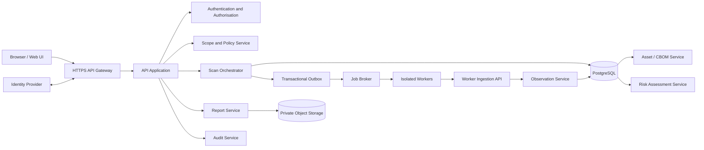
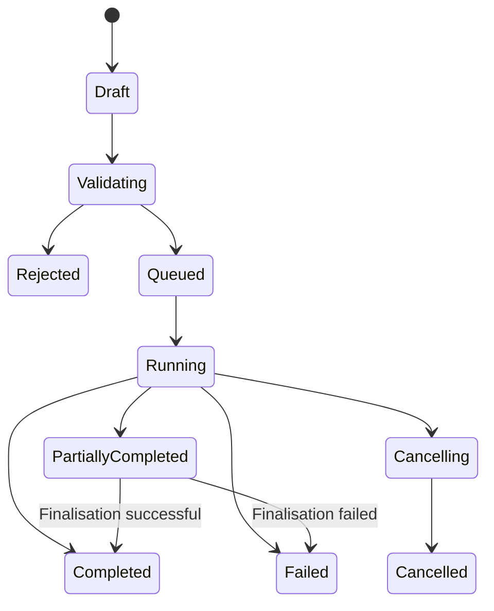
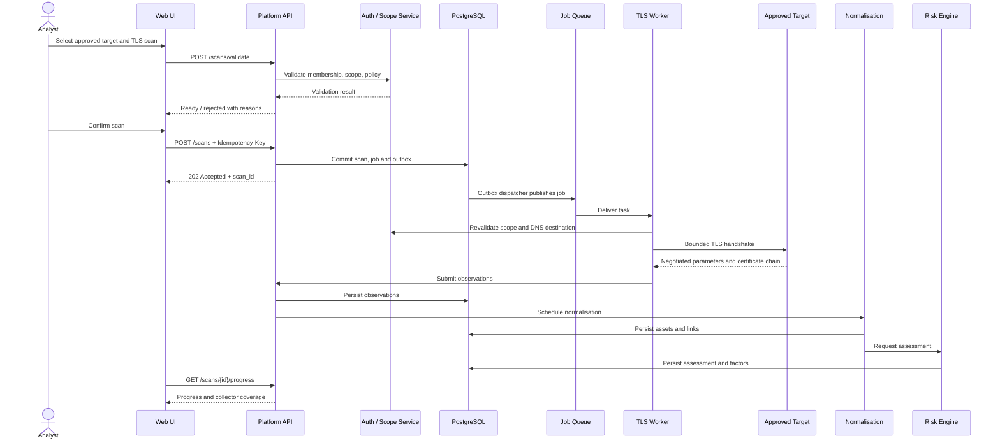
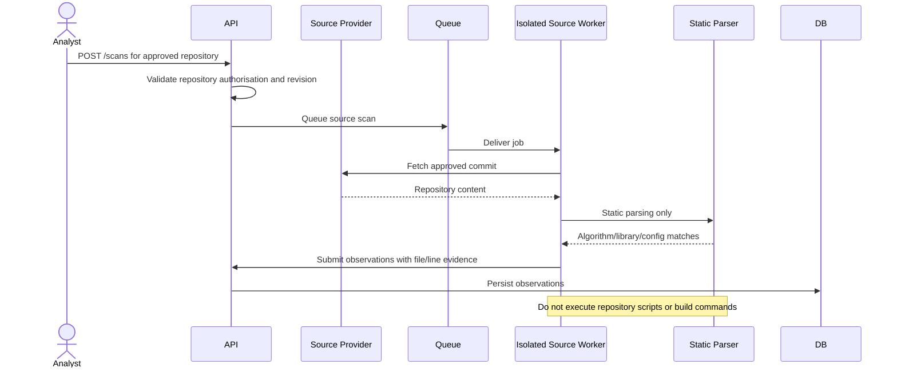
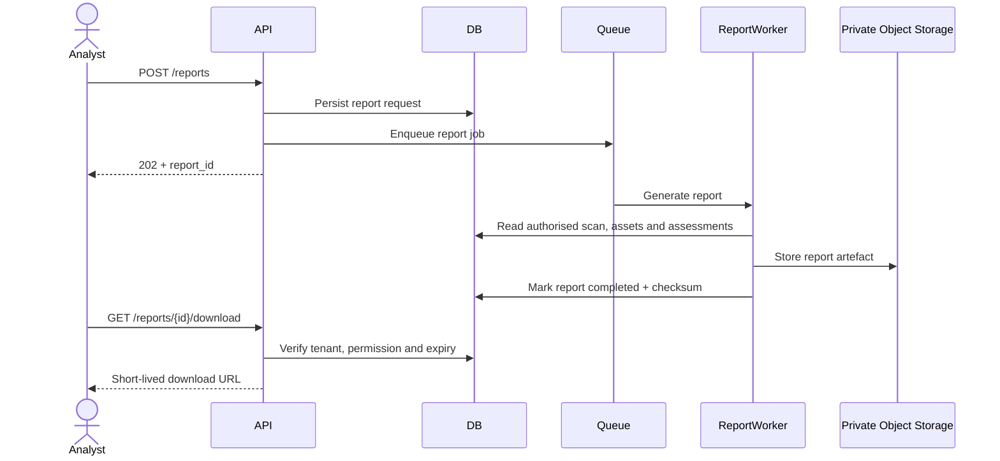

# Quantum Flow Technologies
# PQC Discovery & Risk Assessment Platform
## API Specification Document

**Document ID:** QFT-PQC-API-001  
**Version:** 1.0 — Draft  
**Status:** Proposed API contract for technical review  
**Date:** 02 November 2026  
**Owner:** Quantum Flow Technologies — Engineering  
**Reviewers:** CTO / Technical Lead, Backend Lead, CISO, Product Owner  
**Related documents:** PRD v1.0 Draft; TRD v1.0 Draft; SAD v1.0 Draft; Database Design Document v1.0 Draft; *PQC Platform Vision and Roadmap*, Version 1.0, October 2026

---

## Document status and interpretation

This document defines a proposed end-to-end HTTP API contract for the PQC Discovery & Risk Assessment Platform. It covers the user-facing API, asynchronous scan lifecycle, collector result ingestion, cryptographic inventory, CBOM, risk assessment, recommendations, reports, governance, audit, and integrations.

This is a draft contract, not a claim that the endpoints already exist. Paths, field names, enumerations, pagination rules, and examples are proposals to be reviewed against the approved product scope and database schema before implementation.

The API is designed around the company workflow:

**Discover → Inventory → Prioritise → Plan → Migrate → Assure**

The first release should expose authorised discovery, evidence-backed inventory, explainable risk analysis, and reporting. Migration planning and execution APIs are included as future extension boundaries only; production-changing migration actions must not be enabled by this discovery API release.

The API must never imply that scanning one public domain reveals every cryptographic asset in an enterprise. Responses and reports must expose scope, collector coverage, limitations, failures, provenance, and confidence.

---

# 1. Purpose

The API is the controlled interface between the web application, external integrations, platform services, and asynchronous discovery workers.

It must provide:
1. Authentication and tenant-aware authorisation.
2. Tenant, project, user, role, and policy management.
3. Registration and approval of scan targets.
4. Scan plan validation and authorisation checks.
5. Asynchronous scan creation, status, progress, cancellation, and retry.
6. Collector execution and secure observation ingestion.
7. Normalised cryptographic asset and CBOM access.
8. Explainable, versioned quantum-risk assessments.
9. Actionable recommendations and risk exceptions.
10. Report generation, download, and export.
11. Audit and operational visibility.
12. Stable contracts for future CMDB, SCM, SIEM, ticketing, and cloud integrations.

## 1.1 API design goals

- Consistent, predictable resource-oriented endpoints.
- Explicit tenant context derived from authenticated identity, not trusted from request bodies.
- Strict input validation and safe defaults.
- No long-running scan in a synchronous HTTP request.
- Durable asynchronous job tracking.
- Idempotency for operations that create jobs or trigger side effects.
- Clear machine-readable errors.
- Evidence traceability from assessment to asset, observation, collector, and target.
- Versioned contracts and backwards-compatible evolution.
- Safe-by-default scanning with explicit authorisation and target scope.
- No secrets or private keys in API payloads, logs, or reports.

## 1.2 Non-goals for v1 API

- Unattended changes to customer production systems.
- Automatic replacement of certificates or algorithms.
- Generic remote command execution.
- Arbitrary URL fetching or unrestricted port scanning.
- Uploading private keys or credentials as evidence.
- Treating static source-code matches as proof of runtime cryptographic use.
- Treating a public TLS scan as a full enterprise CBOM.
- Publishing an official risk score before the CISO approves the methodology.

---

# 2. API architecture and clients

## 2.1 API consumers

| Consumer | Access pattern | Main operations |
|---|---|---|
| Web application | User access token | Projects, targets, scans, findings, assets, assessments, reports |
| Platform administrator console | Privileged user token | Tenant and platform administration |
| Tenant administrator | User access token | Membership, roles, policies, authorisations, integrations |
| Discovery worker | Service identity / short-lived workload token | Claim job, heartbeat, submit observations, complete execution |
| External integration | Scoped integration credential or OAuth client | Approved import/export operations |
| Auditor | Read-only user token | Inventory, assessment, reports, audit history |

## 2.2 Logical API components



## 2.3 API base URL

Production base URL is deployment-specific and must be configured by the platform.

Proposed path:

```text
https://<platform-host>/api/v1
```

Development example only:

```text
http://localhost:8000/api/v1
```

Do not hard-code a production hostname in clients or documentation.

## 2.4 Transport

- HTTPS is mandatory outside local development.
- TLS configuration must follow the platform's approved security baseline.
- HTTP requests should be redirected to HTTPS only at the trusted ingress layer; API services should not trust arbitrary forwarded headers.
- HSTS should be configured at the ingress layer where applicable.
- Request bodies and headers must be size-limited.

---

# 3. API conventions

## 3.1 Resource naming

- Use plural nouns: `/projects`, `/targets`, `/scans`, `/assets`.
- Use lowercase kebab-case only where a multiword path is required: `/risk-assessments`.
- Use path parameters for resource identity.
- Use query parameters for filtering, sorting, and pagination.
- Use `POST` for creation or explicit actions.
- Use `PATCH` for partial updates.
- Use `DELETE` only for resources whose deletion is permitted by lifecycle and retention policy.
- Avoid verbs in resource paths except for explicit actions such as `/cancel`, `/retry`, `/validate`, `/approve`, or `/revoke`.

## 3.2 HTTP methods

| Method | Meaning | Idempotency expectation |
|---|---|---|
| GET | Read resource or collection | Safe and idempotent |
| POST | Create resource or trigger action | Use idempotency key for side effects |
| PUT | Replace a resource representation | Idempotent |
| PATCH | Partially update a resource | Must define patch semantics |
| DELETE | Delete or deactivate a resource | Idempotent where supported |

## 3.3 Standard response envelope

For single-resource responses, return the resource directly or use a consistent `data` envelope. This document proposes a consistent envelope:

```json
{
  "data": {
    "id": "6d4c7f7a-7cc8-4e35-b3b2-1a1dcb9a2a11",
    "name": "Production Web Assessment"
  },
  "meta": {
    "request_id": "req_01J9EXAMPLE"
  }
}
```

For collections:

```json
{
  "data": [],
  "meta": {
    "request_id": "req_01J9EXAMPLE",
    "pagination": {
      "next_cursor": null,
      "has_more": false,
      "limit": 25
    }
  }
}
```

If the implementation chooses direct resource responses instead, it must do so consistently and update the OpenAPI contract. Do not mix incompatible response styles across endpoints.

## 3.4 Timestamps

- Use ISO 8601 timestamps with timezone, preferably UTC (`Z`).
- Example: `2026-11-02T09:30:00Z`.
- API timestamps are not localised to the browser timezone.
- Date-only filters must define whether they are interpreted in UTC or tenant-configured timezone.

## 3.5 Identifiers

- Public resource IDs are UUIDs.
- IDs are identifiers, not authorisation tokens.
- Knowing a UUID must never grant access.
- Do not expose database sequential IDs.

## 3.6 Pagination

Use cursor pagination for large collections.

Request:

```http
GET /api/v1/assets?limit=25&cursor=eyJjcmVhdGVkX2F0...
```

Response:

```json
{
  "data": [],
  "meta": {
    "pagination": {
      "limit": 25,
      "next_cursor": "eyJjcmVhdGVkX2F0...",
      "has_more": true
    }
  }
}
```

Rules:
- Default limit: 25.
- Maximum limit: 100, unless an endpoint has a lower security or performance cap.
- Cursor is opaque and signed or otherwise validated.
- Stable ordering must include a unique tie-breaker such as `(created_at, id)`.
- Do not use large `OFFSET` pagination for observations or audit events.

## 3.7 Filtering and sorting

Common filters:
- `status`
- `project_id`
- `target_id`
- `asset_type`
- `algorithm_family`
- `risk_category`
- `created_after`
- `created_before`

Sorting should use an allow-list. Never interpolate user-supplied sort fields directly into SQL.

---

# 4. Authentication and identity

## 4.1 Authentication model

Proposed user authentication:
- OpenID Connect (OIDC) with the customer's or platform's identity provider.
- Authorization Code flow with PKCE for browser-based clients.
- Access tokens are short-lived.
- Refresh-token handling follows identity-provider security guidance.
- API validates issuer, audience, signature, expiry, and relevant claims.
- MFA should be enforced by the identity provider for privileged roles where supported.

The API should not implement its own password database unless the product architecture explicitly requires it and security leadership approves it.

## 4.2 User token claims

Illustrative claims:

```json
{
  "iss": "https://identity.example.com/",
  "sub": "idp-user-123",
  "aud": "quantum-flow-api",
  "exp": 1793611800,
  "iat": 1793608200,
  "email": "analyst@example.com",
  "name": "Security Analyst"
}
```

Tenant membership and role assignment should be resolved server-side. A token claim or browser parameter must not be treated as the sole source of current tenant permissions unless the identity architecture explicitly guarantees timely revocation and approved claim semantics.

## 4.3 Tenant context

For user requests:
- User authenticates.
- API resolves active memberships.
- Client selects an available tenant context through a supported header or route only if needed.
- API validates that membership and permissions exist.
- API establishes tenant context for database access.
- All resource queries are tenant-scoped.

Proposed header:

```http
X-Tenant-ID: <tenant-uuid>
```

This header is a tenant selector, not proof of access. The server must validate membership and role on every request.

For service-to-service calls:
- Use a workload identity or short-lived service token.
- Scope token to permitted operations and tenant/job context.
- Avoid static shared secrets where workload identity is available.
- Rotate credentials and audit service actions.

## 4.4 Authorisation model

Use role-based access control (RBAC), with resource-level checks where required.

| Role | Typical permissions |
|---|---|
| TENANT_ADMIN | Manage members, roles, targets, authorisations, policies, integrations |
| SECURITY_ANALYST | Create scans, review findings, assets, assessments, reports |
| ASSET_OWNER | View assigned assets, update ownership/context, manage assigned recommendations |
| AUDITOR | Read-only inventory, assessments, reports, and permitted audit records |
| PLATFORM_ADMIN | Platform-level administration; separately controlled and audited |

Every operation must check:
1. Authenticated principal.
2. Active tenant membership.
3. Role permission.
4. Resource ownership/tenant match.
5. Resource-level assignment or approval where applicable.
6. Current lifecycle state.

## 4.5 Permission matrix

| Operation | Tenant Admin | Analyst | Asset Owner | Auditor |
|---|---:|---:|---:|---:|
| View tenant projects | Yes | Yes | Assigned only | Yes |
| Create target | Yes | Yes, if permitted | No | No |
| Approve target scope | Yes | Only if explicitly delegated | No | No |
| Create scan | Yes | Yes | No | No |
| Cancel own/allowed scan | Yes | Yes, policy-bound | No | No |
| View observations | Yes | Yes | Assigned only | Read-only |
| Update asset context | Yes | Yes, if permitted | Assigned only | No |
| View risk assessment | Yes | Yes | Assigned only | Read-only |
| Approve risk exception | Delegated approver | No by default | No | No |
| Generate report | Yes | Yes | Assigned scope | Yes |
| Manage integrations | Yes | No by default | No | No |
| View audit events | Yes | Limited | No | Read-only |

This matrix is a starting point. Fine-grained permissions must be approved by product and security owners.

---

# 5. API security and request protection

## 5.1 Required security controls

- Validate every request against a typed schema.
- Enforce tenant and resource ownership on every read/write.
- Use rate limits per user, tenant, IP, and endpoint class.
- Limit request body size and upload size.
- Reject unknown or unsafe scan options.
- Prevent mass assignment: clients may update only explicitly allowed fields.
- Use parameterised queries.
- Apply CORS allow-lists; do not use wildcard origins with credentials.
- Protect browser sessions against CSRF where cookie authentication is used.
- Avoid returning internal stack traces or database errors.
- Redact tokens, secrets, and sensitive evidence from logs.
- Use idempotency keys for scan creation and report generation.
- Audit privileged actions and exports.

## 5.2 Rate-limit response

Return HTTP `429 Too Many Requests` with:

```http
Retry-After: 30
```

Response:

```json
{
  "error": {
    "code": "RATE_LIMIT_EXCEEDED",
    "message": "Request limit exceeded. Retry after the indicated interval.",
    "retryable": true
  },
  "meta": {
    "request_id": "req_01J9EXAMPLE"
  }
}
```

## 5.3 Upload controls

For repository archives, configuration files, or inventory imports:
- Allow only explicitly supported file types and formats.
- Enforce maximum file size and decompressed size.
- Defend against archive path traversal and decompression bombs.
- Scan uploaded files for malware where supported.
- Parse in an isolated worker.
- Do not execute uploaded code or scripts.
- Store uploads in quarantine until validated.
- Expire temporary upload objects.
- Never accept private-key files as discovery input.

---

# 6. Error model

## 6.1 Standard error envelope

```json
{
  "error": {
    "code": "TARGET_NOT_AUTHORISED",
    "message": "The target is not covered by a currently approved authorisation record.",
    "details": [
      {
        "field": "target_id",
        "reason": "No valid authorisation covers this target and scan method."
      }
    ],
    "retryable": false
  },
  "meta": {
    "request_id": "req_01J9EXAMPLE"
  }
}
```

Fields:
- `code`: stable machine-readable identifier.
- `message`: safe human-readable explanation.
- `details`: optional field or policy errors.
- `retryable`: whether retry may succeed without changing the request.
- `request_id`: support and audit correlation identifier.

Do not include stack traces, SQL, internal hostnames, secret values, or raw third-party error bodies.

## 6.2 HTTP status conventions

| HTTP status | Meaning | Example |
|---|---|---|
| 200 | Successful read/update/action | Asset retrieved |
| 201 | Resource created | Target created |
| 202 | Accepted for asynchronous processing | Scan queued |
| 204 | Successful operation with no response body | Resource deactivated |
| 400 | Malformed request | Invalid JSON |
| 401 | Missing/invalid authentication | Token expired |
| 403 | Authenticated but not permitted | Role cannot approve scope |
| 404 | Resource not found or not visible to tenant | Cross-tenant resource |
| 409 | State or idempotency conflict | Scan cannot be cancelled |
| 413 | Payload too large | Import exceeds limit |
| 415 | Unsupported media type | Unsupported archive |
| 422 | Schema or semantic validation failed | Invalid scan options |
| 429 | Rate limit exceeded | Too many scan requests |
| 500 | Unexpected server error | Unhandled internal failure |
| 502 | Upstream dependency failure | Identity provider unavailable |
| 503 | Temporarily unavailable | Worker queue unavailable |
| 504 | Gateway timeout | Upstream timeout |

For cross-tenant IDs, prefer `404` to avoid confirming that another tenant's resource exists.

## 6.3 Proposed error code catalogue

| Code | HTTP | Meaning |
|---|---:|---|
| `AUTHENTICATION_REQUIRED` | 401 | No valid authentication |
| `TOKEN_INVALID` | 401 | Token failed validation |
| `TENANT_CONTEXT_REQUIRED` | 400 | Tenant selector missing where required |
| `TENANT_ACCESS_DENIED` | 403 | No active tenant membership |
| `PERMISSION_DENIED` | 403 | Role lacks permission |
| `RESOURCE_NOT_FOUND` | 404 | Resource unavailable or not visible |
| `VALIDATION_ERROR` | 422 | Request schema invalid |
| `TARGET_NOT_AUTHORISED` | 403 | No valid scan authorisation |
| `TARGET_OUT_OF_SCOPE` | 422 | Target outside approved scope |
| `TARGET_RESOLVES_TO_BLOCKED_ADDRESS` | 422 | DNS resolves to prohibited address |
| `SCAN_POLICY_REJECTED` | 422 | Policy disallows requested scan |
| `SCAN_STATE_CONFLICT` | 409 | Operation invalid for current scan state |
| `IDEMPOTENCY_CONFLICT` | 409 | Same key used with different request |
| `JOB_NOT_RETRYABLE` | 409 | Job cannot be retried |
| `COLLECTOR_UNAVAILABLE` | 503 | Collector unavailable |
| `COLLECTOR_UNSUPPORTED` | 422 | Collector cannot assess source type |
| `EVIDENCE_INVALID` | 422 | Evidence failed validation |
| `REPORT_NOT_READY` | 409 | Report still processing |
| `REPORT_EXPIRED` | 410 | Report has expired |
| `UPLOAD_TOO_LARGE` | 413 | Upload limit exceeded |
| `UNSUPPORTED_MEDIA_TYPE` | 415 | Unsupported content type |
| `RATE_LIMIT_EXCEEDED` | 429 | Rate limit exceeded |
| `INTERNAL_ERROR` | 500 | Unexpected error |

---

# 7. Resource model and endpoint catalogue

All endpoints below are relative to `/api/v1`. Unless explicitly marked public, they require authentication and tenant authorisation.

## 7.1 Endpoint summary

| Domain | Method | Endpoint | Purpose |
|---|---|---|---|
| Current user | GET | `/me` | Current identity and tenant memberships |
| Tenants | GET | `/tenants` | List available tenants |
| Tenants | GET | `/tenants/{tenant_id}` | Tenant details |
| Memberships | GET/POST | `/memberships` | List/invite members |
| Memberships | PATCH/DELETE | `/memberships/{membership_id}` | Update/deactivate membership |
| Projects | GET/POST | `/projects` | List/create projects |
| Projects | GET/PATCH | `/projects/{project_id}` | Read/update project |
| Targets | GET/POST | `/targets` | List/register targets |
| Targets | GET/PATCH | `/targets/{target_id}` | Read/update target |
| Targets | POST | `/targets/{target_id}/validate` | Validate target syntax and scope readiness |
| Authorisations | GET/POST | `/authorisations` | List/create approval records |
| Authorisations | POST | `/authorisations/{id}/approve` | Approve scope |
| Authorisations | POST | `/authorisations/{id}/revoke` | Revoke scope |
| Policies | GET/POST | `/scan-policies` | List/create policies |
| Policies | GET/PATCH | `/scan-policies/{id}` | Read/update draft policy |
| Policies | POST | `/scan-policies/{id}/activate` | Activate approved version |
| Scans | POST | `/scans/validate` | Dry-run validation |
| Scans | GET/POST | `/scans` | List/create scans |
| Scans | GET | `/scans/{scan_id}` | Scan details |
| Scans | GET | `/scans/{scan_id}/progress` | Progress summary |
| Scans | POST | `/scans/{scan_id}/cancel` | Cancel scan |
| Scans | POST | `/scans/{scan_id}/retry` | Retry eligible failed work |
| Jobs | GET | `/scan-jobs/{job_id}` | Job details |
| Jobs | GET | `/scans/{scan_id}/jobs` | List scan jobs |
| Findings | GET | `/findings` | List findings/observations summary |
| Findings | GET | `/findings/{finding_id}` | Finding detail |
| Observations | GET | `/observations` | Search observations |
| Observations | GET | `/observations/{id}` | Observation detail |
| Assets | GET | `/assets` | List CBOM assets |
| Assets | GET | `/assets/{asset_id}` | Asset detail |
| Assets | PATCH | `/assets/{asset_id}` | Update permitted business context |
| Assets | GET | `/assets/{asset_id}/observations` | Evidence history |
| Assets | GET | `/assets/{asset_id}/relationships` | Related assets |
| CBOM | GET | `/cbom` | Current inventory summary |
| CBOM | POST | `/cbom/snapshots` | Create snapshot |
| CBOM | GET | `/cbom/snapshots` | List snapshots |
| CBOM | GET | `/cbom/snapshots/{id}` | Snapshot detail |
| CBOM | POST | `/cbom/exports` | Export CBOM |
| Risk | GET | `/risk-rule-sets` | List visible rule sets |
| Risk | GET | `/risk-assessments` | Search assessments |
| Risk | GET | `/risk-assessments/{id}` | Assessment detail |
| Risk | POST | `/assets/{asset_id}/assessments` | Trigger reassessment |
| Risk | GET | `/risk-assessments/{id}/factors` | Assessment reasons |
| Recommendations | GET | `/recommendations` | List recommendations |
| Recommendations | GET/PATCH | `/recommendations/{id}` | Read/update workflow status |
| Exceptions | POST | `/risk-exceptions` | Request exception |
| Exceptions | POST | `/risk-exceptions/{id}/approve` | Approve exception |
| Reports | POST | `/reports` | Generate report |
| Reports | GET | `/reports` | List reports |
| Reports | GET | `/reports/{id}` | Report status/details |
| Reports | GET | `/reports/{id}/download` | Obtain authorised download |
| Audit | GET | `/audit-events` | Search audit events |
| Integrations | GET/POST | `/integrations` | List/configure integrations |
| Integrations | GET/PATCH | `/integrations/{id}` | Read/update integration |
| Health | GET | `/health/live` | Liveness |
| Health | GET | `/health/ready` | Readiness |

Worker-only endpoints are specified separately in Section 19.

---

# 8. Identity, tenant and project endpoints

## 8.1 `GET /me`

Returns the authenticated principal and available tenant memberships.

Response `200`:

```json
{
  "data": {
    "user": {
      "id": "7b53eac0-08a0-4c3f-88cb-ccfd6bba73d1",
      "email": "analyst@example.com",
      "display_name": "Security Analyst",
      "status": "active"
    },
    "memberships": [
      {
        "tenant_id": "0b1d9e5c-3f91-4f7e-a5b9-3f11a5db8d91",
        "tenant_name": "Example Enterprise",
        "status": "active",
        "roles": ["SECURITY_ANALYST"]
      }
    ]
  },
  "meta": {
    "request_id": "req_01J9EXAMPLE"
  }
}
```

## 8.2 `GET /tenants`

Returns only tenants in which the current user has an active membership, unless the caller is an explicitly authorised platform administrator.

Query parameters:
- `status`
- `limit`
- `cursor`

## 8.3 `GET /tenants/{tenant_id}`

Returns tenant metadata. Sensitive platform settings and secret references must not be exposed.

## 8.4 Membership management

`POST /memberships` request:

```json
{
  "email": "new-analyst@example.com",
  "role_codes": ["SECURITY_ANALYST"],
  "project_ids": []
}
```

Response `201`:

```json
{
  "data": {
    "membership_id": "9f4c13aa-7e24-4ef3-a201-40cda2a6ac31",
    "status": "invited",
    "invitation_status": "pending"
  }
}
```

The platform should invite an identity; it must not create an unmanaged password by default.

---

# 9. Project, target and authorisation endpoints

## 9.1 `POST /projects`

Request:

```json
{
  "name": "Pune Production Environment",
  "slug": "pune-production",
  "description": "Approved production-facing services.",
  "environment": "production",
  "business_criticality": "high"
}
```

Response `201`:

```json
{
  "data": {
    "id": "6d4c7f7a-7cc8-4e35-b3b2-1a1dcb9a2a11",
    "name": "Pune Production Environment",
    "slug": "pune-production",
    "environment": "production",
    "business_criticality": "high",
    "status": "active",
    "created_at": "2026-11-02T09:30:00Z"
  }
}
```

## 9.2 `POST /targets`

Registers a candidate target. Registration does not authorise scanning.

Request — domain target:

```json
{
  "project_id": "6d4c7f7a-7cc8-4e35-b3b2-1a1dcb9a2a11",
  "target_type": "domain",
  "canonical_locator": "example.com",
  "display_name": "Example public website",
  "environment": "production",
  "owner_team": "Infrastructure"
}
```

Response `201`:

```json
{
  "data": {
    "id": "1a1f5b2d-3ef2-4d1c-8d21-72e7b41d2d99",
    "target_type": "domain",
    "canonical_locator": "example.com",
    "status": "pending",
    "authorisation_status": "not_authorised"
  }
}
```

Supported target types should initially be limited to:
- `domain`
- `endpoint`
- `repository`
- `configuration_import`

Additional cloud resource types should be introduced only with dedicated authorisation and collector designs.

## 9.3 `POST /targets/{target_id}/validate`

Performs safe preflight validation without starting a scan.

Request:

```json
{
  "scan_type": "tls",
  "collector_ids": ["network_tls", "certificate_intelligence"]
}
```

Response `200`:

```json
{
  "data": {
    "target_id": "1a1f5b2d-3ef2-4d1c-8d21-72e7b41d2d99",
    "syntax_valid": true,
    "authorisation_valid": false,
    "policy_compatible": true,
    "ready_to_scan": false,
    "checks": [
      {
        "code": "TARGET_SYNTAX_VALID",
        "status": "passed"
      },
      {
        "code": "AUTHORISATION_MISSING",
        "status": "failed",
        "message": "A valid approval record is required before scanning."
      }
    ]
  }
}
```

Validation must not make arbitrary outbound connections unless the preflight method is explicitly authorised and documented.

## 9.4 Authorisation record creation

`POST /authorisations` request:

```json
{
  "target_id": "1a1f5b2d-3ef2-4d1c-8d21-72e7b41d2d99",
  "authorisation_type": "owner_attestation",
  "scope_definition": {
    "hostnames": ["example.com", "www.example.com"],
    "ports": [443],
    "methods": ["tls_handshake", "certificate_retrieval"],
    "max_concurrency": 2,
    "max_duration_seconds": 120
  },
  "evidence_reference": "CHANGE-12345",
  "valid_from": "2026-11-02T00:00:00Z",
  "valid_until": "2026-11-30T23:59:59Z"
}
```

Response `201` status should be `pending` unless the caller has explicit approval authority and the workflow permits immediate approval.

`POST /authorisations/{id}/approve`:
- Requires an authorised approver.
- Must record approver and timestamp.
- Must validate scope completeness and policy.
- Must create an audit event.

`POST /authorisations/{id}/revoke` request:

```json
{
  "reason": "Customer approval withdrawn."
}
```

A revoked authorisation must block new jobs and cause queued jobs to be revalidated before execution.

---

# 10. Scan policy endpoints

## 10.1 `POST /scan-policies`

Creates a draft policy version.

Request:

```json
{
  "name": "Conservative External TLS Policy",
  "policy": {
    "allowed_scan_types": ["tls", "certificate"],
    "allowed_ports": [443],
    "max_concurrency": 2,
    "connect_timeout_seconds": 5,
    "read_timeout_seconds": 10,
    "max_total_duration_seconds": 120,
    "max_redirects": 0,
    "blocked_address_classes": [
      "loopback",
      "private",
      "link_local",
      "multicast",
      "reserved",
      "metadata"
    ],
    "allow_private_network_connector": false
  }
}
```

The server must validate policy values against platform safety ceilings. A tenant policy cannot weaken platform-wide mandatory restrictions.

## 10.2 Policy activation

`POST /scan-policies/{policy_id}/activate`

- Requires approval permission.
- Freezes the version.
- Emits an audit event.
- Future scans reference the immutable policy version.
- Policy changes require a new version.

---

# 11. Scan API — central workflow

## 11.1 Scan lifecycle



The API must return the current state and allowed next actions. The server, not the client, controls transitions.

## 11.2 `POST /scans/validate`

This is a dry-run endpoint. It checks:
- Target exists in the active tenant.
- Target type supports the requested scan.
- Authorisation is active and covers target, methods, ports, and validity period.
- Policy permits the requested collectors.
- Collector IDs are supported and enabled.
- Scope is not obviously unsafe.
- Requested limits do not exceed platform ceilings.

It must not create a scan or execute a full discovery.

Request:

```json
{
  "target_id": "1a1f5b2d-3ef2-4d1c-8d21-72e7b41d2d99",
  "scan_type": "tls",
  "collector_ids": ["network_tls", "certificate_intelligence"],
  "options": {
    "include_certificate_chain": true,
    "capture_negotiated_parameters": true
  }
}
```

Response `200`:

```json
{
  "data": {
    "valid": true,
    "ready_to_queue": true,
    "target_id": "1a1f5b2d-3ef2-4d1c-8d21-72e7b41d2d99",
    "authorisation_record_id": "9bcaad9c-cce7-42c1-b0d5-f9b30e6b9a4f",
    "policy_version": 3,
    "approved_methods": [
      "tls_handshake",
      "certificate_retrieval"
    ],
    "warnings": [
      {
        "code": "PUBLIC_TLS_SCOPE_LIMITATION",
        "message": "This scan cannot inspect private backend cryptographic usage or source code."
      }
    ],
    "errors": []
  }
}
```

## 11.3 `POST /scans`

Creates and queues an asynchronous scan.

Headers:

```http
Authorization: Bearer <access-token>
X-Tenant-ID: <tenant-uuid>
Idempotency-Key: 4a1e2c60-6a8c-4bde-90d8-1d7e7d0d
Content-Type: application/json
```

Request:

```json
{
  "project_id": "6d4c7f7a-7cc8-4e35-b3b2-1a1dcb9a2a11",
  "target_id": "1a1f5b2d-3ef2-4d1c-8d21-72e7b41d2d99",
  "authorisation_record_id": "9bcaad9c-cce7-42c1-b0d5-f9b30e6b9a4f",
  "scan_policy_id": "d54d6a93-7c9c-4c5a-bc7a-9f72f70f3b01",
  "scan_type": "tls",
  "collector_ids": [
    "network_tls",
    "certificate_intelligence"
  ],
  "options": {
    "ports": [443],
    "include_certificate_chain": true,
    "capture_negotiated_parameters": true
  }
}
```

Response `202 Accepted`:

```json
{
  "data": {
    "scan_id": "f1a8b5c2-11b7-4e1a-a5cb-4c80d7f8c001",
    "status": "queued",
    "scan_type": "tls",
    "target_id": "1a1f5b2d-3ef2-4d1c-8d21-72e7b41d2d99",
    "requested_collectors": [
      "network_tls",
      "certificate_intelligence"
    ],
    "progress": {
      "total_collectors": 2,
      "completed_collectors": 0,
      "failed_collectors": 0,
      "percentage": 0
    },
    "created_at": "2026-11-02T09:45:00Z",
    "links": {
      "self": "/api/v1/scans/f1a8b5c2-11b7-4e1a-a5cb-4c80d7f8c001",
      "progress": "/api/v1/scans/f1a8b5c2-11b7-4e1a-a5cb-4c80d7f8c001/progress",
      "jobs": "/api/v1/scans/f1a8b5c2-11b7-4e1a-a5cb-4c80d7f8c001/jobs"
    }
  },
  "meta": {
    "request_id": "req_01J9EXAMPLE"
  }
}
```

The API must persist scan and job intent before queue dispatch. Use a transactional outbox or equivalent reliable mechanism. Return `202` only after the durable scan/job transaction commits.

## 11.4 `GET /scans`

Query:
- `project_id`
- `target_id`
- `status`
- `scan_type`
- `created_after`
- `created_before`
- `limit`
- `cursor`

## 11.5 `GET /scans/{scan_id}`

Returns:
- Scan metadata.
- Target and project references.
- Frozen policy version.
- Authorisation reference.
- Requested collectors.
- Current status.
- Start/completion timestamps.
- Failure summary, if any.
- Coverage and limitations.
- Links to jobs, findings, assets, assessments, and reports.

## 11.6 `GET /scans/{scan_id}/progress`

Response:

```json
{
  "data": {
    "scan_id": "f1a8b5c2-11b7-4e1a-a5cb-4c80d7f8c001",
    "status": "running",
    "progress": {
      "total_collectors": 2,
      "queued": 0,
      "running": 1,
      "completed": 1,
      "partial": 0,
      "failed": 0,
      "percentage": 50
    },
    "collector_status": [
      {
        "collector_id": "network_tls",
        "status": "completed",
        "observations_created": 3
      },
      {
        "collector_id": "certificate_intelligence",
        "status": "running",
        "observations_created": 0
      }
    ],
    "updated_at": "2026-11-02T09:46:12Z"
  }
}
```

Progress percentage is an operational estimate based on defined work units. It must not imply coverage completeness.

## 11.7 `POST /scans/{scan_id}/cancel`

- Requires permission to cancel the scan.
- Valid only for queued or running states.
- Cancellation is cooperative; a network operation already in progress may need to reach a safe timeout.
- Returns `202` if cancellation is being processed.
- Returns `409 SCAN_STATE_CONFLICT` if terminal.

## 11.8 `POST /scans/{scan_id}/retry`

Retry only failed/retryable collector jobs. Do not rerun successful collectors unless explicitly requested and permitted.

Request:

```json
{
  "job_ids": [
    "b25f8e8d-f7e0-41f9-8a1c-cfb57d1a6f9a"
  ],
  "reason": "Temporary upstream connection failure."
}
```

Response `202` includes new retry job IDs and parent scan reference.

---

# 12. Worker and collector API

Worker endpoints are not available to browser users. They require workload identity and narrow service permissions.

## 12.1 Worker job claim

`POST /internal/v1/worker/jobs/claim`

Request:

```json
{
  "worker_id": "tls-worker-pool-01",
  "supported_job_types": ["collector"],
  "supported_collectors": ["network_tls", "certificate_intelligence"],
  "capacity": 2
}
```

Response `200`:

```json
{
  "data": {
    "jobs": [
      {
        "job_id": "b25f8e8d-f7e0-41f9-8a1c-cfb57d1a6f9a",
        "tenant_id": "0b1d9e5c-3f91-4f7e-a5b9-3f11a5db8d91",
        "scan_id": "f1a8b5c2-11b7-4e1a-a5cb-4c80d7f8c001",
        "collector_id": "network_tls",
        "collector_version": "1.0.0",
        "target": {
          "target_id": "1a1f5b2d-3ef2-4d1c-8d21-72e7b41d2d99",
          "hostname": "example.com",
          "ports": [443]
        },
        "scope": {
          "approved_methods": ["tls_handshake", "certificate_retrieval"],
          "max_duration_seconds": 120,
          "max_concurrency": 2
        },
        "expires_at": "2026-11-02T09:50:00Z"
      }
    ]
  }
}
```

The job payload must contain only the minimum required data. Any integration credentials must be provided through a separate short-lived secret retrieval mechanism, not embedded in a generic job payload.

## 12.2 Worker heartbeat

`POST /internal/v1/worker/jobs/{job_id}/heartbeat`

Request:

```json
{
  "worker_id": "tls-worker-pool-01",
  "status": "running",
  "progress": {
    "stage": "tls_handshake",
    "completed_units": 1,
    "total_units": 2
  }
}
```

## 12.3 Start collector execution

`POST /internal/v1/worker/jobs/{job_id}/executions`

Request:

```json
{
  "collector_id": "network_tls",
  "collector_version": "1.0.0",
  "source_type": "network",
  "method": "tls_handshake"
}
```

Response `201` returns `collector_execution_id`.

## 12.4 Submit observations

`POST /internal/v1/worker/executions/{execution_id}/observations`

Request:

```json
{
  "observations": [
    {
      "evidence_type": "tls_handshake",
      "classification": "OBSERVED",
      "observed_at": "2026-11-02T09:47:10Z",
      "subject_locator": "example.com:443",
      "normalized_payload": {
        "tls_version": "TLSv1.3",
        "cipher_suite": "TLS_AES_128_GCM_SHA256",
        "key_exchange_group": "x25519",
        "server_name": "example.com"
      },
      "provenance": {
        "collector_id": "network_tls",
        "collector_version": "1.0.0",
        "method": "tls_handshake",
        "target_port": 443
      },
      "confidence": {
        "score": 1.0,
        "rationale": "Values were directly observed during the TLS handshake."
      }
    }
  ]
}
```

The server validates the worker identity, execution ownership, tenant context, schema, payload size, and permitted evidence types. The worker cannot choose arbitrary tenant IDs or write directly to database tables.

Response `202`:

```json
{
  "data": {
    "accepted_count": 1,
    "rejected_count": 0,
    "observation_ids": [
      "d8e7dfe1-55b8-47b6-a8a0-36d9b0e4d4af"
    ]
  }
}
```

For batch ingestion, define maximum observation count and request size. Large batches should be chunked.

## 12.5 Complete collector execution

`POST /internal/v1/worker/executions/{execution_id}/complete`

Request:

```json
{
  "status": "completed",
  "coverage_summary": {
    "requested_checks": 4,
    "completed_checks": 4,
    "unsupported_checks": 0,
    "limitations": [
      "This collector observes the public TLS endpoint only."
    ]
  },
  "observation_count": 3,
  "duration_ms": 4200
}
```

## 12.6 Fail collector execution

`POST /internal/v1/worker/executions/{execution_id}/fail`

Request:

```json
{
  "error_code": "TLS_HANDSHAKE_TIMEOUT",
  "error_summary": "The endpoint did not complete the TLS handshake within the configured timeout.",
  "retryable": true
}
```

Do not send stack traces or secret-bearing exception strings.

---

# 13. Findings and observation APIs

## 13.1 Findings concept

A finding is a user-facing interpretation or grouping of one or more observations. The underlying observation remains the evidence record.

If v1 does not persist a separate `findings` table, the API may expose a finding as a view over observations and assessments. The implementation must document this mapping so that API consumers do not assume finding IDs are observation IDs.

## 13.2 `GET /findings`

Filters:
- `scan_id`
- `target_id`
- `severity`
- `classification`
- `evidence_type`
- `limit`
- `cursor`

## 13.3 `GET /observations/{id}`

Response includes:
- Observation ID.
- Source and evidence type.
- Classification.
- Observation time.
- Collector ID/version.
- Method and target.
- Normalised payload.
- Provenance.
- Confidence and rationale.
- Evidence object metadata, if available.
- Linked asset IDs.
- Related scan and job IDs.

Sensitive evidence payloads require appropriate permission and must be minimised.

---

# 14. Asset and CBOM APIs

## 14.1 `GET /assets`

Supported filters:
- `project_id`
- `target_id`
- `asset_type`
- `algorithm_family`
- `algorithm_name`
- `cryptographic_purpose`
- `lifecycle_status`
- `classification`
- `business_criticality`
- `risk_category`
- `confidence_min`
- `last_seen_before`
- `last_seen_after`

Response example:

```json
{
  "data": [
    {
      "id": "ac8c8e8e-53d0-47bc-88d2-4dfe0efc66b8",
      "asset_type": "endpoint_config",
      "display_name": "example.com:443 TLS configuration",
      "locator": "example.com:443",
      "algorithm_family": null,
      "algorithm_name": null,
      "lifecycle_status": "active",
      "classification": "OBSERVED",
      "confidence_score": 1.0,
      "latest_risk": {
        "assessment_id": "8f7e8a13-cc83-4a34-a9fd-2ab4b2c70a5e",
        "score": null,
        "category": "unknown",
        "status": "provisional"
      }
    }
  ],
  "meta": {
    "pagination": {
      "limit": 25,
      "next_cursor": null,
      "has_more": false
    }
  }
}
```

## 14.2 `GET /assets/{asset_id}`

Returns:
- Asset metadata.
- Cryptographic purpose and parameters.
- Environment and ownership context.
- Classification and confidence.
- First/last seen.
- Linked observations.
- Relationships.
- Latest and historical assessments.
- Recommendations.
- Lifecycle status.

## 14.3 `PATCH /assets/{asset_id}`

Only business context fields may be user-editable. Do not permit clients to directly overwrite collector-observed algorithm fields.

Request:

```json
{
  "owner_team": "Platform Security",
  "business_criticality": "high",
  "environment": "production"
}
```

The API must record an audit event and preserve the distinction between observed technical facts and user-supplied business context.

## 14.4 `GET /assets/{asset_id}/observations`

Returns evidence history with pagination.

## 14.5 `GET /assets/{asset_id}/relationships`

Returns linked assets and relationship rationale.

## 14.6 CBOM summary

`GET /cbom?project_id=<uuid>`

Response:

```json
{
  "data": {
    "scope": {
      "tenant_id": "0b1d9e5c-3f91-4f7e-a5b9-3f11a5db8d91",
      "project_id": "6d4c7f7a-7cc8-4e35-b3b2-1a1dcb9a2a11"
    },
    "latest_snapshot": {
      "id": "e9e6e8d5-3a83-4e82-8b7e-5e3f65e4f9a4",
      "generated_at": "2026-11-02T10:00:00Z",
      "asset_count": 42
    },
    "coverage": {
      "network_tls": "completed",
      "certificate": "completed",
      "source_code": "not_scanned",
      "dependencies": "not_scanned",
      "configuration_import": "not_scanned"
    },
    "limitations": [
      "The current inventory is based only on the approved external TLS scope."
    ]
  }
}
```

Coverage values should be explicit; absence of a collector result must not be represented as “passed.”

## 14.7 CBOM snapshots

`POST /cbom/snapshots`

Request:

```json
{
  "project_id": "6d4c7f7a-7cc8-4e35-b3b2-1a1dcb9a2a11",
  "include_stale_assets": true,
  "description": "Post-discovery inventory snapshot"
}
```

Response `202` if snapshot generation is asynchronous.

## 14.8 CBOM export

`POST /cbom/exports`

Request:

```json
{
  "project_id": "6d4c7f7a-7cc8-4e35-b3b2-1a1dcb9a2a11",
  "snapshot_id": "e9e6e8d5-3a83-4e82-8b7e-5e3f65e4f9a4",
  "format": "json",
  "include_evidence_references": true
}
```

Supported formats for initial release should be explicitly selected, for example `json` and `csv`. Do not claim conformance to a particular external CBOM interchange standard unless its schema and validation are implemented and tested.

---

# 15. Quantum risk assessment APIs

## 15.1 Risk methodology governance

The API must expose:
- Rule-set name and version.
- Methodology version.
- Assessment engine version.
- Score status (`provisional` or approved status).
- Risk category and contributing factors.
- Evidence quality and freshness.
- Assumptions and limitations.

The 0–1000 scale is a proposed product requirement. The API must not label it as an industry-standard score. Score weights and category thresholds require CISO approval.

## 15.2 `GET /risk-rule-sets`

Lists rule sets visible to the tenant. Do not expose draft platform rule logic to unauthorised tenants.

## 15.3 `POST /assets/{asset_id}/assessments`

Triggers an assessment for an asset.

Request:

```json
{
  "rule_set_id": "6e7c5f85-82e2-42cb-93d0-b7b09e8c0d4f",
  "reason": "Reassessment after new discovery evidence."
}
```

Response `202`:

```json
{
  "data": {
    "assessment_job_id": "5ac9e9c2-2aab-4d9f-a4b9-4d4f4a2d6d19",
    "status": "queued",
    "asset_id": "ac8c8e8e-53d0-47bc-88d2-4dfe0efc66b8"
  }
}
```

## 15.4 `GET /risk-assessments`

Filters:
- `asset_id`
- `project_id`
- `status`
- `risk_category`
- `rule_set_version`
- `assessed_after`
- `assessed_before`

## 15.5 `GET /risk-assessments/{id}`

Response:

```json
{
  "data": {
    "id": "8f7e8a13-cc83-4a34-a9fd-2ab4b2c70a5e",
    "asset_id": "ac8c8e8e-53d0-47bc-88d2-4dfe0efc66b8",
    "status": "provisional",
    "score": null,
    "risk_category": "unknown",
    "threat_summary": "Insufficient cryptographic evidence to assign a defensible score.",
    "evidence_quality": "insufficient",
    "engine_version": "0.1.0",
    "methodology_version": "draft-1",
    "rule_set": {
      "name": "Quantum Risk Baseline",
      "version": "0.1-draft"
    },
    "limitations": [
      "Only the externally observable TLS endpoint was assessed.",
      "Application-level and private backend cryptography were not inspected."
    ],
    "assessed_at": "2026-11-02T10:15:00Z"
  }
}
```

The example intentionally returns a null score where the methodology is not approved or the evidence is insufficient. Do not force a numeric score for every asset.

## 15.6 `GET /risk-assessments/{id}/factors`

Returns each factor with:
- Rule/factor code.
- Explanation.
- Input values used.
- Evidence references.
- Score contribution if scoring is approved.
- Threat mapping (Shor-relevant, Grover-relevant, policy, unknown).

## 15.7 Reassessment and historical results

- Assessments are immutable snapshots.
- Reassessment creates a new record.
- Old report references continue to point to the original assessment.
- API consumers can compare assessment versions through a dedicated comparison endpoint in a later release.

---

# 16. Recommendation and risk exception APIs

## 16.1 `GET /recommendations`

Filters:
- `asset_id`
- `assessment_id`
- `status`
- `priority`
- `assigned_to_user_id`

## 16.2 `PATCH /recommendations/{id}`

Permitted workflow fields:
- `status`
- `assigned_to_user_id`
- `due_at`
- `comment` (if comment/audit model is implemented)

Example:

```json
{
  "status": "in_progress",
  "assigned_to_user_id": "7b53eac0-08a0-4c3f-88cb-ccfd6bba73d1",
  "due_at": "2026-11-20T00:00:00Z"
}
```

The API must not let a user change the underlying assessment or recommendation rule output by editing workflow status.

## 16.3 Risk exception request

`POST /risk-exceptions`

```json
{
  "asset_id": "ac8c8e8e-53d0-47bc-88d2-4dfe0efc66b8",
  "assessment_id": "8f7e8a13-cc83-4a34-a9fd-2ab4b2c70a5e",
  "reason": "Temporary vendor compatibility constraint.",
  "compensating_controls": [
    "Restrict exposure",
    "Monitor endpoint configuration",
    "Review vendor migration roadmap"
  ],
  "valid_until": "2027-02-01T00:00:00Z"
}
```

## 16.4 Exception approval

`POST /risk-exceptions/{id}/approve`

Requires an explicitly authorised risk approver. The requester must not approve their own exception unless policy explicitly allows it and the CISO signs off. Approval must be time-bounded and audited.

---

# 17. Report APIs

## 17.1 `POST /reports`

Creates an asynchronous report request.

Request:

```json
{
  "report_type": "scan_summary",
  "scan_id": "f1a8b5c2-11b7-4e1a-a5cb-4c80d7f8c001",
  "format": "pdf",
  "options": {
    "include_executive_summary": true,
    "include_asset_inventory": true,
    "include_risk_factors": true,
    "include_evidence_details": true,
    "include_technical_appendix": true
  }
}
```

Response `202`:

```json
{
  "data": {
    "report_id": "e0efcb1c-63ac-4e17-95d2-7b7b55d62e00",
    "status": "queued",
    "report_type": "scan_summary",
    "format": "pdf"
  }
}
```

## 17.2 `GET /reports`

Lists reports visible to the current tenant and role.

## 17.3 `GET /reports/{id}`

Returns status, scope, template version, generation timestamp, expiry, and safe error summary.

## 17.4 `GET /reports/{id}/download`

- Verify tenant and resource permission.
- Verify report is completed and not expired.
- Return a short-lived signed URL or stream through an authorised download endpoint.
- Audit the export/download.
- Never expose raw object-storage credentials or permanent public URLs.

Reports should include scope, coverage, limitations, collector versions, methodology version, evidence quality, and recommendations.

---

# 18. Audit, integration and health APIs

## 18.1 `GET /audit-events`

Filters:
- `actor_user_id`
- `action`
- `resource_type`
- `resource_id`
- `result`
- `occurred_after`
- `occurred_before`

Access is restricted to tenant administrators and auditors as approved. Audit events are append-only from the application's perspective.

## 18.2 Integration endpoints

`POST /integrations` configures an integration. The request contains non-secret settings and a secret-manager reference or a secure credential-exchange flow. It must not accept a raw long-lived API token in ordinary JSON if a safer secret flow is available.

Supported integration types may include:
- `scm`
- `cmdb`
- `siem`
- `ticketing`
- `notification`
- `cloud`

Each integration requires a separate permission scope and data mapping.

## 18.3 Health endpoints

`GET /health/live`
- Confirms the API process is alive.
- Must not disclose internal topology.

`GET /health/ready`
- Checks required dependencies sufficiently for traffic readiness.
- Returns degraded/unready when critical dependencies are unavailable.
- Does not expose credentials, connection strings, or internal error details.

---

# 19. OpenAPI contract structure

## 19.1 Required OpenAPI artefact

The implementation should maintain an OpenAPI 3.1 document, generated or validated from the FastAPI route definitions and Pydantic schemas.

Recommended repository path:

```text
docs/
└── api/
    ├── openapi.yaml
    ├── schemas/
    ├── examples/
    └── changelog.md
```

## 19.2 Example OpenAPI skeleton

```yaml
openapi: 3.1.0
info:
  title: Quantum Flow PQC Discovery API
  version: 1.0.0-draft
  description: >
    API for authorised cryptographic discovery, CBOM inventory,
    quantum-risk assessment, recommendations, and reporting.
servers:
  - url: https://{platformHost}/api/v1
    variables:
      platformHost:
        default: api.example.invalid
security:
  - bearerAuth: []
paths:
  /me:
    get:
      summary: Get current user and tenant memberships
      operationId: getCurrentUser
      responses:
        "200":
          description: Current principal
        "401":
          $ref: "#/components/responses/Unauthorized"
  /scans:
    post:
      summary: Create an authorised asynchronous scan
      operationId: createScan
      parameters:
        - $ref: "#/components/parameters/TenantId"
        - $ref: "#/components/parameters/IdempotencyKey"
      requestBody:
        required: true
        content:
          application/json:
            schema:
              $ref: "#/components/schemas/CreateScanRequest"
      responses:
        "202":
          description: Scan accepted and queued
        "403":
          $ref: "#/components/responses/Forbidden"
        "409":
          $ref: "#/components/responses/Conflict"
        "422":
          $ref: "#/components/responses/ValidationError"
components:
  securitySchemes:
    bearerAuth:
      type: http
      scheme: bearer
      bearerFormat: JWT
  parameters:
    TenantId:
      name: X-Tenant-ID
      in: header
      required: true
      schema:
        type: string
        format: uuid
    IdempotencyKey:
      name: Idempotency-Key
      in: header
      required: false
      schema:
        type: string
        maxLength: 128
  schemas:
    CreateScanRequest:
      type: object
      additionalProperties: false
      required:
        - project_id
        - target_id
        - authorisation_record_id
        - scan_policy_id
        - scan_type
        - collector_ids
      properties:
        project_id:
          type: string
          format: uuid
        target_id:
          type: string
          format: uuid
        authorisation_record_id:
          type: string
          format: uuid
        scan_policy_id:
          type: string
          format: uuid
        scan_type:
          type: string
          enum: [tls, certificate, source, dependency, configuration, combined]
        collector_ids:
          type: array
          minItems: 1
          maxItems: 10
          items:
            type: string
        options:
          type: object
          additionalProperties: false
    Error:
      type: object
      required: [error, meta]
      properties:
        error:
          type: object
          required: [code, message, retryable]
          properties:
            code:
              type: string
            message:
              type: string
            retryable:
              type: boolean
            details:
              type: array
              items:
                type: object
        meta:
          type: object
          properties:
            request_id:
              type: string
  responses:
    Unauthorized:
      description: Authentication required or token invalid
    Forbidden:
      description: Permission denied
    Conflict:
      description: Resource state conflict
    ValidationError:
      description: Request validation failed
```

This is a skeleton only. Every endpoint in the catalogue must eventually have complete request, response, error, security, and example definitions.

## 19.3 Schema rules

- Set `additionalProperties: false` for security-sensitive request objects unless extensibility is intentional.
- Use enums for controlled values.
- Use UUID formats for identifiers.
- Use date-time formats for timestamps.
- Define min/max lengths and numeric bounds.
- Mark nullable fields explicitly.
- Use separate read and write schemas.
- Never reuse a database ORM model directly as an API schema.
- Do not expose internal columns such as raw storage keys, secret references, or worker internals.

## 19.4 Contract generation and validation

CI should:
1. Generate OpenAPI from the application.
2. Validate OpenAPI syntax and references.
3. Detect breaking API changes.
4. Run request/response schema tests.
5. Generate client types if required.
6. Publish versioned API documentation.
7. Require review for breaking changes.

---

# 20. End-to-end API workflows

## 20.1 Public TLS scan workflow



## 20.2 Source repository scan workflow



## 20.3 Report workflow



---

# 21. Scan coverage and response semantics

## 21.1 Coverage is not a single boolean

A scan response must distinguish:
- `completed`: collector ran and completed its defined checks.
- `partial`: some checks succeeded and others failed or were unsupported.
- `failed`: collector could not produce usable results.
- `skipped`: not run due to policy or configuration.
- `unsupported`: collector cannot assess this source type.
- `not_scanned`: no collection was requested or performed.
- `unknown`: status cannot be established.

Do not convert missing evidence into a secure/pass result.

## 21.2 Collector-specific coverage

For a public TLS scan, possible coverage:
- DNS resolution.
- TCP connection to approved port.
- TLS handshake.
- Negotiated protocol version.
- Cipher suite.
- Key exchange group/mechanism where observable.
- Server certificate and chain.
- Certificate public-key algorithm and parameters.
- Certificate signature algorithm.
- Certificate validity and selected extensions.

Not covered by that scan unless another collector is used:
- Private backend services.
- Internal network endpoints.
- Source-code cryptographic calls.
- Runtime library usage.
- Database encryption configuration.
- Cloud KMS/HSM policies.
- Stored data encryption.
- Application-level cryptographic protocols.
- Private keys.
- Unobserved service-to-service traffic.

## 21.3 Distinguish cryptographic fields

The API schema must keep these separate:
- `certificate_subject_public_key_algorithm`
- `certificate_signature_algorithm`
- `tls_protocol_version`
- `tls_cipher_suite`
- `tls_key_exchange_group`
- `application_crypto_observation`

Do not use a generic field called `encryption_algorithm` to represent all of them.

---

# 22. Versioning and compatibility

## 22.1 URL versioning

Initial path: `/api/v1`.

Breaking changes require a new major API version. Non-breaking optional fields may be added within v1 if consumers tolerate unknown response fields.

## 22.2 Breaking changes

Examples:
- Removing or renaming a field.
- Changing a field's type.
- Changing enum semantics incompatibly.
- Changing authentication requirements.
- Changing pagination behaviour.
- Changing status transition semantics.

## 22.3 Deprecation process

- Announce deprecation in API changelog.
- Provide migration guidance.
- Support old and new fields during a transition where practical.
- Publish sunset date.
- Monitor old-client usage.
- Remove only after approved deprecation period.

## 22.4 Idempotency

For `POST /scans`, `POST /reports`, and other side-effecting actions:
- Accept `Idempotency-Key`.
- Scope key by tenant and principal or client.
- Store request hash and resulting resource ID.
- Same key + same request returns original result.
- Same key + different request returns `409 IDEMPOTENCY_CONFLICT`.
- Define expiry policy for idempotency records.

---

# 23. API observability and audit

Every request should have:
- Request ID.
- Authenticated actor/service identity.
- Tenant context.
- Route and method.
- Response status.
- Duration.
- Safe error code.
- Related scan/job/resource ID where applicable.

Audit events should be emitted for:
- Target registration and authorisation.
- Scope approval and revocation.
- Scan creation, cancellation, and retry.
- Evidence and report export.
- Asset context changes.
- Risk rule and policy changes.
- Risk exception requests and approvals.
- Integration configuration.
- Membership and role changes.

Do not log access tokens, refresh tokens, raw credentials, private keys, or full sensitive evidence payloads.

---

# 24. Testing and quality assurance

## 24.1 API test categories

1. Unit tests for validation and domain rules.
2. Contract tests against OpenAPI schemas.
3. Authentication tests for missing, expired, wrong-audience, and invalid tokens.
4. RBAC tests for every role and sensitive operation.
5. Tenant isolation tests using multiple tenants.
6. Scope/authorisation tests for valid, expired, revoked, and out-of-scope targets.
7. Idempotency tests for duplicate and conflicting requests.
8. Scan lifecycle tests for all state transitions.
9. Worker identity and job-ownership tests.
10. Observation schema and provenance tests.
11. Asset/CBOM consistency tests.
12. Risk methodology and historical snapshot tests.
13. Report access and expiry tests.
14. Rate-limit and payload-size tests.
15. SSRF/DNS rebinding and blocked-address tests.
16. Fuzzing and malformed JSON tests.
17. Dependency and API security scans.

## 24.2 Essential negative tests

- User from Tenant A requests Tenant B asset ID.
- Analyst attempts to approve a scope without permission.
- Scan is submitted for an expired authorisation.
- Scan is submitted for a revoked target.
- Domain resolves to a blocked private or metadata address.
- DNS answer changes between validation and execution.
- Worker submits an observation for a job it does not own.
- Worker submits a collector ID not assigned to its job.
- Duplicate idempotency key is reused with a different body.
- User downloads an expired report.
- Client attempts to update observed algorithm fields.
- User attempts to set risk score manually.
- Unsupported file type is uploaded.
- Oversized or decompression-bomb archive is rejected.

---

# 25. Performance and operational expectations

Numerical SLAs must be agreed after expected usage is known. The API should nevertheless enforce:
- Bounded synchronous request duration.
- Asynchronous handling for scans, assessments, snapshots, and reports.
- Pagination for large collections.
- Bounded batch ingestion.
- Per-tenant concurrency controls.
- Queue back-pressure.
- Timeouts for upstream providers.
- Circuit breakers or equivalent failure containment for external dependencies.
- Graceful degradation when reporting or optional integrations are unavailable.

---

# 26. Implementation mapping to backend modules

Proposed FastAPI module structure:

```text
apps/api/app/
├── main.py
├── core/
│   ├── config.py
│   ├── security.py
│   ├── errors.py
│   ├── pagination.py
│   └── request_context.py
├── api/v1/
│   ├── router.py
│   ├── me.py
│   ├── tenants.py
│   ├── memberships.py
│   ├── projects.py
│   ├── targets.py
│   ├── authorisations.py
│   ├── scan_policies.py
│   ├── scans.py
│   ├── jobs.py
│   ├── findings.py
│   ├── observations.py
│   ├── assets.py
│   ├── cbom.py
│   ├── risk.py
│   ├── recommendations.py
│   ├── exceptions.py
│   ├── reports.py
│   ├── audit.py
│   └── integrations.py
├── internal/
│   └── worker_api/
├── schemas/
├── services/
├── repositories/
├── models/
├── policies/
└── tests/
```

Keep route handlers thin:
- Parse and validate request.
- Resolve authenticated context.
- Call application service.
- Map domain result to response schema.
- Do not place discovery logic or complex risk rules inside route handlers.

---

# 27. Implementation roadmap

## Phase 1 — API foundation
- FastAPI application and `/api/v1`.
- Authentication integration.
- Tenant context and RBAC.
- Standard errors, request IDs, pagination.
- Health endpoints.
- OpenAPI generation.

## Phase 2 — Organisation and authorisation
- Projects and targets.
- Authorisation records.
- Scan policies and immutable policy versions.
- Scope validation and audit events.

## Phase 3 — Discovery orchestration
- Scan validation.
- Scan creation and idempotency.
- Durable job/outbox pattern.
- Job status, progress, cancellation, retry.
- Worker service identity and internal API.

## Phase 4 — Evidence ingestion
- Collector execution lifecycle.
- Observation schemas.
- Evidence metadata.
- Collector coverage and failure reporting.

## Phase 5 — Inventory and CBOM
- Normalisation and correlation.
- Asset APIs.
- Asset observation history.
- CBOM summary and snapshots.
- JSON/CSV export if approved.

## Phase 6 — Risk and recommendations
- Versioned risk rule sets.
- Assessment orchestration.
- Assessment and factor APIs.
- Recommendation workflow.
- Risk exception approval.

## Phase 7 — Reporting and integrations
- Asynchronous report generation.
- Secure downloads.
- Audit search.
- Integration configuration and import/export adapters.

## Phase 8 — Hardening
- RLS and tenant isolation verification.
- SSRF/DNS rebinding tests.
- Rate limits and load tests.
- API compatibility checks.
- Security review and operational runbooks.

---

# 28. API acceptance criteria

The API is ready for MVP release only when:

- [ ] All endpoints have complete OpenAPI schemas and examples.
- [ ] Authentication validates issuer, audience, signature, expiry, and token type.
- [ ] Tenant context is verified server-side.
- [ ] RBAC and resource ownership are tested.
- [ ] Target authorisation is required before scans.
- [ ] Scope is revalidated at worker execution time.
- [ ] Scan creation is asynchronous and idempotent.
- [ ] Job state is durable and observable.
- [ ] Workers authenticate independently and can only access assigned jobs.
- [ ] Observations preserve collector/version/provenance/classification.
- [ ] TLS cryptographic fields are distinct and correctly typed.
- [ ] Asset and CBOM APIs preserve evidence relationships.
- [ ] Risk results expose methodology/rule-set version and reason codes.
- [ ] Provisional scores are clearly labelled; unsupported scores remain null.
- [ ] Reports are tenant-authorised, expiring, and audited.
- [ ] Errors do not leak sensitive internal information.
- [ ] Rate limits and payload limits are enforced.
- [ ] Security tests cover SSRF, DNS rebinding, cross-tenant access, and worker abuse.
- [ ] CI validates OpenAPI and detects breaking changes.

---

# 29. Open API decisions

| ID | Decision | Suggested owner |
|---|---|---|
| API-OD-01 | Final OIDC provider and claim mapping | Identity / Security |
| API-OD-02 | Whether tenant selector is header-based or route-based | Architecture |
| API-OD-03 | Final RBAC and project-level permission granularity | Product / CISO |
| API-OD-04 | Public vs private worker API deployment boundary | Platform Security |
| API-OD-05 | Maximum request, upload, and batch observation sizes | Backend / Security |
| API-OD-06 | Exact scan and job state machine | Engineering |
| API-OD-07 | Supported target types and authorisation evidence types for MVP | Product / CISO |
| API-OD-08 | Supported collectors and configuration options for first release | Engineering |
| API-OD-09 | Confidence model and 0–1000 score governance | CISO |
| API-OD-10 | CBOM export schema and any external standard alignment | Product / Research |
| API-OD-11 | Report formats and expiry/retention | Product / Legal |
| API-OD-12 | Webhook/event delivery model, if required | Platform |
| API-OD-13 | API rate limits and concurrency ceilings | Operations / Security |
| API-OD-14 | API deprecation and compatibility policy | Engineering |

---

# 30. Related technical artefacts

Recommended next documents and implementation artefacts:

1. OpenAPI 3.1 YAML generated from the approved schemas.
2. Authentication and RBAC implementation design.
3. Scan Orchestrator and Job State Machine design.
4. Network/TLS Collector API contract.
5. Certificate Intelligence schema and API contract.
6. Source/Dependency Collector contract.
7. Observation and Normalisation schema specification.
8. CBOM and Correlation Engine design.
9. Quantum Risk Assessment Methodology and rule catalogue.
10. Recommendation Engine design.
11. Threat Model and API Security Test Plan.
12. API integration guide and client examples.

---

# 31. Approval

| Role | Name | Decision | Date |
|---|---|---|---|
| Product Owner | TBD | Pending | TBD |
| CTO / Technical Lead | TBD | Pending | TBD |
| Backend Lead | TBD | Pending | TBD |
| CISO / Security Reviewer | TBD | Pending | TBD |

**Document status:** Draft — proposed API contract.  
**Approval condition:** Authentication, tenant isolation, authorisation/scope policy, scan lifecycle, worker trust model, risk methodology, and data governance must be reviewed before the API is treated as an approved implementation contract.
