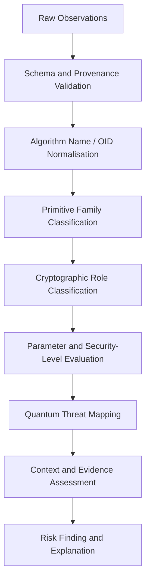
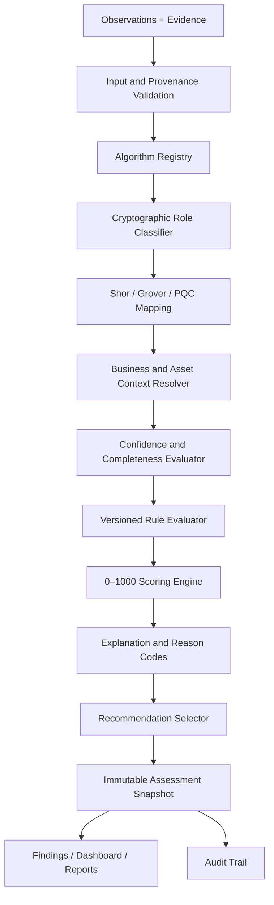
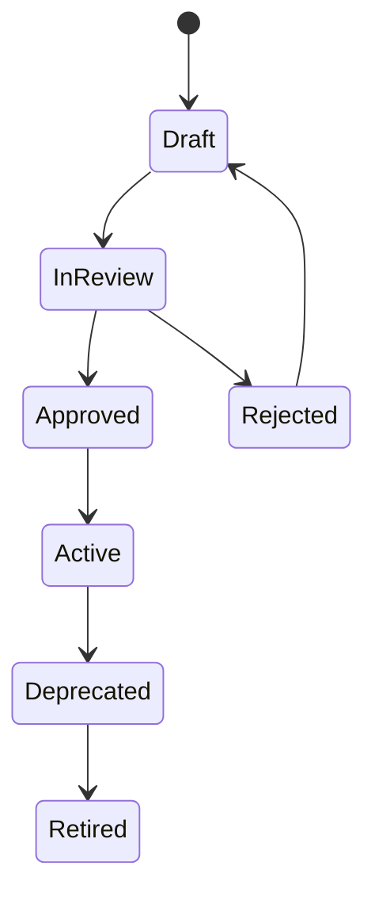

# QUANTUM FLOW TECHNOLOGIES
# PQC Discovery & Risk Assessment Platform
## Quantum Risk Assessment Methodology & Core Engine Design

**Document ID:** QFT-RISK-ENGINE-001  
**Version:** 1.0 — Initial Technical Draft  
**Status:** Draft — For CISO, CTO, Product and Engineering Review  
**Date:** 02 November 2026  
**Classification:** Confidential  
**Owner:** Product / Security Architecture / Engineering  
**Approval authority:** Quantum Flow CISO and designated technical owner

**Related documents:** PRD v1.0 Draft; TRD v1.0 Draft; SAD v1.0 Draft; Database Design v1.0 Draft; API Specification v1.0 Draft; Threat Model & Security Architecture v1.0 Draft; Network/TLS & Certificate Intelligence Collector Design v1.0 Draft; *PQC Discovery & Migration Platform — Vision & Roadmap*, Version 1.0, October 2026.

---

## Document status and important notice

This document defines a proposed, evidence-driven methodology and software design for the Quantum Flow quantum-risk assessment engine. It is not evidence that the engine has been implemented, validated, independently assessed, approved by the CISO, or accepted by customers.

The product requirements propose a score from 0 to 1000. The PRD and company vision do not define an authoritative formula, factor weights or category thresholds. This document therefore proposes an initial, transparent scoring model for controlled evaluation. The weights and thresholds are **provisional design parameters** and must be calibrated against representative ground-truth cases and approved by the CISO before customer-facing use.

The score is a product prioritisation index. It is not a probability of quantum compromise, a prediction of when a cryptographically relevant quantum computer will exist, a measure of exploitability today, a NIST rating, or a certification.

The engine must distinguish:
- observed facts from inferences and imported information;
- cryptographic quantum relevance from overall business risk;
- asset-level findings from organisation-level roll-ups;
- risk score from evidence confidence;
- unknown information from safe information;
- classical cryptography from standardised PQC and hybrid deployments.

A missing field must never silently become a low-risk value.

# 1. Executive Summary

The Quantum Risk Assessment Engine converts normalised cryptographic observations and business context into explainable, versioned risk assessments and remediation priorities.

The engine receives evidence from collectors and approved imports, identifies the cryptographic primitive and its role, maps the primitive to relevant quantum threat considerations, evaluates contextual risk factors, and produces a finding with:
- a score and category, where scoring is sufficiently supported;
- a confidence and completeness statement;
- a transparent explanation and reason codes;
- evidence references and provenance;
- assumptions, unknowns and limitations;
- recommended next actions.

The engine is downstream of discovery. Collectors report what they observed; the engine interprets the observations. A TLS collector must not decide final quantum risk, and a risk engine must not invent fields that the collector did not observe.

## 1.1 Core processing model

**Evidence → Normalisation → Cryptographic classification → Threat mapping → Context assessment → Score calculation → Explanation → Recommendation → Review**

## 1.2 Non-negotiable principles

1. **Evidence before score:** no score without traceable evidence and a known asset.
2. **Correct cryptographic role:** RSA used for signatures and RSA used for key transport are not interchangeable use cases.
3. **Shor and Grover are different:** do not classify symmetric algorithms as if Shor directly breaks RSA/ECC.
4. **No false certainty:** confidence and coverage are visible separately from score.
5. **Deterministic results:** same evidence snapshot, rule set, policy and context must produce the same result.
6. **Versioned methodology:** every assessment records exact engine, mapping, rule, policy and reference-data versions.
7. **Explainability:** every score contribution must have a reason code, value, source and rationale.
8. **Human governance:** CISO-approved rules and thresholds; risk exceptions require authorised review.
9. **No unsupported migration advice:** recommendations must account for protocol, library, vendor, PKI and interoperability dependencies.
10. **No complete-inventory claims from incomplete scans:** coverage and limitations travel with the assessment.

# 2. Purpose, Scope and Boundaries

## 2.1 Purpose

This document specifies:
- the assessment model and score semantics;
- cryptographic algorithm and usage classification;
- Shor/Grover/PQC threat mapping;
- risk dimensions and provisional weights;
- missing-data and confidence treatment;
- asset, finding and organisation aggregation;
- recommendation selection;
- rule and reference-data governance;
- core engine architecture, contracts and APIs;
- persistence, reproducibility and audit requirements;
- validation, calibration and test strategy.

## 2.2 In scope for v1

- TLS endpoints and X.509 certificates.
- Public-key algorithms, parameters and certificate signature algorithms.
- Observable TLS key-exchange groups/mechanisms.
- Negotiated TLS cipher-suite information.
- Approved source-code and dependency observations when those collectors become available.
- Approved configuration and inventory imports.
- Cryptographic algorithm and usage classification.
- Quantum threat mapping and evidence-backed findings.
- Provisional 0–1000 asset prioritisation score.
- Recommendations and review workflow.
- Assessment snapshots, history and exports.

## 2.3 Out of scope for v1

- Predicting the exact arrival date of a cryptographically relevant quantum computer.
- Estimating the probability that a particular customer will be attacked.
- Claiming a cryptographic algorithm is currently exploitable solely because it is quantum-vulnerable.
- Automatically modifying production cryptographic configurations.
- Automatically replacing certificates, libraries, keys or protocols.
- Recommending one universal PQC algorithm for every use case.
- Claiming certification, regulatory compliance or NIST endorsement.
- Treating a public website scan as a complete enterprise CBOM.
- Using opaque machine-learning models to determine the initial risk score.

# 3. Methodology Principles and Definitions

## 3.1 What the score means

The proposed 0–1000 score is a **relative prioritisation index**. A higher score means that, under the selected methodology version and supplied context, the asset should receive earlier assessment or remediation attention.

It is not:
- a percentage;
- a probability;
- a forecast of quantum computer capability;
- a vulnerability severity score for current classical attackers;
- a universal industry benchmark;
- a guarantee that a lower-scoring asset is safe.

The score is only meaningful together with its methodology version, category, reason codes, evidence confidence and limitations.

## 3.2 Separate concepts

| Concept | Meaning | Engine treatment |
|---|---|---|
| Quantum susceptibility | Whether the primitive's security assumption is affected by known quantum algorithms | Threat mapping |
| Cryptographic role | What the primitive is used for: key establishment, signature, encryption, hash, etc. | Classification and role modifier |
| Contextual urgency | How soon the organisation needs to act based on data life, exposure and business impact | Context scoring |
| Migration complexity | How difficult remediation may be | Planning priority/context, not proof of quantum weakness |
| Evidence confidence | How strongly the observation is supported | Separate confidence output and score eligibility |
| Coverage completeness | How much of the intended scope was actually examined | Assessment limitation and organisation-level completeness |
| Current classical exploitability | Whether a weakness is exploitable today by classical means | Separate vulnerability/security finding; not inferred from quantum mapping |

## 3.3 Risk is not the same as confidence

A finding may have high potential impact but low confidence because the evidence is incomplete. The engine must not automatically reduce the underlying risk merely because evidence is weak. Instead:
- retain the potential risk classification;
- lower the confidence/completeness indicator;
- mark the score provisional or withheld if critical facts are missing;
- recommend additional discovery or human validation.

## 3.4 Risk is not the same as migration difficulty

A vendor may have no supported PQC upgrade, making remediation difficult. That does not make the cryptographic primitive more quantum-vulnerable. The engine should show:
- quantum exposure;
- contextual priority;
- migration readiness/complexity;
as distinct outputs.

# 4. Inputs, Evidence and Data Contracts

## 4.1 Required input classes

### A. Cryptographic observations
- Algorithm family and exact name/OID.
- Cryptographic purpose/role.
- Key size, curve, parameters or security level where available.
- Protocol and negotiated configuration.
- Certificate, key, signature or dependency identity.
- Observation timestamp.
- Source collector and collector version.
- Evidence reference and checksum.
- Observed/inferred/imported/unknown classification.
- Confidence and limitations.

### B. Asset context
- Asset ID and type.
- Application/service/system.
- Environment (production, staging, development, test, unknown).
- Business owner and technical owner.
- Business criticality.
- Internet exposure or network accessibility.
- Data types and confidentiality requirements.
- Data retention or confidentiality lifetime.
- Dependencies and downstream consumers.
- Vendor/product and support status.
- Lifecycle state.

### C. Assessment governance
- Tenant and project context.
- Assessment policy ID and version.
- Risk methodology version.
- Threat mapping version.
- Approved standards/reference catalogue version.
- Assessment time and evaluation date.
- Exception/acceptance state, if any.

## 4.2 Evidence classification

Every source observation must use one of the platform's controlled classifications:

- **Observed:** directly measured or parsed by a collector.
- **Inferred:** derived from indirect evidence by a documented rule.
- **Imported:** provided by an approved customer inventory or integration.
- **Unknown:** insufficient information to classify.

Do not convert an inferred source-code match into proof of runtime use. Do not convert an imported inventory record into a direct observation. Preserve the original source classification when multiple observations are correlated.

## 4.3 Evidence provenance

Each evidence reference should include, where applicable:
- evidence ID and content hash;
- tenant, project, scan and execution IDs;
- asset and observation IDs;
- collector ID and version;
- source type and collection method;
- target and location;
- observed timestamp;
- ingestion timestamp;
- parser and normaliser versions;
- confidence rationale;
- limitations and error status;
- immutable or versioned storage reference.

## 4.4 Evidence freshness

Freshness is source- and asset-specific. A certificate observation may be current for the time of the handshake; an imported CMDB record may be much older. The engine should:
- store observed time and ingestion time separately;
- apply configurable freshness windows by source type;
- mark stale evidence;
- avoid silently treating stale data as current;
- retain historical assessments;
- recommend a rescan or inventory refresh when freshness is inadequate.

A stale observation is not necessarily false. It is evidence that may no longer represent the current state.

# 5. Cryptographic Classification Engine

## 5.1 Classification pipeline



## 5.2 Canonical algorithm taxonomy

The engine should normalise algorithm observations into a controlled taxonomy. Preserve the original observed name and OID; never replace raw evidence with a normalised label.

Recommended fields:
- `algorithm_observed_name`
- `algorithm_oid`
- `algorithm_canonical_id`
- `primitive_family`
- `primitive_subfamily`
- `cryptographic_role`
- `parameter_set`
- `key_size_bits`
- `curve_name`
- `security_level_claim`
- `normalisation_rule_id`
- `normalisation_rule_version`
- `classification_status`

## 5.3 Primitive families

At minimum:
- RSA and integer-factorisation public-key mechanisms.
- Finite-field Diffie–Hellman.
- Elliptic-curve cryptography (ECDH, ECDHE, ECDSA and related mechanisms).
- Symmetric block ciphers.
- Symmetric stream ciphers.
- Hash functions.
- Message authentication codes.
- Key derivation functions.
- Password hashing and password-based key derivation.
- Classical signature schemes.
- Key-encapsulation mechanisms.
- Post-quantum signature schemes.
- Post-quantum hash-based signatures.
- Hybrid or composite constructions.
- Unknown or proprietary mechanisms.

## 5.4 Cryptographic role taxonomy

A single algorithm may be used in more than one role. Each role must be represented separately.

| Role | Examples | Assessment focus |
|---|---|---|
| Key establishment / KEM | DH, ECDH, ML-KEM | Confidentiality of established session keys and quantum attack model |
| Key transport | RSA key transport in legacy contexts | Exposure of transported key material |
| Digital signature | RSA, ECDSA, ML-DSA, SLH-DSA | Authentication, integrity and long-term signature trust |
| Symmetric encryption | AES, ChaCha20 | Quantum-adjusted security margin and key size |
| Hashing | SHA-256, SHA-384, SHA-3 | Collision/preimage use and output length |
| MAC | HMAC | Construction-specific security margin |
| Key derivation | HKDF, PBKDF2, scrypt, Argon2 | Construction, entropy, parameters and intended use |
| Certificate signature | RSA/ECDSA/other issuer signature | Certificate-chain authenticity and trust lifecycle |
| Unknown | Unclassified | Further investigation; no guessed risk mapping |

## 5.5 TLS-specific classification

The TLS collector's fields must remain separate:
1. Certificate subject public-key algorithm.
2. Certificate signature algorithm.
3. Negotiated TLS key-exchange group/mechanism.
4. Negotiated cipher suite.
5. TLS protocol version.
6. Application-level cryptographic usage (not inferred from a TLS-only observation).

Example:
- An RSA certificate does not prove RSA key transport is used in the negotiated TLS 1.3 session.
- A TLS 1.3 cipher suite such as `TLS_AES_128_GCM_SHA256` does not identify the key-exchange group.
- An ECDSA certificate signature and an X25519 key exchange are separate cryptographic observations.
- The engine may create separate findings for certificate authentication and session key establishment, but should link them to the same endpoint asset context.

# 6. Quantum Threat Mapping

## 6.1 Threat mapping model

Threat mapping converts a classified primitive and its role into one or more quantum-relevance labels. It must be deterministic, versioned and reviewable.

Suggested labels:
- `SHOR_RELEVANT`
- `GROVER_SECURITY_MARGIN`
- `PQC_STANDARD_RECOGNISED`
- `HYBRID_CONSTRUCTION`
- `QUANTUM_IMPACT_NOT_ESTABLISHED`
- `UNKNOWN_CLASSIFICATION`

These labels describe the relationship to known quantum algorithms or recognised PQC families. They do not alone determine the final risk score.

## 6.2 Shor-related mapping

A sufficiently capable fault-tolerant quantum computer running Shor's algorithm would threaten public-key systems whose security depends on integer factorisation or discrete logarithms.

The mapping catalogue should include relevant:
- RSA public-key operations;
- finite-field Diffie–Hellman;
- elliptic-curve Diffie–Hellman and ephemeral variants;
- elliptic-curve signatures such as ECDSA;
- other mechanisms whose security depends on the same mathematical assumptions.

The engine should distinguish the affected role:
- key establishment/key transport has direct confidentiality implications for protected communications and recorded ciphertext;
- signatures have authentication, integrity, certificate and long-term trust implications;
- certificate issuer signatures can affect trust-chain integrity and PKI migration planning.

Do not state that a classical public-key asset is currently broken by a quantum computer. Phrase the result as exposure to a sufficiently capable future quantum attack under the relevant threat model.

## 6.3 Grover-related mapping

Grover's algorithm provides a quadratic speed-up for unstructured search in an idealised model. Its practical implications for symmetric cryptography and hash functions differ from Shor's impact on factoring/discrete-log systems.

The engine must:
- assess the primitive and construction, not just the algorithm name;
- consider key length and target security level;
- consider hash output length and whether the use is collision, preimage or second-preimage resistance;
- avoid applying a universal “halve every key/hash length” rule;
- avoid labelling AES or SHA-2 as simply broken;
- consult the approved standards/reference catalogue for the applicable interpretation.

## 6.4 PQC recognition

The initial catalogue should recognise:
- ML-KEM — NIST FIPS 203.
- ML-DSA — NIST FIPS 204.
- SLH-DSA — NIST FIPS 205.

Recognition is not a pass/fail security certificate. The engine must separately assess:
- exact algorithm and parameter set;
- implementation/library identity and version;
- protocol integration;
- configuration and use;
- key management and lifecycle;
- interoperability;
- hybrid composition, if applicable;
- vendor support and deployment evidence.

A name match alone does not prove a correct, safe or certified deployment.

## 6.5 Hybrid deployments

A hybrid construction combines classical and PQC mechanisms in a defined protocol or composition. The engine must not assume that the mere presence of a PQC component makes the entire asset quantum-safe.

Record:
- component algorithms;
- composition/protocol definition;
- negotiated or configured status;
- downgrade behaviour where known;
- implementation and version;
- evidence source;
- compatibility and interoperability status;
- policy approval.

If composition cannot be verified, classify it as `HYBRID_CLAIM_UNVERIFIED` or equivalent and request further evidence.

## 6.6 Threat mapping table (initial catalogue)

| Primitive / role | Mapping | Initial interpretation |
|---|---|---|
| RSA key establishment or signature | Shor-relevant | High quantum susceptibility; role-specific impact |
| Finite-field DH key establishment | Shor-relevant | Quantum exposure of discrete-log assumption |
| ECDH/ECDHE | Shor-relevant | Quantum exposure of elliptic-curve discrete-log assumption |
| ECDSA | Shor-relevant | Quantum exposure of signature assumption |
| AES | Grover security margin | Evaluate key size and security target; not “broken” |
| SHA-2/SHA-3 | Grover security margin | Evaluate output length and security property |
| HMAC | Construction-dependent margin | Assess underlying hash and construction |
| ML-KEM | PQC recognised | Verify parameters, implementation and protocol use |
| ML-DSA | PQC recognised | Verify parameters, implementation and signature use |
| SLH-DSA | PQC recognised | Verify parameters, implementation and signature use |
| Unknown/proprietary | Unknown | Manual review; no fabricated classification |

# 7. Risk Dimensions and Context Model

The PRD identifies algorithm exposure, key parameters, protocol usage, external exposure, data confidentiality lifetime, business criticality, migration complexity, vendor support and evidence confidence. This design translates those factors into an initial score model.

## 7.1 Dimension definitions

### D1. Cryptographic quantum susceptibility
How directly the primitive's security assumption is affected by relevant quantum algorithms.

### D2. Cryptographic role and impact
What security property depends on the primitive: confidentiality, key establishment, authentication, signatures, integrity or another purpose.

### D3. Data confidentiality lifetime / urgency
How long the protected information must remain confidential and whether stored or intercepted data could remain sensitive into a future quantum-capable period. This factor is especially relevant to harvest-now-decrypt-later scenarios.

### D4. Exposure and accessibility
Whether the asset is public-facing, reachable by constrained networks, internal, isolated or unknown. Exposure affects opportunity and prioritisation; it does not change the mathematical strength of the primitive.

### D5. Business criticality
Impact to essential services, safety, financial operations, regulated data, customer trust or business continuity if the cryptographic asset fails.

### D6. Dependency and migration complexity
How many applications, protocols, devices, vendors, certificates, clients or downstream services depend on the asset, and how difficult coordinated remediation may be.

### D7. Vendor/platform readiness
Whether a supported upgrade, configuration, PQC/hybrid implementation, hardware replacement or vendor roadmap exists and is validated.

### D8. Evidence quality and completeness
How reliable, direct, current and complete the supporting observations are. This factor governs score eligibility and confidence; it must not be used to hide high potential exposure.

## 7.2 Context values and sources

| Context | Example values | Preferred source |
|---|---|---|
| Environment | Production, staging, development, test, unknown | Approved CMDB/import or owner input |
| Exposure | Internet, partner, internal, isolated, unknown | Network inventory and owner confirmation |
| Criticality | Critical, high, medium, low, unknown | Business owner / approved classification |
| Data confidentiality lifetime | Years or defined bands | Data owner / retention policy |
| Data sensitivity | Approved business classification | Customer policy |
| Vendor support | Supported, planned, unsupported, unknown | Vendor evidence / owner |
| Dependencies | Known dependency graph and owner | CBOM, CMDB, application owner |
| Last validated | Timestamp | Collector/import provenance |

User-entered context must include source, author, timestamp and review status. The engine should not silently treat default values as confirmed facts.

# 8. Proposed 0–1000 Scoring Methodology

## 8.1 Score design

The proposed model uses eight normalised dimensions, each rated from 0 to 5. Each dimension has a provisional weight. The weighted sum produces a score from 0 to 1000.

**This is a proposed model for calibration, not an approved company standard.** The CISO must approve the weights, rating anchors and category thresholds after reviewing test cases and pilot evidence.

| Dimension | Symbol | Weight |
|---|---:|---:|
| Cryptographic quantum susceptibility | Q | 300 |
| Cryptographic role and impact | R | 150 |
| Data confidentiality lifetime / urgency | L | 150 |
| Exposure and accessibility | E | 100 |
| Business criticality | B | 100 |
| Dependency and migration complexity | M | 75 |
| Vendor/platform readiness gap | V | 75 |
| **Total** |  | **1000** |

Evidence confidence is deliberately not a weighted risk factor. It is a separate reliability/eligibility measure. This avoids a dangerous outcome where weak evidence mechanically makes a potentially serious asset look safe.

## 8.2 Normalised rating

Each factor receives a rating `x` from 0 to 5:
- 0 = no identified concern under the dimension, supported by evidence.
- 1 = low.
- 2 = limited/moderate.
- 3 = material.
- 4 = high.
- 5 = very high.

A rating of zero must not mean “not known”. Unknown is represented as missing and handled by the completeness policy.

## 8.3 Formula

For each dimension `i`:

`contribution_i = weight_i × rating_i / 5`

Overall provisional score:

`score = round(sum(contribution_i))`

With weights totalling 1000 and ratings in [0, 5], the score is in [0, 1000].

Example pseudocode:

```python
WEIGHTS = {
    "quantum_susceptibility": 300,
    "cryptographic_role": 150,
    "data_lifetime": 150,
    "exposure": 100,
    "business_criticality": 100,
    "migration_complexity": 75,
    "vendor_readiness_gap": 75,
}

def calculate_score(ratings: dict[str, int]) -> int:
    if set(ratings) != set(WEIGHTS):
        raise ValueError("Missing or unexpected score dimensions")

    for dimension, rating in ratings.items():
        if not isinstance(rating, int) or not 0 <= rating <= 5:
            raise ValueError(f"Invalid rating for {dimension}")

    total = sum(
        WEIGHTS[dimension] * rating / 5
        for dimension, rating in ratings.items()
    )
    return round(total)
```

The production implementation must use decimal/fixed-point arithmetic or a documented rounding strategy to ensure cross-runtime reproducibility.

## 8.4 Rating anchors

### Q — Cryptographic quantum susceptibility (weight 300)

| Rating | Guidance |
|---:|---|
| 0 | Evidence supports a primitive/use not identified as quantum-susceptible under the approved mapping, or a validated PQC construction is correctly deployed for this role |
| 1 | Limited quantum margin concern; construction-specific assessment indicates low concern |
| 2 | Moderate/conditional concern requiring parameter or construction review |
| 3 | Material quantum-related security-margin concern |
| 4 | Strongly Shor-relevant classical public-key mechanism or materially weak parameters |
| 5 | Directly Shor-relevant classical mechanism in a critical security role, or severe parameter/configuration concern under approved rules |

Important: PQC recognition alone is not sufficient for rating 0. Implementation correctness, parameters and deployment evidence must be reviewed. An unknown algorithm is not rating 0.

### R — Cryptographic role and impact (weight 150)

| Rating | Guidance |
|---:|---|
| 0 | No security-relevant cryptographic role established |
| 1 | Limited/non-critical supporting use |
| 2 | Integrity or protection of low-impact data |
| 3 | Important authentication, integrity or confidentiality role |
| 4 | Core key establishment, certificate trust or high-value signature role |
| 5 | Root/issuer trust, critical key establishment, high-value long-term signature or similarly foundational role |

### L — Data confidentiality lifetime / urgency (weight 150)

| Rating | Guidance |
|---:|---|
| 0 | No confidentiality requirement remains |
| 1 | Short-lived, low-sensitivity data |
| 2 | Confidentiality needed for a limited period |
| 3 | Sensitive information with multi-year confidentiality needs |
| 4 | Long-lived sensitive or regulated information |
| 5 | Highly sensitive information requiring long-term secrecy, where harvest-now-decrypt-later is a material concern |

Exact year bands must be configurable and approved for the customer's data policy. Do not hard-code one universal confidentiality horizon.

For signature assets, the factor should be interpreted as the required duration of trust, authenticity or verifiability rather than data secrecy. The factor label and explanation should adapt to the role.

### E — Exposure and accessibility (weight 100)

| Rating | Guidance |
|---:|---|
| 0 | Retired or demonstrably unreachable, with verified lifecycle evidence |
| 1 | Isolated lab/test asset |
| 2 | Restricted internal asset |
| 3 | Internal asset reachable by multiple segments or partner networks |
| 4 | Partner-facing or broadly reachable service |
| 5 | Public internet-facing endpoint or widely distributed exposed component |

Do not infer internet exposure from a hostname string. Use validated network evidence or approved inventory context.

### B — Business criticality (weight 100)

| Rating | Guidance |
|---:|---|
| 0 | No business dependency |
| 1 | Low impact / non-production |
| 2 | Limited business impact |
| 3 | Important business service |
| 4 | High-impact or regulated business service |
| 5 | Critical service, safety, essential operation or major systemic impact |

Criticality should come from an approved business owner or classification source. If absent, mark unknown rather than assuming low.

### M — Dependency and migration complexity (weight 75)

| Rating | Guidance |
|---:|---|
| 0 | No material dependency; straightforward controlled change |
| 1 | Few dependencies, supported configuration change |
| 2 | Limited application/library dependencies |
| 3 | Several components or clients require coordinated testing |
| 4 | Many dependent services, hardware or vendor constraints |
| 5 | Complex ecosystem, legacy/embedded constraints, broad interoperability or major change coordination |

This dimension raises planning priority because remediation may take longer. It does not increase the primitive's quantum susceptibility.

### V — Vendor/platform readiness gap (weight 75)

| Rating | Guidance |
|---:|---|
| 0 | Supported, validated remediation path available |
| 1 | Vendor support available with minor prerequisites |
| 2 | Supported roadmap or upgrade path, not yet validated |
| 3 | Partial support or important compatibility gaps |
| 4 | No clear supported solution; vendor engagement required |
| 5 | Unsupported/obsolete platform or no credible remediation path identified |

Vendor readiness must be evidence-backed. “Unknown vendor status” is missing data, not automatically rating 5.

## 8.5 Provisional categories

The following bands are suggested for initial usability testing only:

| Score | Proposed category | Meaning |
|---:|---|---|
| 0–199 | Low | Lower relative priority under current evidence and context |
| 200–399 | Guarded | Monitor and plan; validate relevant assumptions |
| 400–599 | Elevated | Prioritised technical review and remediation planning |
| 600–799 | High | Near-term remediation planning and owner engagement |
| 800–1000 | Critical | Executive/CISO attention and urgent assessment |

These bands are not industry-standard thresholds. They require calibration and CISO approval. The product must show the methodology version and category definitions alongside scores.

## 8.6 Worked example — RSA certificate on a public endpoint

**Illustrative values only; not a real customer assessment.**

Assume an authorised TLS scan directly observes:
- an RSA certificate public key;
- a public internet-facing endpoint;
- the service owner confirms a critical production service;
- the data owner confirms long-lived confidentiality requirements;
- the service has several dependent clients;
- vendor support is not yet confirmed.

Example provisional ratings:

| Dimension | Rating | Weight | Contribution |
|---|---:|---:|---:|
| Quantum susceptibility | 4 | 300 | 240 |
| Cryptographic role/impact | 4 | 150 | 120 |
| Data lifetime/urgency | 4 | 150 | 120 |
| Exposure | 5 | 100 | 100 |
| Business criticality | 5 | 100 | 100 |
| Migration complexity | 3 | 75 | 45 |
| Vendor readiness gap | 3 | 75 | 45 |
| **Total** |  | **1000** | **770** |

Illustrative result: **770 / 1000 — High**.

Explanation:
- RSA is a Shor-relevant public-key family.
- The certificate observation is direct evidence of the certificate public-key algorithm.
- Public exposure and critical business context increase priority.
- The TLS scan does not prove the complete application cryptographic architecture or that RSA key transport was negotiated.
- The result does not mean the endpoint is currently exploitable by a quantum computer.
- The next step is to validate PKI, TLS key exchange, application dependencies and supported migration options.

## 8.7 Why a score may be withheld

The engine must not force a numeric score when core facts are unavailable or contradictory.

Possible output:
- `score: null`
- `category: "UNASSESSED"` or `INSUFFICIENT_EVIDENCE`
- `assessment_status: "NEEDS_REVIEW"`
- `confidence: "LOW"` or `UNKNOWN`
- reason codes describing missing facts.

Examples:
- Algorithm family unknown.
- Conflicting observations for the same asset with no resolution.
- Cryptographic role cannot be established and changes the threat interpretation.
- Evidence is invalid or provenance cannot be verified.
- Asset identity/correlation is ambiguous.
- Required context is absent and policy requires it for the selected score.

A customer may still receive a qualitative investigation finding without a numeric score.

# 9. Missing Data, Confidence and Uncertainty

## 9.1 Confidence levels

Confidence is an evidence-quality judgement, not risk severity.

| Confidence | General meaning | Typical example |
|---|---|---|
| High | Direct, current, reproducible observation with validated provenance | Parsed certificate from an authorised live TLS handshake |
| Medium | Credible evidence with limited gaps or indirect derivation | Approved configuration import with known source/version |
| Low | Weak, stale, ambiguous or indirect evidence | Source-code string match without runtime confirmation |
| Unknown | Evidence quality cannot be assessed | Unattributed or incomplete record |

Confidence rules must be defined per collector and observation type.

## 9.2 Completeness score

A separate completeness measure may be displayed as a percentage only when the expected fields and coverage denominator are well-defined. It must not be confused with confidence or risk.

Examples:
- A TLS handshake may have high confidence but low enterprise coverage.
- A source-code scanner may have medium confidence for a code pattern and unknown runtime usage.
- An inventory import may be broad but stale.

## 9.3 Missing-data policy

Each risk dimension must support:
- known value;
- unknown;
- not applicable;
- conflicting;
- stale.

The engine must not convert these states to zero.

Proposed policy:
1. If a critical cryptographic classification field is missing, withhold the numeric score.
2. If a non-critical contextual factor is missing, calculate only if policy permits and explicitly mark the score incomplete.
3. Missing dimensions must not silently receive a rating of 0.
4. Report which assumptions or customer inputs would change the result.
5. Permit an authorised reviewer to supply a value with source, timestamp and rationale.
6. Reassess when missing data becomes available.

## 9.4 Uncertainty range

For later versions, the engine may calculate a bounded score range using approved low/high ratings for unknown dimensions. If implemented:
- clearly label it as an uncertainty interval, not a statistical confidence interval;
- document the assumptions and calculation;
- do not show a false precision;
- preserve the point score only if the policy defines a valid imputation method.

Version 1 should prefer withholding a score over inventing a point estimate when critical inputs are unknown.

# 10. Findings and Reason Codes

## 10.1 Finding structure

Each finding must contain:
- `finding_id`
- `tenant_id`
- `project_id`
- `asset_id`
- `assessment_id`
- `rule_id`
- `rule_version`
- `title`
- `description`
- `primitive_family`
- `algorithm`
- `cryptographic_role`
- `quantum_mapping`
- `score`
- `category`
- `confidence`
- `assessment_status`
- `evidence_refs`
- `dimension_ratings`
- `score_contributions`
- `reason_codes`
- `assumptions`
- `unknowns`
- `limitations`
- `recommendation_refs`
- `created_at`

## 10.2 Initial reason-code catalogue

| Code | Meaning |
|---|---|
| `QF-QNT-SHOR-001` | Shor-relevant public-key primitive observed |
| `QF-QNT-GROVER-001` | Symmetric/hash security margin requires quantum-aware review |
| `QF-QNT-PQC-001` | Recognised standardised PQC algorithm observed |
| `QF-QNT-HYBRID-001` | Hybrid construction indicated; composition validation required |
| `QF-ROLE-KEM-001` | Primitive used for key establishment/KEM |
| `QF-ROLE-SIG-001` | Primitive used for digital signature/authentication |
| `QF-ROLE-CERT-001` | Primitive observed in certificate public key or signature |
| `QF-CTX-EXP-001` | Public internet exposure confirmed |
| `QF-CTX-LIFE-001` | Long confidentiality/trust lifetime increases urgency |
| `QF-CTX-CRIT-001` | Critical business service context confirmed |
| `QF-MIG-COMP-001` | Material dependency/migration complexity identified |
| `QF-VENDOR-GAP-001` | Vendor remediation support gap identified |
| `QF-EVID-HIGH-001` | High-confidence direct evidence |
| `QF-EVID-LOW-001` | Low-confidence or indirect evidence |
| `QF-EVID-STALE-001` | Evidence is outside approved freshness window |
| `QF-DATA-MISSING-001` | Required assessment context missing |
| `QF-DATA-CONFLICT-001` | Conflicting observations require resolution |
| `QF-SCOPE-LIMIT-001` | Assessment covers only the specified scan scope |
| `QF-REVIEW-REQ-001` | Human technical review required before conclusion |

Reason codes must be stable identifiers. Their descriptions may evolve by version, but old assessments must retain the exact reason-code version and text snapshot used.

# 11. Core Engine Architecture

## 11.1 Modules

1. **Input validator:** validates schema, tenant scope, evidence references and required fields.
2. **Evidence resolver:** loads immutable/versioned evidence metadata and validates provenance.
3. **Normalisation adapter:** maps collector-specific fields to canonical observations.
4. **Algorithm registry:** maps observed names/OIDs to canonical primitive records.
5. **Role classifier:** identifies usage based on evidence; supports multiple roles.
6. **Quantum mapping registry:** applies Shor/Grover/PQC/hybrid mappings.
7. **Context resolver:** loads business and technical context with source and freshness.
8. **Completeness/confidence evaluator:** determines score eligibility and evidence quality.
9. **Rule evaluator:** applies deterministic, versioned rules.
10. **Scoring engine:** calculates weighted score and category.
11. **Explanation builder:** creates reason codes, contributions and human-readable rationale.
12. **Recommendation selector:** maps findings to approved guidance.
13. **Assessment snapshot writer:** stores immutable assessment output and versions.
14. **Audit publisher:** records assessment creation, review, override and exception events.

## 11.2 Architecture diagram



## 11.3 Separation of concerns

- Collectors do not calculate final risk.
- Normalisers do not invent missing evidence.
- Algorithm registry does not infer runtime usage from a name match.
- Threat mapping does not set business criticality.
- Scoring engine does not generate unsupported migration instructions.
- Recommendation engine does not change customer systems.
- Frontend does not recalculate scores independently.
- Only the backend assessment service may persist an authoritative assessment snapshot.

# 12. Rule Registry and Version Governance

## 12.1 Rule structure

Each rule should include:
- stable rule ID;
- semantic version;
- title and description;
- condition/expression;
- required input fields;
- mapping result;
- score dimension/rating effect;
- reason code;
- evidence requirements;
- severity/category behaviour;
- applicability and exclusions;
- reference source and version;
- effective date;
- author and reviewer;
- approval state;
- test fixtures.

## 12.2 Rule lifecycle



Only approved and active rules may be used for customer assessments. Draft rules may run in a test environment only.

## 12.3 Versioning

Every assessment must record:
- engine build/version;
- scoring methodology version;
- weights and thresholds version;
- algorithm registry version;
- quantum mapping version;
- rule-set version;
- context policy version;
- recommendation catalogue version;
- standards/reference catalogue version;
- source evidence snapshot IDs.

Changing a weight, threshold, mapping or rule creates a new version. Do not silently rewrite historical assessments.

## 12.4 Reference governance

The initial company vision identifies:
- NIST FIPS 203 — ML-KEM.
- NIST FIPS 204 — ML-DSA.
- NIST FIPS 205 — SLH-DSA.
- NIST SP 800-57 Part 1.
- DST Quantum Safe Ecosystem report and National Quantum Mission references.

The standards catalogue must store official title, issuing body, identifier, publication/version date, URL, retrieval date, status, applicability notes and reviewer. Engineering must verify current official editions, errata and status before converting a reference into an active rule. A standards reference in a report does not imply product certification or government endorsement.

# 13. Recommendation Engine Design

## 13.1 Purpose

Recommendations translate a finding into a safe next action. They should help the customer understand what to investigate, who should be involved, what dependencies exist and how to validate a future change.

## 13.2 Recommendation categories

- `INVESTIGATE_FURTHER`
- `VALIDATE_USAGE`
- `UPDATE_CONFIGURATION`
- `UPGRADE_LIBRARY`
- `ENGAGE_VENDOR`
- `REVIEW_PKI`
- `ASSESS_PQC_SUPPORT`
- `PLAN_HYBRID_MIGRATION`
- `TEST_INTEROPERABILITY`
- `REASSESS_AFTER_CHANGE`
- `DOCUMENT_EXCEPTION`

## 13.3 Recommendation record

Each recommendation should contain:
- recommendation ID and catalogue version;
- linked finding and asset;
- rationale and evidence references;
- action description;
- priority;
- affected owners;
- prerequisites and dependencies;
- compatibility considerations;
- required approvals;
- test/validation steps;
- rollback/contingency guidance where applicable;
- source/standard references;
- applicability limitations;
- status and due date.

## 13.4 Recommendation rules

### RSA/ECC certificate observed
Recommend:
1. Validate whether the certificate is used in production and identify its owner.
2. Map the certificate chain, issuing CA, renewal process and dependent clients.
3. Determine separately which key-exchange mechanism the TLS endpoint negotiates.
4. Review the TLS stack, PKI vendor and certificate lifecycle for supported PQC/hybrid roadmaps.
5. Build a controlled test plan before changing certificate or protocol configuration.

Do not recommend “replace RSA with ML-DSA immediately” as a blanket action. Certificate profiles, protocol support, clients, trust stores and PKI operations must be evaluated.

### Shor-relevant key establishment
Recommend:
1. Confirm the protocol and negotiated key-exchange group.
2. Identify data confidentiality lifetime and harvest-now-decrypt-later relevance.
3. Identify clients, gateways and service dependencies.
4. Check supported protocol/library/vendor options.
5. Evaluate standards-aligned PQC or hybrid key-establishment support in a lab.
6. Plan compatibility, performance, monitoring and rollback tests.

### Grover-relevant symmetric/hash observation
Recommend:
1. Confirm exact primitive, key/output size and use.
2. Determine whether the use is encryption, MAC, preimage or collision resistance.
3. Consult the approved standards/reference catalogue.
4. Avoid simplistic universal key-size rules.
5. Document whether any change is needed and why.

### PQC algorithm observed
Recommend:
1. Confirm exact standard and parameter set.
2. Verify implementation/library and version.
3. Validate protocol composition and negotiation.
4. Review key management, lifecycle and operational controls.
5. Test interoperability and downgrade behaviour where applicable.
6. Record evidence and remaining limitations.

### Unknown or ambiguous algorithm
Recommend further evidence collection and expert review. Do not assign a fabricated quantum classification.

## 13.5 Recommendation governance

Recommendations are advisory. No recommendation may trigger a production change in v1. Any future migration executor must be a separate, approval-gated capability with change windows, validation, rollback and audit.

# 14. Asset-Level, Finding-Level and Organisation-Level Aggregation

## 14.1 Finding level

A finding represents a specific risk statement supported by evidence. A single asset can have multiple findings, such as:
- RSA certificate public key;
- ECDHE key exchange;
- certificate signature algorithm;
- weak TLS configuration;
- missing or stale business context.

Do not collapse these into one generic “RSA vulnerable” finding.

## 14.2 Asset level

Asset assessment should:
- retain all linked findings;
- avoid double-counting the same cryptographic fact from duplicate observations;
- identify the most urgent actionable finding;
- expose separate confidentiality, authentication and integrity implications where relevant;
- retain the evidence and rule versions used.

Proposed asset-level summary:
- maximum valid finding score;
- highest category;
- number of findings by category;
- score completeness/confidence;
- unresolved critical unknowns;
- recommended next action.

The maximum score is a conservative priority summary, not a sum of finding scores.

## 14.3 Organisation/project roll-up

Do not simply add all asset scores. That would make large inventories appear riskier only because they contain more assets and would double-count shared infrastructure.

Recommended roll-up outputs:
- number of assets assessed;
- number of assets unassessed/unknown;
- coverage by collector/source and asset type;
- count of findings by category;
- highest-priority assets;
- critical services affected;
- long-lived confidentiality exposure count;
- PQC/hybrid recognition count;
- stale evidence count;
- migration readiness gaps;
- top recurring reason codes.

If an organisation-level numeric index is later required, it needs a separately approved aggregation methodology, normalised denominators, duplicate/dependency handling and explicit confidence/coverage treatment. Version 1 should not manufacture an organisation-wide score by averaging asset scores.

## 14.4 Shared infrastructure

A certificate, gateway or cryptographic service may support many applications. The CBOM should model relationships. The engine should:
- create one canonical asset where justified;
- link dependent services;
- avoid counting the same primitive as independent evidence for every dependent application;
- still reflect business impact across affected services;
- show dependency blast radius separately.

# 15. Data Model and Persistence Requirements

The detailed physical schema is defined in the Database Design Document. The risk engine requires the following logical entities:

| Entity | Purpose |
|---|---|
| `algorithm_registry` | Canonical algorithms, OIDs, primitive families and metadata |
| `algorithm_aliases` | Observed names and aliases mapped to canonical IDs |
| `quantum_threat_mappings` | Shor/Grover/PQC/hybrid mappings and rationale |
| `risk_methodologies` | Immutable methodology versions |
| `risk_dimensions` | Dimension definitions and weights |
| `risk_rating_anchors` | Rating definitions 0–5 |
| `risk_rules` | Rule metadata and expressions |
| `risk_rule_versions` | Immutable rule versions and approvals |
| `risk_assessments` | Assessment snapshot and status |
| `risk_assessment_inputs` | Exact input/evidence snapshot references |
| `risk_dimension_results` | Ratings, missing status and contributions |
| `risk_findings` | Explainable findings |
| `risk_finding_evidence` | Finding-to-evidence relationships |
| `risk_reason_codes` | Stable reason-code catalogue |
| `recommendation_catalogue` | Approved recommendation templates |
| `recommendations` | Asset/finding-specific recommendations |
| `risk_exceptions` | Approved risk acceptance/deferment records |
| `assessment_reviews` | Human review and approval history |
| `assessment_audit_events` | Append-only governance events |

## 15.1 Snapshot requirements

An assessment must be reproducible without reading mutable current registry values. Store or reference immutable versions and exact inputs:
- evidence IDs and hashes;
- context snapshot;
- registry and rule versions;
- weights and thresholds;
- scoring outputs;
- explanation text or template version;
- recommendation catalogue version.

## 15.2 Tenant isolation

- Derive tenant context from authenticated server-side identity.
- Enforce tenant ownership on every input and evidence reference.
- Never trust a tenant ID supplied in a request body as authority.
- Apply database tenant isolation/RLS where designed.
- Ensure background jobs and assessment workers are tenant-scoped.
- Test cross-tenant reference substitution and report access.

# 16. API and Service Contract

Exact endpoint schemas are maintained in the API Specification. The risk engine should expose service operations equivalent to:

- Create assessment for asset, scan or project.
- Validate assessment eligibility.
- Retrieve assessment status.
- Retrieve assessment result and dimension breakdown.
- Retrieve findings and reason codes.
- Retrieve evidence links.
- Retrieve recommendations.
- Request reassessment using a new methodology version.
- Submit human review or risk exception.
- Compare two assessment snapshots.

### 16.1 Assessment request (conceptual)

```json
{
  "project_id": "project-reference",
  "scope": {
    "type": "scan",
    "id": "scan-reference"
  },
  "methodology_version": "1.0-draft",
  "policy_id": "approved-policy-reference",
  "include_recommendations": true
}
```

### 16.2 Assessment response (conceptual)

```json
{
  "assessment_id": "assessment-reference",
  "status": "completed_with_unknowns",
  "methodology_version": "1.0-draft",
  "score": 770,
  "score_status": "provisional",
  "category": "high",
  "confidence": "high",
  "completeness": "partial",
  "reason_codes": [
    "QF-QNT-SHOR-001",
    "QF-CTX-EXP-001",
    "QF-CTX-CRIT-001",
    "QF-SCOPE-LIMIT-001"
  ],
  "limitations": [
    "Assessment covers the observed public TLS endpoint only."
  ]
}
```

Examples are illustrative and do not define final API field names or prove an implementation exists.

## 16.3 Error and status semantics

- `UNASSESSED`: no assessment performed.
- `NEEDS_REVIEW`: critical ambiguity or missing information.
- `COMPLETED`: required inputs available and rules applied.
- `COMPLETED_WITH_UNKNOWNS`: score available under policy but some context is incomplete.
- `FAILED`: technical failure prevented reliable evaluation.
- `STALE`: assessment no longer meets freshness policy.
- `SUPERSEDED`: a newer assessment exists.
- `CANCELLED`: assessment was cancelled.

A failed assessment must not be represented as low risk.

# 17. Explainability and User Experience

The dashboard/report must answer:

1. What asset was assessed?
2. What cryptographic primitive and role were identified?
3. What was directly observed, inferred or imported?
4. Which quantum threat mapping applies and why?
5. What score/category was assigned?
6. Which dimensions contributed to the score?
7. What evidence supports each dimension?
8. What is unknown, stale or contradictory?
9. What are the limitations of the scan?
10. What action is recommended, who should own it and what must be validated?

## 17.1 Score breakdown presentation

Display:
- total score and category;
- methodology version and provisional/approved state;
- each dimension's rating, weight and contribution;
- reason code and short explanation;
- evidence link and source classification;
- confidence and freshness;
- missing information;
- next action.

Do not display a score gauge without the supporting explanation.

## 17.2 Suggested finding layout

**Finding:** Shor-relevant public-key algorithm observed  
**Asset:** `api.example.test:443` (illustrative only)  
**Observed fact:** RSA certificate public key, 2048-bit (example)  
**Quantum relevance:** Shor-related public-key exposure  
**Role:** Certificate authentication; negotiated key exchange assessed separately  
**Evidence:** Certificate fingerprint, collector ID/version, timestamp  
**Confidence:** High for certificate field; does not establish application-wide usage  
**Priority:** Provisional score based on approved context inputs  
**Next action:** Review PKI dependencies and supported migration options

# 18. Testing, Validation and Calibration

## 18.1 Test layers

### Unit tests
- Algorithm alias/OID normalisation.
- Primitive family classification.
- Role classification.
- Shor/Grover/PQC mapping.
- Rating-anchor validation.
- Weighted score calculation.
- Category boundaries.
- Missing-data behaviour.
- Confidence and freshness evaluation.
- Reason-code generation.
- Recommendation selection.
- Deterministic snapshot generation.

### Integration tests
- TLS observation to asset to finding.
- Certificate public key and signature treated separately.
- Key-exchange group and cipher suite treated separately.
- Source-code inferred observation not treated as runtime proof.
- Imported context source and freshness retained.
- Assessment and recommendation persistence.
- Reassessment under a new rule version.
- Cross-tenant access denied.

### Regression tests
- Historical fixture set with expected classification, score and explanation.
- Score outputs remain unchanged for the same immutable input and same methodology version.
- A new methodology version may change results, but must create new snapshots and show a comparison.
- No silent mutation of historical results.

## 18.2 Ground-truth scenario catalogue

Build fixtures for:
1. RSA certificate public key on a public endpoint.
2. ECDSA certificate signature.
3. ECDHE/X25519 key exchange.
4. TLS 1.3 AES cipher suite with key exchange recorded separately.
5. AES-128 and AES-256 observations.
6. SHA-256 and SHA-384 usage with distinct use cases.
7. HMAC usage.
8. ML-KEM recognition with parameter-set evidence.
9. ML-DSA recognition with implementation metadata.
10. SLH-DSA recognition.
11. Claimed hybrid deployment with incomplete composition evidence.
12. Unknown algorithm/OID.
13. Source-code string match with no runtime proof.
14. Stale imported inventory.
15. Conflicting observations for the same asset.
16. High-risk primitive with missing business context.
17. Low-susceptibility primitive in a critical business service.
18. High migration complexity but low quantum susceptibility.

## 18.3 Score validation tests

- Ratings 0 on all dimensions produce 0 under the mathematical model, but policy must still ensure that unknown is not represented as 0.
- Ratings 5 on all dimensions produce 1000.
- Invalid ratings outside 0–5 are rejected.
- Missing dimensions cause the defined incomplete/withheld behaviour.
- Category boundaries are tested at boundary-1, boundary and boundary+1.
- Same inputs and same versions produce identical output.
- Changed weights require a new methodology version.
- Confidence changes do not silently change the underlying risk score.
- A failed collector does not create a low-risk result.
- A public endpoint finding does not imply enterprise-wide coverage.

## 18.4 Calibration process

Before customer-facing scoring:
1. Create a representative dataset of labelled scenarios.
2. Have cryptography/security reviewers independently assess each case.
3. Compare engine outputs with expert rationale.
4. Identify false positives, false negatives and misleading explanations.
5. Review whether factor weights create unintended behaviour.
6. Test sensitivity to each factor.
7. Review category thresholds with the CISO.
8. Document disagreements and adjudication.
9. Freeze methodology version 1.0 only after approval.
10. Retain test fixtures as regression baseline.

Calibration is not the same as fitting a model to produce desired scores. Weights should reflect the agreed prioritisation policy and must remain interpretable.

## 18.5 Sensitivity analysis

The test harness should measure how much the score changes when one dimension changes from 0 to 5 while others remain fixed. Reviewers should verify:
- the score responds monotonically to each risk-increasing dimension;
- migration complexity and vendor gap do not dominate quantum susceptibility;
- context factors do not override a fundamental algorithm classification;
- unknown data does not result in false reassurance;
- category changes are understandable and documented.

# 19. Security, Privacy and Abuse Resistance

The risk engine processes customer-sensitive architecture and inventory information. It must follow the Threat Model & Security Architecture.

Required controls:
- tenant isolation for every query and evidence reference;
- server-side authorisation for assessment, review and export;
- no direct execution of rule code from customer inputs;
- rule expressions restricted to a validated declarative format;
- signed/approved rule releases or equivalent integrity controls;
- immutable methodology versions;
- safe rendering of imported names and evidence text;
- no secrets/private keys in assessment inputs or reports;
- redaction of sensitive metadata in logs;
- rate limits on expensive reassessment and report generation;
- audit all methodology changes, overrides, exceptions and exports;
- restrict rule authoring to authorised roles;
- peer review and tests for every mapping/score change.

## 19.1 Rule execution safety

Do not use arbitrary Python `eval`, dynamic code loading or customer-supplied scripts for rules. Use:
- typed rule structures;
- allowlisted operators;
- validated input paths;
- bounded evaluation complexity;
- deterministic functions;
- explicit rule versioning;
- unit tests and approval workflows.

# 20. Operational Governance and Human Review

## 20.1 Roles

| Role | Responsibility |
|---|---|
| CISO / Risk Owner | Approves methodology, weights, thresholds, risk acceptance |
| Cryptography Reviewer | Reviews algorithm mappings and quantum interpretation |
| Product Owner | Owns user-facing semantics and prioritisation requirements |
| Engineering Lead | Owns deterministic implementation and release |
| Security Engineer | Reviews rule safety, evidence provenance and access controls |
| Asset Owner | Validates asset context and remediation feasibility |
| Auditor | Reviews evidence, approvals and historical assessment changes |

## 20.2 Overrides

A reviewer may correct an asset context or classification only with:
- old and new values;
- reason;
- evidence/source;
- user identity;
- timestamp;
- approval where required.

An override must not erase the original observation. Preserve both the original automated result and the reviewed result.

## 20.3 Risk exceptions

An exception should contain:
- asset/finding;
- scope and reason;
- business owner;
- risk owner approval;
- compensating controls;
- expiry/review date;
- conditions and evidence;
- audit events.

An exception does not change the underlying cryptographic fact or silently reduce its score. It changes governance status (e.g. accepted/deferred) and must remain visible.

# 21. Implementation Plan

### Phase 0 — Methodology approval
- Review proposed dimensions and score meaning.
- Validate threat mapping catalogue.
- Approve or revise provisional weights and categories.
- Define missing-data and confidence policy.
- Approve test scenarios and reference sources.

**Exit gate:** CISO and technical reviewers approve a methodology baseline for implementation.

### Phase 1 — Registry and classification foundation
- Implement algorithm registry and aliases.
- Implement primitive family and role taxonomy.
- Implement Shor/Grover/PQC mapping catalogue.
- Implement typed observation input and provenance validation.

**Exit gate:** classification fixtures pass and raw evidence remains traceable.

### Phase 2 — Rule and scoring core
- Implement versioned methodology configuration.
- Implement factor rating anchors.
- Implement deterministic weighted scoring.
- Implement score eligibility and missing-data policy.
- Implement category assignment and reason codes.

**Exit gate:** formula, boundary and determinism tests pass.

### Phase 3 — Context and explanation
- Integrate asset/business context.
- Implement confidence/freshness evaluator.
- Implement dimension contribution explanations.
- Implement findings and immutable assessment snapshots.

**Exit gate:** reviewers can reproduce every score from stored inputs and versions.

### Phase 4 — Recommendations and APIs
- Implement recommendation catalogue.
- Link findings to recommendations.
- Expose assessment, finding, explanation and comparison APIs.
- Add review and exception workflows.

**Exit gate:** end-to-end assessment and recommendation flow works in staging.

### Phase 5 — Calibration and pilot readiness
- Run ground-truth scenarios.
- Conduct sensitivity and false-positive/negative review.
- Obtain independent cryptography/security review.
- Freeze approved methodology version.
- Publish limitations and operator guide.

**Exit gate:** CISO approval for controlled pilot use.

# 22. Definition of Done

- [ ] Canonical algorithm taxonomy approved.
- [ ] Cryptographic role taxonomy implemented.
- [ ] TLS fields remain distinct.
- [ ] Shor/Grover/PQC mappings are versioned and reviewed.
- [ ] PQC recognition does not imply certification or deployment correctness.
- [ ] Risk dimensions and anchors are approved.
- [ ] 0–1000 score formula is implemented deterministically.
- [ ] Category thresholds are approved and versioned.
- [ ] Missing values are not silently set to zero.
- [ ] Confidence is separate from risk score.
- [ ] Evidence provenance and freshness are retained.
- [ ] Findings include reason codes and score contributions.
- [ ] Recommendations include prerequisites and limitations.
- [ ] Historical assessments are immutable/versioned.
- [ ] Tenant isolation and access control tests pass.
- [ ] Ground-truth, regression and sensitivity tests pass.
- [ ] CISO/cryptography review completed.
- [ ] Customer-facing score language approved.
- [ ] No certification or guaranteed quantum-safety claims are made.

# 23. Open Decisions Requiring Approval

| ID | Decision | Proposed owner |
|---|---|---|
| RISK-OD-01 | Approve score direction and intended interpretation | CISO / Product |
| RISK-OD-02 | Approve or revise eight factor weights | CISO / Risk |
| RISK-OD-03 | Approve category thresholds | CISO / Product |
| RISK-OD-04 | Define confidentiality-lifetime bands by data class | CISO / Customer Risk Owner |
| RISK-OD-05 | Define business-criticality scale and source of truth | Product / Customer |
| RISK-OD-06 | Define evidence confidence rules by collector | Security Engineering |
| RISK-OD-07 | Define stale-evidence windows | Product / Security |
| RISK-OD-08 | Define asset-level aggregation policy | Architecture |
| RISK-OD-09 | Decide whether any organisation-level numeric index is needed | Product / CISO |
| RISK-OD-10 | Approve algorithm registry and reference catalogue maintenance | Cryptography Reviewer |
| RISK-OD-11 | Define rule authoring and approval process | CISO / Engineering |
| RISK-OD-12 | Define exception approval and expiry policy | CISO / Customer Governance |
| RISK-OD-13 | Approve external standards references and review cadence | Cryptography Reviewer |
| RISK-OD-14 | Define customer-facing provisional score language | Product / Legal / CISO |

# 24. References

## Internal source documents
- Quantum Flow Technologies, *PQC Discovery & Migration Platform — Vision & Roadmap*, Version 1.0, October 2026.
- Quantum Flow Technologies, Product Requirements Document v1.0 Draft.
- Quantum Flow Technologies, Technical Requirements Document v1.0 Draft.
- Quantum Flow Technologies, System Architecture Document v1.0 Draft.
- Quantum Flow Technologies, Database Design Document v1.0 Draft.
- Quantum Flow Technologies, API Specification v1.0 Draft.
- Quantum Flow Technologies, Threat Model & Security Architecture v1.0 Draft.
- Quantum Flow Technologies, Network/TLS & Certificate Intelligence Collector Design v1.0 Draft.

## Standards and technical references to verify
- NIST FIPS 203 — Module-Lattice-Based Key-Encapsulation Mechanism Standard (ML-KEM).
- NIST FIPS 204 — Module-Lattice-Based Digital Signature Standard (ML-DSA).
- NIST FIPS 205 — Stateless Hash-Based Digital Signature Standard (SLH-DSA).
- NIST SP 800-57 Part 1 — Recommendation for Key Management.
- NIST Post-Quantum Cryptography Project publications and transition guidance.
- Applicable IETF TLS specifications and current security guidance.

The standards register must verify official versions, status, errata and applicability before rules are activated. No standard reference in this document implies Quantum Flow certification or endorsement.

# 25. Approval

| Role | Name | Decision | Date |
|---|---|---|---|
| Product Owner | TBD | Pending | TBD |
| CISO / Risk Owner | TBD | Pending | TBD |
| Cryptography Reviewer | TBD | Pending | TBD |
| CTO / Technical Lead | TBD | Pending | TBD |
| Engineering Lead | TBD | Pending | TBD |

**Document status:** Draft — proposed risk methodology and engine design.  
**Approval condition:** The scoring formula, rating anchors, category thresholds, evidence/confidence policy, threat mappings and calibration dataset must be reviewed and approved before the score is used for customer-facing prioritisation.
