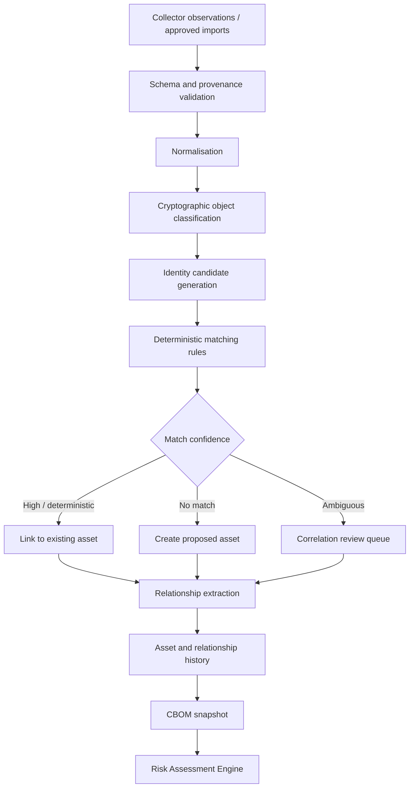

# QUANTUM FLOW TECHNOLOGIES
# PQC Discovery & Risk Assessment Platform
## CBOM & Cryptographic Asset Correlation Engine Design

**Document ID:** QFT-CBOM-CORR-001  
**Version:** 1.0 — Initial Technical Draft  
**Status:** Draft — For Architecture, CISO and Engineering Review  
**Date:** 02 November 2026  
**Classification:** Confidential  
**Owner:** Product / Engineering / Security Architecture  
**Approval authority:** Quantum Flow CISO and designated technical owner

**Related documents:** PRD v1.0 Draft; TRD v1.0 Draft; SAD v1.0 Draft; Database Design Document v1.0 Draft; API Specification v1.0 Draft; Threat Model & Security Architecture v1.0 Draft; Network/TLS & Certificate Intelligence Collector Design v1.0 Draft; Quantum Risk Assessment Methodology & Core Engine Design v1.0 Draft; *PQC Discovery & Migration Platform — Vision & Roadmap*, Version 1.0, October 2026.

---

## Document status and interpretation

This document defines a proposed design for converting collector observations into a traceable cryptographic asset inventory and Cryptographic Bill of Materials (CBOM). It is an engineering design draft, not evidence that the correlation engine or CBOM has been implemented, tested, approved or deployed.

The design follows the company's product workflow:

**Discover → Inventory → Prioritise → Plan → Migrate → Assure**

The CBOM is the inventory layer between discovery and risk prioritisation. It must preserve original observations, establish stable logical asset identities, model relationships and dependencies, expose coverage limitations, and provide versioned snapshots for assessment and reporting.

The key distinction is:

- **Observation:** a time-bound item of evidence produced by a collector or approved import.
- **Cryptographic asset:** a logical entity or usage instance represented in the inventory and supported by one or more observations.
- **Relationship:** a typed, evidence-backed association between assets or between an asset and a business/system entity.
- **CBOM snapshot:** a reproducible, point-in-time view of selected assets, relationships, provenance and coverage.

An observation must not be deleted or overwritten merely because it is correlated with an existing asset. Correlation is a conclusion that must be explainable and reversible.

# 1. Executive Summary

The CBOM & Cryptographic Asset Correlation Engine receives normalised observations from network/TLS, certificate, source-code, dependency, configuration and import collectors. It validates provenance, classifies the observed cryptographic object, proposes or confirms an asset identity, detects duplicates and related entities, links observations to assets, and builds a traceable inventory.

The engine must solve five core problems:

1. **Identity:** determine whether two observations refer to the same logical asset.
2. **Correlation:** connect related objects without confusing association with proof of usage.
3. **History:** preserve changes over time without overwriting evidence.
4. **Coverage:** show what was discovered, what was not inspected and what remains unknown.
5. **Traceability:** allow an analyst to navigate from a CBOM asset to its observations, evidence, scan, collector, source and linked risk assessments.

A public TLS scan may discover a public endpoint, a negotiated TLS session and a presented certificate. It does not reveal the full application cryptographic inventory, private network services, source-code usage, databases, key-management systems or internal dependencies. The CBOM must communicate this limitation prominently.

## 1.1 Core processing flow



## 1.2 Design principles

- Preserve source observations and raw provenance.
- Use asset-type-specific identity rules.
- Prefer deterministic matching over fuzzy guesses.
- Separate identity matching from relationship inference.
- Never merge assets across tenants.
- Never infer runtime use from a source-code string alone.
- Keep confidence and classification attached to each link.
- Preserve conflicting evidence rather than silently selecting one value.
- Make merge, split and manual correction auditable.
- Keep current state and historical snapshots distinguishable.
- Do not represent unknown coverage as a clean bill of health.

# 2. Goals, Scope and Non-Goals

## 2.1 Goals

The engine shall:

1. Ingest validated observations from multiple collectors.
2. Map collector-specific fields to canonical observation and asset schemas.
3. Preserve original values and source-specific evidence references.
4. Generate candidate asset identities using type-specific rules.
5. Correlate observations to existing assets where evidence is sufficient.
6. Create new assets when no suitable match exists.
7. Hold ambiguous matches for review rather than forcing a merge.
8. Model typed relationships among endpoints, certificates, services, applications, repositories, dependencies and cryptographic mechanisms.
9. Track first-seen, last-seen, status and history.
10. Detect changes and possible drift between observations.
11. Produce CBOM snapshots with coverage and provenance.
12. Support search, filtering, export and risk-engine integration.
13. Support correction, merge, split and re-correlation with audit history.
14. Enforce tenant isolation and evidence access controls.

## 2.2 Version 1 supported source classes

- Network/TLS endpoint collector.
- X.509 certificate collector/parser.
- Source-code cryptographic pattern collector, when available.
- Software dependency/SBOM collector, when available.
- Configuration collector/import, when available.
- Approved customer inventory/CMDB imports.

The platform must identify the source class and collector version for each observation. A collector being planned does not mean it is implemented.

## 2.3 Non-goals

Version 1 does not:
- discover every cryptographic asset automatically;
- execute customer code to prove runtime behaviour;
- scan unauthorised networks or repositories;
- collect private keys, passwords, tokens or unrelated secrets;
- use a graph database by default;
- merge ambiguous records automatically;
- infer business ownership or criticality without a source;
- make production cryptographic changes;
- claim that every asset in a CBOM is complete, current or runtime-active;
- treat CBOM export as a certification or compliance attestation.

# 3. Domain Concepts and Terminology

| Concept | Definition | Example |
|---|---|---|
| Observation | One collector/import result at a point in time | TLS handshake negotiated TLS 1.3 |
| Evidence | Structured or artefact-level support for an observation | Certificate DER fingerprint and parsed fields |
| Asset | Stable logical inventory entity | `api.example.com:443` endpoint |
| Cryptographic asset | Asset representing a cryptographic object or usage | X.509 certificate, ECDHE configuration, library crypto usage |
| System entity | Application, service, repository, host, cloud resource or business system | Payment API |
| Relationship | Typed link between assets/entities | Endpoint presents certificate |
| Identity key | Type-specific deterministic identifier used to generate match candidates | Certificate SHA-256 fingerprint |
| Correlation | Decision linking observation to an asset | Certificate observation links to certificate asset |
| Candidate match | Potential identity link not yet accepted | Two similar endpoint records |
| Conflict | Evidence values disagree in a meaningful way | Same endpoint presents different certificates |
| CBOM | Structured inventory of cryptographic assets and relationships | Asset and dependency manifest |
| Snapshot | Immutable point-in-time CBOM representation | CBOM at assessment time |
| Coverage | What scope and source types were actually examined | 1 of 3 approved endpoints completed |

## 3.1 Observation versus asset

An observation is evidence. An asset is a logical record.

Examples:
- A TLS handshake observation records the negotiated protocol, cipher suite and observable key-exchange group.
- A certificate observation records the presented X.509 certificate and parsed properties.
- The certificate may be represented as a certificate asset.
- The TLS endpoint is a separate endpoint asset.
- The endpoint-presented-certificate relationship links the endpoint to the certificate.
- A source-code match for an RSA API is an observation; it may support a source-usage asset, but does not prove runtime use.

One asset may have many observations over time and from different sources. Preserve each observation.

## 3.2 Asset identity versus asset attributes

Identity fields determine whether two records may represent the same entity. Attributes describe the entity and may change.

For example:
- Endpoint identity may use canonical hostname, port and service/protocol context.
- TLS version and cipher suite are observations/attributes, not endpoint identity.
- Certificate identity may use the SHA-256 fingerprint of the exact DER certificate.
- Certificate subject name alone is not a safe identity key.
- Dependency identity must include ecosystem and package coordinates; version is an attribute or version-specific identity depending on the asset model.

Do not include volatile attributes in stable identity keys unless the asset type explicitly requires them.

# 4. Canonical Data Model

## 4.1 Core entities

### A. Observation

Required fields:
- `observation_id`
- `tenant_id`
- `project_id`
- `scan_id` / `execution_id`, when applicable
- `target_id`, when applicable
- `source_type`
- `collector_id`
- `collector_version`
- `collection_method`
- `observed_at`
- `ingested_at`
- `status`
- `evidence_type`
- `classification` (`OBSERVED`, `INFERRED`, `IMPORTED`, `UNKNOWN`)
- `confidence`
- `confidence_rationale`
- `normalised_payload`
- `raw_evidence_ref`
- `evidence_hash`
- `normaliser_version`
- `error_code`
- `limitations`

### B. Asset

Required fields:
- `asset_id`
- `tenant_id`
- `project_id`
- `asset_type`
- `canonical_identifier`
- `display_name`
- `description`
- `environment`
- `owner_reference`, if known
- `business_criticality`, if supplied
- `lifecycle_status`
- `first_seen_at`
- `last_seen_at`
- `last_verified_at`
- `identity_method`
- `identity_confidence`
- `created_at`
- `updated_at`

Cryptographic attributes should be stored in typed fields or a validated, versioned attribute structure. Do not create an unbounded JSON dumping ground.

### C. Asset-observation link

A many-to-many link between observations and assets:
- `asset_observation_id`
- `tenant_id`
- `asset_id`
- `observation_id`
- `link_type`
- `match_method`
- `match_rule_id`
- `match_rule_version`
- `match_confidence`
- `link_status`
- `decision_source` (`AUTOMATED`, `REVIEWED`, `IMPORTED`)
- `reviewed_by`
- `reviewed_at`
- `created_at`

### D. Asset relationship

A typed, directed or undirected link:
- `relationship_id`
- `tenant_id`
- `project_id`
- `source_asset_id`
- `relationship_type`
- `target_asset_id` or `target_entity_ref`
- `directionality`
- `classification`
- `confidence`
- `evidence_refs`
- `valid_from`
- `valid_to`
- `status`
- `created_by`
- `created_at`

### E. CBOM snapshot

- `cbom_snapshot_id`
- `tenant_id`
- `project_id`
- `snapshot_version`
- `created_at`
- `created_by`
- `scope_definition`
- `asset_count`
- `relationship_count`
- `observation_count`
- `coverage_summary`
- `manifest_hash`
- `methodology/reference versions`
- `export_ref`, if materialised
- `status`

## 4.2 Classification and confidence

Every observation, asset link and inferred relationship must preserve classification and confidence.

Classification:
- `OBSERVED`: directly identified by a collector.
- `INFERRED`: derived from indirect evidence using a documented rule.
- `IMPORTED`: supplied by an approved customer inventory or integration.
- `UNKNOWN`: insufficient information.

Confidence:
- `HIGH`
- `MEDIUM`
- `LOW`
- `UNKNOWN`

Confidence is not risk severity. A low-confidence link must not silently become a confirmed asset relationship.

## 4.3 Unknown and null values

- Missing algorithm is not `NONE`.
- Missing owner is not “unowned”.
- Missing business criticality is not low.
- Missing last-seen evidence is not proof an asset is retired.
- A failed collector is not evidence that no asset exists.
- A source-code match is not proof of production runtime use.

Use explicit status fields where `NULL` alone cannot distinguish unknown, not applicable, conflicting, stale and not collected.

# 5. Asset Taxonomy

The initial taxonomy should be controlled and extensible.

| Asset type | Description | Example |
|---|---|---|
| `TLS_ENDPOINT` | Network endpoint exposing TLS | `api.example.com:443` |
| `TLS_CONFIGURATION` | Observed endpoint TLS behaviour/configuration | TLS 1.3 and negotiated group |
| `CERTIFICATE` | X.509 certificate | Leaf or intermediate certificate |
| `CERTIFICATE_AUTHORITY` | CA or issuer entity | Intermediate/root CA reference |
| `PUBLIC_KEY` | Public key material/identity | RSA public key SPKI fingerprint |
| `CRYPTO_ALGORITHM_INSTANCE` | Algorithm in a specific use/context | RSA signature use |
| `KEY_EXCHANGE_CONFIGURATION` | Key exchange mechanism/configuration | X25519 |
| `CIPHER_SUITE_CONFIGURATION` | Negotiated/configured cipher suite | TLS_AES_128_GCM_SHA256 |
| `APPLICATION` | Application or product | Payment service |
| `SERVICE` | Deployed service | Authentication API |
| `HOST` | Host or compute resource | Approved server inventory record |
| `REPOSITORY` | Source repository | Git repository |
| `SOURCE_CRYPTO_USAGE` | Source-code crypto use finding | ECDSA API reference |
| `DEPENDENCY` | Software package/library | OpenSSL package |
| `CRYPTO_LIBRARY` | Cryptographic implementation/library | OpenSSL |
| `PROTOCOL_CONFIGURATION` | Protocol-level configuration | TLS policy |
| `KMS_HSM_REFERENCE` | Key-management/HSM reference, never secret key material | Approved KMS inventory object |
| `IMPORTED_CRYPTO_ASSET` | Customer-supplied inventory object | CMDB crypto record |
| `UNKNOWN_CRYPTO_ASSET` | Unclassified candidate | Unknown crypto object |

The asset taxonomy must be versioned. New asset types require schema, identity, relationship, UI, export and risk-engine impact review.

# 6. Identity and Canonicalisation Strategy

## 6.1 General identity rules

1. Identity must be tenant-scoped.
2. Identity must be asset-type-specific.
3. Preserve original observed values.
4. Normalise only fields with defined semantics.
5. Use stable cryptographic fingerprints where appropriate.
6. Avoid display names and subject names as sole identifiers.
7. Never merge records solely because they share an IP address.
8. Never merge records across tenants.
9. Avoid fuzzy matching as an automatic merge decision.
10. Store the identity rule and version used for every correlation decision.

## 6.2 Endpoint identity

Proposed canonical key components:
- canonicalised hostname (IDNA-aware);
- port;
- transport protocol;
- service identity/context, where available;
- tenant/project scope.

Example:
`tls-endpoint|api.example.com|443|tcp`

Rules:
- Lowercase DNS hostname after standards-compliant IDNA processing.
- Remove a single trailing dot for DNS canonical form.
- Do not treat CNAME aliases as identical assets automatically.
- Preserve original requested hostname and resolved addresses as observation context.
- Do not use resolved IP as the sole endpoint identity; cloud/CDN addresses can be shared and change.
- Different ports are different endpoint assets unless an explicit service model says otherwise.
- SNI hostname and connection peer must both be preserved.

## 6.3 Certificate identity

Primary identity:
- SHA-256 fingerprint over exact DER-encoded certificate.

Secondary descriptive fields:
- issuer;
- serial number;
- subject;
- SANs;
- validity;
- SPKI fingerprint;
- signature algorithm.

Rules:
- Subject name alone is never unique.
- Serial number alone is not globally unique.
- Same public key in two different certificates does not make the certificates identical.
- Reissued certificate with same key but different DER is a different certificate asset; it may be related through a same-SPKI relationship.
- Do not infer trust from a matching fingerprint.

## 6.4 Public-key identity

Where a public key is explicitly observed:
- compute SHA-256 over DER-encoded SubjectPublicKeyInfo;
- preserve the encoding basis and hash algorithm;
- store key algorithm and parameters separately;
- do not store private-key material;
- distinguish a public key asset from a certificate that contains that key.

A public key reused across certificates may be one public-key asset linked to multiple certificate assets, subject to evidence and policy.

## 6.5 Algorithm-instance identity

An algorithm name alone is not a unique asset. Identity should include:
- canonical algorithm;
- role;
- parameter set;
- owning cryptographic object or system;
- source location/configuration context;
- version/revision where relevant.

Example:
`crypto-use|service-123|ECDSA|digital-signature|P-256|production`

Do not merge two unrelated uses of AES simply because both are AES.

## 6.6 Dependency identity

Use ecosystem-specific package coordinates:
- ecosystem;
- package name;
- namespace/group;
- version;
- package URL (purl), where available;
- repository/lockfile context.

A dependency package is distinct from an algorithm usage found inside that package. Link them with a relationship rather than conflating them.

## 6.7 Source finding identity

Candidate identity may include:
- repository ID;
- commit/revision;
- path;
- symbol or rule;
- line/column range;
- normalised finding fingerprint.

A source finding may move between commits. Preserve historical findings and use lineage/correlation links rather than rewriting the original record.

# 7. Correlation Engine

## 7.1 Processing stages

1. Validate incoming observation schema.
2. Verify tenant/project/scan/execution ownership.
3. Validate evidence reference, checksum and provenance metadata.
4. Normalise hostnames, algorithm names, OIDs, package coordinates and fingerprints.
5. Classify candidate asset type.
6. Generate one or more identity candidates.
7. Apply deterministic matching rules for that asset type.
8. Calculate match confidence and record the rule path.
9. Link to an existing asset, create a new asset or queue for review.
10. Extract relationships supported by the observation.
11. Update first-seen/last-seen and current-state projections.
12. Emit an asset/CBOM change event.
13. Preserve the original observation and decision history.

## 7.2 Matching outcomes

| Outcome | Meaning | Action |
|---|---|---|
| Exact match | Strong deterministic identity match | Link observation to existing asset |
| New asset | No candidate matches | Create asset |
| Probable match | Evidence suggests same asset but identity is not conclusive | Queue for review or policy-controlled provisional link |
| Conflict | Candidate records disagree on identity-critical facts | Do not merge; create conflict case |
| Unsupported | Asset type has no approved identity rule | Preserve observation; mark uncorrelated |
| Invalid | Observation fails schema/provenance checks | Reject or quarantine with safe error |

## 7.3 Confidence for correlation

Suggested initial policy:
- **High:** exact stable fingerprint or exact canonical identity under an approved deterministic rule.
- **Medium:** multiple corroborating identifiers but one or more are not globally unique.
- **Low:** fuzzy or indirect evidence only.
- **Unknown:** insufficient data.

Automatic merging should be restricted to high-confidence deterministic matches. Medium/low confidence should create a candidate link or review task according to policy.

## 7.4 Do not over-correlate

Examples of invalid assumptions:
- Same IP means same endpoint.
- Same certificate subject means same certificate.
- Same RSA algorithm means same public key.
- Same dependency name means same package/version.
- Same repository file path means same source-code finding across all revisions.
- Same application name means same deployed service.
- Same TLS cipher suite means same key exchange.
- Certificate public-key algorithm equals negotiated TLS key exchange.

## 7.5 Idempotency

Repeated ingestion of the same observation must not create duplicate observations or duplicate asset links.

Use:
- collector event ID where available;
- idempotency key;
- canonical payload hash;
- tenant/project/source context;
- unique database constraints.

The idempotency key must not be used as an asset identity key. One is an ingestion deduplication mechanism; the other represents a logical entity.

# 8. Relationship Model

## 8.1 Relationship principles

- Relationships are typed and directional where semantics require.
- Every inferred relationship carries confidence and evidence.
- Relationship validity may change over time.
- Preserve relationship history.
- Do not infer a relationship solely from naming similarity.
- Avoid cycles where the relationship type is intended to be a hierarchy.
- Allow relationships to point to non-cryptographic system entities through controlled entity references.

## 8.2 Initial relationship catalogue

| Relationship | Direction | Meaning |
|---|---|---|
| `ENDPOINT_PRESENTS_CERTIFICATE` | Endpoint → Certificate | Certificate observed during endpoint TLS handshake |
| `CERTIFICATE_ISSUED_BY` | Certificate → CA/Issuer | Issuer relationship from certificate chain |
| `CERTIFICATE_CONTAINS_PUBLIC_KEY` | Certificate → Public key | Public key embedded in certificate |
| `CERTIFICATE_SIGNED_WITH` | Certificate → Algorithm instance | Certificate signature algorithm |
| `ENDPOINT_NEGOTIATES_KEY_EXCHANGE` | Endpoint → Key-exchange config | Negotiated mechanism/group |
| `ENDPOINT_NEGOTIATES_CIPHER_SUITE` | Endpoint → Cipher-suite config | Negotiated suite |
| `SERVICE_EXPOSES_ENDPOINT` | Service → Endpoint | Service-to-network endpoint association |
| `APPLICATION_USES_LIBRARY` | Application → Dependency/library | Dependency relationship from approved source |
| `SOURCE_FILE_REFERENCES_ALGORITHM` | Source finding → Algorithm instance | Static source evidence; not runtime proof |
| `DEPENDENCY_CONTAINS_CRYPTO_IMPLEMENTATION` | Dependency → Crypto usage | Supported by package/source evidence |
| `HOST_RUNS_SERVICE` | Host → Service | Imported or observed infrastructure relation |
| `ASSET_DEPENDS_ON_VENDOR` | Asset → Vendor/product | Vendor lifecycle/support context |
| `ASSET_REPLACED_BY` | Old asset → New asset | Reviewed lifecycle transition |
| `ASSET_SAME_PUBLIC_KEY_AS` | Certificate → Certificate | Same SPKI fingerprint, not same certificate |
| `ASSET_CORRELATED_WITH` | Asset → Asset | Explicitly reviewed correlation |

## 8.3 TLS example

A single authorised TLS session may produce:
- endpoint asset;
- TLS session/observation;
- certificate asset;
- public-key asset;
- key-exchange configuration asset;
- cipher-suite configuration asset.

Relationships:
- endpoint presents certificate;
- certificate contains public key;
- endpoint negotiates key exchange;
- endpoint negotiates cipher suite;
- certificate signed with a signature algorithm.

The engine must not collapse these into a single “TLS uses RSA” statement.

# 9. Change Detection and Asset Lifecycle

## 9.1 Lifecycle states

Suggested asset lifecycle:
- `ACTIVE`
- `STALE`
- `RETIRED`
- `REPLACED`
- `DISPUTED`
- `UNKNOWN`

These states must be evidence-backed. A scan failure must not mark an asset retired.

## 9.2 First-seen and last-seen

- `first_seen_at`: earliest accepted observation linked to the asset.
- `last_seen_at`: latest accepted observation.
- `last_verified_at`: latest successful verification for the relevant asset property.
- `last_attempted_at`: latest collection attempt, including failures.

Do not update `last_seen_at` on failed or skipped scans.

## 9.3 Change detection

Detect changes by comparing normalised observations:
- certificate fingerprint changed;
- certificate validity changed;
- public-key algorithm/parameters changed;
- TLS version changed;
- cipher suite changed;
- key-exchange group changed;
- dependency version changed;
- source finding appeared/disappeared;
- configuration changed;
- relationship added/removed.

A change event must contain:
- asset ID;
- property changed;
- previous value/reference;
- new value/reference;
- source observations;
- detected timestamp;
- change rule/version;
- confidence;
- severity/impact classification if applicable.

## 9.4 Disappearance and retirement

Absence from one scan is not proof of retirement. Suggested policy:
- mark `NOT_SEEN_IN_LATEST_SCAN` as a scan-specific status;
- use configurable repeated-successful-scan criteria before marking stale;
- require owner confirmation or authoritative lifecycle evidence before `RETIRED`;
- preserve historical asset and observations;
- do not delete historical records as a side effect of disappearance.

# 10. CBOM Snapshot and Manifest Design

## 10.1 Purpose

A CBOM snapshot is a point-in-time inventory view for reporting, risk assessment, audit and comparison. It must be reproducible.

## 10.2 Snapshot contents

- snapshot ID and version;
- tenant/project and scope;
- creation timestamp and actor;
- included assets and stable identifiers;
- included relationships;
- observation/evidence references;
- source classification and confidence;
- asset lifecycle state;
- collector/source coverage;
- unresolved correlation candidates;
- conflicts and unknowns;
- normaliser/correlation engine versions;
- schema version;
- manifest hash;
- risk assessment reference, if linked.

## 10.3 Snapshot modes

- `PROJECT_CURRENT`: current inventory projection at a defined cutoff.
- `SCAN_DELTA`: assets/relationships affected by one scan.
- `ASSESSMENT_INPUT`: exact inventory subset used by a risk assessment.
- `FULL_EXPORT`: complete permitted project inventory for export.

## 10.4 Snapshot immutability

Once finalised:
- snapshot content must not be modified;
- corrections create a new snapshot;
- preserve previous manifest hash and source references;
- access and export are audited;
- large exports may be stored in private object storage;
- manifest hash must be calculated over a canonical serialisation.

## 10.5 CBOM export

Initial formats:
- JSON as canonical machine-readable export;
- CSV for tabular asset lists where relationships can be represented in companion files;
- PDF/HTML report for human review.

If adopting a formal CBOM schema or external exchange format, the platform must map fields explicitly and validate against the selected schema/version. Do not claim conformance to a standard or format without implementing and testing that conformance.

# 11. Coverage and Completeness

## 11.1 Coverage dimensions

Coverage should be reported across:
- approved targets;
- successful/partial/failed/skipped collector executions;
- asset types;
- environments;
- source types;
- repositories or projects;
- time/freshness;
- unresolved correlations;
- known excluded systems.

## 11.2 Coverage statuses

Use explicit states:
- `SCANNED`
- `PARTIALLY_SCANNED`
- `FAILED`
- `SKIPPED`
- `UNSUPPORTED`
- `NOT_IN_SCOPE`
- `NOT_PROVIDED`
- `UNKNOWN`

A scan can complete successfully while overall enterprise coverage remains partial.

## 11.3 Coverage report example

| Scope item | Status | CBOM implication |
|---|---|---|
| Public endpoint A:443 | Scanned | TLS endpoint and certificate observations available |
| Internal service B | Not in scope | No conclusion about its cryptography |
| Repository C | Not provided | Source-code crypto usage unknown |
| Dependency manifest D | Imported | Package inventory available; runtime use not proven |
| Endpoint E:443 | Failed | No conclusion; retry/review required |

## 11.4 Coverage must not become a security score

Coverage percentage is not a risk score. A 100% scan of a narrow public endpoint scope does not mean 100% enterprise cryptographic coverage.

# 12. Data Quality and Conflict Resolution

## 12.1 Validation layers

1. Schema validation.
2. Tenant/project ownership validation.
3. Evidence reference and checksum validation.
4. Collector identity/version validation.
5. Field-level type/range validation.
6. Canonicalisation validation.
7. Asset identity rule validation.
8. Relationship type and endpoint validation.
9. Conflict detection.
10. Snapshot consistency validation.

## 12.2 Conflicting observations

Example: the same endpoint is observed with two different certificates.

Possible explanations:
- certificate rotation;
- load-balanced backend differences;
- SNI variation;
- different resolved IPs;
- scan at different times;
- TLS interception or network path differences;
- incorrect endpoint correlation.

The engine should preserve both observations and record context:
- requested hostname/SNI;
- connected peer IP;
- port;
- time;
- TLS profile;
- collector version;
- certificate fingerprint.

Do not overwrite the older certificate or label it invalid solely because a newer one exists.

## 12.3 Manual review queue

Review tasks should include:
- candidate assets;
- conflicting observations;
- match rule and score;
- evidence references;
- suggested action: link, keep separate, merge, split, reject;
- reviewer identity and rationale;
- approval timestamp.

Manual decisions must be auditable and reversible through compensating events.

# 13. Correlation Algorithm and Pseudocode

## 13.1 High-level algorithm

```python
def process_observation(observation):
    validate_schema(observation)
    validate_tenant_scope(observation)
    validate_evidence_provenance(observation)

    normalised = normalise_observation(
        observation,
        normaliser_version=ACTIVE_NORMALISER_VERSION,
    )

    candidates = generate_identity_candidates(normalised)
    matches = apply_type_specific_identity_rules(
        normalised,
        candidates,
        rule_set=ACTIVE_CORRELATION_RULESET,
    )

    if matches.has_exact_high_confidence_match:
        asset = link_to_existing_asset(
            observation=observation,
            asset=matches.best_asset,
            match_evidence=matches.explanation,
        )
    elif matches.has_ambiguous_candidates:
        asset = create_or_retain_provisional_candidate(normalised)
        create_review_task(matches)
    else:
        asset = create_new_asset(normalised)

    relationships = extract_evidence_supported_relationships(
        observation,
        asset,
    )
    persist_relationships(relationships)
    update_asset_projection(asset, observation)
    publish_inventory_change_event(asset, observation)

    return asset
```

This pseudocode is conceptual. Production code must use transactions, idempotency, concurrency control, explicit tenant context and failure-safe event publishing.

## 13.2 Matching precedence

Recommended order:
1. Exact cryptographic fingerprint for certificate/public-key identity.
2. Exact canonical identifier for endpoint/package/source asset types.
3. Exact source-native stable ID from an approved integration.
4. Composite match with multiple corroborating identifiers.
5. Candidate review for ambiguous/fuzzy cases.
6. Create new asset if no defensible match exists.

## 13.3 Concurrency

Two workers may ingest observations for the same asset simultaneously. Prevent duplicate assets through:
- database unique constraints on tenant + asset type + canonical identifier;
- transaction-safe insert-or-select pattern;
- idempotent ingestion;
- bounded retry on uniqueness conflicts;
- deterministic identity key generation;
- outbox event creation in the same database transaction.

Do not rely on an in-memory cache as the final uniqueness authority.

# 14. Database Design Alignment

The physical schema is defined in the Database Design Document. The CBOM engine requires the following logical tables or equivalent entities:

| Table/entity | Responsibility |
|---|---|
| `observations` | Immutable source observations |
| `evidence_objects` | Evidence metadata, checksum and storage reference |
| `assets` | Canonical logical assets |
| `asset_identifiers` | One or more identity keys per asset |
| `asset_observations` | Observation-to-asset links and match provenance |
| `asset_relationships` | Typed relationship graph in relational form |
| `correlation_candidates` | Ambiguous candidate matches |
| `correlation_decisions` | Automated and human decisions |
| `asset_change_events` | Detected changes over time |
| `asset_state_history` | Lifecycle and attribute history |
| `cbom_snapshots` | Immutable snapshot metadata |
| `cbom_snapshot_assets` | Assets included in snapshot |
| `cbom_snapshot_relationships` | Relationships included in snapshot |
| `cbom_exports` | Export metadata and object references |
| `coverage_records` | Scope and collector coverage |
| `audit_events` | Security/governance history |

## 14.1 Tenant integrity

- Every tenant-owned entity includes `tenant_id`.
- Composite foreign keys should ensure linked rows belong to the same tenant.
- PostgreSQL RLS should reinforce application-level tenant filtering.
- Correlation queries must always be tenant-scoped.
- Object storage keys must not be guessable and must be access-checked.
- Background jobs must carry a verified tenant/project scope.
- Cross-tenant correlation is prohibited, even where identical public certificates or packages appear in different tenants. A global public reference catalogue may exist separately, but it must not expose customer-specific data.

## 14.2 Evidence retention

- Keep observation metadata according to approved retention policy.
- Store larger permitted evidence artefacts in private object storage.
- Store checksum, size, content type, encryption/retention metadata and access reference.
- Never store private keys or customer secrets.
- Apply tenant deletion and legal-hold requirements.
- Ensure snapshot references remain consistent with retention and deletion policy.

# 15. API and Event Contracts

Exact HTTP paths and schemas are governed by the API Specification. The CBOM service should expose operations equivalent to:

- List/search assets.
- Retrieve asset detail and history.
- Retrieve asset observations and evidence references.
- Retrieve relationships/dependency graph.
- Retrieve correlation candidates.
- Submit review decision.
- Request merge or split.
- Retrieve current CBOM.
- Create/finalise CBOM snapshot.
- Compare snapshots.
- Export CBOM.
- Retrieve coverage summary.

## 15.1 Observation ingestion event (conceptual)

```json
{
  "event_type": "observation.accepted",
  "event_version": "1.0",
  "tenant_id": "tenant-reference",
  "project_id": "project-reference",
  "observation_id": "observation-reference",
  "source_type": "network_tls",
  "collector_id": "qf.network_tls",
  "collector_version": "1.0.0",
  "observed_at": "2026-11-02T10:00:00Z",
  "classification": "observed",
  "evidence_ref": "evidence-reference"
}
```

## 15.2 Inventory change event

```json
{
  "event_type": "cbom.asset.updated",
  "event_version": "1.0",
  "tenant_id": "tenant-reference",
  "project_id": "project-reference",
  "asset_id": "asset-reference",
  "change_type": "OBSERVATION_LINKED",
  "correlation_rule_version": "1.0",
  "occurred_at": "2026-11-02T10:01:00Z"
}
```

Events must not contain private keys, credentials or large raw evidence payloads. Consumers should fetch authorised details through the API.

## 15.3 Transactional outbox

Persist the asset/relationship change and outbox event in the same database transaction. A publisher can deliver events at least once; consumers must be idempotent. Do not assume exactly-once message delivery.

# 16. Security and Privacy Requirements

The correlation engine is exposed to untrusted collector payloads, customer-controlled repositories and imported inventories. Apply the Threat Model & Security Architecture.

Required controls:
- strict schema validation and payload size limits;
- tenant and project ownership checks;
- no arbitrary code execution from observations;
- no dynamic `eval` of matching rules;
- safe parsing of untrusted strings and package metadata;
- parameterised database queries;
- bounded relationship depth and graph traversal;
- rate limits on search, correlation and export;
- access checks for evidence retrieval;
- no secrets/private keys in CBOM records;
- safe HTML/PDF rendering and output escaping;
- audit for merge, split, override, export and deletion;
- protect against cross-tenant identifier substitution;
- encrypt sensitive data at rest and in transit;
- use least-privilege worker and service identities.

## 16.1 Merge and split safety

Merge is a high-impact data operation. It must:
- require authorised role;
- validate tenant/project ownership;
- record source asset IDs and destination asset ID;
- preserve all observations and relationship history;
- detect conflicting attributes;
- create a reversible audit event;
- avoid destructive deletion of source records;
- update projections and snapshots through a controlled process.

Split must similarly preserve original evidence and record the reason and resulting asset identities.

# 17. Performance and Scalability

Initial architecture should remain a modular service using PostgreSQL relational tables and indexes. A graph database is not required for the first release unless measured requirements justify it.

Optimisation requirements:
- indexes on tenant/project, asset type, canonical identifier, first/last seen and lifecycle state;
- unique indexes for deterministic identity keys;
- indexes for observation-to-asset and relationship traversal;
- pagination for asset and observation APIs;
- bounded graph depth and node count;
- asynchronous large exports and snapshot generation;
- batch ingestion with per-record validation;
- partitioning only when measured volume justifies it;
- cache read-heavy registry metadata, not authoritative asset state;
- monitor correlation queue size, ambiguous-match rate and ingestion latency.

Performance targets must be set after expected tenant sizes, observation rates and retention volumes are agreed. Do not invent throughput guarantees before workload measurement.

# 18. Observability and Operations

Metrics:
- observations received/accepted/rejected;
- ingestion latency;
- correlation latency;
- exact-match rate;
- ambiguous-match rate;
- duplicate-asset prevention count;
- conflict count;
- new assets created;
- relationships created/rejected;
- snapshot duration and size;
- export duration;
- failed evidence lookups;
- tenant-isolation denials.

Logs:
- structured and correlation-ID based;
- no raw secrets or full sensitive evidence;
- tenant-safe access;
- bounded error details;
- include rule/collector versions for troubleshooting.

Operational alerts:
- sudden rise in ambiguous correlations;
- repeated uniqueness conflicts;
- observation ingestion failures;
- snapshot hash mismatch;
- evidence reference missing;
- cross-tenant access denial spikes;
- outbox backlog;
- export failures.

# 19. Testing Strategy

## 19.1 Unit tests

- hostname canonicalisation and IDNA cases;
- endpoint identity key generation;
- certificate DER fingerprint identity;
- SPKI identity;
- certificate subject collision;
- package URL and ecosystem identity;
- source finding identity across revisions;
- algorithm alias normalisation;
- relationship extraction;
- match confidence;
- conflict classification;
- lifecycle transitions;
- snapshot canonical serialisation and hashing.

## 19.2 Integration tests

1. First TLS scan creates endpoint and certificate assets.
2. Repeated scan links new observations to the same endpoint/certificate where identity matches.
3. Certificate rotation creates a new certificate asset and a new endpoint relationship without deleting the old certificate.
4. Same subject with different DER fingerprints creates separate certificate assets.
5. Same SPKI in different certificates creates a reviewed/defined shared-key relationship.
6. Different ports create separate endpoint assets.
7. Same IP with different hostnames does not automatically merge endpoints.
8. Different SNI contexts are preserved.
9. TLS cipher suite and key-exchange group remain separate assets/observations.
10. Source-code match is classified as inferred and does not prove runtime use.
11. Duplicate ingestion is idempotent.
12. Concurrent workers do not create duplicate canonical assets.
13. Ambiguous match enters review queue.
14. Failed scan does not update `last_seen_at`.
15. Cross-tenant correlation and evidence access are denied.
16. CBOM snapshot is immutable and reproducible.
17. Merge/split preserves history and audit trail.
18. Deleted or expired evidence references produce explicit limitations, not fabricated evidence.

## 19.3 Security tests

- cross-tenant identifier substitution;
- malformed JSON and oversized payloads;
- malicious Unicode/hostname strings;
- SQL injection attempts;
- unsafe HTML in imported asset names;
- relationship traversal exhaustion;
- export authorisation bypass;
- object-storage reference guessing;
- concurrent merge race;
- malicious source repository metadata;
- audit event tampering attempt;
- snapshot hash verification.

## 19.4 Property-based tests

Useful invariants:
- Same deterministic identity input yields the same canonical key.
- Different tenant IDs never produce a cross-tenant match.
- A failed observation never advances last-seen.
- Reprocessing an idempotent observation does not increase asset or link count.
- Merging never destroys original observation records.
- A snapshot's hash is stable for the same canonical content.
- Unknown values remain unknown through normalisation and export.

# 20. Example End-to-End Scenarios

## Scenario A — First TLS observation

1. An authorised scan observes `api.example.test:443`.
2. Collector emits TLS handshake and certificate observations.
3. Normaliser canonicalises hostname and extracts certificate fingerprint.
4. Correlation engine finds no endpoint or certificate match.
5. Creates endpoint asset and certificate asset.
6. Creates endpoint-presents-certificate relationship.
7. Creates separate TLS configuration observations for negotiated key exchange and cipher suite.
8. Creates CBOM snapshot or updates current inventory.
9. Risk engine receives linked cryptographic assets and evidence.

Expected result: one endpoint asset, one or more certificate assets, separate TLS configuration records, traceable observations and explicit scope.

## Scenario B — Repeat scan, unchanged certificate

1. New scan observes same endpoint and exact certificate DER.
2. Endpoint identity matches.
3. Certificate fingerprint matches.
4. New observations link to existing assets.
5. `last_seen_at` updates only after successful evidence.
6. No duplicate assets are created.
7. Historical observations remain available.

## Scenario C — Certificate rotation

1. Endpoint is observed with a different certificate fingerprint.
2. Endpoint identity matches existing endpoint.
3. New certificate fingerprint does not match old certificate.
4. Create new certificate asset.
5. Add new endpoint-presents-certificate relationship with validity interval.
6. Preserve old certificate and historical relationship.
7. Emit certificate-rotation change event.
8. Risk engine reassesses the current certificate and related PKI context.

## Scenario D — Source-code RSA match

1. Source collector identifies a call to an RSA API in a repository revision.
2. Observation is classified as `INFERRED`.
3. Source finding identity uses repository, revision, path, symbol and rule.
4. Create/link a source-crypto-usage asset.
5. Link source finding to dependency/library if supported by evidence.
6. Do not assert runtime use.
7. Recommendation requests runtime/configuration validation.

## Scenario E — Ambiguous endpoint identity

1. Two observations share an IP address but have different hostnames and SNI.
2. IP-only matching is prohibited.
3. Separate endpoint candidates are maintained.
4. If service identity is unclear, create review task.
5. Preserve both original observations.

# 21. Implementation Plan

### Phase 0 — Domain contract freeze
- Review asset taxonomy.
- Approve observation/asset/relationship distinction.
- Approve identity keys for endpoint and certificate.
- Confirm classification and confidence enums.
- Align logical model with existing database document.

**Exit gate:** domain model and identity rules reviewed by architecture and CISO.

### Phase 1 — Canonical schemas and normalisation
- Implement Pydantic schemas for observations, assets and relationships.
- Implement hostname, OID, algorithm, fingerprint and package canonicalisers.
- Implement schema versioning and validation.
- Add unit fixtures.

**Exit gate:** deterministic normalisation tests pass.

### Phase 2 — Endpoint and certificate correlation
- Implement endpoint identity.
- Implement certificate DER and SPKI identity.
- Implement observation-to-asset links.
- Implement endpoint/certificate/TLS configuration relationships.
- Add idempotency and database uniqueness constraints.

**Exit gate:** repeated scan and certificate rotation integration tests pass.

### Phase 3 — History and conflict handling
- Implement first/last seen and lifecycle projection.
- Implement change events.
- Implement correlation candidate queue.
- Implement reviewer decisions and audit.
- Implement merge/split as controlled operations.

**Exit gate:** conflicts and corrections preserve history.

### Phase 4 — CBOM snapshots and exports
- Implement current CBOM query.
- Implement immutable snapshots.
- Implement canonical manifest and hash.
- Implement JSON export and coverage summary.
- Add report/API integration.

**Exit gate:** snapshot is reproducible and export is tenant-safe.

### Phase 5 — Broader collectors and calibration
- Integrate source/dependency/config/import observations as those collectors are approved and implemented.
- Add asset-specific identity rules.
- Validate relationships and coverage.
- Measure scale and optimise based on workload.

**Exit gate:** additional collector types do not require redesign of core asset model.

# 22. Definition of Done

- [ ] Observation and asset are separate entities.
- [ ] Canonical schemas and versioning implemented.
- [ ] Asset taxonomy approved.
- [ ] Endpoint identity rules implemented and tested.
- [ ] Certificate DER fingerprint identity implemented.
- [ ] SPKI identity is separate from certificate identity.
- [ ] TLS cipher suite and key exchange are distinct.
- [ ] Correlation decisions record method, rule and confidence.
- [ ] Ambiguous matches are not automatically merged.
- [ ] Relationships are typed and evidence-backed.
- [ ] First-seen/last-seen semantics are tested.
- [ ] Failed scans do not mark assets as retired or recently seen.
- [ ] Change history is preserved.
- [ ] Merge/split operations are authorised, reversible and audited.
- [ ] CBOM snapshots are immutable and reproducible.
- [ ] Coverage and limitations are included in exports.
- [ ] Cross-tenant correlation/access tests pass.
- [ ] Idempotency and concurrency tests pass.
- [ ] Risk engine consumes canonical assets and linked evidence.
- [ ] No private keys or secrets are collected or exported.

# 23. Open Decisions Requiring Approval

| ID | Decision | Proposed owner |
|---|---|---|
| CBOM-OD-01 | Approve asset taxonomy and extensibility process | Product / Architecture |
| CBOM-OD-02 | Approve canonical endpoint identity and alias treatment | Backend / Security |
| CBOM-OD-03 | Approve certificate and public-key identity rules | Cryptography Reviewer |
| CBOM-OD-04 | Decide whether medium-confidence links may be provisional | CISO / Product |
| CBOM-OD-05 | Approve relationship catalogue and directionality | Architecture |
| CBOM-OD-06 | Define conflict review and merge/split permissions | CISO / Engineering |
| CBOM-OD-07 | Define stale/retired lifecycle thresholds | Product / Asset Owner |
| CBOM-OD-08 | Select external CBOM exchange schema, if required | Product / Architecture |
| CBOM-OD-09 | Define snapshot retention and deletion semantics | Security / Legal |
| CBOM-OD-10 | Define coverage denominators for each collector | Product / QA |
| CBOM-OD-11 | Confirm expected asset and relationship volumes | Engineering / Operations |
| CBOM-OD-12 | Decide whether/when a graph database is justified | Architecture |
| CBOM-OD-13 | Approve manual review workflow and SLA | Product / CISO |
| CBOM-OD-14 | Define source/dependency identity rules per ecosystem | Engineering |

# 24. References

## Internal documents
- Quantum Flow Technologies, *PQC Discovery & Migration Platform — Vision & Roadmap*, Version 1.0, October 2026.
- Product Requirements Document v1.0 Draft.
- Technical Requirements Document v1.0 Draft.
- System Architecture Document v1.0 Draft.
- Database Design Document v1.0 Draft.
- API Specification v1.0 Draft.
- Threat Model & Security Architecture v1.0 Draft.
- Network/TLS & Certificate Intelligence Collector Design v1.0 Draft.
- Quantum Risk Assessment Methodology & Core Engine Design v1.0 Draft.

The company vision describes discovery, inventory, prioritisation, migration planning and assurance as the platform workflow. It identifies the cryptographic asset model, CBOM, risk analysis, policy, integrations and evidence trail as core product capabilities.

## External schema and standards note
The implementation team should evaluate whether to map exports to an established cryptographic bill-of-materials exchange format, such as a current CycloneDX CBOM capability, after verifying the exact supported specification version and fields. This document does not claim formal schema conformance. Any external format mapping requires explicit schema validation and compatibility tests.

# 25. Approval

| Role | Name | Decision | Date |
|---|---|---|---|
| Product Owner | TBD | Pending | TBD |
| CTO / Technical Lead | TBD | Pending | TBD |
| Backend Lead / DBA | TBD | Pending | TBD |
| CISO / Security Reviewer | TBD | Pending | TBD |
| Cryptography Reviewer | TBD | Pending | TBD |

**Document status:** Draft — proposed CBOM and correlation engine design.  
**Approval condition:** Asset taxonomy, identity rules, relationship semantics, tenant isolation, merge/split governance, coverage model and snapshot retention must be reviewed before production implementation.
