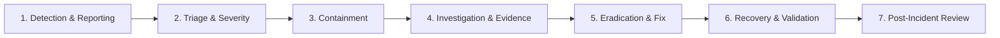

# Product Security Incident Response Plan (IRP)

**Status:** Draft — Pending Company Review and Approval  
**Document ID:** QFT-SEC-IRP-001  
**Version:** 1.0 — Initial Engineering Draft  
**Date:** 02 November 2026  
**Classification:** Internal Security Governance  
**Owner:** CISO / Product Security Incident Response Team (PSIRT)  
**Approval Authority:** `[COMPANY APPROVAL REQUIRED — CISO & Executive Leadership]`  
**Related Documents:** Threat Model v1.0, Security Architecture v1.0, SECURITY.md

---

## 1. Purpose and Scope

This document establishes the official **Product Security Incident Response Plan (IRP)** for the **Quantum Flow Post-Quantum Cryptography (PQC) Discovery & Risk Assessment Platform**.

The plan defines end-to-end procedures for detecting, triaging, containing, investigating, eradicating, and recovering from security incidents affecting:
- Platform infrastructure (Control Plane, FastAPI services, Celery workers, Redis, PostgreSQL).
- Software supply chain (source repositories, third-party libraries, container images).
- Customer data, target network boundaries, and cryptographic scan operations.

> [!IMPORTANT]
> **Operational Boundary Notice:**  
> This plan represents a proposed security management framework. Dedicated 24/7 security operations center (SOC) capabilities and emergency phone hotlines are **subject to corporate staffing and commercial budget approval**.

---

## 2. Incident Severity Classification Matrix

Incidents are classified into four severity tiers based on impact to tenant data, infrastructure, and network safety:

| Severity | Definition & Impact | Product-Specific Examples | Target Initial Triage Window |
|---|---|---|---|
| **P0 — Critical** | Active compromise of platform integrity, unauthorized network egress, cross-tenant data exposure, or remote code execution. | - SSRF bypass allowing connection to internal cloud metadata (`169.254.169.254`). - Cross-tenant data leak exposing one customer's CBOM to another. - Compromise of worker container with host breakout. - Unauthorized scanning of third-party IP without valid written authorization. | < 1 hour |
| **P1 — High** | Severe security weakness without confirmed active exploitation, privilege escalation, or database integrity failure. | - DNS rebinding vulnerability identified in staging/production. - Leakage of internal API token or staging database credential in build logs. - Tampering or checksum failure in raw observation envelopes. - Production worker crash loop caused by a crafted X.509 certificate. | < 4 hours |
| **P2 — Medium** | Moderate security defect, localized denial-of-service, or non-deterministic risk score calculations. | - Calculation logic error causing incorrect risk scoring for a class of algorithms. - Moderate-severity CVE in third-party Python/JS dependency. - Missing audit event for scan cancellation. | < 24 hours |
| **P3 — Low** | Minor security anomaly, cosmetic issue, or non-exploitable configuration discrepancy. | - Informational CVE with no reachable code path. - Incomplete user-agent header emitted during TLS handshakes. | < 3 business days |

---

## 3. Incident Response Lifecycle Phases

### Phase 1: Detection and Reporting
- **Internal Sources:** Automated monitoring alerts (Prometheus / Sentry), worker audit logs (`ScopeViolationError` triggers), container intrusion detection, employee reports.
- **External Sources:** Responsible vulnerability disclosures received via [`SECURITY.md`](../../SECURITY.md), customer notifications, or security researcher reports.

### Phase 2: Initial Triage
- The Incident Commander validates whether the event constitutes a true security incident.
- Assigns severity level (P0–P3).
- Opens an encrypted, private incident tracking ticket (never a public GitHub issue).

### Phase 3: Containment
- **Emergency Scanner Circuit Breaker:** If unauthorized scanning or an SSRF exploit is detected, the Incident Commander immediately invokes the global scanner circuit breaker to terminate all active Celery workers and reject new scan submissions.
- **Network Isolation:** Terminate compromised worker containers or revoke egress security-group rules.
- **Credential Revocation:** Immediately rotate compromised JWT secrets, API tokens, or database passwords.

### Phase 4: Investigation & Evidence Preservation
- Capture and preserve volatile evidence: container memory snapshots, worker socket logs, database WAL logs, and network connection records.
- Compute SHA-256 digests of all evidence files to ensure legal and forensic non-repudiation.
- Determine root cause, blast radius, and whether customer data was accessed or exfiltrated.

### Phase 5: Eradication
- Patch the underlying vulnerability (e.g., updating IP blocklists, fixing parser bounds, hardening JWT verification).
- Rebuild container images from verified clean baselines.
- Update CI/CD automated test suites with regression abuse test cases to prevent recurrence.

### Phase 6: Recovery & Validation
- Deploy validated hotfixes through staging before production release.
- Verify system health, worker lease stability, and database consistency.
- Lift the scanner circuit breaker and resume controlled scanning operations.

### Phase 7: Post-Incident Review (PIR) & Lessons Learned
- Within 5 business days of incident resolution, hold a blameless Post-Incident Review.
- Author a formal PIR report detailing timeline, root cause, detection gaps, response velocity, and mandatory corrective action items.

---

## 4. Product-Specific Incident Playbooks

### Playbook A: SSRF / Unauthorised Network Egress
1. **Trigger:** Worker establishes connection to private RFC 1918 address or cloud metadata.
2. **Immediate Action:** Kill worker pod/container instantly. Revoke scan job.
3. **Investigation:** Inspect target hostname resolution history; determine if DNS rebinding or redirect bypass occurred.
4. **Remediation:** Harden `packages/scanner/safety/` pre-socket filters; mandate worker-pinned IP socket creation.

### Playbook B: Cross-Tenant Data Leakage
1. **Trigger:** Tenant A accesses target or CBOM inventory belonging to Tenant B.
2. **Immediate Action:** Revoke compromised session token. Restrict affected API route if necessary.
3. **Investigation:** Audit PostgreSQL query logic and FastAPI dependency injection for missing `tenant_id` filters.
4. **Customer Communication:** Prepare formal disclosure to affected customer in alignment with contractual and regulatory obligations.

### Playbook C: Compromised Third-Party Dependency
1. **Trigger:** Critical CVE published against a core dependency (e.g., `cryptography`, `pydantic`, `celery`).
2. **Immediate Action:** Run software composition analysis (`pip-audit`, `trivy`) to determine if vulnerable code paths are exposed.
3. **Remediation:** Bump dependency in `pyproject.toml`, test regression suite, and cut an emergency patch release.

---

## 5. Customer Notification & Communications Protocol

- In the event of confirmed customer data exposure or unauthorized scanning against customer endpoints, formal written notification must be delivered to the customer's designated security contact within the contractually agreed notice window (typically 24–72 hours).
- Communications must be factual, detailing: nature of the incident, affected data/targets, actions taken to contain it, and customer guidance.
- All customer communications require prior sign-off by:
  - CISO
  - Executive Leadership
  - Legal Counsel

---

## 6. Incident Team Roles & Escalation Placeholders

| Role | Responsibility | Designation Placeholder |
|---|---|---|
| **Incident Commander (IC)** | Leads incident triage, directs containment, assigns tasks | `[CISO / SECURITY LEAD — TO BE CONFIRMED]` |
| **Technical Lead** | Coordinates code investigation, hotfix development, root cause | `[BACKEND LEAD — TO BE CONFIRMED]` |
| **Communications Lead** | Manages internal executive updates and external customer notices | `[LEGAL / COMMUNICATIONS LEAD — TO BE CONFIRMED]` |

> **Emergency Security Intake Contact:**  
> `[DESIGNATED INCIDENT RESPONSE EMAIL — TO BE CONFIRMED: security-incident@quantumflow.example.com]`

