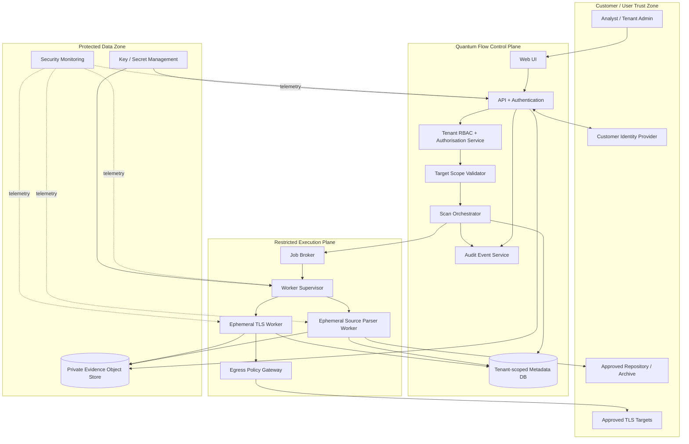
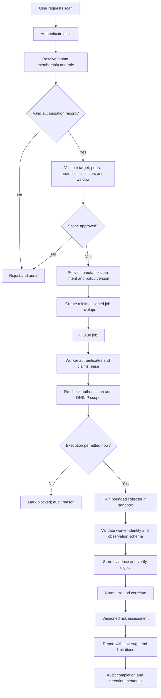
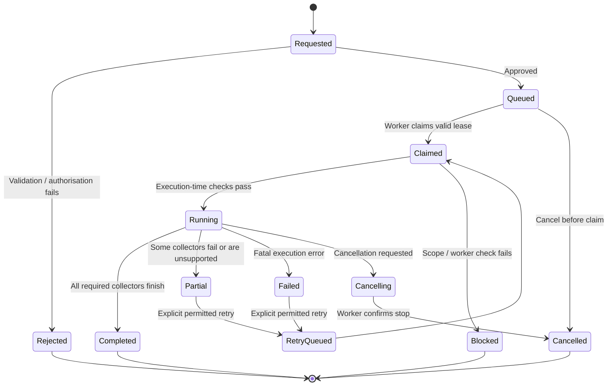

# QUANTUM FLOW TECHNOLOGIES
# PQC Discovery & Risk Assessment Platform
## Threat Model & Security Architecture Document

**Document ID:** QFT-PQC-TM-001  
**Version:** 1.0 — Initial Draft  
**Date:** 02 November 2026  
**Status:** Draft — For CISO, CTO and Engineering Review  
**Classification:** Confidential  
**Owner:** Engineering / Security Engineering  
**Approval authority:** Quantum Flow CISO and designated technical owner  
**Related documents:** PRD v1.0 Draft; TRD v1.0 Draft; SAD v1.0 Draft; Database Design Document v1.0 Draft; API Specification v1.0 Draft; *PQC Discovery & Migration Platform — Vision & Roadmap*, Version 1.0, October 2026.

> **Document status:** This is a proposed security design and threat assessment. It is not evidence that controls have been implemented, independently tested, certified, or approved. All controls marked MUST/SHOULD are requirements proposed for review. The CISO and system owners must approve the final risk acceptance, scan policy, retention policy and deployment profile.

---

# 1. Executive Summary

The Quantum Flow PQC Discovery & Risk Assessment Platform accepts customer-provided targets and repositories, executes discovery collectors, stores cryptographic observations and evidence, correlates observations into a cryptographic bill of materials (CBOM), and produces risk assessments and recommendations. These capabilities create a distinctive security challenge: the platform must inspect untrusted external systems and customer-controlled content while protecting the platform itself and maintaining strict separation between customers.

The highest-priority security risks are:

1. **Server-Side Request Forgery (SSRF):** a user-controlled target or redirect causes a collector to connect to an unintended internal or sensitive destination.
2. **DNS rebinding / resolution-time changes:** a hostname passes validation but resolves to a prohibited address when the worker connects, or changes during a scan.
3. **Unauthorised scanning:** the platform performs network activity outside the customer-approved target, method, time window or port scope.
4. **Worker compromise:** malicious targets, parser inputs, repository content or dependencies exploit a collector and use its runtime privileges to access secrets, other jobs or internal services.
5. **Cross-tenant data leakage:** an authorisation, query, object-storage or background-job defect exposes one tenant's targets, evidence, CBOM, reports or credentials to another.
6. **Credential exposure:** repository tokens, cloud credentials, API keys, session tokens or other secrets leak through logs, process arguments, temporary files, reports or worker memory.
7. **Malicious repository and archive inputs:** crafted files, archives, symlinks, parser bombs or hostile metadata cause code execution, path traversal, resource exhaustion or false findings.
8. **Evidence tampering / loss of integrity:** observations, evidence objects, timestamps, audit events or assessment history are altered, substituted, deleted or detached from their provenance.

The security architecture is based on a **control-plane / execution-plane separation**, deny-by-default target policy, execution-time scope revalidation, isolated and short-lived workers, server-derived tenant context, least privilege, evidence provenance, append-only audit design, and human approval for any future production-changing migration action.

The first release is a discovery and assessment platform. It must not execute customer code, install arbitrary repository dependencies, collect private keys, or make unattended production cryptographic changes. A public TLS scan is only one source of evidence and must never be represented as a complete enterprise cryptographic inventory.

## 1.1 Security objectives

- Prevent the platform from becoming an unauthorised scanning proxy or pivot into customer/internal networks.
- Preserve confidentiality and isolation of each tenant's data and credentials.
- Ensure workers can perform only the approved task and cannot freely reach the control plane, database, metadata endpoints or unrelated targets.
- Preserve the integrity, provenance and traceability of observations, evidence and risk assessments.
- Prevent untrusted repositories and files from being executed or interpreted with excessive privileges.
- Make every scan traceable to a valid authorisation, target scope, policy version, actor, collector version and execution record.
- Minimise collection and retention of customer information.
- Fail safely when authorisation, scope, DNS, worker identity, evidence integrity or policy state cannot be verified.

## 1.2 Security non-goals for v1

- Guaranteeing that a customer is quantum-safe.
- Discovering every cryptographic asset in private or inaccessible environments from a public domain scan.
- Collecting or testing customer private keys.
- Executing arbitrary source code, build scripts, package install hooks or repository workflows.
- Performing unrestricted port scans, internet-wide discovery or lateral movement.
- Automatically changing customer production certificates, protocols, libraries or cryptographic configurations.
- Treating a risk score as a substitute for a CISO-approved risk methodology or expert review.

---

# 2. System Scope and Assumptions

## 2.1 In-scope components

- Web application and browser session.
- Public API and identity integration.
- Tenant, project, role, target and authorisation services.
- Scan policy and scope validation service.
- Scan orchestrator and durable job state.
- Queue / broker and worker supervisor.
- Network/TLS, certificate, source/dependency and configuration collectors.
- Normalisation, correlation and CBOM services.
- Risk and recommendation engines.
- PostgreSQL, object storage, cache and queue data.
- Report generation and export.
- Audit events, logs, metrics, traces and alerting.
- CI/CD, build pipeline, dependency supply chain and deployment secrets.

## 2.2 External dependencies and trust assumptions

- Customer identity provider and identity claims.
- Customer-owned or customer-authorised network targets.
- Customer source repositories and imported configuration files.
- DNS resolvers and public certificate infrastructure.
- Optional SCM, CMDB, cloud, ticketing, SIEM and notification integrations.
- Container runtime, host operating system, cloud account and storage provider.
- Maintained TLS, certificate parsing, archive and source-analysis libraries.

No external target, repository, archive, certificate, DNS response, webhook, imported record or third-party service response is inherently trusted. Each must be validated at the boundary where it is consumed.

## 2.3 Critical assumptions to validate

| ID | Assumption | Security consequence if false | Required validation |
|---|---|---|---|
| A-01 | Every scan has written or otherwise formally recorded customer authorisation | Unauthorised scanning and legal exposure | CISO/legal-approved authorisation workflow |
| A-02 | Target scope is explicit and bounded | Scanner may become an open proxy | Scope schema and deny-by-default tests |
| A-03 | Workers can be isolated from control-plane and tenant data | Worker exploit may become platform-wide compromise | Network and runtime isolation tests |
| A-04 | Tenant identity is derived from verified server-side membership | Cross-tenant access | Negative authorisation tests for every resource type |
| A-05 | Evidence objects can be integrity-checked | Findings may be disputed or manipulated | Hash, versioning and audit verification tests |
| A-06 | Repository scanning is static and non-executing in v1 | Malicious repository code may execute | Sandbox and no-execution tests |
| A-07 | Secrets are supplied only through approved secret references | Credentials may enter logs or persisted job payloads | Secret-flow review and log scanning |
| A-08 | DNS and network policy are enforced at execution time | DNS rebinding / TOCTOU bypass | Resolver and connection-pinning tests |

---

# 3. Architecture and Trust Boundaries

## 3.1 Security architecture overview

The system should separate the **control plane**, which authenticates users, validates authorisation and schedules jobs, from the **execution plane**, which performs bounded discovery. A worker receives a signed or otherwise integrity-protected, short-lived job context containing only the approved target and collector configuration. It does not receive broad tenant credentials or unrestricted network access.



**Interpretation:** the diagram is a logical proposal. Network ACLs, workload identity, storage policy and deployment topology must enforce these boundaries; drawing a boundary does not itself provide isolation.

## 3.2 Trust boundaries

| Boundary | From → To | Main threats | Required controls |
|---|---|---|---|
| TB-01 | Browser → API | Session theft, CSRF, injection, mass assignment | TLS, secure session handling, CSRF where applicable, schema validation, rate limits |
| TB-02 | Identity provider → API | Forged claims, issuer confusion, stale membership | Issuer/audience/signature validation, nonce/state, server-side membership lookup |
| TB-03 | API → tenant data | IDOR, tenant-context confusion | Server-derived tenant context, scoped queries, RLS as defence in depth |
| TB-04 | Orchestrator → queue | Job tampering, replay, tenant mix-up | Authenticated broker, signed job envelope, expiry, job ID and tenant binding |
| TB-05 | Worker → target network | SSRF, rebinding, unauthorised scan, pivoting | Execution-time scope check, pinned resolved IP, egress firewall, protocol allowlist |
| TB-06 | Worker → repository/file input | Parser exploit, archive traversal, resource exhaustion | Ephemeral sandbox, no execution, archive validation, CPU/memory/time limits |
| TB-07 | Worker → database/object store | Credential theft, broad data access, evidence tampering | Workload identity, per-job scoped write interface, no broad DB credentials |
| TB-08 | API/report → evidence | Cross-tenant download, malicious content rendering | Tenant authorization, short-lived access, safe content disposition, output encoding |
| TB-09 | CI/CD → production | Dependency compromise, poisoned build, secret leakage | Pinned dependencies/actions, protected branches, signed artifacts, restricted CI tokens |
| TB-10 | Platform → third-party integrations | Token abuse, data over-sharing, webhook spoofing | Narrow scopes, outbound allowlists, signature verification, audit and revocation |

## 3.3 Data classification

| Class | Examples | Minimum handling |
|---|---|---|
| Public | Public certificate fields, public DNS names, published standards | Integrity and availability controls; do not assume public means harmless |
| Internal | Scan status, collector version, non-sensitive inventory metadata | Authenticated access; tenant isolation; audit |
| Confidential | Customer CBOM, findings, architecture details, repository paths, reports | Tenant isolation, encryption, least privilege, retention policy |
| Restricted secret | SCM tokens, cloud credentials, API keys, signing keys, session tokens | Secret manager only; never logs/reports/job payloads; rotation and access audit |
| Prohibited collection | Customer private keys and unrelated secret values | Do not collect or persist; redact and stop/quarantine if unexpectedly encountered |

---

# 4. Threat Modelling Method

## 4.1 Method

This document uses a practical STRIDE-based analysis across components and trust boundaries, supplemented by abuse cases and risk prioritisation. STRIDE categories are:

- **S — Spoofing:** pretending to be a user, tenant, worker, target or integration.
- **T — Tampering:** altering requests, jobs, observations, evidence, rules or reports.
- **R — Repudiation:** denying an action because audit evidence is missing or mutable.
- **I — Information disclosure:** exposing credentials, evidence, tenant records or internal network data.
- **D — Denial of service:** exhausting workers, queues, parsers, storage or API capacity.
- **E — Elevation of privilege:** obtaining broader tenant, worker, platform or infrastructure permissions.

## 4.2 Risk rating model for this document

The ratings below are qualitative engineering prioritisation, not the product's proposed 0–1000 quantum-risk score.

- **Critical:** plausible path to platform-wide compromise, severe data exposure, or uncontrolled internal network access.
- **High:** meaningful tenant compromise, unauthorised scanning, credential theft, or integrity compromise.
- **Medium:** bounded impact, mitigations available, or exploit requires additional preconditions.
- **Low:** limited impact with strong compensating controls.

Likelihood and impact must be recalibrated against the actual deployment, threat intelligence, customer environment and test results. Residual risk is not accepted merely because a control is documented.

## 4.3 Threat register summary

| ID | Threat | Primary STRIDE | Initial severity | Required disposition |
|---|---|---|---|---|
| TM-01 | SSRF through target URL, redirects or parser fetch | I/E/D | Critical | Block before customer pilot |
| TM-02 | DNS rebinding / TOCTOU between validation and connect | E/I | Critical | Block before customer pilot |
| TM-03 | Unauthorised or out-of-scope scanning | R/E/D | Critical | Block before any external scan |
| TM-04 | Worker compromise / lateral movement | E/I/T | Critical | Block before untrusted inputs are processed |
| TM-05 | Cross-tenant data leakage / IDOR | I/E/T | Critical | Block before multi-tenant use |
| TM-06 | Credential exposure through jobs, logs or temp files | I/E | Critical | Block before credentials are integrated |
| TM-07 | Malicious repository/archive/parser input | E/D/T | High | Block before repository scanning |
| TM-08 | Evidence tampering, substitution or deletion | T/R | High | Required before customer-facing reports |
| TM-09 | Queue/job replay or tenant/job confusion | S/T/E | High | Required before asynchronous scans |
| TM-10 | Report injection / unsafe evidence rendering | T/I | High | Required before report sharing |
| TM-11 | API abuse and resource exhaustion | D | High | Required before external exposure |
| TM-12 | CI/CD and dependency supply-chain compromise | T/E/I | High | Required before release |
| TM-13 | Audit log tampering or gaps | T/R | High | Required before pilot |
| TM-14 | Backup, retention or deletion failure | I/D | Medium–High | Required before production data |
| TM-15 | Risk rule / policy manipulation | T/E/R | High | Require privileged approval and versioning |

---

# 5. Detailed Threat Analysis and Security Requirements

## 5.1 TM-01 — Server-Side Request Forgery (SSRF)

**Scenario:** an analyst submits a hostname, URL or repository reference. The application or worker resolves or follows it and connects to a destination that was never authorised. An attacker may attempt loopback, private, link-local, cloud metadata, internal control-plane or sensitive service destinations. Redirects, alternate IP encodings, IPv6 forms, URL parser differences and protocol confusion may bypass naive validation.

**Assets at risk:** worker host, cloud metadata credentials, internal services, control plane, tenant data, secrets and network segmentation.

**Attack paths:**
1. User enters a URL that points directly to a private or loopback address.
2. A permitted public URL returns a redirect to an internal address.
3. A hostname resolves to a public IP during validation and a private IP during connection.
4. A parser, certificate fetcher, webhook handler or report renderer fetches an embedded URL.
5. URL parser disagreement causes validation of one host but connection to another.
6. An IPv4-mapped IPv6, integer, octal, hexadecimal or unusual textual IP representation bypasses a string check.

**Required controls:**

- Prefer a canonical **hostname + explicit port + protocol** target model over arbitrary full URLs. Accept only supported schemes and ports.
- Parse using one well-maintained URL/IDNA/IP library; reject ambiguous, malformed, credential-bearing and unsupported URL forms.
- Resolve all A and AAAA records using a controlled resolver. Reject the target if any address in the connection candidate set is prohibited unless a specifically approved internal-scan policy permits it.
- Block loopback, unspecified, link-local, private, multicast, reserved, IPv4-mapped IPv6 and cloud metadata ranges by default. Maintain a centrally reviewed denylist based on current IANA special-purpose registries and cloud-provider metadata ranges.
- Re-resolve and revalidate immediately before each connection and after every redirect. Do not rely only on validation at scan creation.
- Disable redirects by default for the TLS collector. If a business requirement allows redirects, cap the number, validate every hop and ensure the final host remains in the exact authorised scope.
- Do not follow certificate AIA/CRL/OCSP URLs or arbitrary embedded links in v1 unless each fetch is separately scoped and policy-approved.
- Enforce outbound network egress at the infrastructure layer. Worker subnets must not reach databases, control-plane administration ports, metadata services or unrelated internal networks.
- Use a dedicated egress proxy/gateway that checks destination IP and port at connection time; application validation alone is insufficient.
- Restrict protocols to the collector's declared purpose. No `file:`, `gopher:`, `ftp:`, `dict:`, `data:` or arbitrary custom schemes.
- Apply connection, handshake, read and total-job timeouts; cap response sizes and concurrent connections.
- Record requested hostname, resolved IP, connected peer IP, port, redirect chain (if any), policy decision and timestamp as audit evidence.

**Acceptance tests:** direct private IP, `127.0.0.1`, `::1`, link-local, metadata IP, IPv4-mapped IPv6, public-to-private redirect, multi-hop redirect, DNS answer containing mixed public/private records, malformed IDNA hostname, alternate IP notation, and redirect loop must all be rejected or safely bounded. Confirm egress firewall independently blocks prohibited destinations even if application validation is bypassed.

**Residual risk:** public targets may change behaviour after validation; DNS and routing can change. Mitigate through per-connection validation, egress enforcement and short-lived scan jobs. Internal scanning, if ever enabled, requires a separate deployment and policy profile rather than weakening public-scan defaults.

## 5.2 TM-02 — DNS Rebinding and Time-of-Check / Time-of-Use (TOCTOU)

**Scenario:** a target's DNS answer changes between scope validation and socket connection, or between repeated connections. A hostname can initially resolve to an allowed public address and later to a private, loopback or metadata address. DNS TTLs, caching and resolver behaviour can create race conditions.

**Required controls:**

1. Perform DNS resolution in a trusted component and record the full A/AAAA answer set, resolver identity, TTL where available and resolution timestamp.
2. Validate every returned address against the active scope policy. Mixed allowed and blocked answers must fail closed by default.
3. Pass a validated resolution result to the worker as a short-lived signed execution constraint.
4. Connect to a validated IP address while preserving the original hostname for TLS SNI and certificate hostname validation. The TLS library must not silently perform a second uncontrolled DNS lookup.
5. Verify the actual connected peer IP against the approved IP set after connection. If it differs, terminate and mark the collector blocked.
6. Re-resolve and revalidate before each new connection, retry or redirect; never assume a prior resolution remains valid.
7. Keep DNS cache lifetime no longer than the approved policy window. Do not allow stale cached answers to override a new deny decision.
8. Protect the resolver path against attacker-controlled search domains, split-horizon surprises and untrusted local resolver configuration.
9. Where a proxy is used, ensure the proxy itself resolves and enforces the final destination policy; do not assume application-side DNS pinning protects proxy-side resolution.
10. Log DNS decision evidence without exposing unrelated internal DNS records.

**Acceptance tests:** use a controlled authoritative DNS test zone that alternates between public and prohibited addresses; verify that the connection either pins to the validated permitted IP or is blocked. Test A-to-AAAA changes, multiple records, TTL expiry, retry, redirect and proxy resolution.

## 5.3 TM-03 — Unauthorised Scanning and Scope Creep

**Scenario:** a user submits a target they do not own, expands a scan to sibling domains or IP ranges, runs a scan outside the agreed time window, selects an unapproved port or collector, or reuses a previously approved authorisation after it expires or is revoked.

**Required controls:**

- Maintain an explicit authorisation record for each customer/project and target scope. It should include authorising organisation/person, proof/reference, permitted hostnames/IP ranges, ports, protocols, collectors, scan intensity, allowed time window/time zone, expiry, emergency contact, stop conditions and restrictions.
- Treat a user-entered domain as a *request*, not proof of ownership or permission.
- Require a designated customer owner or approved Quantum Flow reviewer to approve the authorisation record before any external scan.
- Support exact hostname matching and carefully defined wildcard semantics. Wildcards must not implicitly include unrelated registrable domains, lookalike domains or arbitrary subdomains.
- Bind each scan job to an immutable authorisation ID and authorisation version. Re-check active status, expiry, revocation and exact scope at job creation and immediately before execution.
- Bind permitted ports, protocols, collector IDs, request rate, concurrency, duration and time windows into the job envelope. Workers must not accept broader client-supplied values.
- Enforce a kill switch and customer/Quantum Flow stop-contact path. Cancellation must stop new connections and terminate active work within a defined timeout.
- Default to one explicitly supplied hostname and a small approved port set. No subnet discovery, port sweep, brute-force enumeration, vulnerability exploitation or credential testing in the discovery MVP.
- Store scan intent, approver, approval time, policy version, target, DNS result, worker execution and outcome in audit history.
- Require renewed approval when scope, scan depth, target ownership or collector capability materially changes.
- For a POC, scan only Quantum Flow-owned lab systems or targets with written permission. Do not use public high-profile domains as test targets merely because they are publicly reachable.

**Acceptance tests:** expired authorisation, revoked authorisation, wrong tenant, wrong subdomain, unapproved port, unapproved collector, out-of-window scan, target changed after approval and user lacking approval permission must all fail closed. Cancellation must be tested under active connection and queued-job conditions.

## 5.4 TM-04 — Worker Compromise and Lateral Movement

**Scenario:** a malicious target, malformed certificate, crafted repository file, vulnerable parser or compromised dependency exploits a worker. If the worker has broad network access, long-lived credentials or shared filesystem access, compromise can spread to the control plane, database, other tenants or cloud account.

**Required controls:**

- Run collectors in isolated, ephemeral workloads or containers with a non-root UID, read-only root filesystem, dropped Linux capabilities, seccomp/AppArmor/SELinux profile where available, no privileged mode and no host Docker socket.
- Apply CPU, memory, process, file descriptor, disk, network, wall-clock and output-size quotas per job.
- Use a dedicated worker pool by risk class. Do not co-locate untrusted source parsing with privileged orchestration services.
- Disable outbound network by default for source-parser workers. TLS workers receive only the constrained egress path required for their approved target.
- Prevent worker-to-worker network access and worker access to database administration, cloud metadata and control-plane admin endpoints.
- Give each worker a short-lived workload identity scoped to one job or narrowly defined tenant/project task. Avoid static credentials baked into images or environment variables.
- Do not provide direct broad database credentials. Prefer a narrow observation-ingestion API that validates job ID, tenant binding, collector identity, schema and allowed write operations.
- Validate a worker's identity, job lease, tenant ID, target scope, collector version and expiry on every result submission.
- Use immutable, minimal base images; pin dependencies; scan images; sign release artefacts; maintain an SBOM; rebuild regularly for security updates.
- Apply strict parser limits and safe library versions. Keep cryptographic parsing code small, reviewed and covered by malformed-input tests.
- Terminate the worker after the job; destroy ephemeral filesystem and revoke its identity. Do not reuse a compromised or unhealthy worker for another tenant.
- Monitor unexpected egress, DNS requests, process creation, file access, privilege changes, crash loops and unusual result volumes.
- Maintain a worker quarantine mechanism: revoke identity, remove from queue, isolate network, preserve forensic metadata and prevent further task claims.

**Acceptance tests:** attempt privilege escalation, access to metadata IP, access to database/control-plane ports, cross-job file access, worker identity replay, excessive CPU/memory/output, process spawning, and network egress outside the approved target. Verify the worker cannot read another tenant's evidence or credentials.

## 5.5 TM-05 — Cross-Tenant Data Leakage and Broken Object-Level Authorisation

**Scenario:** an attacker changes a tenant, project, scan, asset, evidence, report or job ID in an API request; a query omits tenant filtering; a background worker trusts a tenant ID from an untrusted payload; or an object-storage URL is exposed across tenants.

**Required controls:**

- Derive tenant context from verified identity and server-side membership. Never trust a `tenant_id` supplied by the browser as the authority for access.
- Centralise resource authorisation and apply it to every read, write, export, download, search, count, report and background operation.
- Use tenant-scoped repository/query interfaces. PostgreSQL Row-Level Security (RLS) may be added as defence in depth, with transaction-scoped tenant context and tests for connection-pool context leakage.
- Ensure primary and foreign key relationships prevent cross-tenant linking. Use composite uniqueness/foreign-key constraints where appropriate (for example `(tenant_id, id)`).
- Treat unguessable UUIDs as defence-in-depth only; they do not replace authorisation.
- Bind queued jobs, worker identity and every observation to the same tenant/project/scan/authorisation context. Verify the binding server-side at ingestion.
- Keep object storage private. Use tenant-specific prefixes or access points and generate short-lived download links only after an authorization check. Do not expose permanent public URLs.
- Ensure cache keys, search indexes, report filenames, temporary directories, metrics labels and export jobs are tenant-aware and do not leak cross-tenant data.
- Avoid leaking existence through error differences; return a consistent not-found response for resources outside the caller's tenant where appropriate.
- Apply tenant-specific retention, deletion and export controls.
- Conduct automated negative tests for every endpoint and resource type using two or more tenants.

**Acceptance tests:** Tenant A must not read, update, delete, search, count, export, download or infer Tenant B's projects, scans, assets, observations, evidence, reports, audit events or integrations by changing IDs, query filters, pagination cursors, headers, job payloads or object keys. Test RLS under pooled connections and asynchronous workers.

## 5.6 TM-06 — Credential and Secret Exposure

**Scenario:** SCM access tokens, cloud credentials, API keys, OIDC tokens, session cookies or integration secrets leak through request bodies, queue payloads, environment variables, process arguments, logs, traces, crash dumps, temporary files, reports or source-code findings.

**Required controls:**

- Store integration credentials in an approved secrets manager or KMS-backed secret store. Persist only a secret reference and metadata in application records.
- Never include raw credentials in scan job payloads, database rows, queue messages, logs, exception messages, telemetry labels, URLs or reports.
- Use short-lived, read-only and repository-scoped credentials wherever possible. Prefer workload identity or federated credentials over long-lived personal access tokens.
- Define a credential purpose, tenant, integration, allowed repositories/resources, expiry, rotation schedule and owner for every secret.
- Retrieve a secret just-in-time into worker memory through workload identity; do not write it to disk. Ensure it is not inherited by child processes.
- Redact known secret formats and high-entropy tokens at the logging boundary. Redaction is defence in depth, not permission to log secrets.
- Avoid command-line arguments for credentials. Do not place tokens in Git remote URLs or clone command strings.
- Disable shell tracing and verbose HTTP/client logging in credential-bearing paths.
- Restrict access to secret versions; audit retrieval, rotation and revocation. Revoke credentials immediately after suspected exposure.
- Scrub temporary files and memory where feasible; use encrypted ephemeral storage and short worker lifetimes.
- Prevent private-key upload and reject known private-key formats. If a private key or unrelated secret is detected in an import, stop processing, quarantine the input, avoid echoing the content, notify the authorised owner and follow the incident procedure.

**Acceptance tests:** plant synthetic canary credentials in inputs and test logs, traces, database, queue, temp files, crash reports and generated reports. No raw canary value may appear. Verify token rotation/revocation invalidates subsequent worker access.

## 5.7 TM-07 — Malicious Repository, Archive and Configuration Inputs

**Scenario:** a repository contains crafted source files, symlinks, nested archives, huge files, parser bombs, malformed encodings, malicious filenames, path traversal entries, poisoned manifests or instructions intended to trigger execution by an AI-assisted or automated scanner.

**Required controls:**

- Treat every file and repository object as hostile data. Static scanning must parse content; it must not execute it.
- Do not run `setup.py`, package lifecycle scripts, build tools, Makefiles, shell scripts, tests, Git hooks, CI workflows, macros or project-specific commands during discovery.
- Fetch only an explicitly approved repository and immutable commit/revision. Record repository identity, commit hash, branch/reference and retrieval time.
- Use read-only SCM permissions limited to selected repositories. Avoid broad organisation-wide tokens.
- Validate archive entries before extraction. Reject absolute paths, `..` traversal, NUL bytes, drive prefixes, symlinks/hardlinks unless specifically handled, device files and unsupported entry types.
- Enforce compressed and decompressed size limits, maximum file count, nesting depth, path length, per-file size, total parse time and memory.
- Extract only into a newly created per-job directory using safe path resolution; verify each resolved path remains beneath the extraction root.
- Reject or safely skip encrypted archives, unsupported compression, malformed encodings and files above policy limits. Report skipped coverage explicitly.
- Use MIME/type sniffing plus extension policy; do not trust filenames alone. Do not render untrusted HTML/SVG in the application origin.
- Parse with maintained libraries and sandbox the parser. Apply regular-expression complexity limits and avoid catastrophic backtracking.
- Treat comments, README text, filenames and repository instructions as data, not as instructions to the platform or AI system. Any AI-assisted analysis must not be able to invoke tools, secrets or network access based on repository content.
- Avoid storing full source files by default. Store file path, line range, rule ID, minimal redacted snippet and cryptographic hash where permitted. Apply customer retention policy.
- Record unsupported file types and parse failures in coverage rather than silently skipping them.

**Acceptance tests:** zip-slip, absolute path, symlink escape, nested archive bomb, huge file, binary file, invalid UTF-8, regex bomb, malformed manifest, malicious README prompt injection, package install hook and executable build script. Verify none execute and resource quotas terminate pathological input safely.

## 5.8 TM-08 — Evidence Tampering, Substitution and Provenance Loss

**Scenario:** a user, compromised worker or database operator changes an observation, replaces an evidence object, alters a timestamp, deletes an audit event, or changes the rule version associated with a risk score. A report then presents a conclusion that cannot be reproduced or defended.

**Required controls:**

- Preserve the raw observation record and normalized record as separate linked entities. Normalisation must not overwrite original collector output.
- Each observation should include stable IDs, tenant/project/scan IDs, target, source, method, collector ID/version, timestamps, classification (`observed`, `inferred`, `imported`, `unknown`), confidence, evidence reference and error/coverage status.
- Calculate a cryptographic hash (for example SHA-256) for each stored evidence object and canonicalized observation payload. Record algorithm, digest, byte size, content type and creation time.
- Use object storage with versioning and retention/object-lock capabilities where supported. Restrict deletion and overwrite permissions to a dedicated retention process.
- Store evidence metadata in the relational database and verify the object hash on retrieval or during integrity audits.
- Use append-only audit events for scan creation, approval, execution, cancellation, evidence ingestion, assessment, export, exception and deletion. Ordinary application roles must not update or delete prior audit records.
- Forward security-relevant audit events to a separate restricted log destination or tamper-evident store. A database-only audit table is not sufficient against a database administrator compromise.
- Use trusted server timestamps; record source-provided timestamps separately and label them untrusted. Synchronise platform clocks and monitor drift.
- Version collectors, normalisation rules, risk rules, policies and report templates. Store exact versions and input evidence references for every assessment.
- New findings or corrections create new versions or superseding records; do not silently rewrite historical assessments.
- Record who approved, changed, exported or deleted data and why. Support legal hold and retention exceptions through controlled workflow.
- Verify signatures on signed artefacts and integration payloads where applicable. Hashes detect change but do not prove who created the evidence; bind them to authenticated worker identity and audit records.

**Acceptance tests:** alter one byte of an evidence object; replace an object version; modify observation fields; replay a worker result; change a risk rule after assessment; delete an audit row using an ordinary role. Integrity checks must detect the change or permissions must deny it. Verify a report can be regenerated from the stored evidence and exact rule-set version.

## 5.9 TM-09 — Queue Tampering, Replay and Job Confusion

**Scenario:** an attacker injects, modifies or replays a queue message, changes tenant/target/collector fields, submits stale results or claims a job using a compromised worker identity.

**Required controls:**

- Use authenticated, encrypted broker connections and separate broker credentials per service role.
- Queue messages should contain a minimal job reference and integrity-protected envelope, not raw secrets or full customer data.
- Bind job ID, tenant ID, project ID, scan ID, authorisation ID/version, target set, collector allowlist, expiry, nonce and policy version into the signed envelope.
- Workers must retrieve authoritative job details from the control plane using workload identity; they must not trust arbitrary queue fields.
- Use short job leases, monotonic state transitions, unique execution IDs and replay detection. A completed/cancelled/expired job cannot be executed again without an explicit retry operation.
- Make result ingestion idempotent and reject duplicate or out-of-order submissions unless the state machine permits them.
- Verify worker identity and collector version on every heartbeat and result submission.
- Use dead-letter queues with restricted access and bounded retention; do not dump secret-bearing payloads into dead-letter logs.

## 5.10 TM-10 — Report Injection and Unsafe Evidence Rendering

**Scenario:** a malicious hostname, certificate subject, repository filename, code snippet or imported value contains HTML, JavaScript, formula payloads or control characters. It executes in the UI, report viewer or exported spreadsheet, or causes misleading content.

**Required controls:**

- Contextually encode all untrusted strings in HTML and UI templates. Never concatenate raw evidence into HTML.
- Serve report downloads from a separate origin or with safe `Content-Disposition: attachment` and restrictive content types where appropriate.
- Apply a restrictive Content Security Policy to the application. Avoid inline script and unsafe HTML rendering.
- Sanitize Markdown/HTML using a maintained allowlist sanitizer; disable embedded scripts, event handlers, iframes and remote resource loading.
- Neutralise spreadsheet formula injection in CSV/XLSX exports by safely escaping values beginning with `=`, `+`, `-`, `@`, tab or carriage return as appropriate to the export format.
- Limit report size and include clear provenance, scan scope, limitations, generation time and methodology version.
- Require authorization before report generation and again before download. Short-lived download links must be tenant-bound and revocable where possible.

## 5.11 TM-11 — API Abuse and Resource Exhaustion

**Scenario:** repeated scan creation, very large uploads, expensive repository parsing, high concurrency, report generation loops or malformed requests exhaust CPU, memory, queue, storage or third-party quotas.

**Required controls:** per-user, tenant, IP and endpoint rate limits; scan quotas; concurrency caps; upload and decompression limits; queue backpressure; bounded retries; circuit breakers; job timeouts; cancellation; storage quotas; pagination limits; request body limits; abuse alerts; and an operator kill switch. A retry must not multiply work without a bounded retry policy.

## 5.12 TM-12 — CI/CD and Software Supply-Chain Compromise

**Scenario:** a malicious dependency, compromised build action, poisoned pull request, leaked CI token or unsigned artifact introduces code that can access customer evidence or execute with worker privileges.

**Required controls:** pin third-party CI actions to immutable commit SHAs; scope workflow permissions per job; disable persisted checkout credentials where not required; protect main/release branches; require peer review and security review for collector, crypto and auth changes; use lockfiles and dependency pinning; scan dependencies and container images; generate and retain an SBOM; sign release artefacts; protect signing keys; isolate build and deployment identities; and deploy only artifacts produced by trusted workflows. Review licences and vulnerabilities for dependencies.

## 5.13 TM-13 — Audit Log Tampering and Repudiation

**Scenario:** a privileged user or compromised service edits or deletes the records needed to establish who approved a scan, which target was contacted, what evidence was collected or who exported a report.

**Required controls:** append-only application semantics; restricted write identities; separate log destination; authenticated event source; sequence/correlation IDs; synchronized timestamps; retention and alerting; access review; and periodic audit integrity checks. Audit failures must be visible and must not silently allow high-risk actions to continue.

## 5.14 TM-14 — Backup, Retention and Deletion Failure

**Scenario:** evidence is retained beyond contract, deleted from the primary database but remains in object versions/backups, or backups are exposed or cannot be restored.

**Required controls:** documented retention classes; tenant-specific deletion workflow; coordinated deletion across database, object storage, indexes, caches and derived reports; backup expiry aligned to policy; encryption and access restrictions for backups; restore tests; legal-hold support; and auditable deletion receipts. Do not promise immediate physical erasure from immutable backups unless the storage design supports it; document backup expiry semantics clearly.

## 5.15 TM-15 — Risk Rule, Policy or Approval Manipulation

**Scenario:** an attacker changes a scan policy, risk weight, severity threshold, approved algorithm mapping or recommendation rule to suppress findings or generate misleading reports.

**Required controls:** versioned immutable rule sets; role separation between author, reviewer and approver; dual approval for production risk policy changes; signed or integrity-protected releases; change rationale; regression fixtures; staged deployment; rollback to a prior version; and re-assessment snapshots. A policy update must not rewrite historical assessment inputs or results.

---

# 6. Secure Scan Lifecycle

## 6.1 Required lifecycle gates



## 6.2 Mandatory scan preconditions

A scan cannot start unless all conditions are true:

- Authenticated user is active.
- User has permission for the project and scan type.
- Tenant is active and not suspended.
- Target is registered and covered by a currently valid authorisation record.
- Requested target, protocol, port, collector, scan intensity and time window are within scope.
- Scan policy version is active.
- Target validation and DNS checks succeed.
- Worker pool is healthy and has the required restricted execution profile.
- Resource quotas permit the job.
- Required customer contact and stop conditions are present.

If a required check is unavailable, the default is to reject or pause the scan, not to bypass the control.

## 6.3 Job state machine



State transitions must be enforced server-side. A worker must not be able to mark an unapproved job as running or completed.

---

# 7. Identity, Authentication and Authorisation

## 7.1 User identity

- Use a maintained OIDC/OAuth 2.0 implementation or approved identity provider integration.
- Validate issuer, audience, signature, expiry, not-before, nonce and state as applicable.
- Map identity to active platform user and tenant membership on the server.
- Do not use unverified email domain as proof of tenant membership.
- Require MFA for privileged roles and sensitive actions where supported by the identity provider.
- Protect browser sessions with secure, HttpOnly and appropriate SameSite cookies if cookie sessions are used; apply CSRF protection to state-changing requests.
- Implement session revocation and reauthentication for high-impact operations.

## 7.2 Role-based access control

Proposed roles:

| Role | Permitted capabilities | Restrictions |
|---|---|---|
| Platform Security Admin | Platform-wide security configuration and incident response | No routine browsing of customer evidence without approved support reason |
| Tenant Admin | Manage tenant users, projects, authorisations and integrations | Cannot access another tenant |
| Scan Approver | Approve/revoke target authorisations and scan policy | Separation from scan requester for sensitive scopes where practical |
| Security Analyst | Create scans within approved scope; inspect findings and reports | Cannot approve own expanded scope unless explicitly authorised by policy |
| Asset Owner | View assigned assets and recommendations; update ownership/context | Cannot change platform security policy |
| Auditor | Read approved audit and assessment records | Read-only; evidence access separately permissioned |
| Service / Worker Identity | Claim assigned jobs and submit bounded results | No interactive login; no broad tenant browsing |

Permissions should be action-specific, not inferred from broad UI roles. Approval, export, secret retrieval, policy change and deletion are separate permissions.

## 7.3 Privileged actions

Require explicit audit events and, where appropriate, step-up authentication or dual approval for:

- Creating or expanding external scan authorisations.
- Enabling internal network scanning.
- Changing egress policy or blocked ranges.
- Changing tenant isolation or retention configuration.
- Accessing or rotating integration secrets.
- Exporting bulk evidence.
- Changing risk methodology or severity thresholds.
- Deleting customer evidence or audit-relevant records.
- Enabling any future migration action.

---

# 8. Data Security and Evidence Architecture

## 8.1 Data minimisation

Collect only fields needed for cryptographic discovery and defensible risk assessment. For TLS discovery, this generally includes negotiated protocol/cipher/key exchange details and public certificate metadata. Do not collect application payloads, user content, authentication cookies, private keys or unrelated traffic. Source scanning should prefer minimal finding snippets and location references over storing full repositories.

## 8.2 Evidence envelope

Every observation/evidence item should carry at least:

```json
{
  "observation_id": "obs_example",
  "tenant_id": "tenant_server_derived",
  "project_id": "project_example",
  "scan_id": "scan_example",
  "target_id": "target_example",
  "source_type": "network_tls",
  "collector_id": "tls_collector",
  "collector_version": "1.0.0",
  "classification": "observed",
  "method": "tls_handshake",
  "observed_at": "2026-11-02T10:00:00Z",
  "recorded_at": "2026-11-02T10:00:02Z",
  "confidence": "high",
  "evidence_digest": "sha256:...",
  "evidence_object_ref": "private-object-reference",
  "policy_version": "scan-policy-v1",
  "execution_id": "exec_example"
}
```

The example is illustrative. Tenant identity in a worker result must be checked against authoritative job state; the worker must not be trusted to choose its tenant. Avoid embedding raw secrets or full source contents in this envelope.

## 8.3 Integrity and provenance

- Hash evidence at ingestion and verify before use/export.
- Preserve collector output and normalised output separately.
- Store exact collector, parser, normaliser, risk-rule and policy versions.
- Link assessments to immutable observation IDs and evidence digests.
- Use append-only audit events and restricted separate log storage.
- Preserve historical snapshots; corrections create superseding records.
- Provide a reproducibility path from report → assessment → finding → asset → observation → collector execution → evidence digest.

## 8.4 Encryption and key management

- Use TLS for browser/API, service-to-service and storage connections.
- Encrypt databases, object storage, backups and ephemeral volumes at rest using managed key services where available.
- Separate keys by environment and, where justified, tenant or data class.
- Restrict key administration from ordinary application roles.
- Rotate keys and credentials under documented procedures; retain old decryption keys only as required for retained data.
- Do not invent claims of end-to-end encryption if the platform processes plaintext evidence.

## 8.5 Retention and deletion

Define retention by data class and contract before pilot. The policy must cover primary database, object versions, replicas, search indexes, caches, logs, exports, backups and legal holds. Deletion must be authorised, tenant-scoped, auditable and verified. Reports must disclose retention assumptions to the customer.

---

# 9. Network and Infrastructure Security

## 9.1 Segmentation

- Public API ingress must not share unrestricted network access with discovery workers.
- Workers must run in a dedicated execution network/subnet or equivalent isolation boundary.
- Worker egress should be denied by default and selectively opened through a policy gateway.
- Database and object storage should accept connections only from required service identities/networks.
- Administrative interfaces must not be reachable from worker networks or public ingress.
- Cloud metadata endpoints must be blocked from workers unless a narrowly scoped workload-identity mechanism requires a documented exception.
- Separate development, test, staging and production environments, credentials and storage.

## 9.2 TLS and service identity

- Enforce modern TLS configurations for platform-facing services according to approved security policy.
- Authenticate service-to-service calls using workload identity or mutually authenticated channels where appropriate.
- Validate certificates and hostnames for platform services; do not disable certificate validation to make integrations work.
- Rotate service credentials and certificates and monitor expiry.

## 9.3 Infrastructure hardening

- Minimal operating system and container images.
- Non-root execution and read-only filesystems for workers.
- No privileged containers or host socket mounts.
- Patch operating systems, runtimes, TLS libraries and parsers on a defined cadence.
- Host firewall and cloud security-group rules deny by default.
- Central secrets manager; no secrets in source control, image layers or build logs.
- Backup encryption and tested restore procedures.
- Runtime monitoring for unexpected process, file, network and privilege activity.

---

# 10. Secure Development and Supply Chain

## 10.1 Secure coding requirements

- Typed request and response schemas with strict validation.
- Parameterised database queries and safe ORM usage.
- Output encoding and safe report rendering.
- Explicit authorization checks at the service/domain layer, not only the UI/router.
- No mass assignment of privileged fields.
- Secure error handling and secret redaction.
- Dependency and container scanning in CI.
- Unit, integration, negative-security and regression tests.
- Peer review for authentication, authorization, scope validation, worker isolation, cryptographic parsing and evidence integrity changes.

## 10.2 CI/CD controls

- Protected main and release branches.
- Required peer review and passing CI checks.
- Pin CI actions and external build dependencies to immutable versions/SHAs where feasible.
- Least-privilege workflow token permissions, scoped per job.
- Disable persisted checkout credentials when not needed.
- Use short-lived deployment credentials and environment approvals.
- Generate SBOM for application and worker images.
- Scan dependencies, images and infrastructure configuration.
- Sign build artefacts and verify signatures before deployment.
- Keep build provenance and release records.
- Separate build identity from production runtime identity.

## 10.3 AI-assisted engineering and analysis

AI-generated code must be reviewed and tested by qualified engineers, especially for cryptographic integrations, parser boundaries, authentication and authorization. Repository content, filenames, comments and imported documentation are untrusted data and must never be treated as instructions to the AI system. AI analysis must not receive secrets or have unrestricted tools/network access. Deterministic rules and evidence remain authoritative for MVP risk outputs.

---

# 11. Logging, Monitoring and Incident Response

## 11.1 Security events to log

- Authentication success/failure and session revocation.
- Role and tenant membership changes.
- Authorisation creation, approval, change, expiry and revocation.
- Scan request, validation decision, queueing, worker claim, execution, cancellation and completion.
- DNS/IP scope decisions and egress-policy blocks.
- Worker crash, quarantine, unexpected process or network activity.
- Secret retrieval, rotation and revocation metadata (never secret values).
- Evidence ingestion, digest mismatch, export, deletion and retention action.
- Risk-rule/policy change and approval.
- Cross-tenant authorization denial and repeated IDOR-like attempts.
- CI/CD release and deployment events.

## 11.2 Logging rules

- Never log passwords, tokens, private keys, cookies, full authorization headers or secret values.
- Avoid logging full repository content, raw request bodies or customer payloads.
- Use correlation IDs and stable resource IDs; avoid sensitive data in metric labels.
- Restrict log access and retention; forward critical audit events to a separately controlled destination.
- Alert on unusual scan volume, denied egress, repeated scope failures, tenant authorization failures, secret retrieval anomalies, evidence digest mismatch and worker isolation violations.

## 11.3 Incident response playbooks

### Suspected SSRF / unauthorised network access
1. Stop or cancel affected jobs and disable the relevant collector/target policy.
2. Quarantine worker and revoke its workload identity.
3. Preserve DNS, connected-peer, egress, job and audit evidence.
4. Determine whether internal services or metadata endpoints were reached.
5. Rotate any potentially exposed credentials.
6. Notify security owner and affected customer under the incident process.
7. Patch validation/egress policy and run regression tests before re-enabling.

### Suspected worker compromise
1. Isolate worker pool and stop new job claims.
2. Revoke worker identities and integration credentials accessible to the pool.
3. Preserve image digest, runtime events, process/network telemetry and job envelope.
4. Identify affected tenants, jobs, evidence and downstream systems.
5. Rebuild from trusted images and verify CI/CD provenance.
6. Perform a security review and controlled re-entry approval.

### Suspected cross-tenant data exposure
1. Disable affected endpoint/export path and revoke exposed links/tokens.
2. Identify tenant IDs, resources, time window, access events and recipient.
3. Preserve relevant audit, database and object access logs.
4. Contain access, rotate credentials if applicable and assess deletion/copy risk.
5. Follow contractual and legal notification requirements.
6. Add regression tests for every affected resource path.

### Suspected credential exposure
1. Revoke/rotate exposed secret immediately.
2. Search logs, traces, queues, temp storage and reports for the synthetic/known indicator without reproducing secret contents.
3. Identify all jobs and integrations that used the credential.
4. Remove or expire affected artefacts according to evidence-preservation policy.
5. Fix the secret flow and validate with canary tests.

### Evidence integrity failure
1. Freeze affected report/assessment exports and mark evidence as integrity-compromised.
2. Preserve current object versions, digests, audit events and access history.
3. Reconstruct from trusted source or re-run an authorised scan if safe.
4. Notify the CISO and impacted customer; do not silently regenerate or overwrite historical records.
5. Determine whether the cause was application bug, privileged misuse or compromise.

---

# 12. Security Verification and Test Plan

Security controls are not complete until tested. The following tests are minimum release gates, not an exhaustive penetration-test scope.

## 12.1 Test matrix

| Test ID | Area | Test case | Expected result | Gate |
|---|---|---|---|---|
| SEC-001 | SSRF | Direct loopback/private/link-local/metadata target | Rejected before connection; egress independently blocked | P0 |
| SEC-002 | SSRF | Public URL redirects to private destination | Redirect blocked; no private connection | P0 |
| SEC-003 | DNS | DNS answer changes between validation and connect | Peer IP mismatch blocked and audited | P0 |
| SEC-004 | DNS | Mixed public/private A/AAAA records | Fail closed by default | P0 |
| SEC-005 | Scope | Expired/revoked/wrong-scope authorisation | Job rejected or blocked at execution | P0 |
| SEC-006 | Scope | Unapproved port/collector/time window | Rejected; no packet sent | P0 |
| SEC-007 | Worker | Worker attempts metadata/control-plane/database access | Network policy denies; alert generated | P0 |
| SEC-008 | Worker | Worker identity/job replay | Rejected; no duplicate execution/result | P0 |
| SEC-009 | Tenant | Tenant A requests Tenant B scan/asset/evidence/report | Denied with no data disclosure | P0 |
| SEC-010 | Tenant | RLS context reused across pooled DB connections | No cross-tenant result | P0 |
| SEC-011 | Secrets | Canary token in input | No token in logs, queue, DB, trace or report | P0 |
| SEC-012 | Repository | Zip-slip, symlink escape, archive bomb | Safely rejected or bounded; no outside write | P0 |
| SEC-013 | Repository | Build/install script in repository | Never executed | P0 |
| SEC-014 | Parser | Malformed cert/source and regex bomb | Bounded failure; worker remains isolated | P1 |
| SEC-015 | Evidence | Evidence byte changed after ingestion | Digest mismatch detected; report flagged | P0 |
| SEC-016 | Audit | Ordinary app role attempts audit update/delete | Denied | P0 |
| SEC-017 | Report | HTML/JS and spreadsheet formula payload | Rendered inert / escaped | P1 |
| SEC-018 | API | Scan creation flood / oversized upload | Rate/size/quota controls enforced | P1 |
| SEC-019 | CI/CD | Dependency/action pinning and token scope review | Policy checks pass; provenance retained | P1 |
| SEC-020 | Retention | Tenant deletion across DB/object/index/backup policy | Deletion workflow verified and auditable | P1 |

P0 = must pass before external customer scanning or multi-tenant pilot. P1 = must pass before broader pilot/production exposure; CISO may elevate any test to P0.

## 12.2 Test environments

- Use an isolated lab with deliberately configured TLS endpoints, test certificates, test repositories and known ground-truth assets.
- Use controlled DNS zones for rebinding and mixed-answer tests.
- Use synthetic credentials only; never test with live customer secrets.
- Use dedicated test tenants with seeded data to verify isolation.
- Use intentionally malicious archives and malformed inputs in disposable worker environments.
- Never conduct destructive tests against customer production systems without separate written approval and a test plan.

## 12.3 Independent review

Before a customer pilot, arrange a security review that covers application authorization, tenant isolation, SSRF and egress controls, worker sandboxing, credential handling, evidence integrity, CI/CD and incident response. A penetration test should be scoped and performed by qualified reviewers. Passing internal tests does not equal certification.

---

# 13. Security Acceptance Criteria and Release Gates

## 13.1 P0 — mandatory before any external scan

- [ ] Written authorisation model approved by CISO/legal.
- [ ] Exact target/port/protocol/collector/time-window scope enforced.
- [ ] SSRF protections implemented in application and network egress layers.
- [ ] DNS rebinding and execution-time peer-IP validation tested.
- [ ] Worker isolation, resource quotas and restricted egress verified.
- [ ] Worker cannot reach metadata, database administration or control-plane administration endpoints.
- [ ] Cancellation and kill switch verified.
- [ ] No private keys or unrelated secrets collected.
- [ ] Secret references and redaction validated with canary tests.
- [ ] Tenant isolation tests pass for every API and background workflow if multi-tenant mode is enabled.
- [ ] Evidence hashes, provenance and audit events are persisted and verified.
- [ ] Repository scanner does not execute repository code and archive controls pass before repository input is enabled.
- [ ] Customer-facing reports disclose scope, coverage, limitations and methodology.

## 13.2 P1 — mandatory before production/pilot expansion

- [ ] Independent security review completed and findings dispositioned.
- [ ] CI/CD supply-chain controls and signed release artefacts operational.
- [ ] Incident response playbooks rehearsed.
- [ ] Backup restore and retention/deletion tests completed.
- [ ] Monitoring and alerting for scope, worker, tenant and evidence anomalies operational.
- [ ] Security ownership, support contacts, vulnerability disclosure and customer notification process defined.
- [ ] Data processing terms and customer permissions documented.

## 13.3 Stop-ship conditions

Stop release or suspend affected functionality if any of the following is true:

- A worker can reach prohibited internal or metadata destinations.
- A scan can run without valid authorisation or outside approved scope.
- A tenant can access another tenant's resource or evidence.
- A credential or private key is stored in logs, queue, reports or ordinary application tables.
- A repository script is executed by the scanner without explicit separately approved design.
- Evidence integrity cannot be verified or audit records can be silently altered by ordinary application roles.
- Worker compromise can access broad platform credentials or unrestricted internal services.

---

# 14. Risk Ownership and Governance

| Area | Accountable owner (proposed) | Required reviewers |
|---|---|---|
| Scan authorisation and acceptable use | CISO / customer security owner | Legal, Product |
| SSRF, DNS and egress architecture | Security Engineering | Platform / DevOps |
| Worker sandbox and runtime identity | Platform / DevOps Lead | Security Engineering |
| Tenant isolation and API authorization | Backend Lead | Security Engineering, QA |
| Secrets management | Security / Platform Lead | Backend, DevOps |
| Repository parsing safety | Discovery Engineering Lead | Security Engineering, QA |
| Evidence integrity and audit | Backend / Data Lead | CISO, QA |
| Risk rules and scoring | CISO / Risk Owner | PQC Architecture, Product |
| Incident response | Security Incident Owner | CTO, Customer Success / Legal |

Each threat must have an owner, treatment decision, implementation ticket, test evidence and residual-risk approval. Risk acceptance must be explicit, time-bound and signed by the designated authority; engineering teams must not self-accept critical customer-impacting risks.

## 14.1 Open decisions requiring approval

| ID | Decision | Proposed default | Approver |
|---|---|---|---|
| OTM-01 | Proof of customer authorisation | Written, target-specific authorisation record before scan | CISO / Legal |
| OTM-02 | Public scan target model | Hostname + explicit port; no arbitrary URL fetch | CISO / Engineering |
| OTM-03 | Internal network scanning | Disabled by default; separate customer-controlled deployment/policy | CISO |
| OTM-04 | Worker isolation technology | Ephemeral sandboxed containers or equivalent stronger isolation | CTO / DevOps |
| OTM-05 | Egress enforcement | Dedicated egress gateway plus network ACLs | Security / DevOps |
| OTM-06 | Tenant isolation | Server-side authorization plus DB RLS defence in depth | CTO / Backend |
| OTM-07 | Evidence retention | Customer/contract-defined schedule; explicit backup semantics | CISO / Legal |
| OTM-08 | Audit storage | Separate restricted tamper-evident destination | CISO / DevOps |
| OTM-09 | SCM credential model | Read-only, repository-scoped, short-lived where possible | Security / Product |
| OTM-10 | Source scanner execution policy | Static parsing only; no build/install/execute | CISO / Engineering |
| OTM-11 | Security test gate | P0 tests required before external scans | CISO |
| OTM-12 | Risk acceptance process | Named owner, expiry, compensating controls and written approval | CISO |

---

# 15. Implementation Roadmap

## Phase 0 — Security design and lab (before external scanning)

- Approve target authorisation model and scan policy.
- Build isolated lab with known-good and malicious test cases.
- Define trust boundaries and network egress policy.
- Define worker identity, job envelope and cancellation semantics.
- Establish data classification, evidence envelope and retention requirements.
- Add threat-model review to architecture and pull-request workflow.

**Exit gate:** scope approved, lab reproducible, SSRF/DNS design reviewed, worker isolation plan approved.

## Phase 1 — Safe TLS discovery POC

- Accept only explicitly approved hostnames and ports.
- Implement DNS resolution and connection-time IP enforcement.
- Use a restricted TLS worker with no broad credentials.
- Collect only public TLS/certificate metadata required for the POC.
- Persist provenance, policy and audit metadata.
- Test scope denial, SSRF, DNS rebinding, cancellation and evidence digest.

**Exit gate:** all P0 network and authorisation tests pass in the lab. No customer scan until approval.

## Phase 2 — Tenant-aware inventory and reporting

- Implement server-derived tenant context and resource-level authorization.
- Add tenant-scoped database access and object-storage authorization.
- Add evidence integrity checks and separate audit destination.
- Add report output encoding and download controls.
- Complete two-tenant negative authorization tests.

**Exit gate:** no cross-tenant access in automated security tests; report provenance is reproducible.

## Phase 3 — Repository and configuration discovery

- Add read-only repository integration and immutable revision pinning.
- Build isolated static parser workers with no execution and no default network egress.
- Add archive traversal, decompression, parser and prompt-injection tests.
- Add credential canary tests and secret-manager integration.

**Exit gate:** malicious repository fixtures are safely bounded; no repository code executes; no secret leakage.

## Phase 4 — Pilot hardening

- Complete independent security review / penetration test.
- Rehearse incident response and worker quarantine.
- Test backup restore, retention and deletion.
- Operationalise monitoring, alerts, release signing and vulnerability handling.
- Obtain CISO sign-off and customer pilot permission.

**Exit gate:** P0/P1 requirements dispositioned and residual risks formally accepted.

---

# 16. Operational Security Checklist

### Before each scan
- [ ] User and tenant are active.
- [ ] Authorisation record is approved, in date and not revoked.
- [ ] Exact target, port, protocol, collector and time window are within scope.
- [ ] DNS results and IP policy are validated.
- [ ] Worker profile and quotas are available.
- [ ] Stop contact and cancellation path are available.

### During each scan
- [ ] Worker lease and identity remain valid.
- [ ] Connected peer IP matches approved resolution.
- [ ] Rate, timeout, concurrency and output limits are enforced.
- [ ] Unexpected egress or resource use triggers containment.
- [ ] No secrets or private keys are collected.
- [ ] Progress, errors and security decisions are audited.

### After each scan
- [ ] Worker is terminated and identity revoked/expired.
- [ ] Evidence digests are verified.
- [ ] Observation provenance and coverage are persisted.
- [ ] Risk assessment references exact evidence and rule versions.
- [ ] Report contains scope and limitations.
- [ ] Temporary files and expired credentials are removed.

### Before each release
- [ ] Peer review and CI checks pass.
- [ ] Dependencies and images are scanned; SBOM generated.
- [ ] Security tests pass, including negative tenant and SSRF tests.
- [ ] Release artifact signature/provenance verified.
- [ ] Secrets and environment configuration reviewed.
- [ ] Security owner approves deployment and known residual risks.

---

# 17. Relationship to Product Vision and Technical Documents

This threat model supports the product workflow **Discover → Inventory → Prioritise → Plan → Migrate → Assure**. For the initial scanner, it focuses on safe discovery, evidence-backed inventory, transparent risk prioritisation and reporting. Migration execution remains outside the v1 discovery scope and must require explicit approvals, maintenance windows, validation and rollback.

It aligns with the product vision's security principles: authorised scanning only; no customer secrets; data minimisation; credential protection; complete audit trails; no unattended production change; secure supply chain; expert review; honest claims; and pilot-ready governance.

It complements:

- **PRD:** product scope, actors, use cases and acceptance criteria.
- **TRD:** implementation requirements, collector and service constraints.
- **SAD:** components, data flows, deployment and trust boundaries.
- **Database Design:** tenant keys, evidence metadata, audit and retention structures.
- **API Specification:** authentication, tenant authorization, scan lifecycle, worker identity, ingestion and report endpoints.

Any approved change to target scope, worker execution model, tenant model, evidence handling, integrations or migration capability must trigger a threat-model review and corresponding updates to the architecture, API, database and test documents.

---

# 18. References and Standards Baseline

## Internal source

- Quantum Flow Technologies, *PQC Discovery & Migration Platform — Vision & Roadmap*, Version 1.0, October 2026. Security principles and scanner architecture are the primary product-specific source.
- Quantum Flow Technologies, PRD v1.0 Draft; TRD v1.0 Draft; SAD v1.0 Draft; Database Design Document v1.0 Draft; API Specification v1.0 Draft.

## External security references for engineering validation

The engineering team should consult current official publications and verify versions before adopting requirements:

- OWASP Server-Side Request Forgery Prevention Cheat Sheet.
- OWASP Application Security Verification Standard (ASVS).
- OWASP API Security Top 10.
- NIST SP 800-53 security and privacy controls (as a control catalogue where useful).
- NIST SP 800-61 incident handling guidance (verify current revision).
- NIST Secure Software Development Framework (SSDF), SP 800-218.
- NIST SP 800-57 Part 1 for key-management context.
- IANA IPv4 and IPv6 Special-Purpose Address Registries.
- Relevant cloud-provider official metadata-service and workload-identity security guidance for the selected deployment environment.

This document does not claim compliance with any of these frameworks. A mapping exercise and evidence-based assessment are required before making compliance claims.

---

# 19. Approval and Sign-off

| Role | Name | Decision | Date | Comments |
|---|---|---|---|---|
| CISO / Security Approver | TBD | Pending | TBD | |
| CTO / Technical Lead | TBD | Pending | TBD | |
| Backend / Platform Lead | TBD | Pending | TBD | |
| DevOps / Infrastructure Lead | TBD | Pending | TBD | |
| Product Owner | TBD | Pending | TBD | |

**Document status:** Draft — proposed threat model and security architecture.  
**Approval condition:** Critical threats have approved controls, P0 tests have passed, owners are assigned, and residual risks are explicitly accepted by the authorised security owner.

---

# Appendix A — Security Requirements Traceability

| Requirement ID | Requirement | Related threat(s) | Verification |
|---|---|---|---|
| QF-SEC-001 | Authorisation record required for every scan | TM-03 | SEC-005, SEC-006 |
| QF-SEC-002 | Target scope enforced at creation and execution | TM-01, TM-02, TM-03 | SEC-001–SEC-006 |
| QF-SEC-003 | Egress deny-by-default | TM-01, TM-02, TM-04 | SEC-001, SEC-002, SEC-007 |
| QF-SEC-004 | Worker identity and job binding | TM-04, TM-09 | SEC-007, SEC-008 |
| QF-SEC-005 | Tenant authorization on every resource | TM-05 | SEC-009, SEC-010 |
| QF-SEC-006 | Secrets manager and no-secret logging | TM-06 | SEC-011 |
| QF-SEC-007 | Static-only repository parsing | TM-07 | SEC-012–SEC-014 |
| QF-SEC-008 | Evidence digest and immutable provenance | TM-08, TM-13 | SEC-015, SEC-016 |
| QF-SEC-009 | Safe report rendering and export | TM-10 | SEC-017 |
| QF-SEC-010 | API quotas and bounded jobs | TM-11 | SEC-018 |
| QF-SEC-011 | Signed and traceable release artifacts | TM-12 | SEC-019 |
| QF-SEC-012 | Retention and deletion verification | TM-14 | SEC-020 |
| QF-SEC-013 | Versioned, approved risk policies | TM-15 | Policy regression and approval tests |

# Appendix B — Threat Review Questions

1. Can a user cause any worker to connect to a destination not explicitly approved?
2. Is the actual connected peer IP checked after DNS resolution and immediately before/after connection?
3. Can a redirect, certificate URL, parser or integration perform an unscoped fetch?
4. Can a worker reach the database, cloud metadata, control plane or another worker?
5. Does any worker receive credentials broader or longer-lived than the job requires?
6. Can Tenant A infer or retrieve any Tenant B object through APIs, exports, caches, reports, logs or worker results?
7. Can repository input execute a script, install a dependency, escape an archive directory or exhaust resources?
8. Can an ordinary application identity alter or delete prior evidence or audit history?
9. Can a report be traced back to the exact scan, observation, evidence digest, collector version and risk-rule version?
10. Is there a tested way to stop scans, quarantine workers, revoke credentials and notify affected customers?
11. Are public TLS observations clearly separated from imported, inferred and unknown enterprise assets?
12. Has the CISO explicitly accepted every residual Critical or High risk before pilot approval?

**End of document.**
