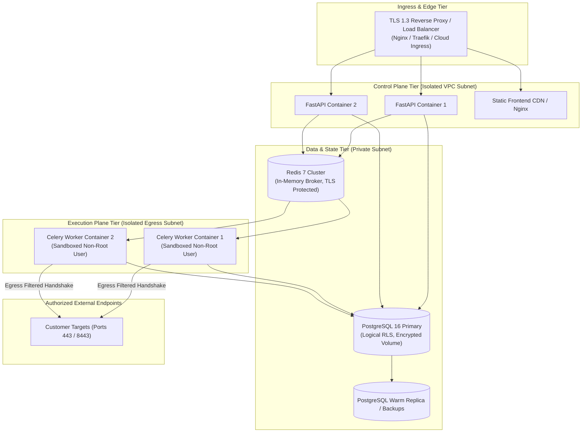

# Deployment & Operations Runbook

**Status:** Draft — Pending Company Review and Approval  
**Document ID:** QFT-OPS-RUNBOOK-001  
**Version:** 1.0 — Initial Engineering Draft  
**Date:** 02 November 2026  
**Classification:** Internal Operations & DevSecOps  
**Owner:** DevSecOps Lead / Platform Engineer  
**Approval Authority:** `[COMPANY APPROVAL REQUIRED — Technical Lead & CISO]`  
**Related Documents:** SAD v1.0, Implementation Blueprint v1.0, Threat Model v1.0

---

## 1. Scope & Execution Disclaimer

This document defines the **proposed deployment architecture, operational procedures, service maintenance, and recovery runbooks** for the Quantum Flow Platform across local development, staging, and production tiers.

> [!WARNING]
> **Operational Readiness Disclaimer:**  
> The repository is currently in **Sprint 0 setup**. The application containers, infrastructure templates, and cloud services described in this runbook are **proposed engineering designs**.  
> In the commands below:
> - `[EXECUTABLE NOW]`: Operations runnable against the current repository state (e.g., local environment checks, directory scaffolding).
> - `[PROPOSED ARCHITECTURE]`: Operational procedures planned for deployment once application containers (`apps/api`, `apps/worker`) and infrastructure manifests are provisioned.

*No cloud provider (AWS, Azure, GCP, or Sovereign Indian Cloud) has been definitively locked as exclusive; architectures are designed using cloud-agnostic, containerized primitives (OCI containers, PostgreSQL 16, Redis 7).*

---

## 2. Proposed Deployment Architecture

The platform separates the user-facing control plane from the isolated scanning execution plane:



---

## 3. Environment Separation

To guarantee data safety, performance isolation, and compliance, the platform maintains four strictly separated tiers:

| Environment | Purpose | Infrastructure Profile | Access Policy |
|---|---|---|---|
| **Local** | Developer testing & unit verification | Docker Compose on developer workstation | Developer local machine |
| **Development (`dev`)** | Continuous integration & feature testing | Ephemeral containers; automated pull-request preview | Automated CI runner; dev team |
| **Staging (`stage`)** | Pre-release validation, load tests, CISO audit | Mirrored production topology; synthetic customer data | Restricted engineering & QA |
| **Production (`prod`)** | Live customer discovery & assessment | High-availability cluster, encrypted volumes, hardened egress | Strictly restricted via audited IAM & break-glass |

---

## 4. Configuration & Secret Management

- **Zero Secrets in Code:** Passwords, API tokens, encryption keys, and database credentials must never be committed to Git.
- **Hierarchical Configuration:**
  1. Base settings defined in code defaults via Pydantic `BaseSettings`.
  2. Environment variables dynamically injected at container runtime.
  3. Sensitive secrets mounted securely from a dedicated secrets vault (e.g., HashiCorp Vault, AWS Secrets Manager, or Kubernetes Secrets).
- **Redaction Rules:** Structured logs must automatically filter headers matching `Authorization`, `Cookie`, `X-API-Key`, or any field containing `password`, `secret`, or `token`.

---

## 5. Container Deployment Procedures

### 5.1 Local Docker Compose `[EXECUTABLE NOW — SCAFFOLDING]`

To start local backing services (PostgreSQL 16 and Redis 7):

```powershell
# Planned Docker Compose startup command for Sprint 0:
docker compose -f infra/docker/docker-compose.yml up -d
```

### 5.2 Container Image Builds `[PROPOSED ARCHITECTURE]`

All application containers must build from minimal, non-root base images:

```bash
# Build FastAPI API container
docker build -t quantumflow/api:v0.1.0 -f apps/api/Dockerfile .

# Build Worker container
docker build -t quantumflow/worker:v0.1.0 -f apps/worker/Dockerfile .

# Build Web static bundle
docker build -t quantumflow/web:v0.1.0 -f apps/web/Dockerfile .
```

*Security Rule:* Container processes run as unprivileged user `appuser` (UID 10001). Write access to the root filesystem is denied (`read_only_root_filesystem: true`).

---

## 6. Database Migrations & Versioning

- **Tool:** Alembic.
- **Execution Policy:** Migrations must run as a **pre-deployment release job** before new application container versions start serving traffic.

```bash
# [PROPOSED ARCHITECTURE] Run database migration to latest schema revision
alembic upgrade head

# Roll back by one migration revision (in the event of deployment failure)
alembic downgrade -1
```

*Safety Rule:* Destructive migrations (e.g., dropping columns or tables) must follow an expand-and-contract pattern across two sequential release cycles.

---

## 7. Service Health Checks & Readiness Probes

Every service must expose two distinct HTTP probe endpoints:

1. **Liveness Probe (`/healthz`):** Returns HTTP 200 if the process is running. Used by orchestrators to trigger container restarts upon deadlocks.
2. **Readiness Probe (`/readyz`):** Returns HTTP 200 only if all downstream dependencies (PostgreSQL pool, Redis connection) respond successfully. Used to route ingress traffic.

```json
// Example /readyz response:
{
  "status": "ready",
  "dependencies": {
    "database": "connected",
    "redis": "connected",
    "schema_version": "20261102_001"
  },
  "timestamp": "2026-11-02T12:00:00Z"
}
```

---

## 8. Logging, Monitoring & Observability

### 8.1 Structured Logging
All containers output JSON-formatted logs to `stdout`/`stderr`:
- `timestamp` (ISO 8601 UTC)
- `level` (`DEBUG`, `INFO`, `WARNING`, `ERROR`, `CRITICAL`)
- `service` (`api`, `worker`, `orchestrator`)
- `tenant_id`
- `scan_id` (if applicable)
- `message`

### 8.2 Operational Metrics (Prometheus)
- `http_requests_total`: Counter by route, method, status code.
- `scan_jobs_active`: Gauge of currently executing worker scans.
- `scan_job_duration_seconds`: Histogram of scan execution latencies.
- `redis_queue_length`: Count of pending Celery tasks.
- `db_connection_pool_active`: Utilization of PostgreSQL connection pools.

### 8.3 Alerting Rules
- **Critical Alert:** Database connection failure rate > 1% over 2 minutes.
- **High Alert:** Redis task queue depth exceeding 500 unassigned jobs for > 5 minutes.
- **Security Alert:** Any trigger of `ScopeViolationError` or blocked SSRF attempt (immediate Slack / PagerDuty notification).

---

## 9. Celery Worker Queue Management

- **Concurrency Limits:** Workers run with bounded concurrency (default: 2–4 workers per container) to prevent socket file-descriptor exhaustion.
- **Heartbeat & Zombie Detection:** Celery heartbeat set to 30 seconds. Jobs without heartbeat updates for > 120 seconds are automatically reclaimed and marked as `FAILED_TIMEOUT`.
- **Scaling:** Worker containers scale horizontally based on queue depth metrics (`redis_queue_length`).

---

## 10. Backup, Disaster Recovery & Data Retention

### 10.1 Backup Policy
- **PostgreSQL Database:**
  - Automated continuous Write-Ahead Log (WAL) archiving to encrypted off-site object storage.
  - Daily full database snapshots retained for 30 days.
  - Point-in-time recovery (PITR) target: Recovery Point Objective (RPO) < 15 minutes.
- **Encryption:** All database backup files encrypted with AES-256-GCM using keys managed outside the production database server.

### 10.2 Recovery Test Procedure
1. Provision a clean, isolated PostgreSQL test container.
2. Restore the latest daily snapshot.
3. Apply WAL logs to the target recovery timestamp.
4. Run schema validation and data integrity checks.
*Recovery verification must be performed and logged monthly by the platform engineering team.*

---

## 11. Rollback & Forward-Fix Procedures

If a deployment exhibits service degradation or data errors:

1. **Immediate Ingress Rollback:** Divert traffic back to the prior stable container release via the load balancer or blue/green route switch.
2. **Database Rollback Assessment:**
   - If no database migration ran: rollback completes immediately.
   - If non-destructive migration ran: the previous container version continues running against the newer schema.
   - If destructive migration ran: execute `alembic downgrade -1` during an emergency maintenance window.
3. **Worker Queue Draining:** Pause new scan task ingestion; allow active workers to complete bounded scans or terminate cleanly.

---

## 12. Operational Troubleshooting Matrix

| Symptom | Root Cause | Immediate Diagnostic Command | Remedial Action |
|---|---|---|---|
| Scan jobs stuck in `SUBMITTED` | Worker process down or disconnected from Redis | `celery -A apps.worker.celery_app status` | Restart Celery worker service; check Redis logs. |
| API returns HTTP 500 on all endpoints | PostgreSQL database connection pool exhausted | `docker logs quantumflow-api` | Increase pool size or terminate orphaned connections. |
| Worker logs `ScopeViolationError` | Target validation blocked an internal or loopback IP | Check worker audit log for `target_ip` | Verify whether target hostname resolves to an unauthorized private IP. |
| Redis memory spikes > 80% | Result backend retaining uncollected task results | `redis-cli info memory` | Enforce task result TTL expiration (default: 24 hours). |

---

## 13. Incident Escalation & On-Call Roster

For operational outages, performance degradation, or infrastructure issues, follow the tiered escalation path:

| Escalation Level | Role | Responsibilities | Target Response Window |
|---|---|---|---|
| **Tier 1** | On-Call Platform Engineer | Initial alert triage, log diagnosis, service restart | < 15 minutes |
| **Tier 2** | Technical Lead / DevSecOps Lead | Deep troubleshooting, rollback execution, code hotfixes | < 30 minutes |
| **Tier 3** | CISO & System Owner | Security boundary breach, data exposure, disaster recovery | < 60 minutes |

> **Emergency Operations Contact:**  
> `[DESIGNATED OPERATIONAL ESCALATION CONTACT — TO BE CONFIRMED: ops-alerts@quantumflow.example.com]`

