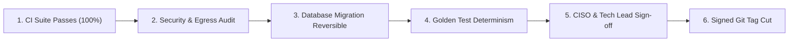

# Release Management Guide

**Status:** Draft — Pending Company Review and Approval  
**Document ID:** QFT-DEV-REL-001  
**Version:** 1.0 — Initial Engineering Draft  
**Date:** 02 November 2026  
**Classification:** Internal Engineering Governance  
**Owner:** DevSecOps Lead / Technical Lead  
**Approval Authority:** `[COMPANY APPROVAL REQUIRED — Technical Lead & CISO]`  
**Related Documents:** Coding Standards, Contribution Guide, Testing Strategy, Deployment Runbook

---

## 1. Purpose and Philosophy

This guide defines the end-to-end **release management lifecycle** for the Quantum Flow Platform. 

As an enterprise cybersecurity product handling cryptographic assessments and network scanning, releases must be predictable, thoroughly tested, auditable, and easily roll-backable. Untested emergency hotfixes or uncoordinated production pushes are strictly prohibited.

---

## 2. Versioning Strategy `[PROPOSED — PENDING ENGINEERING APPROVAL]`

The platform adheres to **Semantic Versioning (SemVer 2.0.0)** with structured pre-release identifiers:

$$\text{MAJOR}.\text{MINOR}.\text{PATCH}[-\text{PRERELEASE}]$$

- **MAJOR (vX.0.0):** Breaking architectural changes, incompatible database migrations requiring manual data migration, breaking REST API contract changes, or major redesigns of the risk scoring methodology.
- **MINOR (v0.X.0 / v1.X.0):** Backward-compatible new capabilities (e.g., adding a new discovery collector, new CBOM export format, or new PQC algorithm support).
- **PATCH (v1.0.X):** Backward-compatible bug fixes, security patches, or performance optimizations.
- **Pre-Release Suffixes:**
  - `-alpha.N`: Internal developer milestones and sprint builds.
  - `-beta.N`: Feature-complete release candidates deployed to staging for customer pilot validation.
  - `-rc.N`: Final release candidates undergoing CISO security sign-off.

---

## 3. Git Branching & Release Tagging

```text
main ---------------------------------------* [v0.1.0-sprint0] ----------* [v0.2.0-sprint1]
        \                                  /                            /
         -- release/v0.1.0 ---------------                             /
                                       \                              /
                                        -- release/v0.2.0 -----------
```

1. **Release Branches:** For major and minor releases, a release branch `release/vX.Y.0` is cut from `main`. Only bug fixes, documentation corrections, and security patches are cherry-picked into release branches.
2. **Git Tags:** Releases are tagged on `main` (or the release branch) using annotated, cryptographically signed tags:
   ```powershell
   git tag -s v0.1.0-sprint0 -m "Release v0.1.0-sprint0: Engineering foundation and documentation baseline"
   ```

---

## 4. Release Prerequisites & CI/CD Gates

Before cutting any release candidate, all of the following gates must be satisfied:



1. **Automated CI Suite:** 100% of unit, integration, contract, and E2E tests pass on the release commit.
2. **Security & Egress Verification:** Zero unresolved high- or critical-severity CVEs in dependencies; SSRF target validation tests pass.
3. **Database Migration Safety:** Alembic migrations must be verified for safe bi-directional execution (`upgrade head` $\rightarrow$ `downgrade -1` $\rightarrow$ `upgrade head`).
4. **Deterministic Golden Suite:** Risk scoring outputs must match the golden benchmark dataset byte-for-byte.
5. **Documentation Synchronization:** OpenAPI specifications, README, and Release Notes must be completely updated.

---

## 5. Security Sign-off & Governance Gate

Prior to promoting any release to staging or production, formal sign-off is required:

| Role | Responsibility | Sign-off Status |
|---|---|---|
| **Technical Lead** | Architecture integrity, performance benchmarks, and code review verification | Required |
| **CISO / Security Lead** | Threat model alignment, SSRF filters, dependency vulnerability review, and RBAC | Required |
| **Product Owner** | Functional scope alignment against roadmap and sprint acceptance criteria | Required |

---

## 6. Changelog & Release Notes Format

Every release must update `CHANGELOG.md` following the [Keep a Changelog](https://keepachangelog.com/) standard:

```markdown
## [0.1.0-sprint0] - 2026-11-02

### Added
- Monorepo directory structure and configuration baseline (QF-001).
- Comprehensive documentation baseline across docs/00 through docs/09.
- Safe environment template (.env.example) and cross-editor settings (.editorconfig).
- Contributor Code of Conduct and Responsible Disclosure Security Policy.

### Security
- Non-bypassable private IP blocking filters defined in scanner design.
- Prohibited collection of customer private keys mandated in data governance.

### Fixed
- N/A (Sprint 0 Baseline)
```

---

## 7. Deployment, Rollback & Forward-Fix Procedures

- **Canary / Blue-Green Strategy:** In production, new container versions are deployed alongside the existing stable version. Ingress traffic is shifted incrementally (10% $\rightarrow$ 50% $\rightarrow$ 100%).
- **Rollback Decision Window:** If error rates exceed 0.5% or health checks fail within 15 minutes of promotion:
  1. Immediately route 100% of ingress back to the previous stable release.
  2. Pause Celery worker task queues.
  3. Assess database state. If non-destructive schema changes were applied, leave them in place; otherwise execute rollback migration.
- **Forward-Fix Policy:** Forward fixes are permitted only for minor configuration updates or typo corrections that have passed CI. Code changes require a new patch release.

