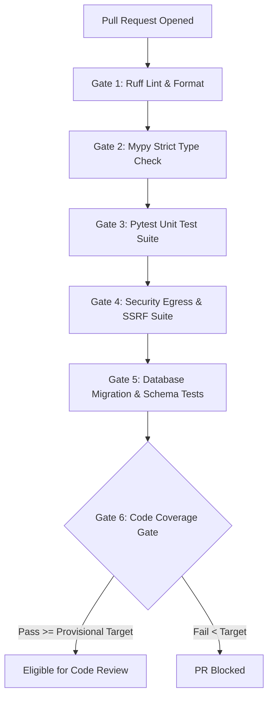

# Quantum Flow Platform — Comprehensive Testing Strategy

**Status:** Draft — Pending Company Review and Approval  
**Document ID:** QFT-TEST-STRAT-001  
**Version:** 1.0 — Initial Engineering Draft  
**Date:** 02 November 2026  
**Classification:** Internal Technical Governance  
**Owner:** QA Lead / DevSecOps Engineer / Technical Lead  
**Approval Authority:** `[COMPANY APPROVAL REQUIRED — Technical Lead & CISO]`  
**Related Documents:** TRD v1.0, SAD v1.0, Threat Model v1.0, Implementation Blueprint v1.0

---

## 1. Executive Summary & Testing Philosophy

The Quantum Flow Post-Quantum Cryptography (PQC) Discovery & Risk Assessment Platform is an enterprise security product. It performs network-level cryptographic discovery, parses untrusted binary certificate structures, normalizes complex cryptographic asset graphs (CBOM), and executes risk calculations.

Flaws in this platform carry high operational risk:
- A false sense of security (e.g., scoring an RSA-2048 key as quantum-safe).
- Unintended network egress (SSRF) into private networks or cloud metadata services.
- Collector memory corruption, socket resource starvation, or worker deadlocks.
- Non-deterministic risk scores undermining executive and audit trust.

Therefore, our testing strategy enforces **multi-layered defensive verification**: every layer—from pure cryptographic parsers up to end-to-end user workflows—must be covered by automated, reproducible tests running against synthetic, ground-truth fixtures.

---

## 2. Testing Objectives

1. **Safety First:** Prove that network discovery collectors cannot be induced to connect to private IP space, cloud metadata, or unauthorized targets.
2. **Determinism:** Guarantee that risk calculations and CBOM correlations produce 100% identical outputs for identical evidence inputs across multiple execution runs.
3. **Data Integrity & Provenance:** Verify that raw observations are immutably persisted and every CBOM asset, finding, and recommendation links directly to an empirical evidence digest.
4. **Resilience & Fault Isolation:** Ensure that parsing errors, network timeouts, or worker crashes are isolated and do not compromise other jobs or the control plane.
5. **Multi-Tenant Boundary Separation:** Validate that tenant data, targets, and scan jobs remain strictly isolated at the database, queue, and API layers.

---

## 3. Test Pyramid & Methodologies

```text
                  / \
                 / E2E \                (Full User Scan Journeys)
                /-------\
               / Security \             (SSRF, Rebinding, Tenant Isolation)
              /------------\
             /  Integration \           (FastAPI + DB + Celery + Redis)
            /----------------\
           / API & Contract   \         (OpenAPI Schema & Payload Validation)
          /--------------------\
         /      Unit Tests      \       (Parsers, Risk Rules, Pure Functions)
        /------------------------\
```

### 3.1 Unit Testing
- **Scope:** Pure algorithms, X.509/ASN.1 parser helpers, Pydantic schema validation, domain state transitions, risk rule evaluations.
- **Framework:** `pytest`
- **Execution Rule:** Fast (<10ms per test). Zero network or database dependencies. Zero mock drift.
- **Key Modules:**
  - `packages/scanner/tls/`: ASN.1 decoding, OID mappings, certificate field extraction.
  - `packages/risk-engine/`: Shor/Grover risk formulas, confidentiality lifetime weights.
  - `packages/cbom/`: Asset deduplication keys, relationship tuple generation.

### 3.2 Integration Testing
- **Scope:** Inter-component interactions within the control plane and execution plane.
- **Database Testing:** Tests run against real PostgreSQL instances (via Docker or testcontainers). Verify SQLAlchemy queries, transactions, JSONB indexing, and rollback semantics.
- **Worker & Queue Testing:** Celery task invocation using Redis. Test task dispatch, progress heartbeats, task timeouts, and result storage.

### 3.3 API Contract Testing
- **Scope:** FastAPI REST endpoints and OpenAPI schema compliance.
- **Framework:** `schemathesis` / `pytest` with `httpx.AsyncClient`.
- **Validation:** Ensure all responses strictly match Pydantic response models, HTTP status codes conform to RFC standards, and RFC 7807 problem details are returned on errors.

### 3.4 Frontend Testing
- **Scope:** React components, custom hooks, user state, and routing.
- **Tooling:** Vitest, React Testing Library, Mock Service Worker (MSW).
- **Validation:** Component rendering, form validation (rejecting invalid hostnames), table pagination, error banners, and coverage limitation disclosures.

### 3.5 Worker and Job Execution Testing
- **Scope:** Celery background worker lifecycle under concurrent load.
- **Scenarios:**
  - Worker claim and lease renewal under long-running handshakes.
  - Zombie task reclamation after simulated worker termination (`kill -9`).
  - Worker graceful shutdown during active TLS handshakes without data corruption.

### 3.6 Scanner & Collector Testing
- **Scope:** Low-level network socket interactions, TLS handshakes, and timeout enforcement.
- **Strategy:** Synthetic mock TLS servers (Python `ssl` / `trustme` / `cryptography`).
- **Validation:** Handshake negotiation with TLS 1.2, TLS 1.3, legacy TLS 1.0/1.1 (expected graceful failure/flagging), self-signed certificates, expired certificates, revoked certificates, and broken chains.

### 3.7 Database Migration Testing
- **Scope:** Alembic migration scripts.
- **Validation:** Every migration must be tested bidirectionally on a clean database:
  `alembic upgrade head` $\longrightarrow$ `alembic downgrade -1` $\longrightarrow$ `alembic upgrade head`.

### 3.8 End-to-End (E2E) Testing
- **Scope:** Complete user journey from target creation to CBOM export.
- **Tooling:** Playwright.
- **Workflow:**
  1. User authenticates into tenant.
  2. Creates Project and authorizes Target (`https://synthetic-target.local:8443`).
  3. Launches Scan Job.
  4. Worker executes bounded TLS handshake.
  5. UI displays real-time progress.
  6. Asset inventory populates with certificate and algorithm nodes.
  7. Risk engine generates explainable finding.
  8. User exports CycloneDX 1.6 CBOM JSON.

### 3.9 Performance & Scalability Testing
- **Scope:** Collector throughput, database query efficiency, and correlation engine scaling.
- **Tooling:** Locust / pytest-benchmark.
- **Key Targets:**
  - Handshake worker throughput: >= 5 concurrent scans per worker without socket starvation.
  - CBOM correlation engine: Process 5,000 observations into asset graph in < 30 seconds.

### 3.10 Regression Testing
- **Scope:** Guarding against regressions in algorithm classification or score calculations.
- **Strategy:** Historical snapshot suite. A golden dataset of 100 diverse certificate chains and TLS configurations is evaluated; outputs must match historical golden files byte-for-byte unless a ruleset version increment is explicitly authorized.

---

## 4. Security-Specific Test Scenarios

The following high-consequence security test suites are mandatory before any milestone release:

| Test Scenario | Attack / Edge Case Vector | Expected Defense Outcome |
|---|---|---|
| **SSRF: RFC 1918 IPv4** | Target hostname resolves to `10.0.0.1`, `172.16.0.1`, `192.168.1.1` | **Blocked:** Socket connection rejected before socket creation with `ScopeViolationError`. |
| **SSRF: Loopback & Link-Local** | Target resolves to `127.0.0.1`, `127.0.0.2`, `169.254.1.1` | **Blocked:** Connection rejected immediately. |
| **SSRF: Cloud Metadata** | Target resolves to `169.254.169.254` (AWS/Azure/GCP metadata) | **Blocked:** Non-bypassable filter rejects socket creation. |
| **SSRF: IPv6 Equivalents** | Target resolves to `::1`, `fe80::/10`, `fc00::/7` | **Blocked:** Pre-connection filter rejects IPv6 private/link-local space. |
| **DNS Rebinding (TOCTOU)** | Hostname resolves to public IP on first check, but private IP on socket connect | **Prevented:** Worker performs DNS check and connects directly to the validated IP address, setting SNI in the TLS ClientHello. |
| **Target Authorisation Bypass** | Attempting to launch scan on target with expired or missing authorisation | **Rejected:** Scan submission returns HTTP 403 / Domain Validation Error. |
| **Tenant Isolation Breach** | User in Tenant A submits query for Target or Scan Job ID belonging to Tenant B | **Rejected:** Returns HTTP 404 (Not Found) or HTTP 403; zero cross-tenant leakage. |
| **Duplicate Job Execution** | Worker receives identical Celery job payload multiple times (at-least-once delivery) | **Idempotent:** Deduplication key prevents duplicate DB entries or redundant network scans. |
| **Worker Crash & Recovery** | Worker killed via SIGKILL during active TLS handshake | **Resilient:** Task lease expires; orchestrator flags scan as failed with actionable error message. |
| **Certificate Rotation** | Same target endpoint presents a new leaf certificate on subsequent scan | **Accurate:** Creates new Certificate asset, retires old relationship, retains endpoint identity. |
| **Unknown Algorithm** | Target presents unassigned or experimental algorithm OID | **Handled:** Labeled as `UNKNOWN` with confidence `0.0`; does not crash parser or risk engine. |
| **Missing Evidence Fields** | Observation envelope missing cipher suite or signature parameters | **Graceful:** Risk engine flags `MISSING_EVIDENCE`, applies conservative provisional score. |
| **Risk Score Determinism** | Evaluating identical asset records 1,000 times across 10 threads | **100% Deterministic:** Every run yields identical floating-point scores and finding tuples. |
| **CBOM Coverage Accuracy** | Scan covers only public TLS port 443 | **Honest:** CBOM export explicitly notes uninspected scopes (source code, internal services). |

---

## 5. Test Data Management & Synthetic Lab Fixtures

Under no circumstances should tests connect to live external production systems or public internet domains.

- **Synthetic CA Fixtures:** A local, ephemeral certificate authority built with `cryptography.x509` generates deterministic test certificate hierarchies:
  - Root CA (RSA-4096 and ECC P-384)
  - Intermediate CAs (RSA-2048, ECC P-256)
  - Leaf Certificates:
    - RSA-1024 (Severely vulnerable)
    - RSA-2048 (Classical compliant, quantum vulnerable)
    - ECC P-256 / P-384 (Classical compliant, quantum vulnerable)
    - Hybrid / Experimental PQC certificates (ML-KEM / ML-DSA test structures)
    - Deliberately expired certificates, malformed ASN.1 extensions, and circular chains.
- **Synthetic TLS Server:** A lightweight, containerized Python test server running in `infra/docker/test-target` serving known cipher suites and certificate configurations.

---

## 6. Continuous Integration (CI) Test Gates

The GitHub Actions CI pipeline enforces the following mandatory verification gates on every Pull Request:



### Provisional Code Coverage Targets `[PROVISIONAL — PENDING COMPANY APPROVAL]`

| Subsystem / Package | Provisional Line Coverage Target | Provisional Branch Coverage Target |
|---|---|---|
| `packages/scanner/safety/` (SSRF, IP, DNS) | **95%** | **90%** |
| `packages/risk-engine/` (Formulas, Rules) | **90%** | **85%** |
| `packages/cbom/` (Asset Correlation) | **85%** | **80%** |
| `apps/api/` (Domain Services, Auth, RBAC) | **80%** | **75%** |
| `apps/web/` (React Components & Hooks) | **70%** | **65%** |

*Note: These targets represent initial engineering recommendations for Sprint 0–1 and must be formally reviewed and approved by the Technical Lead and CISO.*

---

## 7. Release Acceptance Criteria

A versioned release tag (e.g., `v0.1.0-sprint0`, `v1.0.0-beta`) may only be cut when:
1. 100% of CI test gates pass without failure or skipped tests.
2. Zero high- or critical-severity security defects exist in the issue tracker.
3. Regression suite against the golden dataset passes with zero delta.
4. Target validation and SSRF abuse suites pass with zero bypasses.
5. Code coverage meets or exceeds provisional thresholds.
6. The Release Management checklist has been signed off by the Technical Lead and CISO.

