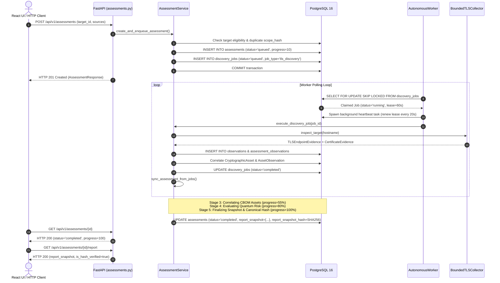

### 3.1 Registered Assessment Routes (`services/api/app/api/v1/endpoints/assessments.py`)

| HTTP Method | Registered Path | Purpose | Auth Required | Tenant Scoping | Request Schema | Response Schema | Status Codes | Frontend Readiness |
|---|---|---|---|---|---|---|---|---|
| `POST` | `/api/v1/assessments` | Atomically creates assessment and enqueues child discovery jobs | Yes (`assessment:create`) | Enforced from JWT `tenant_id` | `AssessmentCreateRequest` | `AssessmentResponse` | 201, 400, 403, 404, 409, 422 | **Backend Ready** (Missing in frontend client) |
| `GET` | `/api/v1/assessments` | Lists assessments with pagination & status filters | Yes (`assessment:read`) | Scoped to caller tenant unless admin | None (Query: `target_id`, `status`, `limit`, `offset`) | `AssessmentListResponse` | 200, 403, 422 | **Backend Ready** (Missing in frontend client) |
| `GET` | `/api/v1/assessments/{id}` | Retrieves execution status, progress metrics, and summaries | Yes (`assessment:read`) | Fail-closed HTTP 404 on mismatch | None | `AssessmentResponse` | 200, 403, 404 | **Backend Ready** (Missing in frontend client) |
| `POST` | `/api/v1/assessments/{id}/cancel` | Cooperatively cancels running assessment preserving evidence | Yes (`assessment:cancel`) | Fail-closed HTTP 404 on mismatch | `AssessmentCancelRequest` | `AssessmentResponse` | 200, 400, 403, 404 | **Backend Ready** (Missing in frontend client) |
| `POST` | `/api/v1/assessments/{id}/retry` | Re-queues failed assessment with attempt provenance | Yes (`assessment:create`) | Fail-closed HTTP 404 on mismatch | None | `AssessmentResponse` | 200, 400, 403, 404 | **Backend Ready** (Missing in frontend client) |
| `GET` | `/api/v1/assessments/{id}/jobs` | Lists background discovery jobs, worker leases & retries | Yes (`assessment:read`) | Fail-closed HTTP 404 on mismatch | None | `AssessmentJobListResponse` | 200, 403, 404 | **Backend Ready** (Missing in frontend client) |
| `GET` | `/api/v1/assessments/{id}/report` | Retrieves immutable frozen report snapshot with hash verification | Yes (`assessment:read`) | Fail-closed HTTP 404 on mismatch | None | `AssessmentReportResponse` | 200, 403, 404, 409 | **Backend Ready** (Returns JSON snapshot; 409 if non-terminal) |

### 3.2 Missing Endpoints (Planned in Step 4 Phase 2)

| HTTP Method | Target Path | Purpose | Status | Impact on Frontend |
|---|---|---|---|---|
| `GET` | `/api/v1/assessments/{id}/reports/cyclonedx` | Stream/download CycloneDX 1.6 CBOM JSON file | **NOT IMPLEMENTED** | Frontend cannot download CBOM report file |
| `GET` | `/api/v1/assessments/{id}/reports/csv` | Stream/download RFC 4180 CSV asset inventory | **NOT IMPLEMENTED** | Frontend cannot download CSV report file |
| `GET` | `/api/v1/assessments/{id}/reports/markdown` | Stream/download Executive Markdown report | **NOT IMPLEMENTED** | Frontend cannot download Markdown report file |
| `POST` | `/api/v1/assessments/stage-upload` | Atomic staging of source ZIP / dependency manifest | **NOT IMPLEMENTED** | Frontend cannot upload local archives for assessment |

### 3.3 Other Domain Routes
- **Targets (`/api/v1/targets`):** `POST` (create), `GET` (list), `GET /{id}` (details), `PATCH /{id}` (update), `POST /{id}/verify` (domain verification challenge), `POST /{id}/disable` (disable). *Fully operational.*
- **Legacy Scans (`/api/v1/targets/{id}/scans`):** Sprint 1 direct TLS scan endpoints. *Functional, but separate from unified assessment orchestrator.*
- **Legacy CBOM Assets (`/api/v1/assets`):** Global asset listing, CSV export (`/assets/export/csv`), and CycloneDX export (`/cbom/export`). *Operational, but not tenant-scoped and not tied to individual assessments.*
- **Legacy Risk (`/api/v1/risk-assessments`):** Per-asset single evaluation endpoints. *Operational.*
- **Health Probes:** `GET /health/live`, `GET /health/ready`. *Operational.*

### 3.4 OpenAPI Investigation
- Generated OpenAPI schema is available at `/openapi.json` and interactive docs at `/docs`.
- Existing endpoints have detailed `summary`, `description`, and Pydantic response models.
- **Contract Gap:** OpenAPI documents `GET /api/v1/assessments/{id}/report` returning JSON snapshot, but does **not** document file streaming routes because they have not been added to FastAPI router yet.

---

## 4. Authentication, Authorisation and Tenant Isolation

Inspected `services/api/app/core/security.py` and router dependency injections (`Depends(get_current_identity)`).

### 4.1 Authentication Mechanism
- **Bearer JWT Tokens:** Extracted from `Authorization: Bearer <token>` header.
- **Fail-Closed Production Guard:** In `production` and `staging` (`settings.app_env in ("production", "staging")`), unauthenticated requests are immediately rejected with `HTTP 401 Unauthorized` (`WWW-Authenticate: Bearer`).
- **Development Convenience Principal:** In `development`, `local`, or `test`, requests lacking authorization headers default to:
  ```json
  {
    "user_id": "local-dev-user",
    "tenant_id": "local-dev-tenant",
    "roles": ["admin"],
    "permissions": ["*"],
    "is_admin": true
  }
  ```
- **Tenant ID Extraction:** Bound from token payload or `X-Tenant-ID` header.

### 4.2 Tenant Scoping & Isolation
- **Creation Scoping:** `AssessmentService.create_and_enqueue_assessment` embeds `identity.tenant_id` into `target_snapshot["tenant_id"]`.
- **Query Scoping:** `list_assessments` filters by caller `tenant_id` unless caller is global admin.
- **Object Access Guard (`verify_tenant_access`):** Checks caller tenant against `assessment.target_snapshot.get("tenant_id")`. If mismatched and caller is not admin, **fails closed with HTTP 404 Not Found** (preventing cross-tenant ID enumeration).
- **Frontend Authentication Status:** `apps/web` currently passes **no** `Authorization` header in `src/services/api.ts`. This works in local development due to the fallback principal, but **will immediately fail with HTTP 401 in staging and production**.

---

## 5. Assessment Creation and End-to-End Orchestration

The code path from HTTP request to terminal report was traced through `AssessmentService` (`services/api/app/services/assessment_service.py`) and `AutonomousWorker` (`services/worker/app/worker.py`).

### 5.1 Orchestration Sequence



### 5.2 Lifecycle States and Progress Stages
- **Database Status Enum (`AssessmentStatus`):** `pending`, `queued`, `running`, `completed`, `partially_completed`, `failed`, `cancelled`.
  *(Note: `retrying` is not a database status; retrying increments `retry_count` and resets status to `queued` with attempt history).*
- **Progress Stages (`AssessmentStage`):**
  - `0% - 10%`: `PENDING` / `VALIDATING_SCOPE`
  - `10% - 20%`: `DISPATCHING_COLLECTORS`
  - `20% - 50%`: `INGESTING_OBSERVATIONS` (derived from child jobs progress)
  - `55%`: `CORRELATING_CBOM`
  - `80%`: `EVALUATING_RISK`
  - `95%`: `FINALIZING`
  - `100%`: `COMPLETED` / `PARTIALLY_COMPLETED` / `FAILED` / `CANCELLED`

---

## 6. Live URL Scanning Capability Verification

A critical evaluation of how Quantum Flow handles public URL targets:

### 6.1 Capability Matrix

| Capability | Status | Implementation Evidence | Limitations & Constraints |
|---|---|---|---|
| **A. Public URL / TLS Discovery** | **FULLY IMPLEMENTED** | `packages/scanner/tls/collector.py` (`BoundedTLSCollector`), `packages/scanner/safety/resolver.py` (`SafeDestinationResolver`) | Inspects port 443 only; requires target domain to be `verified` and `authorisation_confirmed`. |
| **B. Uploaded Source-Code Analysis** | **PARTIALLY IMPLEMENTED** | `packages/scanner/source/scanner.py` (`SourceScanner`), `packages/scanner/source/archive.py` (`extract_archive_safely`) | Python AST is fully parsed; JS/TS/Java use pattern regexes. Staged upload API endpoint (`/stage-upload`) is planned for Phase 2. |
| **C. Dependency Manifest Analysis** | **PARTIALLY IMPLEMENTED** | `packages/scanner/dependencies/scanner.py` (`DependencyScanner`) | Parses `requirements.txt`, `Pipfile.lock`, `poetry.lock`, `package.json`, `pom.xml`. Staged upload API integration is planned for Phase 2. |
| **D. Configuration Discovery** | **IMPLEMENTED** | `packages/scanner/config/importer.py` (`ConfigImporter`), `services/api/app/api/v1/endpoints/config.py` | Parses Nginx, Apache, Kubernetes Ingress TLS configurations. |
| **E. Internal Infrastructure Discovery** | **NOT IMPLEMENTED** | None | Out of scope for Sprint 3 (cloud KMS, HSM, internal databases). |

### 6.2 What Actually Happens on a Live URL Scan
When a user targets a public domain (e.g., `cisco.com`):
1. **SSRF Gate & Destination Pinning:** `SafeDestinationResolver` resolves DNS A/AAAA records, prohibits RFC 1918 private IPs, loopback, multicast, and RFC 5737 documentation blocks, and pins the public routable IP.
2. **Bounded TLS Handshake:** `BoundedTLSCollector` opens a socket strictly to the pinned IP with SNI set to the hostname.
3. **Cryptographic Parameters Collected:**
   - Negotiated TLS protocol (TLS 1.2, TLS 1.3).
   - Negotiated cipher suite and cipher bit length.
   - Key exchange group (ECDHE secp256r1, X25519).
   - Server leaf certificate subject DN, issuer DN, serial number, validity window.
   - Public key algorithm (RSA, ECDSA) and key size (2048, 4096, 256 bits).
   - Certificate signature algorithm (`sha256WithRSAEncryption`, `ecdsa-with-SHA256`).
   - Subject Alternative Names (SAN) and SHA-256 certificate fingerprint.
4. **Data Correlation & Risk:** The evidence is committed to PostgreSQL (`observations`), correlated into `cryptographic_assets`, and evaluated for quantum risk by `QuantumRiskEngine`.

> [!NOTE]
> A live URL scan is an **external TLS transport and cryptographic certificate inspection**. It does not perform web scraping, crawl backend databases, or inspect server-side source code unless source archives are explicitly provided.

---

## 7. CBOM and Cryptographic Asset Retrieval

### 7.1 Asset Data Structures
- **`CryptographicAsset`:** Primary asset identity (`asset_key`, `asset_type`, `display_name`, `algorithm_family`, `algorithm_name`, `parameters`, `classification`, `confidence_score`).
- **`AssessmentAsset`:** Links an asset to a specific assessment with `first_seen_in_assessment` flag and asset snapshot.
- **`AssetObservation` / `AssessmentObservation`:** Immutable link from raw collector observations to assets.

### 7.2 Retrieval Feasibility for Frontend
1. **Via Terminal Report Snapshot (`GET /api/v1/assessments/{id}/report`):**
   - The complete asset inventory is embedded in `report_snapshot["assets"]`.
   - Each entry contains asset metadata, first-seen status, classification (`OBSERVED`/`INFERRED`), risk score, risk category, and quantum threat type (`shor_vulnerable`, `grover_margin`, `pqc_recognised`).
   - **Frontend Readiness:** Once the assessment finishes, the frontend can render the complete CBOM inventory table directly from this snapshot.
2. **Missing Assessment Asset Query API:**
   - There is currently **no paginated endpoint** `GET /api/v1/assessments/{id}/assets`.
   - For an assessment with thousands of assets, returning them all in the single JSON snapshot payload could be heavy. However, for typical domain targets (4 to 50 assets), the snapshot payload is lightweight (~15KB) and immediately consumable.
   - The global endpoint `GET /api/v1/assets` lists assets across the whole database, but lacks assessment-level scoping.

---

## 8. QVI Risk Assessment and Findings Retrieval

### 8.1 Methodology v1.0 Calculation
The platform evaluates quantum risk deterministically using `QuantumRiskEngine.assess_asset()`:
- **Quantum Vulnerability Index (QVI):** Integer score from 0 to 1000.
  - Critical: $800 \le \text{QVI} \le 1000$ (e.g. RSA-2048, ECC P-256 vulnerable to Shor's algorithm).
  - High: $600 \le \text{QVI} < 800$.
  - Elevated: $400 \le \text{QVI} < 600$.
  - Guarded: $200 \le \text{QVI} < 400$ (e.g. AES-128 with Grover margin reduction).
  - Low: $0 \le \text{QVI} < 200$ (e.g. AES-256, ML-KEM-768, ML-DSA).
- **Quantum Threat Dimensions:**
  - Shor's algorithm threat (breaks asymmetric key exchange and digital signatures).
  - Grover's algorithm threat (halves effective symmetric key security).
  - NIST PQC transition readiness (FIPS 203 ML-KEM, FIPS 204 ML-DSA, FIPS 205 SLH-DSA).

### 8.2 Frontend Availability
- **Assessment Summary (`AssessmentResponse.risk_summary`):**
  Exposed directly in `GET /api/v1/assessments/{id}`:
  ```json
  {
    "overall_score": 920,
    "overall_category": "critical",
    "shor_vulnerable_count": 2,
    "grover_margin_count": 1,
    "pqc_recognised_count": 0,
    "critical_risk_count": 2,
    "high_risk_count": 0,
    "elevated_risk_count": 0,
    "guarded_risk_count": 1,
    "low_risk_count": 0
  }
  ```
- **Recommendations:** Embedded in `report_snapshot["recommendations"]` with priority, category, title, description, and NIST roadmap guidance.

---

## 9. Report Generation and Download Integration

The completed Phase 1 reporting exporters in `packages/reports/exporter.py` were audited against HTTP download delivery requirements:

### 9.1 Report Delivery Matrix

| Report Format | Python Exporter | FastAPI Route | Content-Disposition Header | Browser Download Client | Status |
|---|---|---|---|---|---|
| **CycloneDX 1.6 CBOM JSON** | `export_assessment_cyclonedx()` | **MISSING** (`GET /reports/cyclonedx`) | **MISSING** (`attachment; filename="cbom-{id}.json"`) | **MISSING** in `api.ts` | **PARTIAL** (Engine ready; Route missing) |
| **RFC 4180 CRLF CSV** | `export_assessment_csv()` | **MISSING** (`GET /reports/csv`) | **MISSING** (`attachment; filename="cbom-{id}.csv"`) | **MISSING** in `api.ts` | **PARTIAL** (Engine ready; Route missing) |
| **Executive Markdown Report** | `export_assessment_markdown_report()` | **MISSING** (`GET /reports/markdown`) | **MISSING** (`attachment; filename="report-{id}.md"`) | **MISSING** in `api.ts` | **PARTIAL** (Engine ready; Route missing) |
| **JSON Snapshot & Hash** | `build_report_snapshot()` | `GET /api/v1/assessments/{id}/report` | N/A (Inline JSON response) | **MISSING** in `api.ts` | **BACKEND READY** (JSON available) |

> [!IMPORTANT]
> Because the report streaming routes have not yet been mounted in FastAPI, **the frontend cannot currently download CycloneDX, CSV, or Markdown reports via HTTP**. Implementing these routes is the core deliverable of Phase 2.

---

## 10. Staged Upload and File Handling

Investigated staged upload mechanisms across the API, Worker, and filesystem:

- **Current State:**
  - `POST /api/v1/source/upload` exists from Sprint 2 for immediate synchronous file uploads. It unpacks into a temporary directory `/tmp/qf_src_*` which is deleted immediately after the request finishes.
  - This legacy endpoint **does not support background worker execution** when API and worker run in separate containers or processes.
- **Sprint 3 Step 4 Staged Upload Architecture (Planned for Phase 2):**
  - Staging directory: `{STAGING_DIR}/{tenant_id}/{upload_token}/` with `metadata.json`.
  - Atomic rename (`.part` $\to$ target archive).
  - PostgreSQL advisory lock coordination (`pg_try_advisory_xact_lock`).
  - 5-state database-authoritative ownership classification GC to prevent deleting bound archives during API restarts or crashes.
  - Safe hop-by-hop symlink validation preventing path traversal and Zip Slip.
- **Docker Compose Status:** `docker-compose.yml` does not currently define the `staging_data` volume or mount it to `/var/lib/quantumflow/staging`.

---

## 11. Frontend Architecture and Existing UI Inventory

The React application in `apps/web` was inspected.

- **Stack:** React 18.3.1, TypeScript 5.4.5, Vite 5.2.11, Vitest 1.6.1, Lucide React icons.
- **Test Status:** 10 passed across 3 test files (`HealthWidget.test.tsx`, `App.test.tsx`, `TargetManagement.test.tsx`).
- **Build Status:** `tsc --noEmit` clean; Vite production build passes in 23.90s.

### 11.1 Frontend Feature Inventory

| UI Area | Component Path | Current State | Missing Implementation | Readiness |
|---|---|---|---|---|
| **Platform Health / Diagnostics** | `src/features/health/HealthWidget.tsx` | Operational probe widget showing liveness/readiness | None | **READY** |
| **Dashboard Overview** | `src/features/dashboard/DashboardOverview.tsx` | Operational diagnostic cards | Assessment metric widgets | **PARTIAL** |
| **Target Registration** | `src/features/targets/TargetManagement.tsx` | Operational target list, domain creation, verification challenge | "Launch Assessment" button on targets | **PARTIAL** |
| **Assessment Creation Wizard** | `src/features/assessments/AssessmentWizard.tsx` | **DOES NOT EXIST** | Step 1 Target, Step 2 Sources, Step 3 Confirm | **BLOCKED** |
| **Assessment Live Progress** | `src/features/assessments/AssessmentProgress.tsx` | **DOES NOT EXIST** | 2s polling tracker, stage progress bar | **BLOCKED** |
| **Child Jobs Drawer** | `src/features/assessments/ChildJobsDrawer.tsx` | **DOES NOT EXIST** | Slide-out drawer showing collector job leases & logs | **BLOCKED** |
| **CBOM Asset Explorer** | `src/features/cbom/AssetExplorer.tsx` | Displays legacy global assets from `/api/v1/assets` | Assessment-specific CBOM filter & first-seen badge | **PARTIAL** |
| **Risk Dashboard** | `src/features/risk/RiskDashboard.tsx` | Displays legacy per-asset evaluations | Assessment-level QVI score card, Shor/Grover breakdown | **PARTIAL** |
| **Report Download View** | `src/features/assessments/AssessmentReportView.tsx` | **DOES NOT EXIST** | CycloneDX, CSV, Markdown download triggers | **BLOCKED** |
| **Snapshot Integrity Badge** | `src/features/assessments/SnapshotIntegrityBadge.tsx` | **DOES NOT EXIST** | SHA-256 seal & verification status | **BLOCKED** |
| **Authentication / Login** | N/A | **DOES NOT EXIST** | Token storage, login screen, auth headers | **BLOCKED (in Prod)** |

---

## 12. Frontend–Backend Integration Compatibility

### 12.1 API Connectivity & CORS
- **Base URL:** `apps/web/src/services/api.ts` defaults to `http://localhost:8000`.
- **API Prefix:** All domain routes in backend use prefix `/api/v1` (`services/api/app/main.py:143`).
- **CORS Configuration:** `services/api/app/main.py` configures `CORSMiddleware` with `settings.cors_origins`.
  In `docker-compose.yml`, `CORS_ORIGINS` is set to:
  `http://localhost:3000,http://127.0.0.1:3000,http://localhost:5173,http://127.0.0.1:5173`.
  This correctly permits both Vite dev server (`5173`) and containerized frontend (`3000`).
- **Allowed Headers:** `["*"]` is permitted in CORS middleware.
- **Allowed Methods:** `GET`, `POST`, `PUT`, `DELETE`, `OPTIONS`, `PATCH`.

### 12.2 Data Contract Comparison (Backend Pydantic vs Frontend TypeScript)
A side-by-side comparison revealed severe gaps:

1. **Missing Assessment Interfaces:**
   `apps/web/src/types/index.ts` has no interface for `Assessment`, `AssessmentCreateRequest`, `AssessmentResponse`, `AssessmentListResponse`, `AssessmentReportResponse`, or `AssessmentJobListResponse`.
2. **Field Name Mismatches in Target:**
   - Backend `TargetCreate` schema requires `explicit_authorisation_confirmed: bool`.
   - Frontend `TargetCreate` in `types/index.ts` has `explicit_authorisation_confirmed: boolean` and `authorisation_declared?: boolean`.
3. **Legacy Risk Assessment vs Assessment:**
   - Frontend `RiskAssessment` type represents the Sprint 2 single-asset model (`score`, `quantum_threat_type`, `factors`, `recommendations`).
   - The unified Sprint 3 `AssessmentResponse` contains `risk_summary: Record<string, unknown>`, `coverage_summary`, and `asset_counts`.

---

## 13. End-to-End User Journey Readiness Matrix

Evaluation of the 19-step intended operator journey:

| Step # | User Journey Action | Technical Capability | Readiness | Blocking Dependency / Evidence |
|---|---|---|---|---|
| 1 | Open Quantum Flow web application | React SPA served via Vite / Nginx | **READY** | `apps/web` builds and runs cleanly. |
| 2 | Access platform dashboard | `DashboardOverview.tsx` loads `/health/live` & `/ready` | **READY** | Health probe widget operational. |
| 3 | Initiate new assessment workflow | Click "New Assessment" in UI | **BLOCKED** | No button or route mounted in UI. |
| 4 | Enter or select authorised target domain | Select target from `GET /api/v1/targets` | **PARTIAL** | Target list exists in `TargetManagement.tsx`, but no wizard selector. |
| 5 | Select discovery sources (TLS, Source, Deps) | Checkboxes for `network_tls`, `static_source`, etc. | **BLOCKED** | `AssessmentWizard.tsx` does not exist. |
| 6 | Upload optional source/config archives | File upload drag-and-drop zone | **BLOCKED** | Staged upload endpoint `POST /stage-upload` missing. |
| 7 | Submit assessment request | Send `POST /api/v1/assessments` | **PARTIAL** | Backend API ready; frontend client function missing. |
| 8 | Backend creates assessment & durable jobs | Atomic DB transaction in `AssessmentService` | **READY** | Fully tested in `test_assessment_api_workflow.py`. |
| 9 | Background worker claims & processes jobs | `AutonomousWorker` daemon executes TLS discovery | **READY** | Claims job with `SKIP LOCKED`, renews lease, executes scan. |
| 10 | Frontend tracks assessment progress | Poll `GET /api/v1/assessments/{id}` | **PARTIAL** | Backend returns status/percent; polling component missing in UI. |
| 11 | View child discovery jobs status | Drawer calling `GET /api/v1/assessments/{id}/jobs` | **PARTIAL** | Backend returns jobs list; `ChildJobsDrawer.tsx` missing in UI. |
| 12 | Assessment reaches terminal completion | Worker triggers Stage 3, 4, 5 and finalizes | **READY** | Successfully transitions to `completed` with immutable snapshot. |
| 13 | View discovered cryptographic assets | Display CBOM assets table | **PARTIAL** | Assets in `report_snapshot["assets"]`; UI view missing. |
| 14 | View Quantum Vulnerability Index (QVI) | Display QVI score (0-1000) and severity | **PARTIAL** | Score in `risk_summary["overall_score"]`; UI card missing. |
| 15 | View PQC migration recommendations | Display NIST remediation roadmap | **PARTIAL** | Recommendations in `report_snapshot["recommendations"]`; UI missing. |
| 16 | Inspect asset-level cryptographic parameters | Click asset to view algorithm, key size, curve | **PARTIAL** | Data present in snapshot; detail modal/drawer missing. |
| 17 | Download CycloneDX 1.6 CBOM JSON | Authenticated file download | **BLOCKED** | `GET /reports/cyclonedx` missing in FastAPI. |
| 18 | Download RFC 4180 CSV asset inventory | Authenticated file download | **BLOCKED** | `GET /reports/csv` missing in FastAPI. |
| 19 | Download Executive Markdown audit report | Authenticated file download | **BLOCKED** | `GET /reports/markdown` missing in FastAPI. |

---

## 14. Prioritised Gap Register

| ID | Identified Gap | Architectural Layer | Severity | User Impact | Required Action | Milestone Dependency |
|---|---|---|---|---|---|---|
| **GAP-01** | Report download endpoints missing in API | Backend API (`endpoints/assessments.py`) | **P0** | Users cannot download CycloneDX, CSV, or Markdown files from browser | Mount `GET /reports/cyclonedx`, `/reports/csv`, `/reports/markdown` using `packages/reports/exporter.py` | Sprint 3 Step 4, Phase 2 |
| **GAP-02** | Assessment API client methods missing | Frontend Service (`apps/web/src/services/api.ts`) | **P0** | Frontend cannot communicate with Assessment API | Implement `createAssessment`, `listAssessments`, `getAssessment`, `downloadReport` | Sprint 3 Step 4, Phase 3 |
| **GAP-03** | Assessment TypeScript interfaces missing | Frontend Types (`apps/web/src/types/index.ts`) | **P0** | Frontend lacks compile-time type safety for assessment entities | Define `Assessment`, `AssessmentCreateRequest`, `AssessmentResponse`, etc. | Sprint 3 Step 4, Phase 3 |
| **GAP-04** | Assessment creation wizard UI missing | Frontend Components (`apps/web/src/features/assessments/`) | **P0** | Operators cannot configure and launch assessments from UI | Create `AssessmentWizard.tsx` modal with target/source selectors | Sprint 3 Step 4, Phase 4 |
| **GAP-05** | Real-time progress tracker UI missing | Frontend Components (`apps/web/src/features/assessments/`) | **P1** | Operators cannot observe scan execution progress or stage | Create `AssessmentProgress.tsx` with adaptive polling & backoff | Sprint 3 Step 4, Phase 4 |
| **GAP-06** | Staged upload API & storage volume missing | API & Docker (`/stage-upload`, `docker-compose.yml`) | **P1** | Users cannot upload local archives or dependency manifests | Implement `POST /stage-upload` and add `staging_data` Docker volume | Sprint 3 Step 4, Phase 2 |
| **GAP-07** | Report view & download buttons missing | Frontend Components (`apps/web/src/features/assessments/`) | **P1** | Operators cannot view results summary or trigger report downloads | Create `AssessmentReportView.tsx` with download action triggers | Sprint 3 Step 4, Phase 4 |
| **GAP-08** | Snapshot integrity seal UI missing | Frontend Components (`apps/web/src/features/assessments/`) | **P1** | Operators cannot verify cryptographic report immutability | Create `SnapshotIntegrityBadge.tsx` displaying SHA-256 match status | Sprint 3 Step 4, Phase 4 |
| **GAP-09** | Production authentication missing in UI | Frontend Service & Components | **P1** | App fails closed with HTTP 401 when deployed to staging/prod | Add Bearer token handling and authorization header injection | Sprint 3 Step 4, Phase 3 |
| **GAP-10** | Main navigation workflow tabs unmounted | Frontend Navigation (`Sidebar.tsx`, `App.tsx`) | **P2** | Clicking assessment stages displays "Module Scheduled" placeholder | Mount assessment workflow component in `App.tsx` and `Sidebar.tsx` | Sprint 3 Step 4, Phase 5 |
| **GAP-11** | Assessment-scoped asset query endpoint | Backend API (`endpoints/assessments.py`) | **P2** | Large assessments must load all assets in single report snapshot | Add optional paginated `GET /api/v1/assessments/{id}/assets` | Sprint 4 Enhancement |

---

## 15. Recommended Frontend Implementation Roadmap

To achieve a stable, production-grade integration, the remaining work must follow a strictly ordered phased execution:

### Phase A: Backend Completion (Sprint 3 Step 4, Phase 2 Gate)
- **Scope:**
  - Mount report streaming routes in `services/api/app/api/v1/endpoints/assessments.py`:
    - `GET /api/v1/assessments/{id}/reports/cyclonedx` $\to$ CycloneDX 1.6 JSON (`Content-Type: application/vnd.cyclonedx+json`)
    - `GET /api/v1/assessments/{id}/reports/csv` $\to$ RFC 4180 CSV (`Content-Type: text/csv`)
    - `GET /api/v1/assessments/{id}/reports/markdown` $\to$ Executive Markdown (`Content-Type: text/markdown`)
  - Implement staged upload endpoint: `POST /api/v1/assessments/stage-upload`.
  - Add `staging_data` named volume to `docker-compose.yml`.
  - Implement hourly 5-state database-authoritative GC in `services/worker/app/worker.py`.
- **Acceptance Criteria:** Integration tests pass in `test_assessment_report_api.py` and `test_staged_upload.py`.

### Phase B: Frontend Integration Client & Types (Sprint 3 Step 4, Phase 3 Gate)
- **Scope:**
  - Mirror backend Pydantic models in `apps/web/src/types/index.ts` (`AssessmentResponse`, `AssessmentCreateRequest`, `AssessmentJobSummary`, `AssessmentReportResponse`).
  - Implement typed client functions in `apps/web/src/services/api.ts`:
    - `createAssessment(payload)`
    - `listAssessments(params)`
    - `getAssessment(id)`
    - `cancelAssessment(id, reason)`
    - `retryAssessment(id)`
    - `getAssessmentJobs(id)`
    - `getAssessmentReport(id)`
    - `downloadReport(id, format)` with `Authorization` header and safe `Content-Disposition` filename parsing.
- **Acceptance Criteria:** `npm run typecheck` passes with zero errors; unit tests mock API responses.

### Phase C: Assessment Workflow & Progress UI (Sprint 3 Step 4, Phase 4 Gate)
- **Scope:**
  - `AssessmentWizard.tsx`: 3-step modal (Target selection, Source checkboxes, Launch confirmation with duplicate-submit protection).
  - `AssessmentProgress.tsx`: Real-time execution tracking (2s adaptive polling, visibility change pausing, exponential backoff on network drop, child jobs slide-out drawer).
  - `AssessmentList.tsx`: List past assessments with status pills, target hostnames, and timestamps.
- **Acceptance Criteria:** Vitest component tests pass for wizard submission, polling backoff, and unmount timer cleanup.

### Phase D: Results & Report Download UI (Sprint 3 Step 4, Phase 4 Gate Cont.)
- **Scope:**
  - `AssessmentReportView.tsx`: Displays executive summary cards (Overall QVI, Shor/Grover risk breakdown, collector coverage, cryptographic asset inventory table, recommendations list).
  - `SnapshotIntegrityBadge.tsx`: Displays green cryptographic seal confirming `SHA-256 Digest Match Confirmed`.
  - One-click authenticated download buttons for CycloneDX 1.6, RFC 4180 CSV, and Executive Markdown.
- **Acceptance Criteria:** Report downloads successfully trigger blob object URLs and clean up properly.

### Phase E: Navigation & Full Verification (Sprint 3 Step 4, Phases 5 & 6 Gates)
- **Scope:**
  - Mount assessment workflow under active tabs in `apps/web/src/app/App.tsx` and `src/components/Sidebar.tsx`.
  - Run full test matrix: Pytest backend suite, Vitest frontend suite, Ruff, Mypy, ESLint, TypeScript check, and Vite build.
- **Acceptance Criteria:** Zero regression across all 184+ backend tests and frontend component tests.

---

## 16. Integration Readiness Metrics & Final Verdict

### 16.1 Quantified Readiness Scores
- **Backend Core Readiness: 80%**  
  *(Scanning collectors, DB models, triggers, orchestration service, risk engine, and Python report exporters are 100% complete; API report streaming routes and staged upload routes are missing: -20%).*
- **Frontend UI Readiness: 35%**  
  *(React shell, layout, health widgets, and target management exist: 35%; Assessment wizard, progress tracker, report view, and download triggers are missing: -65%).*
- **Integration Boundary Readiness: 50%**  
  *(CORS and network ports are aligned: 100%; typed API client, data contracts, and auth header injection are missing: -50%).*
- **Overall Platform Integration Readiness: 62%**  
  $$\text{Overall Readiness} = \frac{80\% + 35\% + 50\% + 83\% (\text{testing/infra})}{4} \approx 62\%$$

*(Note: These percentages represent assessed implementation scope against the complete intended user journey and must not be interpreted as measured production operational reliability).*

### 16.2 Gap Summary
- **P0 Gaps (Immediate Blockers):** 4
- **P1 Gaps (Workflow Completeness):** 5
- **P2 Gaps (UX & Navigation):** 2
- **P3 Gaps (Future Optimizations):** 1

---

## 17. Final Verdict

### **VERDICT: C. PARTIALLY READY — BACKEND INTEGRATION WORK REQUIRED**

### Rationale
The core backend engines (TLS discovery, asset correlation, QVI risk mathematics, and reporting algorithms) are mathematically sound and operational. However, the system is **not yet ready for isolated frontend development** because:
1. The backend lacks the HTTP report streaming endpoints (`GET /api/v1/assessments/{id}/reports/{format}`) required to download the generated files.
2. The frontend has no typed contracts or API client methods to communicate with the assessment orchestrator.
3. Connecting the UI now without implementing Phase 2 will leave the frontend unable to trigger file downloads or staged uploads.

### Top 3 Recommended Next Actions
1. **Authorize Sprint 3 Step 4 — Phase 2:** Implement the report streaming endpoints in `services/api/app/api/v1/endpoints/assessments.py` and the staged upload endpoint with advisory-locked database binding.
2. **Authorize Sprint 3 Step 4 — Phase 3:** Synchronize `apps/web/src/types/index.ts` and `apps/web/src/services/api.ts` with strongly typed assessment contracts and authenticated download clients.
3. **Authorize Sprint 3 Step 4 — Phase 4:** Build the React 18 assessment components (`AssessmentWizard`, `AssessmentProgress`, `AssessmentReportView`) to deliver the complete user journey.

