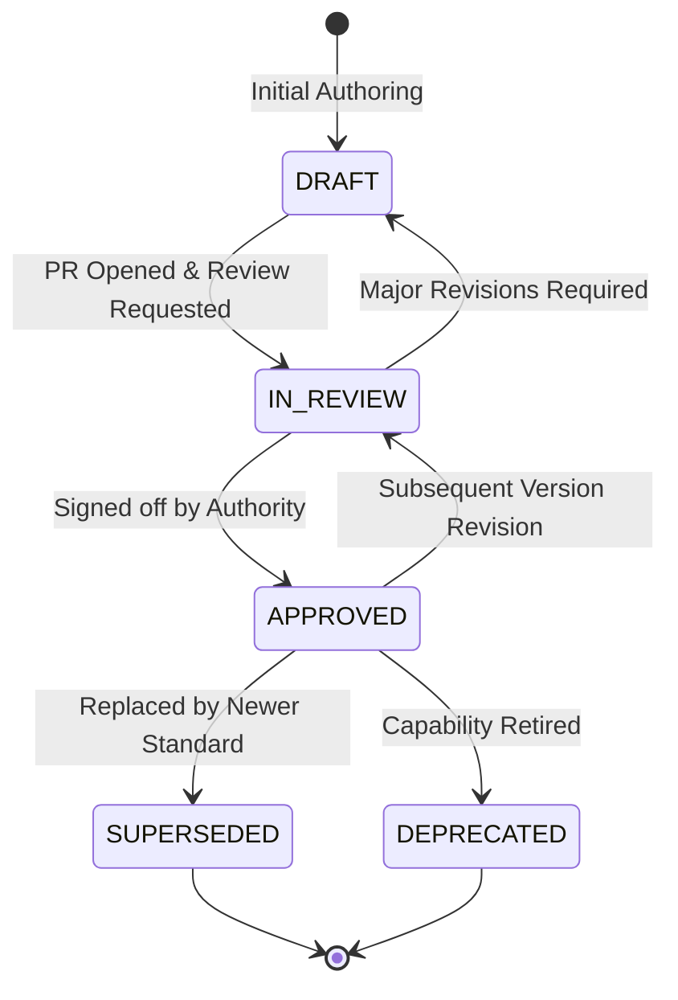

# Quantum Flow Documentation Governance & Lifecycle Guide

**Status:** Draft — Pending Company Review and Approval  
**Document ID:** QFT-GOV-DOC-001  
**Version:** 1.0 — Initial Engineering Draft  
**Date:** 02 November 2026  
**Classification:** Internal Technical Governance  
**Owner:** Technical Documentation Lead / Technical Lead / CISO  
**Approval Authority:** `[COMPANY APPROVAL REQUIRED — CISO & Technical Lead]`  
**Target Audience:** All engineers, architects, technical writers, and product managers

---

## 1. Purpose and Philosophy

Documentation is a **first-class engineering artifact** in Quantum Flow Technologies. 

As a cybersecurity platform addressing the post-quantum cryptographic transition, clear, version-controlled, auditable, and accurate documentation is essential. Outdated documentation, broken links, or unverified claims of security compliance introduce operational and legal risks.

This guide defines the standards, naming conventions, lifecycle states, review cadences, and approval authority for all technical documentation within the repository.

---

## 2. Documentation Ownership by Category

Every directory in `docs/` is assigned a designated accountable owner responsible for technical accuracy:

| Category / Directory | Topic Scope | Primary Accountable Owner | Approval Authority |
|---|---|---|---|
| `docs/00-company-vision/` | Executive vision, strategic roadmap, market positioning | Founder & CEO | Founder & CEO |
| `docs/01-product/` | PRD, user journeys, feature requirements, glossary | Product Owner | Product Owner |
| `docs/02-technical-architecture/` | TRD, SAD, Implementation Blueprint, ADRs | Technical Lead / Enterprise Architect | Technical Lead & CISO |
| `docs/03-database/` | Database Design Document (DDD), schemas, partitions | Backend Lead / Data Architect | Technical Lead |
| `docs/04-api/` | REST API contracts, payload models, OpenAPI specs | Backend Lead / API Architect | Technical Lead |
| `docs/05-risk-engine/` | Quantum risk methodology, scoring formulas, rulesets | Cryptographic Architect / CISO | CISO & Tech Lead |
| `docs/06-cbom/` | CBOM schema, asset correlation engine, CycloneDX | Platform Engineer / Architect | Technical Lead |
| `docs/07-security/` | Threat model, egress controls, data governance, IRP | Product Security Lead / CISO | CISO |
| `docs/08-development/` | Setup guide, coding standards, testing, operations | DevSecOps Lead / QA Lead | Technical Lead |
| `docs/09-project-management/` | Implementation roadmap, backlog, RTM | Technical Program Manager | Tech Lead & PO |

---

## 3. Standard Document Lifecycle & Status Model

All formal specifications must include a standardized metadata header indicating their current lifecycle state:



### Document Status Definitions
- `DRAFT`: The document is actively being authored or updated. Content represents proposed ideas and must not be treated as binding architectural policy.
- `IN_REVIEW`: The document has been submitted for formal review (via Pull Request). Technical leads, CISO, and peer reviewers are evaluating the content.
- `APPROVED`: The document has received formal sign-off from the designated Approval Authority. It represents binding architectural and engineering direction.
- `SUPERSEDED`: The document has been officially replaced by a newer version or standard (e.g., "Superseded by TRD v2.0").
- `DEPRECATED`: The architectural direction or capability is retired and no longer maintained.

> [!IMPORTANT]
> **Approval Authority Notice:** Only the designated company authority (e.g., CISO for security/risk, Technical Lead for architecture/database, CEO for vision) can formally advance a document to `APPROVED` status.

---

## 4. Document Control Header Specification

Every formal technical document must begin with the standard Document Control block:

```markdown
# [DOCUMENT TITLE]

**Document ID:** QFT-[CATEGORY]-[CODE]-[NUMBER]  
**Version:** X.Y — [Draft / Approved / In Review]  
**Status:** DRAFT | IN_REVIEW | APPROVED | DEPRECATED | SUPERSEDED  
**Date:** YYYY-MM-DD  
**Classification:** Confidential | Internal Engineering  
**Owner:** [Role / Team]  
**Approval Authority:** [Designated Role / Executive]  
**Related Documents:** [Links to related specs]
```

---

## 5. File Naming & Organization Conventions

1. **Category Directories:** Standardized 2-digit numeric prefix followed by kebab-case: `00-company-vision`, `01-product`, etc.
2. **Major Specifications:** PascalCase or Upper_Snake_Case with explicit version suffix:
   - `PRD_v1.0.md`
   - `TRD_v1.0.md`
   - `Database_Design_v1.0.md`
3. **Engineering Guides:** Upper_Snake_Case:
   - `Setup_Guide.md`
   - `Coding_Standards.md`
   - `Testing_Strategy.md`
4. **Architecture Decision Records:** Sequential 4-digit zero-padded number with kebab-case title:
   - `ADR-0001-modular-monolith-architecture.md`

---

## 6. Diagram & Visual Standards

- **Preferred Diagram Tool:** **Mermaid** code blocks natively embedded in Markdown.
- **Rules:**
  - Quote node labels containing special characters or parentheses: `id["Node (Label)"]`.
  - Avoid HTML styling inside node labels.
  - Choose clear orientations: `flowchart LR` for pipelines, `flowchart TD` for hierarchies, `sequenceDiagram` for handshakes.
- **Binary Images:** Where raster/vector images are required (e.g., UI mockups), store them in a local `assets/` subfolder and embed using relative paths.

---

## 7. Cross-Document Consistency & Maintenance

1. **Single Source of Truth:** Core technical facts (e.g., database table names, API paths, risk weights) must be defined authoritatively in their primary document and referenced elsewhere via relative links. Never copy-paste multi-page tables between documents.
2. **Relative Linking:** All internal documentation links must use relative Markdown file paths (e.g., `[TRD](./02-technical-architecture/TRD_v1.0.md)`).
3. **Review Cadence:**
   - Architecture & Security docs: Reviewed prior to every major sprint milestone.
   - Standards Register (NIST FIPS 203/204/205): Checked monthly for errata or revisions.
   - Operations & Runbooks: Verified monthly via disaster recovery rehearsals.

---

## 8. Archival & Historical Deprecation

When a major document version is retired:
- Update its status header to `SUPERSEDED` and provide an explicit markdown link to the replacement document.
- Move obsolete drafts to an `archive/` subfolder if necessary, preserving full Git history.
- Never delete historical technical records without documented CISO approval.
