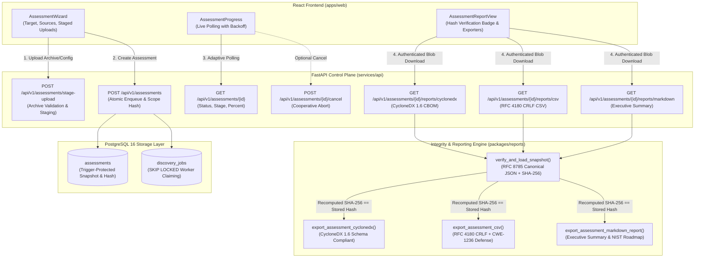
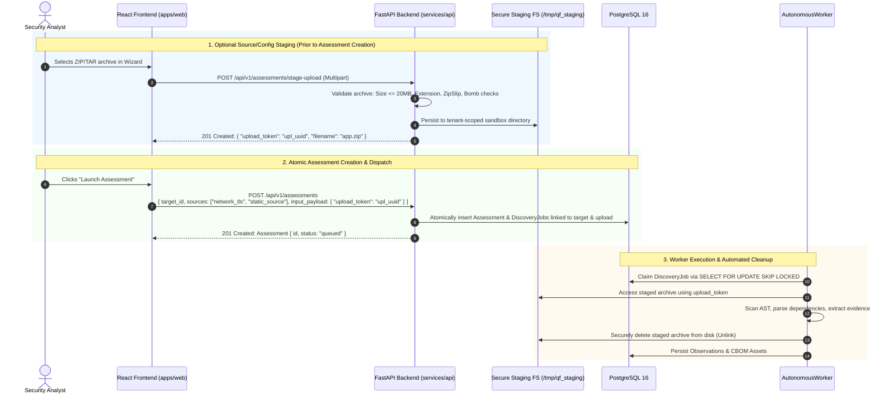
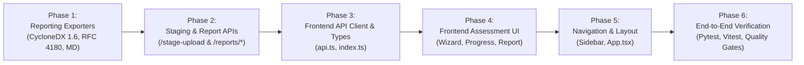

# Quantum Flow — Sprint 3 Step 4 Implementation Plan (Revision 1.1)
## Unified Enterprise Reporting & Frontend Guided Assessment Integration

**Document ID:** QFT-SPRINT-003-STEP-4-PLAN-REV1.1  
**Version:** 1.1 (Supersedes v1.0 following Engineering Review)  
**Date:** 3 November 2026  
**Status:** Submitted for Engineering Review & Approval (No Implementation Until Approved)  
**Target Milestone:** Sprint 3 Step 4 — Unified Reporting & Frontend Integration  
**Dependencies:** Sprint 3 Step 1 (Schema & DB Integrity), Step 2 (Assessment Orchestrator), Step 3 (REST API & Autonomous Worker) — All Formally Accepted  

---

## 1. Executive Summary & Purpose

Sprint 3 Steps 1 through 3 delivered an immutable, trigger-protected PostgreSQL 16 schema, an end-to-end multi-source `AssessmentService` correlating discovery evidence into Methodology v1.0 QVI risk evaluations, and an autonomous worker daemon with `SKIP LOCKED` job claiming, heartbeat renewal, and fail-closed tenant isolation.

**Sprint 3 Step 4** delivers the platform's reporting subsystem and React guided assessment workflow. This revised plan (Version 1.1) addresses all findings from the engineering review, establishing:

1. **RFC 4180 Compliant CSV Export:** Exact CRLF (`\r\n`) record delimiters, strict RFC 4180 quoting and escaping, and comprehensive formula injection neutralization (CWE-1236) protecting against leading whitespace, tabs, and control characters.
2. **Canonical Snapshot Integrity Verification:** Mandatory verification operation computing the canonical RFC 8785 SHA-256 digest of the terminal snapshot and comparing it against `report_snapshot_hash` using constant-time comparison before generating any report format.
3. **CycloneDX 1.6 CBOM Schema Compliance:** Strict conformity to the official CycloneDX 1.6 CBOM JSON Schema, validating `cryptoProperties`, dependency graphs, deterministic `bom-ref` resolution, and standard `properties` extensions for Quantum Flow-specific attributes.
4. **Complete Source Upload & Staging Lifecycle:** Explicit API contracts for source archives, dependency manifests, and TLS configurations with size ceilings, archive sanitization, tenant isolation, and cleanup lifecycle.
5. **Authenticated Frontend Downloads:** Secure fetch/Blob streaming architecture passing bearer authorization headers, handling HTTP error responses (401, 404, 409, 500), and managing Blob object URL cleanup.
6. **Precise Assessment Lifecycle Availability:** Distinct report behaviors for `completed`, `partially_completed`, `cancelled`, and `failed` states, enforcing that absence of evidence is never presented as proof of post-quantum safety.
7. **Accurate Network Security Terminology:** Proper distinction between public-routable destination IP resolution, destination IP pinning, SSRF mitigation, and DNS ownership challenge verification.
8. **Resilient Frontend Polling Hook:** Unmount cleanup, terminal state termination, exponential backoff on network failures, Page Visibility API integration, and duplicate submission prevention.

> [!IMPORTANT]
> **Governance & Scope Guardrails:** This document is exclusively a specification. **No implementation code, frontend modifications, or endpoint additions will be executed until this plan receives formal approval.** Zero database migrations will be introduced. Core risk engine mathematics and CBOM asset-key generation algorithms remain strictly invariant.

---

## 2. Architecture & Data Flow

### 2.1 Subsystem Data Flow



---

## 3. Reporting Subsystem Specifications

### 3.1 Canonical Snapshot Integrity Verification

Before generating any report export (CycloneDX, CSV, or Markdown), the API layer must perform a cryptographic integrity check on the stored snapshot.

#### Verification Algorithm:
1. **Load Entity:** Retrieve `Assessment` by `assessment_id` ensuring tenant isolation.
2. **Lifecycle Gate:** If assessment status is `queued` or `running`, raise `HTTP 409 Conflict` ("Reports cannot be generated for active assessments").
3. **Existence Gate:** If `report_snapshot` is `None` or `report_snapshot_hash` is `None`, raise `HTTP 422 Unprocessable Content` ("Terminal report snapshot is missing").
4. **Canonical Serialization:** Invoke the existing canonical serializer [`compute_canonical_evidence_sha256(assessment.report_snapshot)`](file:///d:/Desktop/quantum-flow-pqc-platform/packages/scanner/safety/canonical.py#L40) which deterministically sorts JSON keys and formats floats/integers per RFC 8785. **Do not create a secondary canonicalization function.**
5. **Constant-Time Comparison:** Compare the computed SHA-256 digest against `assessment.report_snapshot_hash` using `hmac.compare_digest(computed_hash, stored_hash)`.
6. **Tamper Rejection:** If `compare_digest` returns `False`:
   - Log critical security alert: `Snapshot hash mismatch on assessment {assessment_id}`.
   - Raise `HTTP 500 Internal Server Error` with detail `"Terminal assessment report snapshot failed cryptographic integrity verification. Report export aborted."`
7. **Single Verified Source of Truth:** Pass the verified `assessment.report_snapshot` dictionary to the exporter functions. All formats are generated from this identical verified object.

#### Integrity Scope & Cryptographic Boundaries:
- **What this verifies:** Guarantees that the data loaded from PostgreSQL has not been modified, corrupted, or altered since the terminal snapshot was finalized and protected by the `trg_protect_terminal_assessment_snapshot` database trigger.
- **What this does NOT represent:** It is **not** an asymmetric digital signature (e.g. RSA-PSS or ECDSA) signed by an external PKI authority, nor does it prove authenticity against a superuser with direct root access to PostgreSQL who could bypass triggers. The UI and documentation must clearly state:
  `Integrity Verification: SHA-256 Snapshot Digest Match Confirmed`
  and must **never** claim "Digitally Signed by Certificate Authority".

---

### 3.2 RFC 4180 Compliant CSV Exporter with Formula-Injection Defense

#### Record Delimiter & Escaping Specifications:
- **Record Delimiter:** Must strictly use CRLF (`\r\n`) per RFC 4180 Section 2.1.
- **Field Separator:** Comma (`,`).
- **Quoting Rules:**
  - Standard `csv.QUOTE_MINIMAL` using double quotes (`"`).
  - Any field containing a comma, CRLF (`\r\n`), line feed (`\n`), carriage return (`\r`), or double quote must be enclosed in double quotes.
  - Any double quote appearing inside a field must be escaped by prefixing it with another double quote (`""`).

#### Formula-Injection Defense (CWE-1236):
Spreadsheet applications (Excel, LibreOffice Calc, Google Sheets) execute formulas if a cell starts with trigger characters. Attackers frequently bypass naive filters by prefixing formula triggers with spaces, tabs, carriage returns, or control characters.

The sanitization function `sanitize_csv_field(val: Any) -> str` enforces:
1. `val is None` -> returns empty string `""`.
2. Convert to string `s = str(val)`.
3. Strip leading ASCII/Unicode whitespace and control characters:
   `stripped = s.lstrip(" \t\r\n\x0b\x0c\x00\x1f")`
4. If `stripped` is not empty and begins with any formula trigger character (`=`, `+`, `-`, `@`, `|`, `%`):
   - Prefix the string with a single quote: `return f"'{s}"`
5. If the original string `s` begins with any control character (`\t`, `\r`, `\n`):
   - Prefix with a single quote: `return f"'{s}"`
6. Otherwise, return `s` unchanged.

> [!NOTE]
> **Database Invariance:** Formula-injection sanitization occurs **strictly during the export generation stream**. Raw evidence values in PostgreSQL (`observations`, `cryptographic_assets`, `report_snapshot`) remain 100% uncorrupted and true to source.

#### Column Schema (16 Standard Columns):
| # | Column Name | Source in `report_snapshot` | Description |
|---|---|---|---|
| 1 | `Assessment ID` | `assessment_id` | UUID of the assessment run |
| 2 | `Target Hostname` | `target.hostname` | Inspected domain or target identifier |
| 3 | `Asset Key` | `asset.asset_key` | Deterministic CBOM identifier (e.g. `cert:sha256:...`) |
| 4 | `Asset Type` | `asset.asset_type` | `certificate`, `protocol`, `algorithm`, `key` |
| 5 | `Display Name` | `asset.display_name` | Human-readable asset name |
| 6 | `Algorithm Family` | `asset.algorithm_family` | `RSA`, `ECC`, `AES`, `SHA2`, etc. |
| 7 | `Algorithm Name` | `asset.algorithm_name` | Exact parameter identifier (e.g. `RSA-2048`, `ECDHE-P256`) |
| 8 | `Cryptographic Purpose` | `asset.cryptographic_purpose` | `key_exchange`, `digital_signature`, `encryption`, `hashing` |
| 9 | `Locator` | `asset.locator` | File path, line number, or endpoint `host:port` |
| 10 | `Business Criticality` | `asset.criticality` | `critical`, `high`, `medium`, `low` |
| 11 | `Classification` | `asset.classification` | `OBSERVED`, `INFERRED`, `IMPORTED` |
| 12 | `Confidence Score` | `asset.confidence` | Float formatted to 2 decimals (`0.00`–`1.00`) |
| 13 | `QVI Risk Score` | `risk.score` | Integer raw score (0–1000) per Methodology v1.0 |
| 14 | `Risk Category` | `risk.category` | `CRITICAL`, `HIGH`, `MEDIUM`, `LOW`, `NEGLIGIBLE` |
| 15 | `Quantum Threat Type` | `risk.threat_type` | `Shor Vulnerable`, `Grover Vulnerable`, `Classical Only`, `Post-Quantum Safe` |
| 16 | `Remediation Priority` | `risk.priority` | `immediate`, `near_term`, `medium_term`, `monitor` |

---

### 3.3 CycloneDX 1.6 CBOM Schema Compliance

The CycloneDX export generates a valid CycloneDX v1.6 document matching the official specification (`https://cyclonedx.org/schema/bom-1.6.schema.json`).

#### 1. Root Document Structure
```json
{
  "$schema": "http://cyclonedx.org/schema/bom-1.6.schema.json",
  "bomFormat": "CycloneDX",
  "specVersion": "1.6",
  "serialNumber": "urn:uuid:c9a95a19-7011-4432-b495-8ee9329ade4a",
  "version": 1,
  "metadata": {
    "timestamp": "2026-11-03T02:00:00Z",
    "tools": {
      "components": [
        {
          "type": "application",
          "author": "Quantum Flow Technologies",
          "name": "Quantum Flow PQC Discovery & Risk Platform",
          "version": "1.0.0"
        }
      ]
    },
    "component": {
      "type": "service",
      "name": "quantumflow.in",
      "bom-ref": "target:quantumflow.in"
    }
  },
  "components": [],
  "dependencies": []
}
```

#### 2. Component Mapping with `cryptoProperties`
Each cryptographic asset maps to a component with `type: "cryptographic-asset"`. Supported attributes map directly to CycloneDX 1.6 schema fields:

- **Certificates:**
  ```json
  {
    "type": "cryptographic-asset",
    "name": "CN=quantumflow.in",
    "bom-ref": "cert:sha256:0123456789abcdef...",
    "cryptoProperties": {
      "assetType": "certificate",
      "certificateProperties": {
        "subjectName": "CN=quantumflow.in",
        "issuerName": "CN=QuantumFlow Enterprise CA",
        "notValidBefore": "2026-01-01T00:00:00Z",
        "notValidAfter": "2027-01-01T00:00:00Z",
        "signatureAlgorithmRef": "alg:sha256WithRSAEncryption"
      }
    }
  }
  ```
- **Algorithms & Keys:**
  ```json
  {
    "type": "cryptographic-asset",
    "name": "RSA-2048",
    "bom-ref": "algo:rsa:2048",
    "cryptoProperties": {
      "assetType": "algorithm",
      "algorithmProperties": {
        "primitive": "signature",
        "parameterSetIdentifier": "2048",
        "keyLength": 2048
      }
    }
  }
  ```
- **Protocols (TLS / SSH / IPsec):**
  ```json
  {
    "type": "cryptographic-asset",
    "name": "TLSv1.3",
    "bom-ref": "proto:tls:1.3",
    "cryptoProperties": {
      "assetType": "protocol",
      "protocolProperties": {
        "type": "tls",
        "version": "1.3",
        "cipherSuites": [
          {"name": "TLS_AES_256_GCM_SHA384"}
        ]
      }
    }
  }
  ```

#### 3. Standard `properties` for Quantum Flow Extensions
Custom attributes not defined as standard fields in CycloneDX 1.6 are preserved via the official CycloneDX `properties` array (name-value pairs) rather than inventing invalid schema fields:
```json
"properties": [
  {"name": "qft:qvi_score", "value": "780"},
  {"name": "qft:risk_category", "value": "HIGH"},
  {"name": "qft:quantum_threat", "value": "Shor Vulnerable"},
  {"name": "qft:evidence_quality", "value": "high"},
  {"name": "qft:classification", "value": "OBSERVED"},
  {"name": "qft:methodology_version", "value": "QFT-RISK-v1.0"}
]
```

#### 4. Dependency Graph Integrity
- The `dependencies` array maps all relationships from `report_snapshot["cbom"]["relationships"]`.
- Every `ref` in `dependencies` and every element in `dependsOn` **must exist** as a `bom-ref` in the `components` list. Dangling references are stripped to prevent schema validation failure.

---

### 3.4 Executive Markdown Summary Report

The Executive Markdown summary is structured for technical leadership, audit committees, and security architects:

1. **Title & Document Control:**
   - Title: `# Quantum Flow — Post-Quantum Cryptographic Assessment Report`
   - Metadata Block: Assessment ID, Target Hostname, Assessment Status, Date/Time (UTC), Methodology Version, Engine Version.
   - Integrity Seal:
     `> [!NOTE]`  
     `> **Integrity Verification:** Canonical Snapshot Digest SHA-256: \`{report_snapshot_hash}\` (Verified)`
2. **Executive Summary:**
   - Overall Quantum Vulnerability Index (QVI max raw score on 0–1000 scale).
   - High-level verdict: Post-Quantum Readiness level.
   - Inventory totals: Total cryptographic assets, broken down by risk category (Critical, High, Medium, Low, Negligible).
3. **Observation Scope & Network Verification Evidence:**
   - Target Hostname and Domain Verification status.
   - Resolved Pinned Destination IP (with SSRF protection status).
   - Discovery sources executed (`network_tls`, `static_source`, `dependency_manifest`, `config_posture`).
   - Collector status summary table (Source, Status, Duration ms, Assets Found).
4. **CBOM Inventory Summary:**
   - Asset distribution by classification (`OBSERVED` vs `INFERRED` vs `IMPORTED`).
   - Discovered primitives table (Type, Display Name, Algorithm, Purpose, Key Length, Location).
5. **Quantum Threat Analysis (Methodology v1.0):**
   - **Shor Vulnerability Profile:** Exposure of asymmetric primitives (RSA, ECC, Diffie-Hellman) to Shor's algorithm.
   - **Grover Vulnerability Profile:** Symmetric cipher key-length reduction (AES-128 effective security halved to 64 bits).
   - Dimension contribution breakdown (Q, R, L, E, B, M, V).
6. **Prioritised Remediation Roadmap:**
   - Actionable recommendations mapped to NIST standards (FIPS 203 ML-KEM, FIPS 204 ML-DSA, FIPS 205 SLH-DSA).
   - Grouped by priority: Immediate, Near-Term, Medium-Term.
7. **Coverage Limitations & Partial Execution Notice:**
   - If any collector failed or was omitted, clearly document unexamined areas.
   - Standard governance statement: *"Absence of discovery evidence from unexamined sources does NOT constitute proof of post-quantum safety."*

---

## 4. Assessment Lifecycle and Report Availability

| Assessment Status | Terminal? | Snapshot Present? | Report Generation Behavior | UI Presentation |
|---|:---:|:---:|---|---|
| `queued` | No | No | `HTTP 409 Conflict`: "Assessment is queued. Reports cannot be generated until execution completes." | Spinner; progress bar at 0%; export buttons disabled. |
| `running` | No | No | `HTTP 409 Conflict`: "Assessment is active in stage '{progress_stage}'. Reports cannot be generated until execution completes." | Live progress bar with stage indicators; export buttons disabled. |
| `completed` | Yes | Yes | `HTTP 200 OK`: Generates full CycloneDX, CSV, and Markdown from verified snapshot. | Green status badge; "Integrity Confirmed" badge; all exports active. |
| `partially_completed` | Yes | Yes | `HTTP 200 OK`: Generates reports containing all successfully collected evidence. Includes explicit "Partial Coverage" warning section detailing failed collectors. | Amber badge; warning banner; reports generated with disclaimer. |
| `cancelled` | Yes | Yes | `HTTP 200 OK`: Generates reports reflecting partial evidence collected prior to cancellation. Tagged prominently as "CANCELLED AUDIT RUN". | Red/Grey badge; cancellation reason shown; reports available for partial audit. |
| `failed` | Yes | Yes/No | If snapshot exists with 0 assets: `HTTP 200 OK` generating failure audit report. If no snapshot exists: `HTTP 422 Unprocessable Content`. | Red badge; error summary displayed; retry button active. |

---

## 5. Source Upload and Staging Architecture

The wizard enables multi-source assessment configuration. To maintain security, clear staging boundaries are established:



### Upload Specifications:
- **Endpoint:** `POST /api/v1/assessments/stage-upload`
- **File Types Permitted:** `.zip`, `.tar`, `.tar.gz`.
- **Maximum Archive Size:** 20 MB (`20 * 1024 * 1024` bytes).
- **Security Guards:**
  - Enforce `extract_archive_safely` (Zip Slip rejection, path traversal rejection, symlink rejection, bomb expansion limit 200MB).
  - Private key exclusion (exclusion of `.key`, `.p12`, `.jks`, `.ssh/id_rsa` and sniffing for `-----BEGIN ...PRIVATE KEY-----`).
- **Configuration Directives:** Direct text submission in `input_payload["config_content"]` (maximum 500 KB) with `config_type` (`nginx`, `apache`, `kubernetes`). No file upload required for configs.
- **Tenant Isolation:** Upload directory scoped to `/tmp/qf_staging/{tenant_id}/{upload_token}/`.
- **Cleanup Guarantee:** Autonomous worker unlinks the staged archive immediately upon scan completion or failure. Staged uploads older than 2 hours that were never dispatched are purged by worker zombie recovery.

---

## 6. Authenticated Frontend Downloads Architecture

Browser anchor tags (`<a href="..." download>`) cannot attach custom `Authorization: Bearer <token>` headers. To maintain fail-closed security in production/staging environments, all file downloads utilize an authenticated fetch/Blob workflow.

### Implementation Pattern (`apps/web/src/services/api.ts`):
```typescript
export async function downloadAssessmentReport(
  assessmentId: string,
  format: "cyclonedx" | "csv" | "markdown"
): Promise<void> {
  const token = getAuthToken(); // From session/local storage
  const headers: Record<string, string> = {
    Accept: format === "cyclonedx" ? "application/vnd.cyclonedx+json" : format === "csv" ? "text/csv" : "text/markdown",
  };
  if (token) {
    headers["Authorization"] = `Bearer ${token}`;
  }

  const response = await fetch(`${API_BASE_URL}/api/v1/assessments/${assessmentId}/reports/${format}`, {
    method: "GET",
    headers,
  });

  if (!response.ok) {
    let errorDetail = `Download failed with status ${response.status}`;
    try {
      const errJson = await response.json();
      errorDetail = errJson.detail || errJson.error?.message || errorDetail;
    } catch {
      // Body not JSON
    }
    throw new Error(errorDetail);
  }

  // Extract safe filename from Content-Disposition header
  const disposition = response.headers.get("Content-Disposition");
  let filename = `quantumflow_${format}_${assessmentId}.${format === "cyclonedx" ? "json" : format === "csv" ? "csv" : "md"}`;
  if (disposition && disposition.includes("filename=")) {
    const match = disposition.match(/filename=["']?([^"';]+)["']?/);
    if (match && match[1]) {
      filename = match[1].trim();
    }
  }

  // Create Blob and trigger browser download
  const blob = await response.blob();
  const blobUrl = window.URL.createObjectURL(blob);
  const link = document.createElement("a");
  link.href = blobUrl;
  link.download = filename;
  document.body.appendChild(link);
  link.click();
  document.body.removeChild(link);

  // Revoke object URL after delay to prevent memory leaks
  setTimeout(() => window.URL.revokeObjectURL(blobUrl), 1000);
}
```

---

## 7. Accurate Network Evidence & Authorization Terminology

Previous drafts erroneously used the phrase "RFC 5737 safe destination IP". RFC 5737 specifically defines IPv4 address blocks (`192.0.2.0/24`, `198.51.100.0/24`, `203.0.113.0/24`) reserved exclusively for documentation and examples.

The documentation, code, and UI will use technically accurate networking and cryptographic terminology:
1. **Resolved Destination IP:** The public-routable IP address returned by system DNS resolvers for the target FQDN.
2. **Pinned Destination IP:** The specific IP pinned by [`SafeDestinationResolver`](file:///d:/Desktop/quantum-flow-pqc-platform/packages/scanner/tls/collector.py) to prevent DNS rebinding attacks between eligibility validation and TLS socket connection.
3. **SSRF Guard:** Anti-SSRF enforcement prohibiting socket connections to loopback (`127.0.0.0/8`, `::1`), private ranges (`10.0.0.0/8`, `172.16.0.0/12`, `192.168.0.0/16`), link-local (`169.254.0.0/16`), and cloud metadata services (`169.254.169.254`).
4. **SNI & Certificate Chain Evidence:** Extracted peer certificate Subject DN, Issuer DN, validity timestamps, public key algorithm, key length, and signature algorithm.
5. **Target Ownership Verification:** DNS TXT challenge token verification (`qf-verify=...`) confirming administrative authority to inspect the target domain.

---

## 8. Frontend Guided Assessment Workflow & Resilience

### 8.1 Directory Structure (`apps/web/src/features/assessments/`)
```text
apps/web/src/features/assessments/
├── AssessmentManagement.tsx         # Top-level container (tabs, list, launch button)
├── AssessmentWizard.tsx             # 3-step modal (Target, Sources & Upload, Dispatch)
├── AssessmentList.tsx               # Filterable datatable with status badges & actions
├── AssessmentProgress.tsx           # Real-time execution monitor & stage timeline
├── AssessmentReportView.tsx         # Verified findings, coverage cards & authenticated downloads
├── hooks/
│   └── useAssessmentProgress.ts     # Resilient polling hook with backoff & cleanup
├── components/
│   ├── CoverageBreakdownCard.tsx    # Source & classification coverage visualization
│   ├── RiskDistributionCard.tsx     # QVI score distribution & threat split
│   ├── SnapshotIntegrityBadge.tsx   # Verified SHA-256 hash match indicator
│   └── ChildJobsDrawer.tsx          # Collapsible worker tasks drawer
└── __tests__/
    ├── AssessmentWizard.test.tsx    # Form validation, source selection, submit tests
    ├── AssessmentProgress.test.tsx  # Polling, stage transitions, cancel tests
    └── AssessmentReportView.test.tsx# Metrics display, export button tests
```

### 8.2 Resilient Polling Hook (`useAssessmentProgress.ts`)
To prevent infinite loops, memory leaks, and excessive backend load:
1. **Unmount Cleanup:** Uses `useRef` to store the timer ID and cancels it in the `useEffect` cleanup return function.
2. **Terminal State Termination:** Stops polling immediately once `assessment.status` enters `completed`, `partially_completed`, `failed`, or `cancelled`.
3. **Page Visibility API:** Listens to `visibilitychange`. Pauses polling when the tab is backgrounded; polls immediately and resumes when the tab becomes active.
4. **Exponential Backoff on Failure:**
   - Normal interval: `2000ms`.
   - On network error or HTTP 5xx: interval increases to `4000ms`, then `8000ms`, capping at `16000ms`.
   - On successful response: interval resets to `2000ms`.
   - After 5 consecutive failures: stops polling and displays a "Connection Lost. Click to Reconnect" alert.
5. **Accurate Progress:** Displays the exact `progress_percent` (0–100) and `progress_stage` from the database. Zero simulated or fabricated progress animations.

### 8.3 Duplicate Submission Defense
In `AssessmentWizard`:
- `isSubmitting` state disables the "Launch Assessment" button and displays a spinner.
- Idempotency key generated per form open prevents double-click submission races.

---

## 9. Comprehensive Behavioral Test Strategy

Arbitrary test counts are replaced with explicit behavioral verification targets:

### 9.1 Backend Test Suites
1. **CSV Security & RFC 4180 Tests (`tests/unit/test_assessment_csv_export.py`):**
   - Asserts all lines terminate with `\r\n` (CRLF).
   - Asserts commas, quotes, and multiline values are correctly escaped.
   - Tests formula injection with trigger characters (`=`, `+`, `-`, `@`, `|`, `%`).
   - Tests formula injection preceded by spaces, tabs (`\t`), newlines (`\n`), carriage returns (`\r`), and control characters (`\x00`–`\x1f`).
   - Asserts raw database models remain unquoted; only the exported CSV stream contains `'`.
2. **CycloneDX 1.6 Schema Validation Tests (`tests/unit/test_cyclonedx_schema.py`):**
   - Uses `jsonschema.validate` against the official CycloneDX 1.6 JSON Schema.
   - Validates certificates, algorithms, and protocol components.
   - Validates that every `ref` in `dependencies` resolves to an existing `bom-ref`.
   - Validates custom attributes in `properties`.
3. **Snapshot Integrity Verification Tests (`tests/unit/test_snapshot_integrity.py`):**
   - Tests report generation succeeds when computed SHA-256 matches `report_snapshot_hash`.
   - Tests report generation is rejected (`HTTP 500`) when snapshot content is mutated or forged.
   - Tests `HTTP 409 Conflict` when report endpoints are called on `queued` or `running` assessments.
4. **Tenant Isolation & Security Tests (`tests/integration/test_assessment_report_security.py`):**
   - Verifies Tenant B cannot download Tenant A's reports (returns `404 Not Found`).
   - Verifies unauthenticated calls in `production` return `401 Unauthorized`.
5. **Staged Upload Security Tests (`tests/integration/test_staged_upload.py`):**
   - Verifies archives >20MB are rejected (`413 Entity Too Large`).
   - Verifies ZipSlip and private key inclusion fail upload with `400 Bad Request`.
   - Verifies staged archive is unlinked after collector processing.

### 9.2 Frontend Vitest Suites
1. **`AssessmentWizard.test.tsx`:** Form validation, source checkbox toggling, target selection, submit payload structure, and error banner rendering.
2. **`AssessmentProgress.test.tsx`:** Polling tick handling, stage indicator updates, cancellation button trigger, and terminal state halt.
3. **`AssessmentReportView.test.tsx`:** Integrity badge display (showing SHA-256 match, not claiming CA signature), metric card values, and authenticated download button triggers.

---

## 10. Phase-Wise Implementation Sequence



| Phase | Target Scope | Output Deliverables |
|---|---|---|
| **Phase 1** | Reporting Exporters | Enhanced `packages/reports/exporter.py` with `export_assessment_cyclonedx`, `export_assessment_csv` (CRLF), `export_assessment_markdown_report`. Tests in `tests/unit/test_assessment_reports.py`. |
| **Phase 2** | API Endpoints & Staging | `POST /stage-upload` and `GET /reports/*` in `services/api/app/api/v1/endpoints/assessments.py`. Tests in `tests/integration/test_assessment_report_api.py`. |
| **Phase 3** | Frontend Client & Types | Authenticated download functions, typed API methods in `apps/web/src/services/api.ts`, interfaces in `apps/web/src/types/index.ts`. |
| **Phase 4** | Frontend Components | `AssessmentManagement`, `AssessmentWizard`, `AssessmentProgress`, `AssessmentReportView`, `useAssessmentProgress` in `apps/web/src/features/assessments/`. |
| **Phase 5** | Navigation Integration | Update `apps/web/src/components/Sidebar.tsx` and `apps/web/src/app/App.tsx` to mount the workflow. |
| **Phase 6** | Full Verification | Execute complete test matrix: Pytest, Vitest, Ruff, Mypy, TypeScript, ESLint, Vite build. |

---

## 11. Acceptance Criteria Checklist

- [ ] `export_assessment_csv` generates CRLF (`\r\n`) record delimiters conforming to RFC 4180.
- [ ] Formula injection sanitization neutralizes `=`, `+`, `-`, `@`, `|`, `%` preceded by whitespace, tabs, or control characters across all 16 columns without modifying database values.
- [ ] CycloneDX 1.6 CBOM export validates against official CycloneDX 1.6 schema with zero errors, valid `cryptoProperties`, and resolved dependency `bom-ref` links.
- [ ] Cryptographic snapshot verification recomputes canonical SHA-256 and blocks report export upon digest mismatch.
- [ ] UI displays accurate integrity status ("SHA-256 Snapshot Digest Match Confirmed") without falsely claiming external digital signatures.
- [ ] Staged uploads enforce 20MB archive limit, ZipSlip defense, private key exclusion, and automatic worker cleanup.
- [ ] Authenticated Blob download utility attaches bearer tokens, handles HTTP 401/404/409/500, uses safe filenames, and revokes object URLs.
- [ ] Report endpoints return `409 Conflict` during `queued`/`running` states and generate partial reports with explicit disclaimers for `partially_completed` and `cancelled` states.
- [ ] Network discovery documentation and UI use accurate terminology: Pinned Destination IP, SSRF Guard, TLS SNI, and DNS Challenge Verification.
- [ ] Frontend polling hook implements unmount cleanup, terminal state halting, Page Visibility pausing, and exponential backoff.
- [ ] 100% pass across all quality gates: Pytest backend suite, Ruff linter/formatter, Mypy, Vitest frontend suite, TypeScript typecheck, ESLint, and Vite production build.

---

## 12. Explicit List of Files Expected to be Modified / Created

### New Files to Create (10):
1. `docs/QFT-SPRINT-003-STEP-4-PLAN-REV1.1.md` (This document)
2. `tests/unit/test_assessment_reports.py` (Unit tests for CSV, CycloneDX, Markdown exporters)
3. `tests/integration/test_assessment_report_api.py` (Integration tests for report download endpoints & integrity check)
4. `apps/web/src/features/assessments/AssessmentManagement.tsx`
5. `apps/web/src/features/assessments/AssessmentWizard.tsx`
6. `apps/web/src/features/assessments/AssessmentProgress.tsx`
7. `apps/web/src/features/assessments/AssessmentReportView.tsx`
8. `apps/web/src/features/assessments/hooks/useAssessmentProgress.ts`
9. `apps/web/src/features/assessments/components/SnapshotIntegrityBadge.tsx`
10. `apps/web/src/features/assessments/__tests__/AssessmentComponents.test.tsx`

### Existing Files Expected to be Modified (6):
1. [`packages/reports/exporter.py`](file:///d:/Desktop/quantum-flow-pqc-platform/packages/reports/exporter.py) (Add assessment-level CycloneDX, CRLF CSV, and Markdown exporters)
2. [`services/api/app/api/v1/endpoints/assessments.py`](file:///d:/Desktop/quantum-flow-pqc-platform/services/api/app/api/v1/endpoints/assessments.py) (Add report streaming routes & stage-upload route)
3. [`services/api/app/schemas/assessment.py`](file:///d:/Desktop/quantum-flow-pqc-platform/services/api/app/schemas/assessment.py) (Add stage upload response schema)
4. [`apps/web/src/services/api.ts`](file:///d:/Desktop/quantum-flow-pqc-platform/apps/web/src/services/api.ts) (Add authenticated download function and assessment API methods)
5. [`apps/web/src/types/index.ts`](file:///d:/Desktop/quantum-flow-pqc-platform/apps/web/src/types/index.ts) (Add assessment TypeScript interfaces)
6. [`apps/web/src/app/App.tsx`](file:///d:/Desktop/quantum-flow-pqc-platform/apps/web/src/app/App.tsx) and [`Sidebar.tsx`](file:///d:/Desktop/quantum-flow-pqc-platform/apps/web/src/components/Sidebar.tsx) (Mount assessment workflow)

---

## 13. Resolution Matrix for Review Findings

| Review Finding | Priority | Resolution in Plan Revision 1.1 |
|---|:---:|---|
| **CSV RFC 4180 Mismatch** | **P1** | Section 3.2 specifies exact CRLF (`\r\n`) line endings, double-quote escaping, and comprehensive formula injection defense (testing leading whitespace, tabs, and control characters across all 16 columns). Database values remain unquoted. |
| **Snapshot Verification Undefined** | **P1** | Section 3.1 establishes a mandatory verification algorithm using existing canonical RFC 8785 SHA-256 serializer and `hmac.compare_digest`. Hash mismatch returns HTTP 500 and blocks report generation. Clear distinction made between hash matching and PKI digital signatures. |
| **Authenticated Downloads** | **P1** | Section 6 defines an authenticated fetch/Blob streaming architecture passing bearer authorization headers, handling HTTP 401/404/409/500, extracting filenames, and revoking Blob URLs. |
| **Upload/API Contract Missing** | **P1** | Section 5 defines `POST /api/v1/assessments/stage-upload` for archives with 20MB limit, ZipSlip rejection, private key sniffing, tenant isolation, and worker unlink cleanup. Direct textarea input for configuration directives. |
| **CycloneDX Schema Compliance** | **P1** | Section 3.3 specifies compliance with official CycloneDX 1.6 JSON Schema, mapping standard `cryptoProperties`, resolving dependency `bom-ref` links, and placing Quantum Flow extensions in standard `properties`. |
| **RFC 5737 Terminology** | **P2** | Section 7 corrects terminology, replacing "RFC 5737 safe IP" with Pinned Destination IP, SSRF Guard, TLS SNI evidence, and DNS challenge token verification. |
| **Terminal Assessment States** | **P2** | Section 4 provides an exhaustive state-by-state matrix for `queued`, `running`, `completed`, `partially_completed`, `cancelled`, and `failed`. Mandates that missing evidence is never presented as proof of safety. |
| **Frontend Polling & Resilience** | **P2** | Section 8.2 defines `useAssessmentProgress` with unmount cleanup, terminal state halting, Page Visibility API pausing, exponential backoff, and duplicate submission prevention. |

---

**Plan Revision 1.1 is complete. No implementation work has begun. Awaiting explicit engineering approval.**

