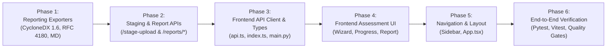

# Quantum Flow — Sprint 3 Step 4 Implementation Plan (Revision 1.2)
## Unified Enterprise Reporting & Frontend Guided Assessment Integration

**Document ID:** QFT-SPRINT-003-STEP-4-PLAN-REV1.2  
**Version:** 1.2 (Final Engineering Revision)  
**Date:** 3 November 2026  
**Status:** Submitted for Final Engineering Review & Approval (No Implementation Until Approved)  
**Target Milestone:** Sprint 3 Step 4 — Unified Reporting & Frontend Integration  
**Dependencies:** Sprint 3 Step 1 (Schema & DB Integrity), Step 2 (Assessment Orchestrator), Step 3 (REST API & Autonomous Worker) — All Formally Accepted  

---

## 1. Executive Summary & Purpose

Sprint 3 Steps 1 through 3 delivered:
- An immutable, trigger-protected PostgreSQL 16 schema with RESTRICT referential integrity, composite foreign keys, and canonical scope hashing.
- An end-to-end multi-source `AssessmentService` correlating TLS, AST source code, dependency manifests, and TLS configurations into Methodology v1.0 QVI risk evaluations.
- Production-grade REST API endpoints, fail-closed tenant boundary isolation, and a durable `AutonomousWorker` daemon with `SKIP LOCKED` job claiming and continuous heartbeat renewal.

**Sprint 3 Step 4** delivers the human- and machine-consumable interfaces:
1. **Unified Enterprise Reporting Subsystem:** Multi-format export engines producing **CycloneDX 1.6 CBOM JSON** (with complete `cryptoProperties` and graph validation), **formula-neutralized RFC 4180 CSV** (CWE-1236 immune with CRLF delimiters), and an **Executive Markdown Summary** derived directly from the cryptographically verified terminal snapshot.
2. **Frontend Guided Assessment Workflow:** A cohesive React 18 interface in `apps/web` guiding operators from target selection, multi-source configuration, and live real-time execution tracking through to findings exploration, cryptographic snapshot verification, and authenticated report downloads.

> [!IMPORTANT]
> **Governance & Scope Guardrails:** This document is exclusively an architectural specification. **No implementation code, frontend modifications, or endpoint additions will be executed until this plan receives formal approval.** Zero database migrations will be introduced. Core risk engine mathematics and CBOM asset-key generation algorithms remain strictly invariant.

---

## 2. Architecture & Data Flow

### 2.1 Subsystem Data Flow

```mermaid
flowchart TD
    subgraph Client["React Frontend (apps/web)"]
        UI_WIZ["AssessmentWizard<br/>(Target, Sources, Staged Uploads)"]
        UI_PROG["AssessmentProgress<br/>(Live Polling with Backoff & Visibility)"]
        UI_REP["AssessmentReportView<br/>(Hash Verification Badge & Exporters)"]
    end

    subgraph API["FastAPI Control Plane (services/api)"]
        EP_STG["POST /api/v1/assessments/stage-upload<br/>(Atomic Upload Staging)"]
        EP_ASS["POST /api/v1/assessments<br/>(Atomic Enqueue & Scope Hash)"]
        EP_POLL["GET /api/v1/assessments/{id}<br/>(Status, Stage, Percent)"]
        EP_CANCEL["POST /api/v1/assessments/{id}/cancel<br/>(Cooperative Abort)"]
        EP_CDX["GET /api/v1/assessments/{id}/reports/cyclonedx<br/>(CycloneDX 1.6 CBOM)"]
        EP_CSV["GET /api/v1/assessments/{id}/reports/csv<br/>(RFC 4180 CRLF CSV)"]
        EP_MD["GET /api/v1/assessments/{id}/reports/markdown<br/>(Executive Summary)"]
    end

    subgraph SharedFS["Shared Staging Volume (/var/lib/quantumflow/staging)"]
        STG_DIR["{STAGING_DIR}/{tenant_id}/{upload_token}/<br/>(Tenant-Isolated Archive Staging)"]
    end

    subgraph Core["Integrity & Reporting Engine (packages/reports)"]
        VERIFY["verify_and_load_snapshot()<br/>(RFC 8785 Canonical JSON + SHA-256)"]
        EXP_CDX["export_assessment_cyclonedx()<br/>(CycloneDX 1.6 Schema Compliant + Diagnostics)"]
        EXP_CSV["export_assessment_csv()<br/>(RFC 4180 CRLF + CWE-1236 Defense)"]
        EXP_MD["export_assessment_markdown_report()<br/>(Executive Summary & NIST Roadmap)"]
    end

    subgraph DB["PostgreSQL 16 Storage Layer"]
        T_ASS[("assessments<br/>(Trigger-Protected Snapshot & Hash)")]
        T_JOBS[("discovery_jobs<br/>(SKIP LOCKED Worker Claiming)")]
    end

    subgraph Worker["AutonomousWorker Process (services/worker)"]
        W_CLAIM["Claim DiscoveryJob (SKIP LOCKED)"]
        W_EXEC["Execute Scan from SharedFS"]
        W_CLEAN["Terminal Cleanup (Success / Exhausted Retries)"]
    end

    UI_WIZ -->|1. Upload Archive/Manifest| EP_STG
    EP_STG -->|Atomic .part -> target rename| STG_DIR
    UI_WIZ -->|2. Create Assessment with upload_token| EP_ASS
    EP_ASS --> T_ASS
    EP_ASS --> T_JOBS
    UI_PROG -->|3. Adaptive Polling (Backoff & Visibility)| EP_POLL
    UI_PROG -.->|Optional Cancel| EP_CANCEL

    W_CLAIM --> T_JOBS
    W_CLAIM --> W_EXEC
    W_EXEC --> STG_DIR
    W_EXEC --> T_ASS
    W_CLEAN --> STG_DIR

    UI_REP -->|4. Authenticated Blob Download| EP_CDX
    UI_REP -->|4. Authenticated Blob Download| EP_CSV
    UI_REP -->|4. Authenticated Blob Download| EP_MD

    EP_CDX --> VERIFY
    EP_CSV --> VERIFY
    EP_MD --> VERIFY
    VERIFY -->|Recomputed SHA-256 == Stored Hash| EXP_CDX
    VERIFY -->|Recomputed SHA-256 == Stored Hash| EXP_CSV
    VERIFY -->|Recomputed SHA-256 == Stored Hash| EXP_MD
```

---

## 3. Shared API–Worker Staging Storage Architecture

### 3.1 Docker Compose & Host Storage Alignment
The API and Worker run as separate operating system processes and may be deployed in independent Docker containers. Storing uploads in an ephemeral container-local `/tmp` directory fails because the API container's `/tmp` is invisible to the Worker container.

- **Shared Docker Volume:** A persistent named volume `staging_data` is mounted into both the `api` and `worker` service containers at `/var/lib/quantumflow/staging`.
- **Docker Compose Configuration (`docker-compose.yml`):**
  ```yaml
  services:
    api:
      environment:
        STAGING_DIR: /var/lib/quantumflow/staging
      volumes:
        - staging_data:/var/lib/quantumflow/staging

    worker:
      environment:
        STAGING_DIR: /var/lib/quantumflow/staging
      volumes:
        - staging_data:/var/lib/quantumflow/staging

  volumes:
    postgres_data:
    redis_data:
    staging_data:
  ```
- **Host Development Alignment:** When running locally without containers, both the FastAPI development server and the worker process share the same filesystem directory:
  `STAGING_DIR = Path(os.getenv("STAGING_DIR", "./staging_data"))`.
  Both environments enforce identical path resolution, file permissions, and tenant isolation semantics.

### 3.2 Atomic Upload Staging & Tenant Scoping
To prevent race conditions where a worker attempts to claim and read an incomplete upload stream:
1. The API writes incoming file chunks to a temporary file: `{upload_token}.part`.
2. Once the stream completes, byte count is verified (`<= 20MB` for archives, `<= 5MB` for standalone manifests), and archive safety checks pass, the API atomically renames the file via `os.replace("{upload_token}.part", target_path)`.
3. An adjacent `metadata.json` is written atomically containing:
   ```json
   {
     "upload_token": "upl_0123456789abcdef0123456789abcdef",
     "tenant_id": "tenant-alpha",
     "filename": "repo_bundle.zip",
     "file_type": "archive",
     "byte_size": 4194304,
     "sha256": "e3b0c44298fc1c149afbf4c8996fb92427ae41e4649b934ca495991b7852b855",
     "created_at": "2026-11-03T03:00:00Z",
     "expires_at": "2026-11-03T07:00:00Z",
     "assessment_id": null
   }
   ```
4. **Path Traversal Protection:** All path accesses strictly resolve `Path(STAGING_DIR, tenant_id, upload_token, filename).resolve()`, verifying that the resulting path is strictly a child of `Path(STAGING_DIR, tenant_id, upload_token)`.

### 3.3 Worker Consumption & Retry-Safe Cleanup Lifecycle
- **Read-Only Worker Extraction:** The Worker reads the staged artifact from the shared volume and extracts it into an ephemeral worker sandbox directory (`/tmp/qf_worker_run_{uuid}`).
- **Retry Preservation:** The staged archive on the shared volume is **not** unlinked after a single job failure. As long as `assessment.status != 'completed'` and `assessment.retry_count < assessment.max_retries`, the archive is preserved so that `POST /api/v1/assessments/{id}/retry` can re-run collectors without requiring the user to re-upload the artifact.
- **Terminal Cleanup:** Autonomous worker unlinks `{STAGING_DIR}/{tenant_id}/{upload_token}` only when the parent assessment reaches a final terminal state:
  - `completed`: Successfully finalized -> cleanup.
  - `cancelled`: Operator cancelled -> cleanup.
  - `failed`: Terminal failure with retries exhausted (`retry_count >= max_retries`) -> cleanup.
- **Zombie / Abandoned Upload Cleanup:** A periodic cleanup task runs hourly in the worker daemon:
  - Scans `{STAGING_DIR}/*/*/metadata.json`.
  - If `assessment_id` is `null` and `datetime.now(UTC) > expires_at` (4 hours from upload), unlinks the staging directory.
  - If `assessment_id` is set, queries PostgreSQL: if assessment is terminal (`completed`, `cancelled`, or `failed` with retries exhausted), purges the directory.

---

## 4. Upload Token & Artifact Lifecycle

### 4.1 Token Specifications
- **Generation:** Cryptographically secure UUIDv4 formatted as `upl_{uuid4().hex}`.
- **Validity Window:** 4 hours from initial upload.
- **Tenant Scoping:** The upload token is tied to `current_user.tenant_id`.
- **Validation on Assessment Creation:** When `POST /api/v1/assessments` is called with `input_payload: {"upload_token": "upl_xxx"}`:
  - The API verifies that `metadata.json` exists for that token under `current_user.tenant_id`.
  - If token does not exist, belongs to another tenant, or has expired (`datetime.now(UTC) > expires_at`), the API rejects creation with `HTTP 400 Bad Request` ("Invalid or expired upload token").
  - On successful assessment creation, the API updates `metadata.json` with `"assessment_id": str(assessment.id)`.

### 4.2 Multi-Job Safe Reuse
A single uploaded source code archive can be safely referenced by multiple child jobs:
- `static_source` (JobType: `source_analysis`): Scans AST and regex patterns across Python, TypeScript, and Java files.
- `dependency_manifest` (JobType: `dependency_scan`): Parses package manifests (`package.json`, `requirements.txt`, `pom.xml`, `poetry.lock`) within the same repository.
Both workers read the archive in parallel from the shared volume without file locks or contention.

### 4.3 Standalone Manifest Uploads vs Archives vs Configs
| Input Type | Supported Formats | Size Ceiling | Staging Mechanism | Ingestion Path |
|---|---|:---:|---|---|
| **Source Archive** | `.zip`, `.tar`, `.tar.gz` | 20 MB | `POST /stage-upload` (multipart) | Staged to shared volume, referenced by `upload_token` |
| **Standalone Manifest** | `requirements.txt`, `package.json`, `package-lock.json`, `pom.xml`, `poetry.lock`, `Pipfile.lock` | 5 MB | `POST /stage-upload` (multipart) with `file_type=manifest` | Staged to shared volume, referenced by `upload_token` |
| **Configuration Posture** | Nginx, Apache, Kubernetes Ingress directives | 500 KB | Direct JSON payload (`input_payload.config_content`) | Embedded directly in assessment payload (no staging file) |

> [!NOTE]
> **Dependency Manifest Scope:** `poetry.lock` and `Pipfile.lock` are fully supported as standalone manifests alongside `requirements.txt`, `package.json`, `package-lock.json`, and `pom.xml`.
> **Repository Locators Out of Scope:** Unauthenticated or authenticated remote Git repository cloning (e.g. `https://github.com/...`) is explicitly **out of scope** for Sprint 3 Step 4. All source analysis requires an archive upload, standalone manifest upload, or direct text upload.

---

## 5. Reporting Subsystem Specifications

### 5.1 Canonical Snapshot Integrity Verification

Before generating any report export (CycloneDX, CSV, or Markdown), the API layer must perform a cryptographic integrity check on the stored snapshot.

#### Verification Algorithm:
1. **Load Entity:** Retrieve `Assessment` by `assessment_id` ensuring tenant isolation.
2. **Lifecycle Gate:** If assessment status is `queued` or `running`, raise `HTTP 409 Conflict` ("Reports cannot be generated for active assessments").
3. **Existence Gate:** If `report_snapshot` is `None` or `report_snapshot_hash` is `None`, raise `HTTP 422 Unprocessable Content` ("Terminal report snapshot is missing").
4. **Canonical Serialization:** Invoke the existing canonical serializer [`compute_canonical_evidence_sha256(assessment.report_snapshot)`](file:///d:/Desktop/quantum-flow-pqc-platform/packages/scanner/safety/canonical.py#L40) which deterministically sorts JSON keys and formats floats/integers per RFC 8785. **Do not create a secondary canonicalization function.**
5. **Constant-Time Comparison:** Compare the computed SHA-256 digest against `assessment.report_snapshot_hash` using `hmac.compare_digest(computed_hash, stored_hash)`.
6. **Tamper Rejection:** If `compare_digest` returns `False`:
   - Log critical security alert: `Snapshot hash mismatch on assessment {assessment_id}`.
   - Raise `HTTP 500 Internal Server Error` with detail `"Terminal assessment report snapshot failed cryptographic integrity verification. Report export aborted."`
7. **Single Verified Source of Truth:** Pass the verified `assessment.report_snapshot` dictionary to the exporter functions. All formats are generated from this identical verified object.

#### Integrity Scope & Cryptographic Boundaries:
- **What this verifies:** Guarantees that the data loaded from PostgreSQL has not been modified, corrupted, or altered since the terminal snapshot was finalized and protected by the `trg_protect_terminal_assessment_snapshot` database trigger.
- **What this does NOT represent:** It is **not** an asymmetric digital signature (e.g. RSA-PSS or ECDSA) signed by an external PKI authority, nor does it prove authenticity against a superuser with direct root access to PostgreSQL who could bypass triggers. The UI and documentation must clearly state:
  `Integrity Verification: SHA-256 Snapshot Digest Match Confirmed`
  and must **never** claim "Digitally Signed by Certificate Authority".

---

### 5.2 RFC 4180 Compliant CSV Exporter with Formula-Injection Defense

#### Record Delimiter & Escaping Specifications:
- **Record Delimiter:** Must strictly use CRLF (`\r\n`) per RFC 4180 Section 2.1.
- **Field Separator:** Comma (`,`).
- **Quoting Rules:**
  - Standard `csv.QUOTE_MINIMAL` using double quotes (`"`).
  - Any field containing a comma, CRLF (`\r\n`), line feed (`\n`), carriage return (`\r`), or double quote must be enclosed in double quotes.
  - Any double quote appearing inside a field must be escaped by prefixing it with another double quote (`""`).

#### Formula-Injection Defense (CWE-1236):
Spreadsheet applications (Excel, LibreOffice Calc, Google Sheets) execute formulas if a cell starts with trigger characters. Attackers frequently bypass naive filters by prefixing formula triggers with spaces, tabs, carriage returns, or control characters.

The sanitization function `sanitize_csv_field(val: Any) -> str` enforces:
1. `val is None` -> returns empty string `""`.
2. Convert to string `s = str(val)`.
3. Strip leading ASCII/Unicode whitespace and control characters:
   `stripped = s.lstrip(" \t\r\n\x0b\x0c\x00\x1f")`
4. If `stripped` is not empty and begins with any formula trigger character (`=`, `+`, `-`, `@`, `|`, `%`):
   - Prefix the string with a single quote: `return f"'{s}"`
5. If the original string `s` begins with any control character (`\t`, `\r`, `\n`):
   - Prefix with a single quote: `return f"'{s}"`
6. Otherwise, return `s` unchanged.

> [!NOTE]
> **Database Invariance:** Formula-injection sanitization occurs **strictly during the export generation stream**. Raw evidence values in PostgreSQL (`observations`, `cryptographic_assets`, `report_snapshot`) remain 100% uncorrupted and true to source.

#### Column Schema (16 Standard Columns):
| # | Column Name | Source in `report_snapshot` | Description |
|---|---|---|---|
| 1 | `Assessment ID` | `assessment_id` | UUID of the assessment run |
| 2 | `Target Hostname` | `target.hostname` | Inspected domain or target identifier |
| 3 | `Asset Key` | `asset.asset_key` | Deterministic CBOM identifier (e.g. `cert:sha256:...`) |
| 4 | `Asset Type` | `asset.asset_type` | `certificate`, `protocol`, `algorithm`, `key` |
| 5 | `Display Name` | `asset.display_name` | Human-readable asset name |
| 6 | `Algorithm Family` | `asset.algorithm_family` | `RSA`, `ECC`, `AES`, `SHA2`, etc. |
| 7 | `Algorithm Name` | `asset.algorithm_name` | Exact parameter identifier (e.g. `RSA-2048`, `ECDHE-P256`) |
| 8 | `Cryptographic Purpose` | `asset.cryptographic_purpose` | `key_exchange`, `digital_signature`, `encryption`, `hashing` |
| 9 | `Locator` | `asset.locator` | File path, line number, or endpoint `host:port` |
| 10 | `Business Criticality` | `asset.criticality` | `critical`, `high`, `medium`, `low` |
| 11 | `Classification` | `asset.classification` | `OBSERVED`, `INFERRED`, `IMPORTED` |
| 12 | `Confidence Score` | `asset.confidence` | Float formatted to 2 decimals (`0.00`–`1.00`) |
| 13 | `QVI Risk Score` | `risk.score` | Integer raw score (0–1000) per Methodology v1.0 |
| 14 | `Risk Category` | `risk.category` | `CRITICAL`, `HIGH`, `MEDIUM`, `LOW`, `NEGLIGIBLE` |
| 15 | `Quantum Threat Type` | `risk.threat_type` | `Shor Vulnerable`, `Grover Vulnerable`, `Classical Only`, `Post-Quantum Safe` |
| 16 | `Remediation Priority` | `risk.priority` | `immediate`, `near_term`, `medium_term`, `monitor` |

---

### 5.3 CycloneDX 1.6 CBOM Schema Compliance & Visible Graph Diagnostics

The CycloneDX export generates a valid CycloneDX v1.6 document matching the official specification (`https://cyclonedx.org/schema/bom-1.6.schema.json`).

#### 1. Root Document Structure
```json
{
  "$schema": "http://cyclonedx.org/schema/bom-1.6.schema.json",
  "bomFormat": "CycloneDX",
  "specVersion": "1.6",
  "serialNumber": "urn:uuid:c9a95a19-7011-4432-b495-8ee9329ade4a",
  "version": 1,
  "metadata": {
    "timestamp": "2026-11-03T02:00:00Z",
    "tools": {
      "components": [
        {
          "type": "application",
          "author": "Quantum Flow Technologies",
          "name": "Quantum Flow PQC Discovery & Risk Platform",
          "version": "1.0.0"
        }
      ]
    },
    "component": {
      "type": "service",
      "name": "quantumflow.in",
      "bom-ref": "target:quantumflow.in"
    },
    "properties": []
  },
  "components": [],
  "dependencies": []
}
```

#### 2. Component Mapping with `cryptoProperties`
Each cryptographic asset maps to a component with `type: "cryptographic-asset"`. Supported attributes map directly to CycloneDX 1.6 schema fields:
- **Certificates:** Mapped to `cryptoProperties.certificateProperties` (`subjectName`, `issuerName`, `notValidBefore`, `notValidAfter`, `signatureAlgorithmRef`).
- **Algorithms & Keys:** Mapped to `cryptoProperties.algorithmProperties` (`primitive`, `parameterSetIdentifier`, `keyLength`, `curve`).
- **Protocols (TLS):** Mapped to `cryptoProperties.protocolProperties` (`type: "tls"`, `version: "1.3"`, `cipherSuites: [...]`).

#### 3. Standard `properties` for Quantum Flow Extensions
Custom attributes not defined as standard fields in CycloneDX 1.6 are preserved via the official CycloneDX `properties` array (name-value pairs) rather than inventing invalid schema fields:
```json
"properties": [
  {"name": "qft:qvi_score", "value": "780"},
  {"name": "qft:risk_category", "value": "HIGH"},
  {"name": "qft:quantum_threat", "value": "Shor Vulnerable"},
  {"name": "qft:evidence_quality", "value": "high"},
  {"name": "qft:classification", "value": "OBSERVED"},
  {"name": "qft:methodology_version", "value": "QFT-RISK-v1.0"}
]
```

#### 4. Visible Dependency Graph Diagnostics (Never Silently Dropping Relationships)
Dangling dependency relationships will **never be silently discarded**:
- The serializer checks every relationship `(source -> target)`:
  - If both `source` and `target` exist in `components`: emitted in `dependencies`.
  - If either `source` or `target` is missing: the serializer records an explicit diagnostic entry in `metadata.properties`:
    `{"name": "qft:export_diagnostics:unresolved_dependency", "value": "source:{source}->target:{target} (missing component bom-ref)"}`.
- **Visible Identification:**
  - If any unresolved dependencies exist:
    - Sets metadata property: `{"name": "qft:dependency_graph_status", "value": "INCOMPLETE_RELATIONSHIPS_RECORDED"}`.
    - Sets metadata property: `{"name": "qft:warning:incomplete_dependency_graph", "value": "WARNING: {count} cryptographic relationships could not be resolved in the component inventory"}`.
    - Adds top-level CycloneDX comment under `metadata.comment`: `"WARNING: CBOM dependency graph contains {count} unresolved relationships. See qft:export_diagnostics in metadata.properties."`
  - In the **Executive Markdown Report** and **Report View UI**, an explicit alert banner is rendered:  
    `> [!WARNING] Dependency Graph Incomplete: {count} cryptographic relationships could not be linked to inventoried components.`

---

### 5.4 Executive Markdown Summary Report & Metric Semantics

The Executive Markdown summary is structured for technical leadership, audit committees, and security architects:

1. **Title & Document Control:**
   - Title: `# Quantum Flow — Post-Quantum Cryptographic Assessment Report`
   - Metadata Block: Assessment ID, Target Hostname, Assessment Status, Date/Time (UTC), Methodology Version (`QFT-RISK-v1.0`), Engine Version (`v1.0.0`).
   - Integrity Seal:
     `> [!NOTE]`  
     `> **Integrity Verification:** Canonical Snapshot Digest SHA-256: \`{report_snapshot_hash}\` (Verified)`
2. **Executive Summary & Accurate Metrics:**
   - **Headline Score:** Explicitly labeled as **Maximum Asset QVI** (`max(asset.score)` on 0–1000 scale). No unauthorized "Enterprise Readiness Level" is invented.
   - **Aggregate Distribution:** Explicit table of **Asset Risk Categories** (`CRITICAL`, `HIGH`, `MEDIUM`, `LOW`, `NEGLIGIBLE`) with exact asset counts.
   - **Mean Asset QVI:** Formally labeled as arithmetic mean across assessed assets.
3. **Observation Scope & Network Verification Evidence:**
   - Target Hostname and Domain Verification status.
   - Resolved Pinned Destination IP (with SSRF protection status).
   - Discovery sources executed (`network_tls`, `static_source`, `dependency_manifest`, `config_import`).
   - Collector status summary table (Source, Status, Duration ms, Assets Found).
4. **CBOM Inventory Summary:**
   - Asset distribution by classification (`OBSERVED` vs `INFERRED` vs `IMPORTED`).
   - Discovered primitives table with explicit technical distinction between:
     - Certificate Public-Key Algorithm (e.g. RSA-2048, ECDSA P-256).
     - Certificate Signature Algorithm (e.g. sha256WithRSAEncryption).
     - Negotiated TLS Cipher Suite (e.g. TLS_AES_256_GCM_SHA384).
     - Key-Exchange Mechanism / Group (e.g. ECDHE X25519).
5. **Quantum Threat Analysis (Methodology v1.0):**
   - **Shor Vulnerability Profile:** Exposure of asymmetric primitives to Shor's algorithm (polynomial time factorisation / discrete logarithm).
   - **Grover Theoretical Speedup:** Accurately described as a theoretical quadratic speedup on unstructured search reducing effective security margins (e.g., 128-bit key effectively provides ~64 bits of security margin against an idealized quantum adversary; 256-bit symmetric keys provide 128 bits of security margin under Grover's algorithm).
   - Dimension contribution breakdown (Q, R, L, E, B, M, V).
6. **Prioritised Remediation Roadmap:**
   - Actionable recommendations mapped to NIST standards (FIPS 203 ML-KEM, FIPS 204 ML-DSA, FIPS 205 SLH-DSA).
7. **Coverage Limitations & Partial Execution Notice:**
   - Clearly document any failed or unexamined sources.
   - Standard governance statement: *"Absence of discovery evidence from unexamined sources does NOT constitute proof of post-quantum safety."*

---

## 6. Assessment Lifecycle and Report Availability

| Assessment Status | Terminal? | Snapshot Present? | Report Generation Behavior | UI Presentation |
|---|:---:|:---:|---|---|
| `queued` | No | No | `HTTP 409 Conflict`: "Assessment is queued. Reports cannot be generated until execution completes." | Spinner; progress bar at 0%; export buttons disabled. |
| `running` | No | No | `HTTP 409 Conflict`: "Assessment is active in stage '{progress_stage}'. Reports cannot be generated until execution completes." | Live progress bar with stage indicators; export buttons disabled. |
| `completed` | Yes | Yes | `HTTP 200 OK`: Generates full CycloneDX, CSV, and Markdown from verified snapshot. | Green status badge; "Integrity Confirmed" badge; all exports active. |
| `partially_completed` | Yes | Yes | `HTTP 200 OK`: Generates reports containing all successfully collected evidence. Includes explicit "Partial Coverage" warning section detailing failed collectors. | Amber badge; warning banner; reports generated with disclaimer. |
| `cancelled` | Yes | Yes | `HTTP 200 OK`: Generates reports reflecting partial evidence collected prior to cancellation. Tagged prominently as "CANCELLED AUDIT RUN". | Red/Grey badge; cancellation reason shown; reports available for partial audit. |
| `failed` | Yes | Yes/No | If snapshot exists with 0 assets: `HTTP 200 OK` generating failure audit report. If no snapshot exists: `HTTP 422 Unprocessable Content`. | Red badge; error summary displayed; retry button active. |

---

## 7. Authenticated Frontend Downloads & Safe Filename Handling

Browser anchor tags (`<a href="..." download>`) cannot attach custom `Authorization: Bearer <token>` headers. To maintain fail-closed security in production/staging environments, all file downloads utilize an authenticated fetch/Blob workflow.

### 7.1 Robust Filename Extraction & Security Rules
The download utility enforces comprehensive security parsing on the `Content-Disposition` header:
1. **RFC 5987 `filename*` Extraction:** Prioritizes `filename*=UTF-8''encoded_name`. If present, decodes via `decodeURIComponent`. If malformed or decode raises an exception, safely falls back to standard `filename=`.
2. **Standard `filename` Extraction:** Matches `filename=["']?([^"';]+)["']?`.
3. **Empty or Missing Filename Fallback:** If filename is missing or whitespace-only, uses deterministic fallback: `quantumflow_{report_type}_{assessment_id}.{expected_ext}`.
4. **Path Traversal & Separator Sanitization:** Strips all forward slashes (`/`), backslashes (`\`), URL-encoded path separators (`%2F`, `%5C`, `%2f`, `%5c`), and null bytes (`\x00`).
5. **Control Character Elimination:** Strips all ASCII control characters (`\x00`–`\x1f`, `\x7f`).
6. **Strict Extension Enforcement:** Verifies the final filename ends with the expected safe extension (`.json` for CycloneDX, `.csv` for CSV, `.md` for Markdown). If an attacker or proxy injects executable extensions (e.g. `.exe`, `.bat`, `.sh`, `.php`), the extension is replaced with the authorized extension.

### 7.2 Implementation (`apps/web/src/services/api.ts`):
```typescript
/**
 * Stream and download an authenticated assessment report.
 * Fails closed in production if unauthenticated; extracts safe filenames and revokes object URLs.
 */
export async function downloadAssessmentReport(
  assessmentId: string,
  format: "cyclonedx" | "csv" | "markdown"
): Promise<void> {
  const token = getAuthToken(); // From session state / api client
  const isProduction = import.meta.env.PROD;

  if (isProduction && !token) {
    throw new Error("Authentication required: Missing active session token for report download.");
  }

  const expectedExt = format === "cyclonedx" ? "json" : format === "csv" ? "csv" : "md";
  const defaultFilename = `quantumflow_${format}_${assessmentId}.${expectedExt}`;

  const headers: Record<string, string> = {
    Accept:
      format === "cyclonedx"
        ? "application/vnd.cyclonedx+json"
        : format === "csv"
        ? "text/csv"
        : "text/markdown",
  };
  if (token) {
    headers["Authorization"] = `Bearer ${token}`;
  }

  const response = await fetch(
    `${API_BASE_URL}/api/v1/assessments/${assessmentId}/reports/${format}`,
    {
      method: "GET",
      headers,
    }
  );

  if (!response.ok) {
    let errorDetail = `Download failed with HTTP ${response.status}`;
    try {
      const errJson = await response.json();
      errorDetail = errJson.detail || errJson.error?.message || errorDetail;
    } catch {
      // Body not JSON
    }
    throw new Error(errorDetail);
  }

  // Parse safe filename supporting RFC 5987 filename* and standard filename
  const disposition = response.headers.get("Content-Disposition");
  let filename = defaultFilename;

  if (disposition) {
    let extracted: string | null = null;
    // 1. Try RFC 5987 filename*=UTF-8''encoded_name
    const rfc5987Match = disposition.match(/filename\*=UTF-8''([^;]+)/i);
    if (rfc5987Match && rfc5987Match[1]) {
      try {
        extracted = decodeURIComponent(rfc5987Match[1]);
      } catch {
        // Fallback on decode failure
      }
    }
    // 2. Try standard filename="name" if RFC 5987 not present or failed
    if (!extracted) {
      const stdMatch = disposition.match(/filename=["']?([^"';]+)["']?/);
      if (stdMatch && stdMatch[1]) {
        extracted = stdMatch[1].trim();
      }
    }

    if (extracted && extracted.trim()) {
      // Sanitize: Replace path separators (raw & encoded), null bytes, and control characters
      let sanitized = extracted
        .replace(/%2f|%5c/gi, "_")
        .replace(/[/\\?%*:|"<>]/g, "_")
        .replace(/[\x00-\x1f\x7f]/g, "")
        .trim();

      // Ensure safe extension matches expected format
      if (!sanitized.endsWith(`.${expectedExt}`)) {
        sanitized = `${sanitized.replace(/\.[^/.]+$/, "")}.${expectedExt}`;
      }
      if (sanitized && sanitized !== `.${expectedExt}`) {
        filename = sanitized;
      }
    }
  }

  // Create Blob and trigger browser download
  const blob = await response.blob();
  const blobUrl = window.URL.createObjectURL(blob);
  const link = document.createElement("a");
  link.href = blobUrl;
  link.download = filename;
  document.body.appendChild(link);
  link.click();
  document.body.removeChild(link);

  // Revoke object URL after delay to prevent memory leaks
  setTimeout(() => window.URL.revokeObjectURL(blobUrl), 1000);
}
```

### CORS Configuration in Backend (`services/api/app/main.py`):
Ensure `CORSMiddleware` exposes `Content-Disposition`:
```python
app.add_middleware(
    CORSMiddleware,
    allow_origins=settings.cors_origins,
    allow_credentials=True,
    allow_methods=["GET", "POST", "PUT", "DELETE", "OPTIONS", "PATCH"],
    allow_headers=["*"],
    expose_headers=["Content-Disposition"],
)
```

---

## 8. Frontend Guided Assessment Workflow & Resilience

### 8.1 Component Architecture & Responsibilities
- **`AssessmentManagement.tsx`:** Primary view container. Manages active tab state, renders the assessment list, search/filter bars, and the "Launch Assessment" button which opens `AssessmentWizard`.
- **`AssessmentWizard.tsx`:** 3-step modal wizard:
  - Step 1: Target Selection (shows target verification status, safe resolved IP).
  - Step 2: Discovery Sources & Upload (`network_tls`, `static_source`, `dependency_manifest`, `config_import`). Manages staged upload triggers and configuration text inputs.
  - Step 3: Review & Dispatch. Form validation, idempotency token, and dispatch to `POST /api/v1/assessments`.
- **`AssessmentList.tsx`:** Datatable of past and running assessments with pagination, status badges, progress bars, Maximum Asset QVI scores, and quick action buttons.
- **`AssessmentProgress.tsx`:** Real-time execution monitor rendering the 6-stage timeline (`VALIDATING_SCOPE`, `DISPATCHING_COLLECTORS`, `COLLECTING`, `CORRELATING`, `EVALUATING`, `FINALIZING`), child jobs drawer, and cooperative cancellation modal.
- **`AssessmentReportView.tsx`:** Verified assessment report view rendering the `SnapshotIntegrityBadge`, `CoverageBreakdownCard`, `RiskDistributionCard`, and authenticated download buttons.

### 8.2 Resilient Polling Hook (`useAssessmentProgress.ts`)
To prevent infinite loops, memory leaks, and excessive backend load:
1. **Unmount Cleanup:** Uses `useRef` to store the timer ID and cancels it in the `useEffect` cleanup return function.
2. **Terminal State Termination:** Stops polling immediately once `assessment.status` enters `completed`, `partially_completed`, `failed`, or `cancelled`.
3. **Page Visibility API:** Listens to `visibilitychange`. Pauses polling when the tab is backgrounded; polls immediately and resumes when the tab becomes active.
4. **Exponential Backoff on Failure:**
   - Normal interval: `2000ms`.
   - On network error or HTTP 5xx: interval increases to `4000ms`, then `8000ms`, capping at `16000ms`.
   - On successful response: interval resets to `2000ms`.
   - After 5 consecutive failures: stops polling and displays a "Connection Lost. Click to Reconnect" alert.
5. **Accurate Progress:** Displays the exact `progress_percent` (0–100) and `progress_stage` from the database. Zero simulated or fabricated progress animations.

---

## 9. Comprehensive Behavioral Test Strategy

### 9.1 Backend Test Suites
1. **CSV Security & RFC 4180 Tests (`tests/unit/test_assessment_reports.py`):**
   - Asserts all lines terminate with `\r\n` (CRLF).
   - Asserts commas, quotes, and multiline values are correctly escaped.
   - Tests formula injection with trigger characters (`=`, `+`, `-`, `@`, `|`, `%`).
   - Tests formula injection preceded by spaces, tabs (`\t`), newlines (`\n`), carriage returns (`\r`), and control characters (`\x00`–`\x1f`).
   - Asserts raw database models remain unquoted; only the exported CSV stream contains `'`.
2. **CycloneDX 1.6 Schema Validation Tests (`tests/unit/test_cyclonedx_schema.py`):**
   - Uses `jsonschema.validate` against the official CycloneDX 1.6 JSON Schema.
   - Validates certificates, algorithms, and protocol components.
   - Validates that every `ref` in `dependencies` resolves to an existing `bom-ref`.
   - Validates that unresolved dependencies are logged in `metadata.properties` diagnostics and top-level comment.
3. **Snapshot Integrity Verification Tests (`tests/unit/test_snapshot_integrity.py`):**
   - Tests report generation succeeds when computed SHA-256 matches `report_snapshot_hash`.
   - Tests report generation is rejected (`HTTP 500`) when snapshot content is mutated or forged.
   - Tests `HTTP 409 Conflict` when report endpoints are called on `queued` or `running` assessments.
4. **Tenant Isolation & Security Tests (`tests/integration/test_assessment_report_api.py`):**
   - Verifies Tenant B cannot download Tenant A's reports (returns `404 Not Found`).
   - Verifies unauthenticated calls in `production` return `401 Unauthorized`.
   - Verifies `Content-Disposition` header structure, safe filename emission, and RFC 5987 handling.
5. **Staged Upload & Shared Storage Tests (`tests/integration/test_staged_upload.py`):**
   - Verifies API writes file and Worker reads identical bytes from shared volume (`STAGING_DIR`).
   - Verifies concurrent reads by both `source_analysis` and `dependency_scan` on the same staged file.
   - Verifies archives >20MB and standalone manifests >5MB are rejected (`413 Entity Too Large`).
   - Verifies ZipSlip and private key inclusion fail upload with `400 Bad Request`.
   - Verifies staged archive is preserved during partial failure and unlinked only on final terminal state.
   - Verifies retry after collector failure re-reads the staged file without re-upload.
   - Verifies tenant isolation: Tenant B cannot reference Tenant A's upload token.
   - Verifies periodic garbage collector purges expired unreferenced staging directories (>4 hours).

### 9.2 Frontend Vitest Suites
1. **`AssessmentComponents.test.tsx`:**
   - Tests `AssessmentWizard` form validation, source selection, target selection, submit payload structure.
   - Tests `AssessmentProgress` polling ticks, stage updates, cancellation confirmation modal.
   - Tests `AssessmentReportView` integrity badge rendering (SHA-256 match confirmed), metric card values, and authenticated download triggers.
   - Tests download filename sanitization (malformed RFC 5987, path separators, unsafe extensions).

---

## 10. Phase-Wise Implementation Sequence



| Phase | Target Scope | Output Deliverables |
|---|---|---|
| **Phase 1** | Reporting Exporters | Enhanced `packages/reports/exporter.py` with `export_assessment_cyclonedx` (with visible diagnostics), `export_assessment_csv` (CRLF), `export_assessment_markdown_report`. Tests in `tests/unit/test_assessment_reports.py`, `tests/unit/test_cyclonedx_schema.py`, and `tests/unit/test_snapshot_integrity.py`. |
| **Phase 2** | API Endpoints & Staging | `POST /stage-upload` and `GET /reports/*` in `services/api/app/api/v1/endpoints/assessments.py`. Tests in `tests/integration/test_assessment_report_api.py` and `tests/integration/test_staged_upload.py`. |
| **Phase 3** | Frontend Client & Types | Authenticated download functions, typed API methods in `apps/web/src/services/api.ts`, interfaces in `apps/web/src/types/index.ts`, CORS headers in `services/api/app/main.py`. |
| **Phase 4** | Frontend Components | `AssessmentManagement`, `AssessmentWizard`, `AssessmentList`, `AssessmentProgress`, `AssessmentReportView`, `useAssessmentProgress`, and cards in `apps/web/src/features/assessments/`. Tests in `AssessmentComponents.test.tsx`. |
| **Phase 5** | Navigation Integration | Update `apps/web/src/components/Sidebar.tsx` and `apps/web/src/app/App.tsx` to mount the workflow. |
| **Phase 6** | Full Verification | Execute complete test matrix: Pytest, Vitest, Ruff, Mypy, TypeScript, ESLint, Vite build. |

---

## 11. Acceptance Criteria Checklist

- [ ] `export_assessment_csv` generates CRLF (`\r\n`) record delimiters conforming to RFC 4180.
- [ ] Formula injection sanitization neutralizes `=`, `+`, `-`, `@`, `|`, `%` preceded by whitespace, tabs, or control characters across all 16 columns without modifying database values.
- [ ] CycloneDX 1.6 CBOM export validates against official CycloneDX 1.6 schema with zero errors, valid `cryptoProperties`, and visibly records unresolved dependency references as export diagnostics and comment warnings.
- [ ] Cryptographic snapshot verification recomputes canonical SHA-256 and blocks report export upon digest mismatch.
- [ ] UI displays accurate integrity status ("SHA-256 Snapshot Digest Match Confirmed") without falsely claiming external digital signatures.
- [ ] Shared volume storage (`/var/lib/quantumflow/staging`) allows both API and Worker processes to access staged artifacts atomically.
- [ ] Staged uploads enforce 20MB archive limit, 5MB manifest limit (including `poetry.lock`), ZipSlip defense, private key exclusion, shared volume persistence, and worker cleanup upon terminal state.
- [ ] Authenticated Blob download utility attaches bearer tokens, fails closed in production, handles HTTP 401/404/409/500, parses RFC 5987 filenames safely, and revokes object URLs.
- [ ] Report endpoints return `409 Conflict` during `queued`/`running` states and generate partial reports with explicit disclaimers for `partially_completed` and `cancelled` states.
- [ ] Network discovery documentation and UI use accurate terminology: Pinned Destination IP, SSRF Guard, TLS SNI, and DNS Challenge Verification.
- [ ] Frontend polling hook implements unmount cleanup, terminal state halting, Page Visibility pausing, and exponential backoff.
- [ ] 100% pass across all quality gates: Pytest backend suite, Ruff linter/formatter, Mypy, Vitest frontend suite, TypeScript typecheck, ESLint, and Vite production build.

---

## 12. Complete and Exact File Inventory

### 12.1 New Implementation Files (16 Files Total)

#### New Backend Test Files (5):
1. `tests/unit/test_assessment_reports.py` (Unit tests for CSV RFC 4180 CRLF and Markdown exporters)
2. `tests/unit/test_cyclonedx_schema.py` (Official CycloneDX 1.6 JSON Schema validation with jsonschema)
3. `tests/unit/test_snapshot_integrity.py` (Snapshot canonical SHA-256 verification and tamper rejection)
4. `tests/integration/test_assessment_report_api.py` (Streaming routes, headers, 401, 404, 409, 500)
5. `tests/integration/test_staged_upload.py` (Staged upload API, shared volume, archive security, worker cleanup)

#### New Frontend Files (11):
1. `apps/web/src/features/assessments/AssessmentManagement.tsx` (Top-level view container)
2. `apps/web/src/features/assessments/AssessmentWizard.tsx` (3-step modal)
3. `apps/web/src/features/assessments/AssessmentList.tsx` (Datatable of assessments)
4. `apps/web/src/features/assessments/AssessmentProgress.tsx` (Live execution tracker)
5. `apps/web/src/features/assessments/AssessmentReportView.tsx` (Findings, integrity confirmation & export triggers)
6. `apps/web/src/features/assessments/hooks/useAssessmentProgress.ts` (Polling hook with backoff & cleanup)
7. `apps/web/src/features/assessments/components/SnapshotIntegrityBadge.tsx` (SHA-256 integrity badge)
8. `apps/web/src/features/assessments/components/CoverageBreakdownCard.tsx` (Coverage by source & evidence quality)
9. `apps/web/src/features/assessments/components/RiskDistributionCard.tsx` (QVI distribution & Shor/Grover breakdown)
10. `apps/web/src/features/assessments/components/ChildJobsDrawer.tsx` (Worker tasks drawer)
11. `apps/web/src/features/assessments/__tests__/AssessmentComponents.test.tsx` (Vitest component tests)

---

### 12.2 Existing Files Expected to be Modified (8 Files Total)
1. [`packages/reports/exporter.py`](file:///d:/Desktop/quantum-flow-pqc-platform/packages/reports/exporter.py) (Add assessment-level CycloneDX with visible diagnostics, CRLF CSV, and Markdown exporters)
2. [`services/api/app/api/v1/endpoints/assessments.py`](file:///d:/Desktop/quantum-flow-pqc-platform/services/api/app/api/v1/endpoints/assessments.py) (Add report streaming routes & stage-upload route)
3. [`services/api/app/schemas/assessment.py`](file:///d:/Desktop/quantum-flow-pqc-platform/services/api/app/schemas/assessment.py) (Add stage upload response schema)
4. [`services/api/app/main.py`](file:///d:/Desktop/quantum-flow-pqc-platform/services/api/app/main.py) (CORS `expose_headers=["Content-Disposition"]`)
5. [`apps/web/src/services/api.ts`](file:///d:/Desktop/quantum-flow-pqc-platform/apps/web/src/services/api.ts) (Add authenticated download function and assessment API methods)
6. [`apps/web/src/types/index.ts`](file:///d:/Desktop/quantum-flow-pqc-platform/apps/web/src/types/index.ts) (Add assessment TypeScript interfaces)
7. [`apps/web/src/components/Sidebar.tsx`](file:///d:/Desktop/quantum-flow-pqc-platform/apps/web/src/components/Sidebar.tsx) (Activate Plan/Assessments sidebar navigation item)
8. [`apps/web/src/app/App.tsx`](file:///d:/Desktop/quantum-flow-pqc-platform/apps/web/src/app/App.tsx) (Mount AssessmentManagement view)

---

### 12.3 Documentation Deliverables (2 Files Total)
1. `docs/QFT-SPRINT-003-STEP-4-PLAN-REV1.2.md` (The canonical revision document)
2. `docs/SPRINT_3_STEP_4_IMPLEMENTATION_PLAN.md` (Repository mirrored plan)

---

## 13. Resolution Matrix for Review Findings

| Review Finding | Priority | Resolution in Plan Revision 1.2 |
|---|:---:|---|
| **Shared API–Worker Staging Storage** | **P1** | Section 3 specifies dedicated shared volume `/var/lib/quantumflow/staging` mounted into both API and Worker containers (`STAGING_DIR`). Atomic `.part` file creation. Preserves archives during retries; unlinks only upon terminal assessment completion or retry exhaustion. Hourly GC purges abandoned uploads. |
| **Upload Lifecycle & API Contract** | **P1** | Section 4 specifies 4-hour token expiry, tenant validation, multi-job read-only archive reuse (`static_source` and `dependency_manifest`), standalone manifest uploads (explicitly including `poetry.lock` and `Pipfile.lock`), and direct configuration text. Remote Git repository cloning is explicitly declared out of scope. |
| **Authenticated Download Security** | **P1** | Section 7 specifies fail-closed check in production if token is missing, RFC 5987 `filename*` parsing with path-traversal sanitization, safe extension enforcement, Blob URL revocation, and CORS `expose_headers=["Content-Disposition"]` in `main.py`. |
| **CycloneDX Dependency Graph Integrity** | **P1** | Section 5.3 strictly prohibits silently discarding relationships. Validates every `bom-ref` and visibly records unresolved dependencies in `metadata.properties`, metadata comment warnings, and Markdown report alert banner. Requires official CycloneDX 1.6 schema validation. |
| **QVI & Executive Report Semantics** | **P2** | Section 5.4 strictly preserves Methodology v1.0. Eliminates invented "readiness levels". Explicitly labels Maximum Asset QVI and Mean Asset QVI. Accurately describes Grover's theoretical quadratic speedup and security margin halving. Distinguishes certificate public keys, signature algorithms, cipher suites, and key-exchange groups. |
| **Normalized Source Names & File Inventory** | **P2** | Section 4 & 12 normalizes discovery source identifier to `config_import` matching backend models. Reconciles exact file inventory: exactly 16 new implementation files (5 backend tests + 11 frontend files), 8 existing files modified, and 2 documentation files. |

---

**Plan Revision 1.2 is complete. No implementation work has begun. Awaiting explicit engineering approval.**
