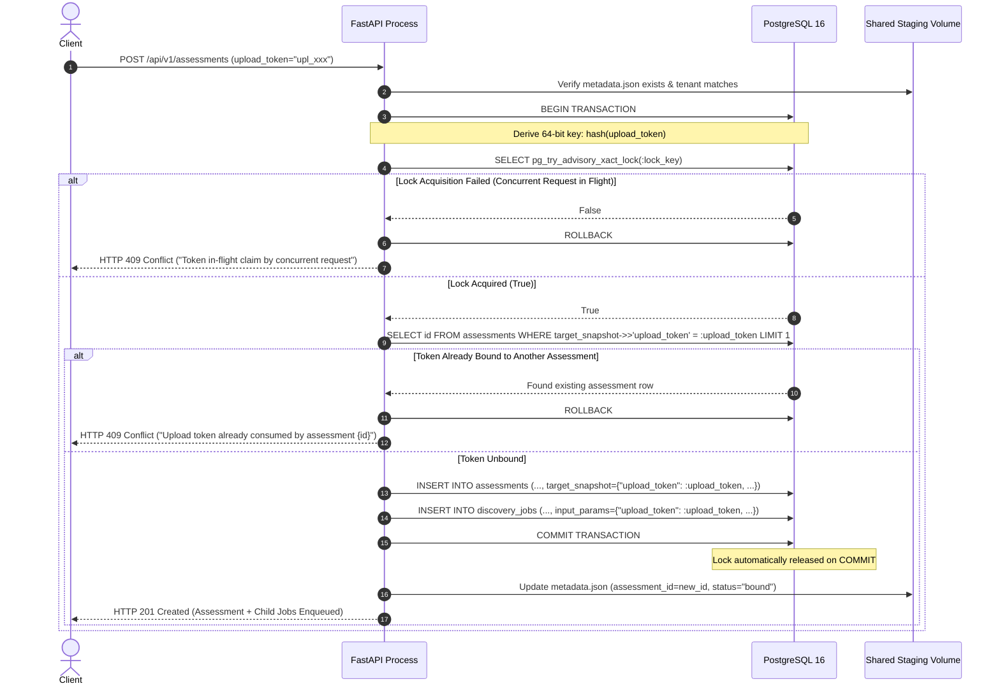
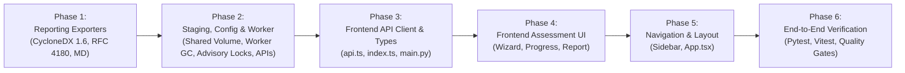

# Quantum Flow — Sprint 3 Step 4 Implementation Plan (Revision 1.4)
## Unified Enterprise Reporting & Frontend Guided Assessment Integration

**Document ID:** QFT-SPRINT-003-STEP-4-PLAN-REV1.4  
**Version:** 1.4 (Final Engineering Revision)  
**Date:** 3 November 2026  
**Status:** Submitted for Final Engineering Review & Approval (No Implementation Until Approved)  
**Target Milestone:** Sprint 3 Step 4 — Unified Reporting & Frontend Integration  
**Dependencies:** Sprint 3 Step 1 (Schema & DB Integrity), Step 2 (Assessment Orchestrator), Step 3 (REST API & Autonomous Worker) — All Formally Accepted  

---

## 1. Executive Summary & Purpose

Sprint 3 Steps 1 through 3 established the core discovery and risk assessment engine:
- **Step 1:** An immutable, trigger-protected PostgreSQL 16 schema with `RESTRICT` referential integrity, composite foreign keys, canonical scope hashing, and frozen report snapshot triggers.
- **Step 2:** An end-to-end multi-source `AssessmentService` correlating TLS, AST source code, dependency manifests, and TLS configurations into Methodology v1.0 Quantum Vulnerability Index (QVI) evaluations.
- **Step 3:** Production-grade REST API endpoints, fail-closed tenant boundary isolation, and a durable `AutonomousWorker` daemon with `SELECT FOR UPDATE SKIP LOCKED` job claiming and continuous heartbeat renewal.

**Sprint 3 Step 4** delivers the human- and machine-consumable interfaces of the platform:
1. **Unified Enterprise Reporting Subsystem:** Multi-format export engines producing:
   - **CycloneDX 1.6 CBOM JSON:** Validated against the official CycloneDX 1.6 JSON Schema, complete with cryptographic properties (`cryptoProperties`), standard extension properties, and visible dependency graph diagnostics for unresolved references.
   - **RFC 4180 CRLF CSV:** Cryptographic asset inventory formatted with strict CRLF (`\r\n`) record delimiters, RFC 4180 quotation escaping, and rigorous spreadsheet formula-injection mitigation across all columns.
   - **Executive Markdown Summary:** High-level executive audit summary derived directly from the cryptographically verified terminal snapshot, detailing Maximum Asset QVI, risk category distributions, network verification evidence, Shor/Grover threat profiles, and NIST remediation roadmaps.
2. **Frontend Guided Assessment Workflow:** A cohesive React 18 / TypeScript interface in `apps/web` guiding operators from target selection, multi-source configuration, and staged artifact uploads through to live real-time execution tracking, child jobs drawer, findings exploration, cryptographic snapshot verification, and authenticated report downloads.

> [!IMPORTANT]
> **Governance & Scope Guardrails:**
> - This document is exclusively an architectural specification. **No implementation code, frontend modifications, or endpoint additions will be executed until this plan receives explicit approval.**
> - Zero database migrations or schema alterations will be introduced. All storage and deduplication requirements map to existing tables (`assessments`, `discovery_jobs`, `targets`, `cryptographic_assets`), PostgreSQL advisory locks, and the canonical `scope_hash`.
> - Core risk engine mathematics (Methodology v1.0 QVI) and CBOM asset-key generation algorithms remain strictly invariant.
> - Zero Git commits and zero Git pushes will be executed.

---

## 2. Architecture & Data Flow

### 2.1 Subsystem Data Flow

```mermaid
flowchart TD
    subgraph Client["React Frontend (apps/web)"]
        UI_WIZ["AssessmentWizard<br/>(Target, Sources, Staged Uploads, Submit Guard)"]
        UI_PROG["AssessmentProgress<br/>(Live Polling with Backoff & Visibility)"]
        UI_REP["AssessmentReportView<br/>(Hash Verification Badge & Exporters)"]
    end

    subgraph API["FastAPI Control Plane (services/api)"]
        EP_STG["POST /api/v1/assessments/stage-upload<br/>(Atomic Upload Staging)"]
        EP_ASS["POST /api/v1/assessments<br/>(Advisory Lock, Token Claim & Scope Hash)"]
        EP_POLL["GET /api/v1/assessments/{id}<br/>(Status, Stage, Percent)"]
        EP_CANCEL["POST /api/v1/assessments/{id}/cancel<br/>(Cooperative Abort)"]
        EP_CDX["GET /api/v1/assessments/{id}/reports/cyclonedx<br/>(CycloneDX 1.6 CBOM)"]
        EP_CSV["GET /api/v1/assessments/{id}/reports/csv<br/>(RFC 4180 CRLF CSV)"]
        EP_MD["GET /api/v1/assessments/{id}/reports/markdown<br/>(Executive Summary)"]
    end

    subgraph SharedFS["Shared Staging Volume (/var/lib/quantumflow/staging)"]
        STG_DIR["{STAGING_DIR}/{tenant_id}/{upload_token}/<br/>(metadata.json & staged artifact)"]
    end

    subgraph Core["Integrity & Reporting Engine (packages/reports)"]
        VERIFY["verify_and_load_snapshot()<br/>(RFC 8785 Canonical JSON + SHA-256)"]
        EXP_CDX["export_assessment_cyclonedx()<br/>(CycloneDX 1.6 Schema Compliant + Diagnostics)"]
        EXP_CSV["export_assessment_csv()<br/>(RFC 4180 CRLF + Formula Mitigation)"]
        EXP_MD["export_assessment_markdown_report()<br/>(Executive Summary & NIST Roadmap)"]
    end

    subgraph DB["PostgreSQL 16 Storage Layer"]
        T_ASS[("assessments<br/>(Trigger-Protected Snapshot, target_snapshot, scope_hash)")]
        T_JOBS[("discovery_jobs<br/>(SKIP LOCKED Worker Claiming, input_params)")]
        LOCKS["PostgreSQL Transaction Advisory Locks<br/>(pg_try_advisory_xact_lock)"]
    end

    subgraph Worker["AutonomousWorker Process (services/worker)"]
        W_CLAIM["Claim DiscoveryJob (SKIP LOCKED)"]
        W_EXEC["Execute Scan from SharedFS (Read-Only)"]
        W_CLEAN["Terminal Cleanup (Success / Exhausted Retries)"]
        W_GC["Hourly Abandoned Upload GC"]
    end

    UI_WIZ -->|1. Upload Archive/Manifest| EP_STG
    EP_STG -->|Atomic .part -> target rename| STG_DIR
    UI_WIZ -->|2. Create Assessment with upload_token| EP_ASS
    EP_ASS -->|Acquire token advisory lock| LOCKS
    EP_ASS -->|Check & Bind Token| T_ASS
    EP_ASS --> T_JOBS
    EP_ASS -.->|Sync bound state| STG_DIR
    UI_PROG -->|3. Adaptive Polling (Backoff & Visibility)| EP_POLL
    UI_PROG -.->|Optional Cancel| EP_CANCEL

    W_CLAIM --> T_JOBS
    W_CLAIM --> W_EXEC
    W_EXEC -->|Read-Only Concurrent Stream| STG_DIR
    W_EXEC --> T_ASS
    W_CLEAN --> STG_DIR
    W_GC --> STG_DIR

    UI_REP -->|4. Authenticated Blob Download| EP_CDX
    UI_REP -->|4. Authenticated Blob Download| EP_CSV
    UI_REP -->|4. Authenticated Blob Download| EP_MD

    EP_CDX --> VERIFY
    EP_CSV --> VERIFY
    EP_MD --> VERIFY
    VERIFY -->|Recomputed SHA-256 == Stored Hash| EXP_CDX
    VERIFY -->|Recomputed SHA-256 == Stored Hash| EXP_CSV
    VERIFY -->|Recomputed SHA-256 == Stored Hash| EXP_MD
```

---

## 3. Shared Staging Storage Architecture & Deployment Boundaries

### 3.1 Docker Compose & Host Storage Alignment
The API and Worker run as separate operating system processes and may be deployed in independent Docker containers. Storing uploads in an ephemeral container-local `/tmp` directory fails because the API container's `/tmp` filesystem is isolated from the Worker container.

- **Shared Docker Volume:** A persistent named volume `staging_data` is mounted into both the `api` and `worker` service containers at `/var/lib/quantumflow/staging`.
- **Docker Compose Configuration (`docker-compose.yml`):**
  ```yaml
  services:
    api:
      environment:
        STAGING_DIR: /var/lib/quantumflow/staging
      volumes:
        - staging_data:/var/lib/quantumflow/staging

    worker:
      environment:
        STAGING_DIR: /var/lib/quantumflow/staging
      volumes:
        - staging_data:/var/lib/quantumflow/staging

  volumes:
    postgres_data:
      driver: local
    redis_data:
      driver: local
    staging_data:
      driver: local
  ```
- **Host Development Alignment:** When running locally without containers, both the FastAPI development server and the worker process share the same filesystem directory:
  `STAGING_DIR = Path(os.getenv("STAGING_DIR", "./staging_data"))`.
  Both environments enforce identical path resolution, file permissions, and tenant isolation semantics.

### 3.2 Deployment Boundaries & Multi-Host Qualification
- **Sprint 3 Step 4 Scope (Single-Host Deployment):** Docker named volumes (`staging_data`) and local directories are tailored for single-host deployments (Docker Compose or local bare-metal / developer workstations) where the API and Worker processes share the underlying host storage.
- **Architectural Boundary for Distributed Deployments:** In a multi-host production deployment (e.g., multi-node Kubernetes clusters or distributed virtual machines across availability zones), a local Docker named volume cannot bridge separate container hosts. Such architectures require:
  1. Distributed network-attached storage (e.g., NFS, AWS EFS, Azure Files) mounted at `STAGING_DIR`.
  2. S3-compatible object storage (e.g., AWS S3, Google Cloud Storage, MinIO) with pre-signed upload URLs and worker download streaming.
- **Explicit Sprint Boundary:** Multi-host shared storage drivers and object storage adapters are architectural evolution paths deferred beyond Sprint 3. Single-host shared volume storage completely satisfies all Sprint 3 Step 4 requirements.

---

## 4. Database-Backed Upload Token Concurrency & Retry-Safe Lifecycle

### 4.1 Token Ingestion & Staging
1. **Token Format:** Cryptographically secure UUIDv4 formatted as `upl_{uuid4().hex}`.
2. **Tenant Scoping:** The upload token directory is partitioned by tenant ID:
   `{STAGING_DIR}/{tenant_id}/{upload_token}/`.
3. **Atomic Chunk Writing:**
   - The API streams incoming multipart chunks to `{upload_token}.part`.
   - Streaming enforces size budgets on the fly (`<= 20MB` for archives, `<= 5MB` for standalone manifests). If exceeded, streaming aborts immediately and the partial file is unlinked.
   - Upon completion, the API atomically renames `{upload_token}.part` to `target_filename` via `os.replace`.
4. **Metadata Specification (`metadata.json`):**
   An adjacent `metadata.json` is atomically created containing:
   ```json
   {
     "upload_token": "upl_0123456789abcdef0123456789abcdef",
     "tenant_id": "tenant-alpha",
     "filename": "source_bundle.zip",
     "file_type": "archive",
     "byte_size": 4194304,
     "sha256": "e3b0c44298fc1c149afbf4c8996fb92427ae41e4649b934ca495991b7852b855",
     "created_at": "2026-11-03T03:00:00Z",
     "expires_at": "2026-11-03T07:00:00Z",
     "assessment_id": null,
     "status": "staged"
   }
   ```

### 4.2 Database-Backed Atomic Cross-Process Token Claiming
A file-only read-modify-write on `metadata.json` cannot prevent race conditions between concurrent API processes. Revision 1.4 establishes a **database-backed transactional claim mechanism using PostgreSQL Transaction-Scoped Advisory Locks without requiring database migrations**:



#### Concurrency & Failure Recovery Guarantees:
1. **One Token Bound to Only One Assessment:** Ensured by the exclusive transaction advisory lock combined with the query on `target_snapshot->>'upload_token'`. No two assessments can ever claim the same `upload_token`.
2. **Concurrent Claim Elimination:** Two concurrent requests for the same token serialize on `pg_try_advisory_xact_lock`. The second request either fails to acquire the advisory lock (`409 Conflict`) or, if the first committed, finds the existing token in the database check (`409 Conflict`).
3. **Transaction Rollback Safety:** If any exception occurs before `db.commit()` (e.g. database error, invalid target, constraint violation), the transaction rolls back. PostgreSQL **automatically and immediately releases** the transaction-scoped advisory lock (`_xact_lock`). No database record is written, leaving the token unbound and eligible for clean retry.
4. **Process Crash Safety:** If the API process crashes mid-transaction, PostgreSQL immediately terminates the connection and releases all transaction-scoped advisory locks. No permanent locks or orphaned states can ever exist.
5. **Multi-Job Concurrent Read Safety:** Child jobs (`source_analysis` and `dependency_scan`) belonging to that same bound assessment read the staged archive in **read-only mode** from `{STAGING_DIR}/{tenant_id}/{upload_token}/{filename}`. Workers do not acquire advisory locks or write locks, so both collectors read the artifact in parallel without lock contention.
6. **Filesystem Metadata Synchronization:** Once the database transaction commits, `metadata.json` is updated with `assessment_id: str(assessment.id)` and `status: "bound"`. Even if the process crashes before updating `metadata.json`, the database is the authoritative source of truth: any future attempt to bind that token will be blocked by the database check.
7. **Zero Database Migrations:** Requires zero new tables, zero new columns, and zero schema migrations.

### 4.3 Retry-Safe Lifecycle & Terminal Cleanup
- **Preservation on Job Failure:** If a child job fails (e.g. transient timeout or syntax error in a file), the staged archive is **not unlinked**. As long as `assessment.status != 'completed'` and `assessment.retry_count < assessment.max_retries`, the archive remains available on the shared volume so that `POST /api/v1/assessments/{id}/retry` can re-run collectors without requiring the user to re-upload the repository.
- **Terminal Cleanup:** The staging directory `{STAGING_DIR}/{tenant_id}/{upload_token}` is unlinked only when the parent assessment enters a final terminal state:
  1. `completed`: Successfully finalized with snapshot -> cleanup staging files.
  2. `cancelled`: Operator cancelled assessment -> cleanup staging files.
  3. `failed`: Terminal failure with retries exhausted (`retry_count >= max_retries`) -> cleanup staging files.
- **Hourly Periodic Garbage Collector (Abandoned Uploads):**
  An asynchronous maintenance routine runs every 60 minutes in the `AutonomousWorker` daemon:
  - Scans `{STAGING_DIR}/*/*/metadata.json`.
  - Case A (Unbound / Abandoned): If `assessment_id` is `null` and `now > expires_at` (4 hours after upload), recursively removes the directory via `shutil.rmtree`.
  - Case B (Bound to Terminal Assessment): If `assessment_id` is set, queries PostgreSQL: if assessment status is `completed`, `cancelled`, or `failed` with max retries exhausted, purges the orphaned directory.

---

## 5. Explicit Idempotency & Deduplication Semantics

To ensure complete architectural precision, the platform formally distinguishes between **server-side semantic duplicate protection**, **frontend submit-guarding**, and **full HTTP idempotency-key specification**:

### 5.1 Architecture Comparison Matrix
| Capability | Scope in Sprint 3 Step 4 | Mechanism | Response on Duplicate |
|---|:---:|---|---|
| **Semantic Scope Deduplication** | **Implemented** | Canonical `scope_hash` transaction check in `create_and_enqueue_assessment` | `HTTP 409 Conflict` (`DuplicateActiveAssessmentError`) with active assessment ID |
| **Frontend Submit Guard** | **Implemented** | React state (`isSubmitting`) disabling launch button immediately upon click | Disables UI trigger; drops repeated user click events |
| **Full HTTP Idempotency (RFC 9110 / IETF)** | **Deferred (Post-Sprint 3)** | Requires `idempotency_keys` database table, schema migration, request fingerprinting & response caching | Replays cached `HTTP 201 Created` with identical body; rejects reused key with altered payload (`HTTP 422`) |

### 5.2 Server-Side Semantic Deduplication (`scope_hash`)
Step 3 implemented transaction-safe semantic deduplication:
```sql
SELECT id, status FROM assessments
WHERE target_id = :target_id AND scope_hash = :scope_hash
  AND status IN ('pending', 'queued', 'running')
FOR UPDATE;
```
- **Semantic Contract:**
  1. If an assessment with the identical target, discovery sources, and parameters is currently active (`pending`, `queued`, `running`), the server returns `HTTP 409 Conflict` indicating that discovery is already in progress.
  2. Once an assessment enters a terminal state (`completed`, `partially_completed`, `failed`, `cancelled`), subsequent requests with the same scope are permitted to execute a fresh assessment.
- **Distinction from HTTP Idempotency:**
  This is **semantic duplicate-assessment protection**, not full HTTP idempotency: it does not replay cached `201 Created` responses, nor does it store client-provided `Idempotency-Key` headers.

### 5.3 Detailed Behavior Under Full HTTP Idempotency (Future Architecture Decision)
For future platform evolution, full HTTP idempotency would enforce the following behavioral matrix:
- **Repeated request with SAME key & SAME payload:** Return cached original response (status `201 Created` with identical response body and headers).
- **Concurrent requests using SAME key:** Second request returns `HTTP 409 Conflict` or `HTTP 429 Too Many Requests` ("Request with this idempotency key is currently executing").
- **Reuse of SAME key with DIFFERENT payload:** Reject with `HTTP 422 Unprocessable Content` ("Idempotency-Key reuse with altered request payload").
- **Requests WITHOUT key:** Standard execution guarded solely by semantic `scope_hash` check.

> [!IMPORTANT]
> **Sprint Boundary & Decision:**
> Full server-side HTTP idempotency requires creating a dedicated `idempotency_keys` table and schema migration. Under the strict **no-migration constraint** of Sprint 3, this is explicitly deferred as a post-Sprint 3 architectural initiative. The API in Sprint 3 Step 4 relies on **canonical semantic scope deduplication (`scope_hash`)**, and the frontend relies on **client-side UI submit guarding**.

---

## 6. Source Code Scanning Architecture & Accurate Terminology

### 6.1 Language Parser Specifications
To ensure documentation and architectural clarity, the capabilities of the source discovery engine are explicitly specified:
- **Python (`packages/scanner/source/parsers/python_parser.py`):**
  - **Mechanism:** Native Python AST parsing via `ast.parse` and `ast.NodeVisitor` (`PythonCryptoVisitor`).
  - **Capabilities:** Syntactic inspection of module imports (`hashlib`, `cryptography`, `Crypto`), function call attributes, asymmetric key generation calls (`rsa.generate_private_key`, `ec.generate_private_key`), cipher instances (`AES`, `TripleDES`), and parameter sets.
- **JavaScript / TypeScript (`packages/scanner/source/parsers/js_parser.py`):**
  - **Mechanism:** Heuristic regular expressions and lexical pattern matching (not AST parsing).
  - **Capabilities:** Detects Node.js `node:crypto` imports, `generateKeyPair` (RSA, EC, DH), WebCrypto API invocations (`subtle.generateKey`, `subtle.digest`), and common crypto libraries (`crypto-js`, `jose`, `bcrypt`).
- **Java (`packages/scanner/source/parsers/java_parser.py`):**
  - **Mechanism:** Heuristic regular expressions and token stream pattern matching (not AST parsing).
  - **Capabilities:** Detects Java Cryptography Architecture (JCA/JCE) imports (`java.security.*`, `javax.crypto.*`), `KeyPairGenerator.getInstance("RSA"|"EC")`, `Cipher.getInstance("AES/...")`, and BouncyCastle provider calls.
- **Dependency Manifests (`packages/scanner/dependencies/scanner.py`):**
  - **Mechanism:** Structured format parsing.
  - **Capabilities:** Parses `requirements.txt`, `package.json`, `package-lock.json`, `pom.xml`, `poetry.lock`, and `Pipfile.lock` to extract cryptographic libraries, package versions, and known weak dependencies.

---

## 7. Archive Security Bounds & Extraction Protections

When an archive is processed by the API during staging verification or extracted by a worker into an ephemeral scratch directory, it must strictly satisfy defense-in-depth resource ceilings to eliminate Zip Slip, Zip Bombs, and secret exfiltration.

### 7.1 Explicit Security Ceilings
| Parameter | Limit | Enforcement Point | Violation Consequence |
|---|:---:|---|---|
| **Compressed Upload Ceiling** | **20 MB** (`MAX_ARCHIVE_BYTES`) | API `POST /stage-upload` streaming | Streaming aborted; `HTTP 413 Entity Too Large` |
| **Standalone Manifest Ceiling** | **5 MB** (`MAX_MANIFEST_BYTES`) | API `POST /stage-upload` streaming | Streaming aborted; `HTTP 413 Entity Too Large` |
| **Uncompressed Expanded Ceiling** | **200 MB** (`MAX_UNCOMPRESSED_BYTES`) | API pre-check & Worker extraction | Extraction halted; directory wiped; `ArchiveSecurityError` |
| **Maximum Extracted File Count** | **500 files** (`MAX_FILE_COUNT`) | API infolist check & Worker loop | Extraction halted; directory wiped; `ArchiveSecurityError` |
| **Single File Size Ceiling** | **10 MB** (`MAX_SINGLE_FILE_BYTES`) | Worker extraction per-file check | Oversized file safely skipped or rejected |

### 7.2 Structural Extraction Protections
The extraction logic in [`packages/scanner/source/archive.py`](file:///d:/Desktop/quantum-flow-pqc-platform/packages/scanner/source/archive.py) enforces:
1. **Zip Slip / Path Traversal Defense:**
   - Rejects any archive member with normalized paths starting with `/` or containing `..`.
   - Resolves target destination `(target_dir / member.filename).resolve()` and asserts `destination.is_relative_to(target_dir)`. If false, raises `ArchiveSecurityError`.
2. **Symlink and Hardlink Rejection:**
   - In ZIP archives: skips entries where Unix file attributes indicate symbolic links (`(member.external_attr >> 16) & 0o170000 == 0o120000`).
   - In TAR archives: rejects `tarinfo.issym()` or `tarinfo.islnk()` with `ArchiveSecurityError`.
3. **Nested Archive Recursion Prevention:**
   - Skips nested archive extensions (`.zip`, `.tar`, `.gz`, `.tgz`, `.bz2`, `.xz`, `.7z`) to prevent recursive decompression attacks.
4. **Secret & Private Key Sniffing / Exclusion:**
   - Pre-extraction: skips files with private key extensions (`.key`, `.p12`, `.pfx`, `.pkcs12`, `.jks`, `.keystore`) or names (`id_rsa`, `id_ecdsa`, `id_ed25519`).
   - Post-extraction sniffing: inspects the first 4KB of content for PEM private key headers (`-----BEGIN * PRIVATE KEY-----`). If detected, the file is unlinked immediately and excluded from the scan.
5. **Error Cleanup:**
   - If an `ArchiveSecurityError` or OS error occurs during extraction, the worker executes `shutil.rmtree(scratch_dir, ignore_errors=True)` immediately to prevent disk pollution.

---

## 8. API Contract & Endpoints Specification

### 8.1 New Endpoints Overview
| HTTP Method | Path | Authentication | Description |
|---|---|:---:|---|
| `POST` | `/api/v1/assessments/stage-upload` | Required (Bearer) | Stage source archive or manifest to shared storage |
| `GET` | `/api/v1/assessments/{id}/reports/cyclonedx` | Required (Bearer) | Download CycloneDX 1.6 CBOM JSON report |
| `GET` | `/api/v1/assessments/{id}/reports/csv` | Required (Bearer) | Download RFC 4180 CRLF CSV asset inventory |
| `GET` | `/api/v1/assessments/{id}/reports/markdown` | Required (Bearer) | Download Executive Summary Markdown report |

### 8.2 Staged Upload Contract (`POST /api/v1/assessments/stage-upload`)
- **Request:** `multipart/form-data`
  - `file`: UploadFile (required)
  - `file_type`: string enum (`"archive"` | `"manifest"`, default `"archive"`)
- **Validation Rules:**
  - `file_type == "archive"`: Filename must end with `.zip`, `.tar`, `.tar.gz`, or `.tgz`. Size `<= 20MB`. Validates zip/tar structure without full extraction.
  - `file_type == "manifest"`: Filename must be one of `requirements.txt`, `package.json`, `package-lock.json`, `pom.xml`, `poetry.lock`, `Pipfile.lock`. Size `<= 5MB`.
- **Response (`HTTP 201 Created`):**
  ```json
  {
    "upload_token": "upl_0123456789abcdef0123456789abcdef",
    "filename": "repo_bundle.zip",
    "file_type": "archive",
    "byte_size": 4194304,
    "sha256": "e3b0c44298fc1c149afbf4c8996fb92427ae41e4649b934ca495991b7852b855",
    "expires_at": "2026-11-03T07:00:00Z"
  }
  ```

---

## 9. Reporting Subsystem Specifications

### 9.1 Canonical Snapshot Integrity Verification
Before streaming any report format, the API layer must perform a cryptographic integrity check on the stored snapshot:
1. **Load Entity:** Retrieve `Assessment` by `assessment_id` ensuring tenant isolation.
2. **Lifecycle Gate:** If assessment status is `queued` or `running`, raise `HTTP 409 Conflict` ("Reports cannot be generated for active assessments").
3. **Existence Gate:** If `report_snapshot` is `None` or `report_snapshot_hash` is `None`, raise `HTTP 422 Unprocessable Content` ("Terminal report snapshot is missing").
4. **Canonical Serialization:** Invoke the existing canonical serializer [`compute_canonical_evidence_sha256(assessment.report_snapshot)`](file:///d:/Desktop/quantum-flow-pqc-platform/packages/scanner/safety/canonical.py#L40) which deterministically sorts JSON keys and formats floats/integers per RFC 8785. **Do not create a secondary canonicalization function.**
5. **Constant-Time Comparison:** Compare the computed SHA-256 digest against `assessment.report_snapshot_hash` using `hmac.compare_digest(computed_hash, stored_hash)`.
6. **Tamper Rejection:** If `compare_digest` returns `False`:
   - Log critical security alert: `Snapshot hash mismatch on assessment {assessment_id}`.
   - Raise `HTTP 500 Internal Server Error` with detail `"Terminal assessment report snapshot failed cryptographic integrity verification. Report export aborted."`
7. **Single Source of Truth:** Pass the verified `assessment.report_snapshot` dictionary to the exporter functions. All formats are generated from this identical verified object.

> [!NOTE]
> **Integrity Scope & Cryptographic Boundaries:**
> - **What this verifies:** Guarantees that the data loaded from PostgreSQL has not been modified or corrupted since the terminal snapshot was finalized and locked by the `trg_protect_terminal_assessment_snapshot` database trigger.
> - **What this does NOT represent:** It is **not** an asymmetric digital signature (e.g. RSA-PSS or ECDSA) signed by an external PKI certificate authority. The UI and documentation must clearly state:
>   `Integrity Verification: SHA-256 Snapshot Digest Match Confirmed`
>   and must **never** claim "Digitally Signed by Certificate Authority".

---

### 9.2 CycloneDX 1.6 CBOM Schema Compliance & Visible Graph Diagnostics
The CycloneDX export generates a valid CycloneDX v1.6 document matching the official specification (`bom-1.6.schema.json`).

#### 1. Component Mapping with `cryptoProperties`
Each cryptographic asset maps to a component with `type: "cryptographic-asset"`:
- **Certificates:** Mapped to `cryptoProperties.certificateProperties` (`subjectName`, `issuerName`, `notValidBefore`, `notValidAfter`, `signatureAlgorithmRef`).
- **Algorithms & Keys:** Mapped to `cryptoProperties.algorithmProperties` (`primitive`, `parameterSetIdentifier`, `keyLength`, `curve`).
- **Protocols (TLS):** Mapped to `cryptoProperties.protocolProperties` (`type: "tls"`, `version: "1.3"`, `cipherSuites: [...]`).

#### 2. Standard `properties` for Quantum Flow Extensions
Custom attributes are preserved via the official CycloneDX `properties` array rather than invalid schema fields:
```json
"properties": [
  {"name": "qft:qvi_score", "value": "780"},
  {"name": "qft:risk_category", "value": "HIGH"},
  {"name": "qft:quantum_threat", "value": "Shor Vulnerable"},
  {"name": "qft:evidence_quality", "value": "high"},
  {"name": "qft:classification", "value": "OBSERVED"},
  {"name": "qft:methodology_version", "value": "QFT-RISK-v1.0"}
]
```

#### 3. Visible Dependency Graph Diagnostics
Unresolved dependency relationships will **never be silently discarded**:
- The serializer checks every relationship `(source -> target)`:
  - If both `source` and `target` exist in `components`: emitted in `dependencies`.
  - If either `source` or `target` is missing: the serializer records an explicit diagnostic entry in `metadata.properties`:
    `{"name": "qft:export_diagnostics:unresolved_dependency", "value": "source:{source}->target:{target} (missing component bom-ref)"}`.
- **Visible Identification:**
  - If any unresolved dependencies exist:
    - Sets metadata property: `{"name": "qft:dependency_graph_status", "value": "INCOMPLETE_RELATIONSHIPS_RECORDED"}`.
    - Sets metadata property: `{"name": "qft:warning:incomplete_dependency_graph", "value": "WARNING: {count} cryptographic relationships could not be resolved in the component inventory"}`.
    - Adds top-level CycloneDX comment under `metadata.comment`: `"WARNING: CBOM dependency graph contains {count} unresolved relationships. See qft:export_diagnostics in metadata.properties."`
  - In the **Executive Markdown Report** and **Report View UI**, an explicit alert banner is rendered:  
    `> [!WARNING] Dependency Graph Incomplete: {count} cryptographic relationships could not be linked to inventoried components.`

---

### 9.3 RFC 4180 Compliant CSV Exporter with Formula-Injection Mitigation
- **Record Delimiter:** Must strictly use CRLF (`\r\n`) per RFC 4180 Section 2.1.
- **Field Separator:** Comma (`,`).
- **Quoting Rules:** `csv.QUOTE_MINIMAL` using double quotes (`"`). Internal quotes escaped as `""`.
- **Formula-Injection Mitigation:**
  Spreadsheet applications (Excel, LibreOffice Calc, Google Sheets) execute formulas if a cell starts with formula trigger characters.
  The sanitization function `sanitize_csv_field(val: Any) -> str` enforces:
  1. `val is None` -> returns empty string `""`.
  2. Convert to string `s = str(val)`.
  3. Strip leading ASCII whitespace, tabs, carriage returns, newlines, vertical tabs, form feeds, Unicode whitespace (`\u00a0`, `\u200b`, `\u3000`), Byte Order Mark (`\ufeff`), DEL (`\x7f`), and ASCII control characters (`\x00`–`\x1f`).
  4. If stripped string is not empty and begins with any formula trigger character (`=`, `+`, `-`, `@`, `|`, `%`):
     - Prefix string with a single quote: `return f"'{s}"`.
  5. If the original string `s` begins with raw control characters (`\t`, `\r`, `\n`):
     - Prefix string with a single quote: `return f"'{s}"`.
  6. Otherwise, return `s` unchanged.

> [!NOTE]
> **Database Invariance:** Formula-injection sanitization occurs **strictly during the export generation stream**. Raw evidence values in PostgreSQL (`observations`, `cryptographic_assets`, `report_snapshot`) remain 100% uncorrupted and true to source.

#### Column Schema (16 Standard Columns):
1. `Assessment ID`
2. `Target Hostname`
3. `Asset Key`
4. `Asset Type`
5. `Display Name`
6. `Algorithm Family`
7. `Algorithm Name`
8. `Cryptographic Purpose`
9. `Locator`
10. `Business Criticality`
11. `Classification`
12. `Confidence Score`
13. `QVI Risk Score`
14. `Risk Category`
15. `Quantum Threat Type`
16. `Remediation Priority`

---

### 9.4 Executive Markdown Summary Report & Metric Semantics
1. **Title & Document Control:**
   - Title: `# Quantum Flow — Post-Quantum Cryptographic Assessment Report`
   - Metadata Block: Assessment ID, Target Hostname, Assessment Status, Date/Time (UTC), Methodology Version (`QFT-RISK-v1.0`), Engine Version (`v1.0.0`).
   - Integrity Seal:
     `> [!NOTE]`  
     `> **Integrity Verification:** Canonical Snapshot Digest SHA-256: \`{report_snapshot_hash}\` (Verified)`
2. **Executive Summary & Accurate Metrics:**
   - **Headline Score:** Explicitly labeled as **Maximum Asset QVI** (`max(asset.score)` on 0–1000 scale). No unauthorized "Enterprise Readiness Level" is invented.
   - **Aggregate Distribution:** Explicit table of **Asset Risk Categories** (`CRITICAL`, `HIGH`, `MEDIUM`, `LOW`, `NEGLIGIBLE`) with exact asset counts.
   - **Mean Asset QVI:** Formally labeled as arithmetic mean across assessed assets.
3. **Observation Scope & Network Verification Evidence:**
   - Target Hostname and Domain Verification status.
   - Resolved Pinned Destination IP (with SSRF protection status).
   - Discovery sources executed (`network_tls`, `static_source`, `dependency_manifest`, `config_import`).
   - Collector status summary table (Source, Status, Duration ms, Assets Found).
4. **CBOM Inventory Summary:**
   - Asset distribution by classification (`OBSERVED` vs `INFERRED` vs `IMPORTED`).
   - Discovered primitives table with technical distinction between:
     - Certificate Public-Key Algorithm (e.g. RSA-2048, ECDSA P-256).
     - Certificate Signature Algorithm (e.g. sha256WithRSAEncryption).
     - Negotiated TLS Cipher Suite (e.g. TLS_AES_256_GCM_SHA384).
     - Key-Exchange Mechanism / Group (e.g. ECDHE X25519).
5. **Quantum Threat Analysis (Methodology v1.0):**
   - **Shor Vulnerability Profile:** Exposure of asymmetric primitives to Shor's algorithm (polynomial time factorisation / discrete logarithm).
   - **Grover Theoretical Speedup:** Accurately described as a theoretical quadratic speedup on unstructured search reducing effective security margins (e.g., 128-bit key effectively provides ~64 bits of security margin against an idealized quantum adversary; 256-bit symmetric keys provide 128 bits of security margin under Grover's algorithm).
   - Dimension contribution breakdown (Q, R, L, E, B, M, V).
6. **Prioritised Remediation Roadmap:**
   - Actionable recommendations mapped to NIST standards (FIPS 203 ML-KEM, FIPS 204 ML-DSA, FIPS 205 SLH-DSA).
7. **Coverage Limitations & Partial Execution Notice:**
   - Clearly document any failed or unexamined sources.
   - Standard governance statement: *"Absence of discovery evidence from unexamined sources does NOT constitute proof of post-quantum safety."*

---

## 10. Assessment Lifecycle and Report Availability

| Assessment Status | Terminal? | Snapshot Present? | Report Generation Behavior | UI Presentation |
|---|:---:|:---:|---|---|
| `queued` | No | No | `HTTP 409 Conflict`: "Assessment is queued. Reports cannot be generated until execution completes." | Spinner; progress bar at 0%; export buttons disabled. |
| `running` | No | No | `HTTP 409 Conflict`: "Assessment is active in stage '{progress_stage}'. Reports cannot be generated until execution completes." | Live progress bar with stage indicators; export buttons disabled. |
| `completed` | Yes | Yes | `HTTP 200 OK`: Generates full CycloneDX, CSV, and Markdown from verified snapshot. | Green status badge; "Integrity Confirmed" badge; all exports active. |
| `partially_completed` | Yes | Yes | `HTTP 200 OK`: Generates reports containing all successfully collected evidence. Includes explicit "Partial Coverage" warning section detailing failed collectors. | Amber badge; warning banner; reports generated with disclaimer. |
| `cancelled` | Yes | Yes | `HTTP 200 OK`: Generates reports reflecting partial evidence collected prior to cancellation. Tagged prominently as "CANCELLED AUDIT RUN". | Red/Grey badge; cancellation reason shown; reports available for partial audit. |
| `failed` | Yes | Yes/No | If snapshot exists with 0 assets: `HTTP 200 OK` generating failure audit report. If no snapshot exists: `HTTP 422 Unprocessable Content`. | Red badge; error summary displayed; retry button active. |

---

## 11. Authenticated Frontend Downloads & Safe Filename Handling

Browser anchor tags (`<a href="..." download>`) cannot attach custom `Authorization: Bearer <token>` headers. To maintain fail-closed security in production/staging environments, all file downloads utilize an authenticated fetch/Blob workflow.

### 11.1 Robust Filename Extraction & Security Rules
The download utility enforces comprehensive security parsing on the `Content-Disposition` header:
1. **RFC 5987 `filename*` Extraction:** Prioritizes `filename*=UTF-8''encoded_name`. If present, decodes via `decodeURIComponent`. If malformed or decode raises an exception, safely falls back to standard `filename=`.
2. **Standard `filename` Extraction:** Matches `filename=["']?([^"';]+)["']?`.
3. **Empty or Missing Filename Fallback:** If filename is missing or whitespace-only, uses deterministic fallback: `quantumflow_{report_type}_{assessment_id}.{expected_ext}`.
4. **Path Traversal & Separator Sanitization:** Strips all forward slashes (`/`), backslashes (`\`), URL-encoded path separators (`%2F`, `%5C`, `%2f`, `%5c`), and null bytes (`\x00`).
5. **Control Character Elimination:** Strips all ASCII control characters (`\x00`–`\x1f`, `\x7f`).
6. **Strict Extension Enforcement:** Verifies the final filename ends with the expected safe extension (`.json` for CycloneDX, `.csv` for CSV, `.md` for Markdown). If an attacker or proxy injects executable extensions (e.g. `.exe`, `.bat`, `.sh`, `.php`), the extension is replaced with the authorized extension.

### 11.2 Implementation (`apps/web/src/services/api.ts`):
```typescript
/**
 * Stream and download an authenticated assessment report.
 * Fails closed in production if unauthenticated; extracts safe filenames and revokes object URLs.
 */
export async function downloadAssessmentReport(
  assessmentId: string,
  format: "cyclonedx" | "csv" | "markdown"
): Promise<void> {
  const token = getAuthToken();
  const isProduction = import.meta.env.PROD;

  if (isProduction && !token) {
    throw new Error("Authentication required: Missing active session token for report download.");
  }

  const expectedExt = format === "cyclonedx" ? "json" : format === "csv" ? "csv" : "md";
  const defaultFilename = `quantumflow_${format}_${assessmentId}.${expectedExt}`;

  const headers: Record<string, string> = {
    Accept:
      format === "cyclonedx"
        ? "application/vnd.cyclonedx+json"
        : format === "csv"
        ? "text/csv"
        : "text/markdown",
  };
  if (token) {
    headers["Authorization"] = `Bearer ${token}`;
  }

  const response = await fetch(
    `${API_BASE_URL}/api/v1/assessments/${assessmentId}/reports/${format}`,
    {
      method: "GET",
      headers,
    }
  );

  if (!response.ok) {
    let errorDetail = `Download failed with HTTP ${response.status}`;
    try {
      const errJson = await response.json();
      errorDetail = errJson.detail || errJson.error?.message || errorDetail;
    } catch {
      // Body not JSON
    }
    throw new Error(errorDetail);
  }

  // Parse safe filename supporting RFC 5987 filename* and standard filename
  const disposition = response.headers.get("Content-Disposition");
  let filename = defaultFilename;

  if (disposition) {
    let extracted: string | null = null;
    const rfc5987Match = disposition.match(/filename\*=UTF-8''([^;]+)/i);
    if (rfc5987Match && rfc5987Match[1]) {
      try {
        extracted = decodeURIComponent(rfc5987Match[1]);
      } catch {
        // Fallback on decode failure
      }
    }
    if (!extracted) {
      const stdMatch = disposition.match(/filename=["']?([^"';]+)["']?/);
      if (stdMatch && stdMatch[1]) {
        extracted = stdMatch[1].trim();
      }
    }

    if (extracted && extracted.trim()) {
      let sanitized = extracted
        .replace(/%2f|%5c/gi, "_")
        .replace(/[/\\?%*:|"<>]/g, "_")
        .replace(/[\x00-\x1f\x7f]/g, "")
        .trim();

      if (!sanitized.endsWith(`.${expectedExt}`)) {
        sanitized = `${sanitized.replace(/\.[^/.]+$/, "")}.${expectedExt}`;
      }
      if (sanitized && sanitized !== `.${expectedExt}`) {
        filename = sanitized;
      }
    }
  }

  const blob = await response.blob();
  const blobUrl = window.URL.createObjectURL(blob);
  const link = document.createElement("a");
  link.href = blobUrl;
  link.download = filename;
  document.body.appendChild(link);
  link.click();
  document.body.removeChild(link);

  setTimeout(() => window.URL.revokeObjectURL(blobUrl), 1000);
}
```

### 11.3 CORS Configuration in Backend (`services/api/app/main.py`)
Ensure `CORSMiddleware` exposes `Content-Disposition`:
```python
app.add_middleware(
    CORSMiddleware,
    allow_origins=settings.cors_origins,
    allow_credentials=True,
    allow_methods=["GET", "POST", "PUT", "DELETE", "OPTIONS", "PATCH"],
    allow_headers=["*"],
    expose_headers=["Content-Disposition"],
)
```

---

## 12. Frontend Guided Assessment Workflow & Resilience

### 12.1 Component Architecture & Responsibilities
- **`AssessmentManagement.tsx`:** Primary view container. Manages active tab state, renders the assessment list, search/filter bars, and the "Launch Assessment" button which opens `AssessmentWizard`.
- **`AssessmentWizard.tsx`:** 3-step modal wizard:
  - Step 1: Target Selection (shows target verification status, safe resolved IP).
  - Step 2: Discovery Sources & Upload (`network_tls`, `static_source`, `dependency_manifest`, `config_import`). Manages staged upload triggers and configuration text inputs.
  - Step 3: Review & Dispatch. Form validation, client-side submit guard (`isSubmitting` flag and disabled button state), and dispatch to `POST /api/v1/assessments`.
- **`AssessmentList.tsx`:** Datatable of past and running assessments with pagination, status badges, progress bars, Maximum Asset QVI scores, and quick action buttons.
- **`AssessmentProgress.tsx`:** Real-time execution monitor rendering the 6-stage timeline (`VALIDATING_SCOPE`, `DISPATCHING_COLLECTORS`, `COLLECTING`, `CORRELATING`, `EVALUATING`, `FINALIZING`), child jobs drawer, and cooperative cancellation modal.
- **`AssessmentReportView.tsx`:** Verified assessment report view rendering the `SnapshotIntegrityBadge`, `CoverageBreakdownCard`, `RiskDistributionCard`, and authenticated download buttons.

### 12.2 Resilient Polling Hook (`useAssessmentProgress.ts`)
1. **Unmount Cleanup:** Uses `useRef` to store the timer ID and cancels it in the `useEffect` cleanup return function.
2. **Terminal State Termination:** Stops polling immediately once `assessment.status` enters `completed`, `partially_completed`, `failed`, or `cancelled`.
3. **Page Visibility API:** Listens to `visibilitychange`. Pauses polling when the tab is backgrounded; polls immediately and resumes when the tab becomes active.
4. **Exponential Backoff on Failure:**
   - Normal interval: `2000ms`.
   - On network error or HTTP 5xx: interval increases to `4000ms`, then `8000ms`, capping at `16000ms`.
   - On successful response: interval resets to `2000ms`.
   - After 5 consecutive failures: stops polling and displays a "Connection Lost. Click to Reconnect" alert.
5. **Accurate Progress:** Displays the exact `progress_percent` (0–100) and `progress_stage` from the database. Zero simulated or fabricated progress animations.

---

## 13. Comprehensive Behavioral Test Strategy

### 13.1 Backend Test Suites
1. **CSV Security & RFC 4180 Tests (`tests/unit/test_assessment_reports.py`):**
   - Asserts all lines terminate strictly with `\r\n` (CRLF).
   - Asserts commas, quotes, and multiline values are correctly escaped per RFC 4180.
   - Tests formula injection with trigger characters (`=`, `+`, `-`, `@`, `|`, `%`).
   - Tests formula injection preceded by spaces, tabs (`\t`), newlines (`\n`), carriage returns (`\r`), Unicode whitespace (`\u00a0`, `\u200b`, `\u3000`), BOM (`\ufeff`), DEL (`\x7f`), and ASCII control characters (`\x00`–`\x1f`).
   - Asserts raw database models remain unquoted; only the exported CSV stream contains `'`.
2. **CycloneDX 1.6 Schema Validation Tests (`tests/unit/test_cyclonedx_schema.py`):**
   - Uses `jsonschema.validate` against the official CycloneDX 1.6 JSON Schema (`bom-1.6.schema.json`).
   - Validates explicit representative fixtures:
     - Certificate (with `subjectName`, `issuerName`, `notValidBefore`, `notValidAfter`, `signatureAlgorithmRef`).
     - TLS Protocol (TLS 1.2, TLS 1.3 with cipher suites).
     - Algorithm & Key (RSA, ECC, AES, Kyber/ML-KEM).
   - Validates that every `ref` in `dependencies` resolves to an existing `bom-ref`.
   - Validates that unresolved dependencies are logged in `metadata.properties` diagnostics and top-level comment while the document remains schema-valid.
3. **Snapshot Integrity Verification Tests (`tests/unit/test_snapshot_integrity.py`):**
   - Tests report generation succeeds when computed SHA-256 matches `report_snapshot_hash`.
   - Tests report generation is rejected (`HTTP 500`) when snapshot content is mutated or forged.
   - Tests `HTTP 409 Conflict` when report endpoints are called on `queued` or `running` assessments.
4. **Tenant Isolation & Security Tests (`tests/integration/test_assessment_report_api.py`):**
   - Verifies Tenant B cannot download Tenant A's reports (returns `404 Not Found`).
   - Verifies unauthenticated calls in `production` return `401 Unauthorized`.
   - Verifies `Content-Disposition` header structure, safe filename emission, and RFC 5987 handling.
5. **Staged Upload & Shared Storage Tests (`tests/integration/test_staged_upload.py`):**
   - Verifies API writes file and Worker reads identical bytes from shared volume (`STAGING_DIR`).
   - Verifies concurrent reads by both `source_analysis` and `dependency_scan` on the same staged file.
   - Verifies archives >20MB and standalone manifests >5MB are rejected (`413 Entity Too Large`).
   - Verifies ZipSlip and private key inclusion fail upload with `400 Bad Request`.
   - Verifies 200MB uncompressed ceiling and 500 file limit are enforced during extraction.
   - Verifies staged archive is preserved during partial failure and unlinked only on final terminal state.
   - Verifies retry after collector failure re-reads the staged file without re-upload.
   - Verifies tenant isolation: Tenant B cannot reference Tenant A's upload token.
   - Verifies database-backed advisory lock and uniqueness check reject concurrent double consumption with `409 Conflict`.
   - Verifies periodic garbage collector purges expired unreferenced staging directories (>4 hours).

### 13.2 Frontend Vitest Suites
1. **`AssessmentComponents.test.tsx`:**
   - Tests `AssessmentWizard` form validation, source selection, target selection, submit payload structure, and client-side double-click prevention (`isSubmitting`).
   - Tests `AssessmentProgress` polling ticks, stage updates, cancellation confirmation modal.
   - Tests `AssessmentReportView` integrity badge rendering (SHA-256 match confirmed), metric card values, and authenticated download triggers.
   - Tests download filename sanitization (malformed RFC 5987, path separators, unsafe extensions).

---

## 14. Phase-Wise Implementation Sequence



| Phase | Target Scope | Output Deliverables |
|---|---|---|
| **Phase 1** | Reporting Exporters | Enhanced `packages/reports/exporter.py` with `export_assessment_cyclonedx` (with visible diagnostics), `export_assessment_csv` (RFC 4180 CRLF + formula mitigation), `export_assessment_markdown_report`. Dev dependency in `pyproject.toml` and pinned lock in `requirements-dev.lock` (`jsonschema`). Tests in `tests/unit/test_assessment_reports.py`, `tests/unit/test_cyclonedx_schema.py`, and `tests/unit/test_snapshot_integrity.py`. |
| **Phase 2** | Staging, Config & Worker | Update `docker-compose.yml` (shared volume), `services/api/app/core/config.py` (`staging_dir`), `services/worker/app/worker.py` (consumption, terminal cleanup, hourly GC), `services/api/app/api/v1/endpoints/assessments.py` (`POST /stage-upload`, `GET /reports/*`), and `services/api/app/schemas/assessment.py`. Database-backed advisory lock claim in `AssessmentService`. Tests in `tests/integration/test_assessment_report_api.py` and `tests/integration/test_staged_upload.py`. |
| **Phase 3** | Frontend Client & Types | Authenticated download functions, typed API methods in `apps/web/src/services/api.ts`, interfaces in `apps/web/src/types/index.ts`, CORS headers in `services/api/app/main.py`. |
| **Phase 4** | Frontend Components | `AssessmentManagement`, `AssessmentWizard`, `AssessmentList`, `AssessmentProgress`, `AssessmentReportView`, `useAssessmentProgress`, and components in `apps/web/src/features/assessments/`. Tests in `AssessmentComponents.test.tsx`. |
| **Phase 5** | Navigation Integration | Update `apps/web/src/components/Sidebar.tsx` and `apps/web/src/app/App.tsx` to mount the workflow. |
| **Phase 6** | Full Verification | Execute complete test matrix: Pytest, Vitest, Ruff, Mypy, TypeScript, ESLint, Vite build. |

---

## 15. Acceptance Criteria Checklist

- [ ] `export_assessment_csv` generates CRLF (`\r\n`) record delimiters conforming strictly to RFC 4180 Section 2.1.
- [ ] Formula injection mitigation neutralizes `=`, `+`, `-`, `@`, `|`, `%` preceded by ASCII whitespace, tabs, newlines, carriage returns, Unicode whitespace (`\u00a0`, `\u200b`, `\u3000`), BOM (`\ufeff`), DEL (`\x7f`), and ASCII control characters across all 16 columns without modifying database values.
- [ ] CycloneDX 1.6 CBOM export validates against official CycloneDX 1.6 schema with zero errors, valid `cryptoProperties`, and visibly records unresolved dependency references as export diagnostics and comment warnings.
- [ ] Cryptographic snapshot verification recomputes canonical SHA-256 and blocks report export upon digest mismatch.
- [ ] UI displays accurate integrity status ("SHA-256 Snapshot Digest Match Confirmed") without falsely claiming external digital signatures.
- [ ] Shared volume storage (`/var/lib/quantumflow/staging`) allows both API and Worker processes to access staged artifacts atomically.
- [ ] Staged uploads enforce 20MB archive limit, 5MB manifest limit (including `poetry.lock`), 200MB uncompressed ceiling, 500 file limit, ZipSlip defense, private key exclusion, shared volume persistence, and worker cleanup upon terminal state.
- [ ] Upload token binding enforces single-assessment ownership via PostgreSQL transaction-scoped advisory locks and `target_snapshot` uniqueness queries, rejecting concurrent double-consumption with `409 Conflict`, while allowing concurrent read-only access by multiple child jobs.
- [ ] Server-side deduplication maps to canonical `scope_hash`, and frontend client-side submit guard prevents accidental double-click submissions. Full HTTP idempotency-key response caching is formally documented as deferred post-Sprint 3.
- [ ] Authenticated Blob download utility attaches bearer tokens, fails closed in production, handles HTTP 401/404/409/500, parses RFC 5987 filenames safely, and revokes object URLs.
- [ ] Report endpoints return `409 Conflict` during `queued`/`running` states and generate partial reports with explicit disclaimers for `partially_completed` and `cancelled` states.
- [ ] Network discovery documentation and UI use accurate terminology: Pinned Destination IP, SSRF Guard, TLS SNI, and DNS Challenge Verification.
- [ ] Frontend polling hook implements unmount cleanup, terminal state halting, Page Visibility pausing, and exponential backoff.
- [ ] 100% pass across all quality gates: Pytest backend suite, Ruff linter/formatter, Mypy, Vitest frontend suite, TypeScript typecheck, ESLint, and Vite production build.

---

## 16. Complete and Exact File Inventory

### 16.1 New Implementation Files (16 Files Total)

#### New Backend Test Files (5):
1. `tests/unit/test_assessment_reports.py` (Unit tests for CSV RFC 4180 CRLF, formula mitigation, and Markdown exporter)
2. `tests/unit/test_cyclonedx_schema.py` (Official CycloneDX 1.6 JSON Schema validation with jsonschema and representative fixtures)
3. `tests/unit/test_snapshot_integrity.py` (Snapshot canonical SHA-256 verification and tamper rejection)
4. `tests/integration/test_assessment_report_api.py` (Streaming routes, headers, 401, 404, 409, 500)
5. `tests/integration/test_staged_upload.py` (Staged upload API, shared volume, archive security limits, database-backed advisory lock token binding, worker cleanup)

#### New Frontend Files (11):
1. `apps/web/src/features/assessments/AssessmentManagement.tsx` (Top-level view container)
2. `apps/web/src/features/assessments/AssessmentWizard.tsx` (3-step modal)
3. `apps/web/src/features/assessments/AssessmentList.tsx` (Datatable of assessments)
4. `apps/web/src/features/assessments/AssessmentProgress.tsx` (Live execution tracker)
5. `apps/web/src/features/assessments/AssessmentReportView.tsx` (Findings, integrity confirmation & export triggers)
6. `apps/web/src/features/assessments/hooks/useAssessmentProgress.ts` (Polling hook with backoff & cleanup)
7. `apps/web/src/features/assessments/components/SnapshotIntegrityBadge.tsx` (SHA-256 integrity badge)
8. `apps/web/src/features/assessments/components/CoverageBreakdownCard.tsx` (Coverage by source & evidence quality)
9. `apps/web/src/features/assessments/components/RiskDistributionCard.tsx` (QVI distribution & Shor/Grover breakdown)
10. `apps/web/src/features/assessments/components/ChildJobsDrawer.tsx` (Worker tasks drawer)
11. `apps/web/src/features/assessments/__tests__/AssessmentComponents.test.tsx` (Vitest component tests)

---

### 16.2 Existing Files Expected to be Modified (13 Files Total)
1. [`docker-compose.yml`](file:///d:/Desktop/quantum-flow-pqc-platform/docker-compose.yml) (Add `staging_data` volume mount under `api` and `worker`, declare top-level named volume)
2. [`pyproject.toml`](file:///d:/Desktop/quantum-flow-pqc-platform/pyproject.toml) (Add `"jsonschema>=4.21.0,<5.0.0"` to dev optional dependencies)
3. [`requirements-dev.lock`](file:///d:/Desktop/quantum-flow-pqc-platform/requirements-dev.lock) (Add pinned lockfile entries for `jsonschema==4.22.0` and dependencies)
4. [`services/api/app/core/config.py`](file:///d:/Desktop/quantum-flow-pqc-platform/services/api/app/core/config.py) (Add `staging_dir: str = "./staging_data"` to `Settings`)
5. [`services/worker/app/worker.py`](file:///d:/Desktop/quantum-flow-pqc-platform/services/worker/app/worker.py) (Integrate staging directory path, archive consumption, retry preservation, terminal cleanup, and hourly unreferenced GC)
6. [`services/api/app/main.py`](file:///d:/Desktop/quantum-flow-pqc-platform/services/api/app/main.py) (CORS `expose_headers=["Content-Disposition"]`)
7. [`services/api/app/api/v1/endpoints/assessments.py`](file:///d:/Desktop/quantum-flow-pqc-platform/services/api/app/api/v1/endpoints/assessments.py) (Add report streaming routes & stage-upload route)
8. [`services/api/app/schemas/assessment.py`](file:///d:/Desktop/quantum-flow-pqc-platform/services/api/app/schemas/assessment.py) (Add stage upload request/response schemas)
9. [`packages/reports/exporter.py`](file:///d:/Desktop/quantum-flow-pqc-platform/packages/reports/exporter.py) (Add assessment-level CycloneDX with visible diagnostics, CRLF CSV with formula mitigation, and Markdown exporters)
10. [`apps/web/src/services/api.ts`](file:///d:/Desktop/quantum-flow-pqc-platform/apps/web/src/services/api.ts) (Add authenticated download function and assessment API methods)
11. [`apps/web/src/types/index.ts`](file:///d:/Desktop/quantum-flow-pqc-platform/apps/web/src/types/index.ts) (Add assessment TypeScript interfaces)
12. [`apps/web/src/components/Sidebar.tsx`](file:///d:/Desktop/quantum-flow-pqc-platform/apps/web/src/components/Sidebar.tsx) (Activate Plan/Assessments sidebar navigation item)
13. [`apps/web/src/app/App.tsx`](file:///d:/Desktop/quantum-flow-pqc-platform/apps/web/src/app/App.tsx) (Mount AssessmentManagement view)

---

### 16.3 Documentation Deliverables (2 Files Total)
1. `docs/QFT-SPRINT-003-STEP-4-PLAN-REV1.4.md` (The canonical revision document)
2. `docs/SPRINT_3_STEP_4_IMPLEMENTATION_PLAN.md` (Repository mirrored plan)

---

## 17. Resolution Matrix for Review Findings

| Review Finding | Priority | Resolution in Plan Revision 1.4 |
|---|:---:|---|
| **Upload Token Concurrency** | **P1** | Section 4 specifies PostgreSQL Transaction-Scoped Advisory Locks (`pg_try_advisory_xact_lock`) derived from token hash combined with checking existing token bindings in `target_snapshot`. Rejects concurrent claims with `409 Conflict`. Automatically releases on rollback or crash. Workers read-only access without locks. Requires zero migrations. |
| **Idempotency Semantics Clarification** | **P1** | Section 5 formally distinguishes existing `scope_hash` semantic duplicate-assessment protection, client-side submit guarding, and full HTTP `Idempotency-Key` response replay. Full HTTP idempotency is explicitly listed as a deferred post-Sprint 3 feature requiring schema migration approval. |
| **Dependency Lockfile** | **P1** | Section 16 includes [`requirements-dev.lock`](file:///d:/Desktop/quantum-flow-pqc-platform/requirements-dev.lock) alongside `pyproject.toml` in the implementation file inventory, preserving exact dependency pinning and reproducible installation. |
| **Reconciled File Inventory** | **P1** | Section 16 enumerates all 13 existing modified files, 16 new implementation files (5 backend tests + 11 frontend files), and 2 documentation files. Zero implicit files remain. |
| **Archive Extraction Limits** | **P1** | Section 7 restores all Sprint 2 limits: 20MB compressed upload ceiling, 200MB uncompressed expanded ceiling, 500 files limit, 10MB single file ceiling, ZipSlip rejection, symlink/hardlink rejection, nested archive rejection, private key sniffing and exclusion, and immediate atomic scratch cleanup. |
| **Source Scanner Terminology** | **P2** | Section 6 accurately defines Python native AST analysis (`ast.parse` and `ast.NodeVisitor`) vs JavaScript/TypeScript and Java heuristic regex and token pattern matching (not AST parsing), and structured dependency manifest parsing. |
| **Formula-Injection Mitigation & Expanded Tests** | **P2** | Section 9.3 & 13.1 replace "CWE-1236 immune" with "formula-injection mitigation". Expanded test matrix covers triggers preceded by Unicode whitespace (`\u00a0`, `\u200b`, `\u3000`), BOM (`\ufeff`), DEL (`\x7f`), and control characters (`\x00`–`\x1f`), while asserting raw database evidence remains uncorrupted. |
| **CycloneDX 1.6 Schema Validation & Fixtures** | **P2** | Section 9.2 & 13.1 specify official schema validation using `jsonschema` with representative fixtures for certificates, protocols, and algorithms/keys. Explicitly validates that unresolved dependencies emit visible diagnostics and warnings while remaining schema-valid. Distinguishes schema validity from semantic correctness. |
| **Deployment Boundaries for Shared Storage** | **P2** | Section 3 qualifies Docker named volumes and local directories as single-host solutions (Docker Compose / local development). Formally documents that multi-host container clusters require shared network storage (NFS/EFS) or object storage (S3/GCS/MinIO), deferred beyond Sprint 3. |

---

**Plan Revision 1.4 is complete. No implementation work has begun. Awaiting explicit engineering approval.**

