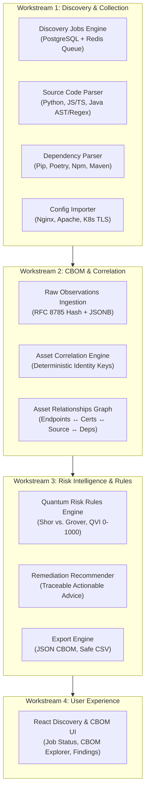

# Quantum Flow Technologies — Sprint 2 Implementation Plan
## Cryptographic Discovery & Risk Intelligence

**Document ID:** QFT-SPRINT-002-PLAN  
**Version:** 1.0  
**Status:** Approved for Implementation  
**Date:** 2026-11-02  
**Target Milestone:** Sprint 2 (Days 31–45)  
**Repository:** `quantum-flow-pqc-platform`

---

## 1. Executive Summary & Objective

Sprint 2 builds the core cryptographic discovery, inventory correlation, and preliminary risk intelligence foundation on top of the Sprint 0/1 baselines.

The objective is to enable an enterprise user to:
1. Provide an authorized source archive, software manifest, or cryptographic configuration file.
2. Asynchronously process discovery jobs with bounded concurrency, durable PostgreSQL state tracking, and failure recovery.
3. Extract verified cryptographic findings across source code (Python, JS/TS, Java), dependency manifests (`requirements.txt`, `poetry.lock`, `package.json`, `package-lock.json`, `pom.xml`), and TLS configurations (Nginx, Apache, Kubernetes).
4. Ingest observations into the Cryptographic Bill of Materials (CBOM) correlation engine, mapping raw evidence into logical `CryptographicAsset` entities with deterministic identity keys and relationships.
5. Evaluate discovered assets against the CISO-defined Quantum Risk Assessment Methodology v1.0 (evaluating Shor factoring/discrete-log vs. Grover symmetric search, 8 risk dimensions Q, R, L, E, B, M, V on a 0–1000 scale).
6. Generate explainable findings, remediation recommendations, and exportable artifacts (CycloneDX 1.6 compatible JSON and injection-safe CSV).
7. Interact with discovery results through an expanded React 18 dashboard.

---

## 2. Workstreams & Scope

---

## 3. Backlog Task Mapping

We preserve all completed Sprint 0 and Sprint 1 tasks and map existing/new backlog task IDs:

| Backlog ID | Workstream / Component | Task Description | Priority |
|---|---|---|---|
| **QF-018** | Job Orchestration | Scan & Discovery Job state machine (`queued`, `running`, `completed`, `failed`, `cancelled`) | P0 |
| **QF-019** | Job Orchestration | Worker claim, lease timeout, heartbeat, and zombie recovery | P1 |
| **QF-020** | Job Orchestration | Job submission, listing, progress, and cancellation REST endpoints | P1 |
| **QF-021** | Job Orchestration | Idempotency guards against duplicate job submissions and concurrent execution collisions | P0 |
| **QF-042** | Source Discovery | Safe source archive extraction (Zip slip/bomb guard) and cryptographic pattern analysis (Python, JS/TS, Java) | P0 |
| **QF-043** | Dependency Discovery | Software dependency parser for Python (`requirements.txt`, `poetry.lock`), npm (`package.json`, `package-lock.json`), and Maven (`pom.xml`) | P0 |
| **QF-044** | Configuration Import | Read-only configuration parser for Nginx, Apache, and Kubernetes TLS manifests | P1 |
| **QF-029** | CBOM Inventory | Cryptographic asset identity resolution engine (deterministic `asset_key` generation) | P0 |
| **QF-030** | CBOM Inventory | CBOM asset correlation engine and relationship graph persistence | P0 |
| **QF-032** | CBOM Inventory | Scan coverage summary and limitation calculator (Observed / Inferred / Imported / Unknown) | P2 |
| **QF-033** | Risk Intelligence | Cryptographic algorithm classification catalogue (Shor-vulnerable vs. Grover margin vs. PQC) | P0 |
| **QF-034** | Risk Intelligence | Deterministic quantum risk scoring engine (0–1000 scale, 8 dimensions) | P0 |
| **QF-035** | Risk Intelligence | Rule-based finding and remediation recommendation generator | P1 |
| **QF-036** | Risk Intelligence | Risk assessment persistence and versioned API | P1 |
| **QF-037** | Risk Intelligence | Risk scoring determinism and regression test suite | P0 |
| **QF-041** | Reports & Exports | Assessment export engine: CycloneDX 1.6 JSON and formula-injection-safe CSV | P1 |
| **QF-039** | Web Application | CBOM asset explorer and relationship visualizer | P1 |
| **QF-040** | Web Application | Discovery job manager, source upload, and risk assessment dashboard | P1 |

---

## 4. Architecture & Safety Decisions

### ADR-003: Lightweight Durable Discovery Job Queue
- **Decision:** Use PostgreSQL as the single source of truth for job states, leasing, and retries, with Redis used for async task dispatching. Avoid introducing heavyweight Celery/Kafka clusters for the initial release.
- **Rationale:** Simplifies local and test execution, prevents split-brain state between broker and database, and ensures ACID transactional integrity on job failure or cancellation.

### ADR-004: Safe Archive Extraction Sandbox
- **Decision:** Enforce multi-layered archive decompression limits:
  1. Maximum uncompressed size limit: 50 MB.
  2. Maximum file count: 500 files.
  3. Maximum compression ratio: 1:50.
  4. Path traversal defense: resolve canonical paths; reject any member containing `..` or leading `/`.
  5. Symlink handling: ignore or reject all symbolic/hard links to prevent host filesystem traversal.
  6. File size ceiling: individual files over 5 MB are skipped with an explicit coverage limitation note.

### ADR-005: Deterministic Asset Identity Keys
- **Decision:** Assets use stable, deterministic, tenant-scoped identity keys:
  - `tls_endpoint`: `tls:<hostname>:<port>`
  - `certificate`: `cert:sha256:<fingerprint_hex>`
  - `algorithm_usage`: `code:<file_path>:<algorithm_family>:<line_number>`
  - `dependency`: `dep:<ecosystem>:<package_name>:<version>`
  - `protocol_config`: `cfg:<file_path>:<directive>`
- **Rationale:** Prevents duplicate asset proliferation, enables repeatable re-scans, and tracks changes over time without loss of history.

### ADR-006: Formula-Injection Defense for CSV Exports
- **Decision:** Prepend a single quote `'` to any string field beginning with `=`, `+`, `-`, `@`, `\t`, or `\r` before serializing to CSV.
- **Rationale:** Protects downstream spreadsheet users against CVE-class CSV formula injection attacks.

---

## 5. Explicit Non-Goals for Sprint 2

1. **No Production Cryptographic Modifications:** The platform is strictly an inspection and intelligence system; it does not push configuration or rotate certificates.
2. **No Arbitrary Remote Repository Cloning:** No unrestricted `git clone` from user-supplied URLs to prevent SSRF and network egress abuse. Only uploaded archive files or controlled test files are processed.
3. **No Execution of Uploaded Source Code:** Source code is analyzed statically (AST / tokens / regex); build scripts (`setup.py`, `pom.xml` plugins, npm scripts) are never executed.
4. **No Private Key or Secret Extraction:** Secret keys discovered in files are never ingested as evidence payloads.
5. **No Universal Enterprise Inventory Claims:** Reports clearly state that coverage is bounded by the specific files, endpoints, and packages analyzed.

---

## 6. Acceptance Criteria

Sprint 2 is accepted when:
1. **Job Engine:** Discovery jobs can be submitted, queued, claimed by workers, tracked via API, and cancelled gracefully.
2. **Source Analysis:** Python, JS/TS, and Java source files in an uploaded zip archive are parsed for cryptographic primitives (RSA, ECC, AES, SHA-2, etc.) and generate structured observations with line-level snippets.
3. **Dependency Analysis:** Lockfiles (`requirements.txt`, `poetry.lock`, `package.json`, `package-lock.json`, `pom.xml`) produce inventory records with ecosystem, package, version, and direct/transitive status.
4. **Configuration Import:** Nginx, Apache, and Kubernetes TLS configurations parse protocols and cipher suites without executing scripts or capturing secrets.
5. **CBOM Correlation:** Observations are correlated into `CryptographicAsset` entities and `AssetRelationship` links with deterministic keys.
6. **Risk Engine:** Assets are scored deterministically against Methodology v1.0 (0–1000 QVI, 8 dimensions, Shor vs. Grover distinction) with traceable explanations and recommendations.
7. **Export Engine:** Assessment and CBOM can be exported to valid JSON and safe CSV.
8. **UI:** React frontend supports source archive upload, job tracking, CBOM inspection, finding explanations, and export downloads.
9. **Quality Gates:** 100% test pass on Pytest, Ruff lint/format, Mypy, TypeScript `tsc`, ESLint, Vitest, and production build.

