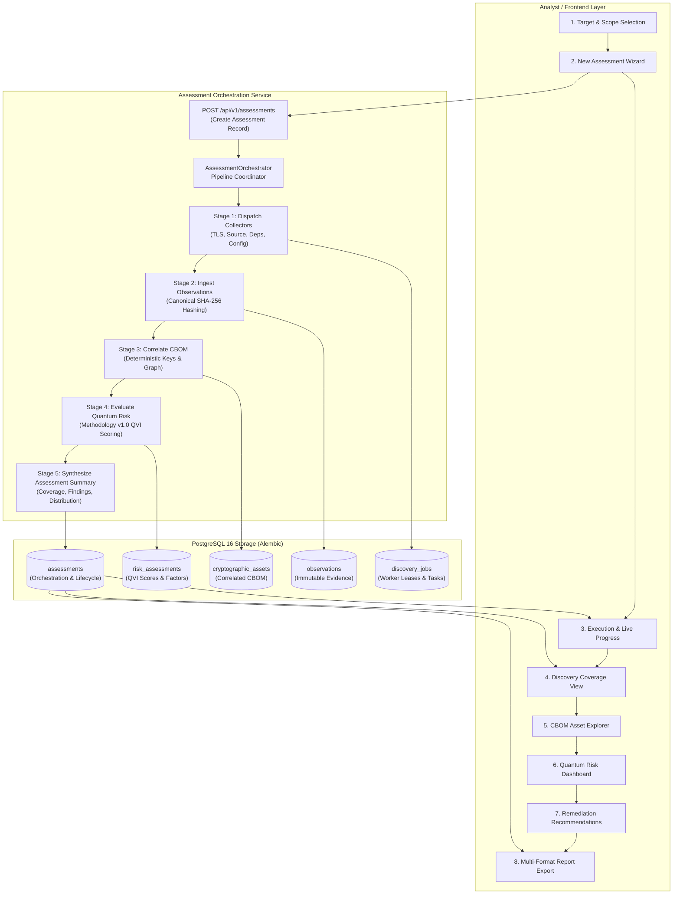
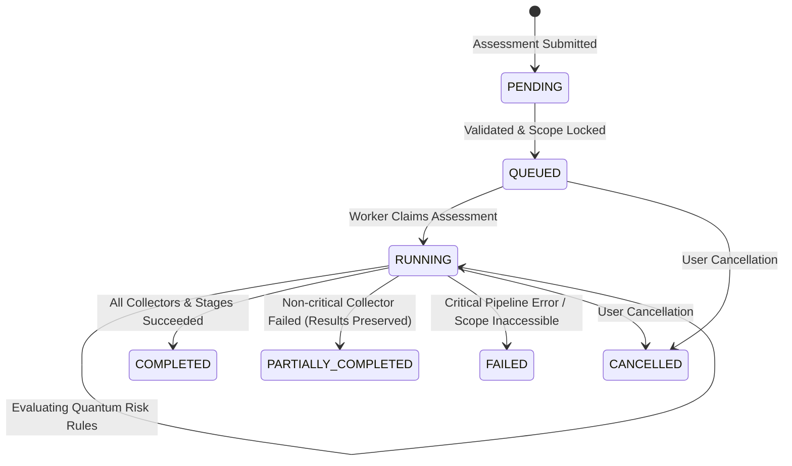

# Quantum Flow — Sprint 3 Implementation Plan
## Scanner MVP, Assessment Workflow & Repeatable Demonstration

**Document ID:** QFT-SPRINT-003-PLAN  
**Version:** 1.0  
**Status:** Submitted for Engineering Review (Phase 0)  
**Date:** 2026-11-02  
**Target Milestone:** Sprint 3 (Days 46–60) — Unified Assessment Workflow & Demonstration  
**Repository:** `quantum-flow-pqc-platform`  
**Current Branch:** `main` (Verified Clean; Sprint 2 Committed & Pushed to Remote)  

---

## 1. Executive Summary & Repository Status

### 1.1 Repository State & Sprint 2 Baseline Verification
- **Branch:** `main`
- **Working Tree:** Clean (zero uncommitted changes, zero untracked files).
- **Remote Tracking:** `origin/main` is up to date with commit `d6a1b09` (`docs(sprint2): record sprint 2 implementation report and update development backlog`).
- **Sprint 2 Commit Chain Verified:**
  1. `3a17cb5`: `feat(db): add alembic migration for discovery jobs, cbom assets, and risk intelligence`
  2. `316d82a`: `feat(scanner): implement safe source archive extractor, static parsers, and dependency scanner`
  3. `cea0714`: `feat(cbom): implement cbom asset correlation, relationship graphs, and cyclonedx exporter`
  4. `e4d0f78`: `feat(risk): implement methodology v1.0 quantum risk scoring engine and recommendations`
  5. `8f8d577`: `feat(api): add discovery jobs, source upload, config import, and cbom risk endpoints`
  6. `6d54181`: `feat(web): add source upload, config import, cbom explorer, and risk assessment views`
  7. `74cc44a`: `test(sprint2): add unit, security, and integration test suites for discovery and risk engine`
  8. `d6a1b09`: `docs(sprint2): record sprint 2 implementation report and update development backlog`
- **Quality Gates Baseline:**
  - Python Linting (Ruff): 0 errors across 115 files.
  - Python Formatting (Ruff Format): 115 files 100% formatted.
  - Static Type Analysis (Mypy): 0 issues across 106 source files.
  - Backend Test Suite (Pytest): 98 passing tests (78 unit/sec + 20 integration) in 3.62s.
  - Frontend TypeScript (`tsc --noEmit`): 0 errors.
  - Frontend Linting (ESLint): 0 warnings, 0 errors.
  - Frontend Unit Tests (Vitest): 10 passing tests across 3 suites.
  - Frontend Production Build (Vite): Clean 208kB production bundle.

---

## 2. Scope & Objectives

Sprint 3 unifies the disparate discovery collectors, correlation algorithms, and risk rules built in Sprints 1 and 2 into an **Enterprise Assessment Workflow** with persistent lifecycle states, comprehensive coverage reporting, and a safe, repeatable demonstration environment.

### Core Objectives:
1. **Unified Assessment Orchestration:**
   - Coordinate Target Management, Bounded TLS Discovery, Source Code Analysis, Dependency Manifest Scanning, Configuration Import, CBOM Correlation, and Quantum Risk Assessment under a single durable `Assessment` orchestration entity.
   - Maintain explicit traceability and foreign-key relationships across Targets, Discovery Jobs, Observations, CBOM Assets, and Risk Assessments.
2. **Persistent Assessment Lifecycle Management:**
   - Implement durable states: `PENDING`, `QUEUED`, `RUNNING`, `COMPLETED`, `PARTIALLY_COMPLETED`, `FAILED`, `CANCELLED`.
   - Track progress percentages, execution stages, timestamps, active worker leases, and granular collector status (attempted, successful, failed).
   - Prevent misleading completion states when mandatory collectors fail.
3. **Coverage Accounting & Evidence Quality:**
   - Provide multi-dimensional coverage metrics:
     - By Discovery Source (`network_tls`, `static_source`, `dependency_manifest`, `config_import`).
     - By Asset Classification (`OBSERVED`, `INFERRED`, `IMPORTED`, `UNKNOWN`).
     - By Evidence Quality (`high`, `medium`, `low`, `insufficient`).
   - Identify unexamined areas, missing manifests, and unsupported algorithms without corrupting weighted risk scores.
4. **Assessment-Level Risk Prioritisation:**
   - Synthesize asset-level QVI evaluations into an enterprise risk profile.
   - Calculate assessment-level risk distribution, Shor vs. Grover vulnerability breakdown, and top-priority remediation items.
5. **Multi-Format Assessment Reporting:**
   - Enterprise Markdown assessment report (Executive Summary, Target Scope, CBOM Inventory, Risk Profile, Recommendations, Limitations).
   - Full CycloneDX 1.6 CBOM JSON export.
   - Neutralized RFC 4180 CSV export with formula injection defense.
6. **Frontend Unified Workflow:**
   - Integrate existing React views into a single, cohesive workflow:
     `Targets` → `New Assessment Wizard` → `Assessment Execution & Progress` → `Discovery Coverage` → `CBOM Explorer` → `Risk Assessment` → `Recommendations` → `Reports`.
   - Implement meaningful loading, error, empty, partial, and cancelled states with zero hardcoded sample metrics.
7. **Repeatable Demonstration Environment:**
   - Create synthetic source code repositories, dependency manifests, and TLS configurations.
   - Provide a safe CLI runner and automated demonstration script verifying expected findings and risk scores.

---

## 3. Existing Components to Reuse (Zero Duplication)

| Component | Location | Reusable Capabilities |
|---|---|---|
| **Target Management** | `services/api/app/db/models/target.py` | Target verification, domain safety, FQDN validation |
| **TLS Handshake Collector** | `packages/scanner/tls/` | Bounded TLS probe, SNI preservation, X.509 certificate extraction |
| **Source Archive Sandbox** | `packages/scanner/source/archive.py` | Zip Slip defense, bomb ceiling, symlink rejection, private key exclusion |
| **Source AST & Pattern Parsers** | `packages/scanner/source/parsers/` | Python AST analysis, JS/TS regex/token parser, Java regex/token parser |
| **Dependency Scanner** | `packages/scanner/dependencies/` | Pip, npm, and maven manifest parsing, declared vs lockfile tagging |
| **Config Importer** | `packages/scanner/config/importer.py` | Nginx, Apache, and Kubernetes Ingress TLS directive parsing |
| **CBOM Correlator** | `packages/cbom/correlator.py` | Deterministic asset keys (`cert`, `tls`, `code`, `dep`, `cfg`), graph relationships |
| **CycloneDX Exporter** | `packages/cbom/cyclonedx.py` | CycloneDX 1.6 JSON generation with `cryptoProperties` |
| **Quantum Risk Engine** | `packages/risk/engine.py` | Methodology v1.0 QVI scoring (7 weighted dimensions summing to 950 raw points) |
| **Risk Threat Catalogue** | `packages/risk/catalogue.py` | Shor vs Grover algorithm threat classifications |
| **Job Execution Engine** | `services/api/app/services/job_service.py` | Atomic `SKIP LOCKED` worker claiming, leases, zombie reclamation, idempotency |
| **CSV & Report Exporter** | `packages/reports/exporter.py` | Formula injection neutralized CSV and asset-level markdown |
| **Frontend UI Components** | `apps/web/src/features/` | TargetManagement, SourceUpload, AssetExplorer, RiskDashboard |

---

## 4. Identified Architectural Gaps

1. **Missing Orchestrator Entity:**
   - Currently, `DiscoveryJob` manages individual asynchronous tasks, and `RiskAssessment` assesses a single asset. There is no top-level `Assessment` record that groups all collectors, observations, assets, and reports for a target into a single audit entity.
2. **Disconnected Pipeline:**
   - A user currently has to run TLS scan, upload source archive, import config, and evaluate assets in separate, disconnected API calls. No single orchestrator executes the pipeline: `Discovery → Ingestion → Correlation → Risk Scoring → Reporting`.
3. **Lack of Coverage Summary Entity:**
   - While coverage exists inside `SourceScanCoverage`, there is no unified assessment-level coverage model combining network endpoints, source repositories, dependencies, and configuration files.
4. **Disconnected Frontend Navigation:**
   - The React UI shows separate tabs for `Targets`, `Source Discovery`, `CBOM Inventory`, and `Risk Prioritisation`, rather than an assessment-driven workflow where an analyst starts an assessment and steps through execution to reporting.
5. **No Synthetic Demonstration Fixtures:**
   - No self-contained synthetic repository fixtures or automated demonstration runner exist to show stakeholders a repeatable, end-to-end PQC risk assessment.

---

## 5. Proposed Architecture & Assessment Lifecycle



### Assessment Lifecycle State Machine:



---

## 6. Proposed API & Database Changes

### 6.1 Database Schema Additions (`assessments` Table)

Alembic migration to introduce `assessments` and associate existing entities:

```sql
CREATE TABLE assessments (
    id UUID PRIMARY KEY,
    title VARCHAR(200) NOT NULL,
    target_id UUID REFERENCES targets(id) ON DELETE SET NULL,
    status VARCHAR(50) NOT NULL DEFAULT 'pending',
    discovery_sources JSONB NOT NULL DEFAULT '[]',
    progress_percent INTEGER NOT NULL DEFAULT 0,
    progress_stage VARCHAR(100) NOT NULL DEFAULT 'PENDING',
    collector_results JSONB NOT NULL DEFAULT '{}',
    asset_counts JSONB NOT NULL DEFAULT '{}',
    risk_summary JSONB NOT NULL DEFAULT '{}',
    coverage_summary JSONB NOT NULL DEFAULT '{}',
    error_summary TEXT,
    methodology_version VARCHAR(50) NOT NULL DEFAULT 'QFT-RISK-v1.0',
    engine_version VARCHAR(50) NOT NULL DEFAULT 'v1.0.0',
    started_at TIMESTAMP WITH TIME ZONE,
    completed_at TIMESTAMP WITH TIME ZONE,
    created_at TIMESTAMP WITH TIME ZONE NOT NULL,
    updated_at TIMESTAMP WITH TIME ZONE NOT NULL
);

-- Foreign keys to link existing discovery entities to the Assessment run
ALTER TABLE discovery_jobs ADD COLUMN assessment_id UUID REFERENCES assessments(id) ON DELETE SET NULL;
ALTER TABLE observations ADD COLUMN assessment_id UUID REFERENCES assessments(id) ON DELETE SET NULL;
ALTER TABLE cryptographic_assets ADD COLUMN assessment_id UUID REFERENCES assessments(id) ON DELETE SET NULL;
ALTER TABLE risk_assessments ADD COLUMN assessment_id UUID REFERENCES assessments(id) ON DELETE SET NULL;

CREATE INDEX ix_assessments_target_id ON assessments(target_id);
CREATE INDEX ix_assessments_status ON assessments(status);
CREATE INDEX ix_discovery_jobs_assessment_id ON discovery_jobs(assessment_id);
CREATE INDEX ix_cryptographic_assets_assessment_id ON cryptographic_assets(assessment_id);
CREATE INDEX ix_risk_assessments_assessment_id ON risk_assessments(assessment_id);
```

### 6.2 New REST Endpoints (`/api/v1/assessments`)

| Method | Endpoint | Description |
|---|---|---|
| `POST` | `/api/v1/assessments` | Create and trigger an enterprise assessment run |
| `GET` | `/api/v1/assessments` | List assessments with status, score, asset counts, progress |
| `GET` | `/api/v1/assessments/{id}` | Detailed assessment status, progress stage, and collector breakdowns |
| `GET` | `/api/v1/assessments/{id}/progress` | Lightweight live progress polling endpoint |
| `POST` | `/api/v1/assessments/{id}/cancel` | Cancel an active assessment run |
| `POST` | `/api/v1/assessments/{id}/retry` | Retry failed collectors for partially completed assessments |
| `GET` | `/api/v1/assessments/{id}/coverage` | Coverage analysis by source, classification, and quality |
| `GET` | `/api/v1/assessments/{id}/assets` | CBOM assets correlated under this assessment |
| `GET` | `/api/v1/assessments/{id}/risk` | Prioritised findings, dimension contributions, and Shor vs Grover breakdown |
| `GET` | `/api/v1/assessments/{id}/recommendations` | Traceable NIST PQC remediation recommendations |
| `GET` | `/api/v1/assessments/{id}/reports/cyclonedx` | CycloneDX 1.6 CBOM JSON export |
| `GET` | `/api/v1/assessments/{id}/reports/csv` | RFC 4180 CSV export with injection neutralization |
| `GET` | `/api/v1/assessments/{id}/reports/markdown` | Executive Markdown summary report |

---

## 7. Security & Governance Considerations

1. **Authorization & Scope Boundary Enforcement:**
   - Network TLS scanning can only be executed against verified targets owned by the organization.
   - Source archives and configurations cannot trigger external network calls or command execution.
2. **Zero Code Execution in Sandboxed Parsers:**
   - Python AST (`ast.NodeVisitor`), JS/TS regex/token matching, and Java regex/token matching remain read-only. No files are compiled, loaded, or executed.
3. **Private Key & Secret Exclusion (Preserved & Enforced):**
   - Pre-extraction file name exclusion (`.key`, `.p12`, `id_rsa`) and post-extraction content sniffing (`-----BEGIN ...PRIVATE KEY-----`) are strictly enforced.
4. **CSV Formula Injection Neutralization:**
   - All exported text fields are sanitized to neutralize formula prefixes (`=`, `+`, `-`, `@`, `|`, `%`, `\t`, `\r`, `\n`) even when preceded by whitespace.
5. **Worker Leasing & Concurrency Guards:**
   - Atomic database transactions with `SKIP LOCKED` prevent duplicate job execution or task collisions.
6. **No Real Credentials in Demonstration:**
   - Synthetic demo fixtures contain exclusively dummy certificates, synthetic cryptographic code snippets, and sanitized configurations clearly marked as `SYNTHETIC EVIDENCE`.

---

## 8. Acceptance Criteria

- [ ] Submitting an assessment request creates a persistent `Assessment` record in state `PENDING`/`QUEUED`.
- [ ] Orchestrator executes enabled collectors (TLS probe, Source AST, Dependency manifest, Config importer) and records granular execution metrics.
- [ ] Raw observations are persisted immutably with SHA-256 evidence digests and linked to the assessment.
- [ ] CBOM correlation normalizes observations into cryptographic assets and relationships linked to the assessment.
- [ ] Quantum Risk Engine evaluates assets against Methodology v1.0, generating scores (max raw 950 points on 0–1000 scale), factors, and recommendations.
- [ ] Failed collectors mark the assessment as `PARTIALLY_COMPLETED` (or `FAILED` if required stages abort) with detailed error logs; successful evidence is preserved.
- [ ] Comprehensive reports (CycloneDX 1.6 JSON, injection-safe CSV, Executive Markdown) can be downloaded for any completed assessment.
- [ ] Frontend integrates into a seamless 8-stage workflow with live progress tracking, coverage explorer, and export buttons.
- [ ] A synthetic demonstration fixture set runs cleanly via an automated script, proving complete end-to-end functionality.
- [ ] Zero regressions across existing Sprint 0–2 tests (98/98 tests passing).

---

## 9. Comprehensive Test Plan

1. **Unit Tests:**
   - Assessment lifecycle state transition validation (`PENDING` → `QUEUED` → `RUNNING` → `COMPLETED`/`PARTIALLY_COMPLETED`/`FAILED`/`CANCELLED`).
   - Assessment summary calculation (asset counts, risk distribution, Shor vs. Grover counts).
   - Coverage metrics computation (observed, inferred, imported, unknown).
   - Report generator unit tests (Enterprise Markdown, CycloneDX, CSV).
2. **Security Tests:**
   - Unauthorized target assessment rejection.
   - Private key rejection during assessment source extraction.
   - Formula injection neutralization in enterprise assessment CSV export.
3. **Integration Tests:**
   - Full end-to-end assessment execution flow (Target + Source Archive + Config Import → CBOM → Risk → Report).
   - Partial failure handling (e.g., TLS connection failure while source upload succeeds).
   - Assessment cancellation mid-execution.
   - Duplicate assessment submission idempotency.
4. **Frontend Integration Tests:**
   - New Assessment form submission and validation.
   - Live progress polling view state rendering.
   - Coverage breakdown and risk summary components.
   - Vitest suite passing with zero failures.

---

## 10. Implementation Sequence

1. **Step 1 — Database & Models:** Create `Assessment` model, update relationships in `DiscoveryJob`, `CryptographicAsset`, `Observation`, and `RiskAssessment`, and generate Alembic migration.
2. **Step 2 — Assessment Orchestrator Service:** Implement `AssessmentService` and pipeline coordinator in `services/api/app/services/assessment_service.py`.
3. **Step 3 — API Endpoints & Schemas:** Implement `/api/v1/assessments` router, schemas, progress polling, cancellation, and report downloads.
4. **Step 4 — Reporting Enhancements:** Expand `packages/reports/exporter.py` with enterprise assessment summary generation.
5. **Step 5 — Frontend Integration:** Update `apps/web` with unified 8-step workflow navigation, `NewAssessmentModal`, `AssessmentProgress`, `CoverageExplorer`, and `ReportViewer`.
6. **Step 6 — Synthetic Demonstration Suite:** Build `demo/fixtures/` and `demo/run_demo.py` with repeatable instructions.
7. **Step 7 — Test Suite & Quality Gates:** Write comprehensive automated test suites and verify all local quality gates (Ruff, Mypy, Pytest, ESLint, Vitest, Vite Build).
8. **Step 8 — Documentation & Audit Report:** Create `docs/SPRINT_3_IMPLEMENTATION_REPORT.md` and synchronize `Development_Backlog.md`.

