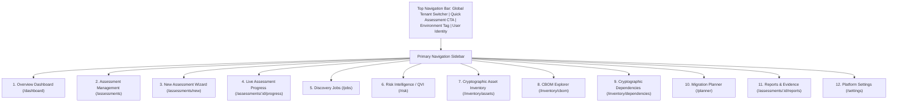
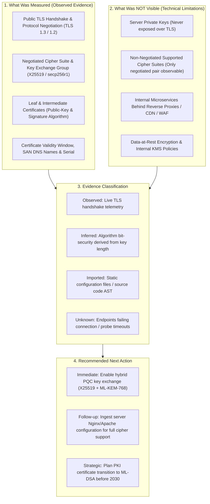
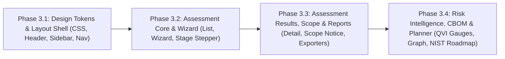

# Quantum Flow — Enterprise UI/UX Phase 3 Implementation Plan
## Design System, Information Architecture & Frontend Engineering Specification

**Document ID:** `QFT-SPRINT-003-STEP-4-PHASE-3-PLAN-REV1.0`  
**Date:** 3 November 2026  
**Status:** DRAFT PROPOSAL FOR REVIEW & AUTHORIZATION  
**Baseline:** Sprint 3, Step 4, Phase 2 (`QFT-SPRINT-003-STEP-4-PHASE-2-AUTH-01`)  
**Design Reference:** KavachQ Design Aesthetics (`https://kavachq.in/` and `https://kavachq.in/scan`)  
**Target Application:** `apps/web` (React 18, TypeScript, Vite)  

---

## 1. Executive Summary & Design Philosophy

### 1.1 Objective
Quantum Flow is transforming into an original, premium enterprise cybersecurity platform for post-quantum cryptographic discovery and risk intelligence. Using the visual poise, clarity, and information hierarchy of KavachQ as an aesthetic benchmark, Quantum Flow establishes its own bespoke design system, product identity, and architectural contracts.

The application serves two primary enterprise personas:
1. **Executive Stakeholders (CISO, Security Leadership, Risk & Compliance Officers, Board Auditors):** Require immediate, high-level posture summaries, Quantum Vulnerability Index (QVI) aggregates, regulatory compliance roadmaps, and verifiable audit evidence.
2. **Technical Practitioners (Security Engineers, Cryptographers, PKI Architects, Platform/DevOps Engineers):** Require granular cryptographic parameters, exact algorithm identities, OID mappings, key lengths, cipher negotiation handshakes, source-code dependency trees, and actionable remediation steps.

### 1.2 Core Workflow
The platform guides the enterprise through the complete cryptographic transition lifecycle:
$$\textbf{Discover} \longrightarrow \textbf{Inventory (CBOM)} \longrightarrow \textbf{Assess (QVI)} \longrightarrow \textbf{Prioritise} \longrightarrow \textbf{Plan (Migration)} \longrightarrow \textbf{Report (Audit Verified)}$$

### 1.3 Key Architectural Invariants Preserved
This UI/UX specification strictly honors all existing Quantum Flow engineering contracts:
- **Zero Schema or Methodology Alterations:** Methodology v1.0 (QVI 0–1000 mathematical engine, 5 risk dimensions: Algorithm, Key Length, Purpose, Environment, Migration Complexity) is untouched.
- **Zero API Contract Inventions:** Frontend TypeScript interfaces map directly to backend Pydantic models from FastAPI and `packages/scanner/`, `packages/risk/`, and `packages/reports/`.
- **Strict Evidence Transparency:** In conformity with high-assurance security principles, the UI strictly distinguishes:
  - **Observed Evidence:** Tangible data extracted from active handshakes or parsed files.
  - **Inferred Evidence:** Algorithmic deductions (e.g. protocol compatibility from cipher suites).
  - **Imported Evidence:** Declarations ingested from configuration files or static manifests.
  - **Unknown / Unobserved:** Explicitly acknowledged gaps where scanner visibility stopped.
- **Scope & Limitations Accountability:** The UI explicitly defines what a scan measured, what was not visible, and why a public TLS scan does not equal a complete internal estate assessment.

---

## 2. Quantum Flow Design System & Visual Tokens

The design direction pairs an editorial, high-trust aesthetic with modern cybersecurity dashboard precision. It uses warm, organic off-white/ivory canvas backgrounds, deep navy text and navigation, and muted forest/olive-green accents.

### 2.1 Color Palette & Semantic Tokens

```css
:root {
  /* Canvas & Surface Tokens (Warm Ivory & Alabaster) */
  --qf-canvas-bg: #FAF9F5;              /* Primary background: warm off-white / ivory */
  --qf-surface-card: #FFFFFF;            /* Card & container background: clean white */
  --qf-surface-secondary: #F3F1EC;       /* Elevated surfaces, table headers, inactive tabs */
  --qf-surface-tertiary: #EBE8E1;        /* Wells, code block backgrounds, inner borders */
  --qf-border-subtle: #E5E1D8;           /* Default 1px hairline border */
  --qf-border-strong: #D1CBBF;           /* Hover / active container border */

  /* Typography Tokens (Deep Navy / Slate) */
  --qf-text-primary: #0F172A;            /* Deep Slate Navy: primary headings and body */
  --qf-text-secondary: #334155;          /* Navy Slate: secondary labels, card subtitles */
  --qf-text-muted: #64748B;              /* Slate: captions, helper text, timestamps */
  --qf-text-faint: #94A3B8;              /* Light Slate: disabled states, placeholder text */

  /* Brand & Accent Tokens (Muted Forest Olive) */
  --qf-olive-primary: #3B5240;           /* Primary brand action: muted deep olive */
  --qf-olive-hover: #2C3E30;             /* Primary hover: darker forest olive */
  --qf-olive-light: #EBF0EC;             /* Light olive tint: tag backgrounds, active pills */
  --qf-olive-border: #C8D6CA;            /* Soft olive accent borders */
  --qf-olive-accent: #55725B;            /* Muted green accent highlights */

  /* Secondary Interactive Tokens */
  --qf-navy-primary: #1E293B;            /* Secondary button / sidebar brand background */
  --qf-navy-hover: #0F172A;              /* Dark navy hover */

  /* Severity & Risk Palette (Refined Enterprise Tones) */
  --qf-risk-critical-bg: #FEF2F2;        /* QVI >= 700: soft crimson tint */
  --qf-risk-critical-text: #991B1B;      /* QVI >= 700: deep carmine red */
  --qf-risk-critical-border: #FECACA;

  --qf-risk-high-bg: #FFF7ED;            /* QVI 500-699: soft amber-rust tint */
  --qf-risk-high-text: #C2410C;          /* QVI 500-699: burnt orange */
  --qf-risk-high-border: #FED7AA;

  --qf-risk-medium-bg: #FEFCE8;          /* QVI 300-499: warm ochre tint */
  --qf-risk-medium-text: #A16207;        /* QVI 300-499: dark amber ochre */
  --qf-risk-medium-border: #FEF08A;

  --qf-risk-low-bg: #F0FDF4;             /* QVI < 300: pale mint tint */
  --qf-risk-low-text: #166534;           /* QVI < 300: deep forest green */
  --qf-risk-low-border: #BBF7D0;

  /* Quantum Readiness Status Tokens */
  --qf-quantum-vuln-bg: #FEF2F2;
  --qf-quantum-vuln-text: #991B1B;       /* RSA, ECC, DH (Shor vulnerable) */
  --qf-quantum-hybrid-bg: #EFF6FF;
  --qf-quantum-hybrid-text: #1E40AF;     /* X25519 + ML-KEM-768 */
  --qf-quantum-safe-bg: #F0FDF4;
  --qf-quantum-safe-text: #166534;       /* ML-KEM, ML-DSA, SLH-DSA, AES-256 */

  /* Shadows & Elevation */
  --qf-shadow-sm: 0 1px 2px rgba(15, 23, 42, 0.04);
  --qf-shadow-md: 0 4px 6px -1px rgba(15, 23, 42, 0.06), 0 2px 4px -2px rgba(15, 23, 42, 0.04);
  --qf-shadow-lg: 0 10px 15px -3px rgba(15, 23, 42, 0.08), 0 4px 6px -4px rgba(15, 23, 42, 0.04);

  /* Radii & Geometry */
  --qf-radius-sm: 4px;
  --qf-radius-md: 8px;                   /* Standard card radius */
  --qf-radius-lg: 12px;                  /* Modal / large panel radius */
  --qf-radius-full: 9999px;              /* Pill badges */
}
```

### 2.2 Typography Hierarchy

```css
:root {
  /* Editorial Serif (Authority, Headings, Executive Quotes) */
  --qf-font-serif: "Fraunces", "Newsreader", "Playfair Display", Georgia, serif;

  /* Sans-Serif Dashboard (Precision, Data, Navigation, Controls) */
  --qf-font-sans: "Plus Jakarta Sans", "Inter", -apple-system, BlinkMacSystemFont, "Segoe UI", Roboto, sans-serif;

  /* Monospace (Cryptographic Primitives, Hashes, Ciphers, OIDs) */
  --qf-font-mono: "JetBrains Mono", "SF Mono", Menlo, Consolas, "Liberation Mono", monospace;
}
```

| Type Role | Font Family | Size | Weight | Line Height | Usage |
|:---|:---|:---|:---|:---|:---|
| **Display Header** | Serif | `2.25rem` (36px) | 600 SemiBold | 1.25 | Executive summary titles, assessment verdict hero |
| **Section Title** | Serif | `1.5rem` (24px) | 600 SemiBold | 1.3 | Module headers, major card headings |
| **Card Subtitle** | Sans-serif | `1.125rem` (18px) | 600 SemiBold | 1.4 | Section subdivisions, modal titles |
| **Body Primary** | Sans-serif | `0.9375rem` (15px) | 400 Regular | 1.5 | Primary descriptions, table cells, form labels |
| **Body Secondary** | Sans-serif | `0.8125rem` (13px) | 400 Regular | 1.5 | Metadata labels, helper instructions, table footers |
| **Technical Label** | Monospace | `0.8125rem` (13px) | 500 Medium | 1.4 | Cipher suites, algorithms (`ML-KEM-768`), hashes |
| **Pill / Badge** | Sans-serif | `0.6875rem` (11px) | 600 SemiBold | 1.2 | Severity tags, readiness status, protocol versions |

---

## 3. Application Navigation & Information Architecture

### 3.1 Dual-Audience Navigation Model
Quantum Flow provides a unified header with persona perspective toggling:
- **Executive Mode:** Prioritizes aggregate risk charts, financial/exposure prioritization, compliance matrices (NIST IR 8547, CNSA 2.0, BSI TR-02102), and verifiable PDF/Markdown export.
- **Engineering Mode:** Surfaces raw CBOM component graphs, AST source finding snippets, handshake telemetry, cipher parameter breakdowns, and CLI discovery jobs.

### 3.2 Site Navigation Hierarchy



---

## 4. Module-by-Module UX Specifications

### Module 1: Overview Dashboard (`/dashboard`)
- **Status in Baseline:** Partially implemented (`DashboardOverview.tsx` has health widgets and basic scan list).
- **Redesign Requirements:**
  - **Executive QVI Scorecard:** Central dial showing organizational Quantum Vulnerability Index (0–1000) with categorical band indicator (`Critical`, `High`, `Elevated`, `Guarded`, `Low`).
  - **Cryptographic Exposure Matrix:** Breakdown of discovered assets into:
    - *Shor-Vulnerable (Asymmetric Break):* RSA, ECC, ECDH, DSA.
    - *Grover-Impacted (Key Halving):* AES-128, 3DES, SHA-1, SHA-256.
    - *Post-Quantum Ready / Hybrid:* ML-KEM, ML-DSA, SLH-DSA, X25519+ML-KEM-768.
  - **Recent Assessments Activity:** Table of recent assessments with stage progress, asset count, status badges, and direct report download links.
  - **Quick Scan CTA:** Immediate input for entering target hostname with instant scan kick-off button.

### Module 2: Assessment Management (`/assessments`)
- **Status in Baseline:** Missing (currently only `TargetManagement.tsx` manages targets).
- **Screen Specification:**
  - **Filter Bar:** Search by assessment name/target, filter by environment (`production`, `staging`, `testing`, `development`), criticality (`critical`, `high`, `medium`, `low`), and status (`queued`, `running`, `completed`, `failed`, `cancelled`).
  - **Assessment Grid / Table:**
    - Columns: Assessment Name, Target Domain, Created At, Execution Duration, Stage Indicator, Discovered Assets Count, Highest QVI Score, Actions.
    - Quick Action Menu: View Progress / Results, Download CycloneDX, Download Executive Report, Retry (if failed), Cancel (if active).
  - **Pagination Controls:** Bounded pagination respecting backend `skip` and `limit` parameters.

### Module 3: New Assessment Wizard (`/assessments/new`)
- **Status in Baseline:** Missing (target creation and source upload exist disconnectedly).
- **Screen Specification (4-Step Guided Flow):**
  - **Step 1: Target Definition & Authorization:**
    - Input hostname / IP range.
    - Select environment and business criticality.
    - Mandatory checkbox: *Explicit Enterprise Authorization Confirmed* (`explicit_authorisation_confirmed = true`).
  - **Step 2: Collector Selection:**
    - Checkbox: *TLS Endpoint Discovery* (port, ALPN probe).
    - Checkbox: *Source Code Repository Inspection* (AST cryptographic call parsing).
    - Checkbox: *Server Configuration Ingestion* (Nginx, Apache, Kubernetes manifests).
  - **Step 3: Staged Archive Upload (Phase 2 Staging Subsystem):**
    - Drag-and-drop zone for `.tar.gz` / `.zip` archive.
    - Client-side pre-validation: file size check ($\le 25\text{MB}$), extension validation.
    - Invokes `POST /api/v1/assessments/stage-upload` with progress bar, receiving `upload_token`.
    - Live quota gauge displaying current tenant storage usage (out of 100MB limit).
  - **Step 4: Review & Launch:**
    - Summary of selected scope, active collectors, estimated duration.
    - Launch button invokes `POST /api/v1/assessments`, atomically linking `upload_token`.
    - Automatic redirection to Live Assessment Progress (`/assessments/{id}/progress`).

### Module 4: Live Assessment Progress (`/assessments/:id/progress`)
- **Status in Baseline:** Missing.
- **Screen Specification:**
  - **Stage Stepper Timeline:** Real-time visualization of the 6 assessment phases:
    1. `QUEUED` $\to$ 2. `DISCOVERY` $\to$ 3. `CBOM_INGESTION` $\to$ 4. `RISK_ASSESSMENT` $\to$ 5. `REPORT_FROZEN` $\to$ 6. `COMPLETED`.
  - **Overall Progress Bar:** Percentage gauge calculated from stage weights and child discovery job states.
  - **Child Discovery Jobs Table:**
    - Real-time status of each worker job (`tls_scanner`, `source_scanner`, `config_importer`).
    - Worker lease expiration countdown, retry count, and live telemetry log.
  - **Cooperative Controls:**
    - *Cancel Assessment:* Prompts for confirmation and invokes `POST /api/v1/assessments/{id}/cancel`.
    - *Retry Assessment:* For failed or partially completed runs, triggers `POST /api/v1/assessments/{id}/retry`.
  - **Completion Transition:** Upon reaching `completed`, smoothly animates and unlocks report downloads and results exploration.

### Module 5: Discovery Jobs Inspection (`/jobs`)
- **Status in Baseline:** Partially implemented (raw JSON dump in `DashboardOverview.tsx`).
- **Screen Specification:**
  - Global overview of background discovery workers and distributed job execution.
  - Filter by job type (`tls_scanner`, `source_scanner`, `config_importer`) and status.
  - Detailed drawer displaying job `input_params`, worker lease duration, `retry_count`, and execution logs.

### Module 6: Risk Intelligence / QVI Dashboard (`/risk`)
- **Status in Baseline:** Partially implemented (`RiskDashboard.tsx` shows asset scores).
- **Screen Specification:**
  - **QVI Mathematical Posture:** Visual breakdown of the 5 Methodology v1.0 risk dimensions:
    - **D1: Algorithm Vulnerability ($V$):** Weight 0.30. Shor factorisation vs Grover halving.
    - **D2: Key Length & Security Margin ($K$):** Weight 0.20. Classical bit security evaluation.
    - **D3: Cryptographic Purpose Criticality ($P$):** Weight 0.20. Key exchange vs digital signature vs bulk encryption.
    - **D4: Exposure & Environment ($E$):** Weight 0.15. Public internet vs internal network vs air-gapped.
    - **D5: Dependency & Migration Complexity ($M$):** Weight 0.15. Number of consuming applications and hardcoded implementations.
  - **Top High-Risk Assets Table:** Prioritized list of cryptographic assets sorted descending by QVI score.
  - **Threat Category Filter:** Segment assets by threat exposure: *Harvest Now Decrypt Later (HNDL)*, *Digital Signature Impersonation*, or *Symmetric Exhaustion*.

### Module 7: Cryptographic Asset Inventory (`/inventory/assets`)
- **Status in Baseline:** Partially implemented (`AssetExplorer.tsx`).
- **Screen Specification:**
  - Comprehensive searchable directory of all cryptographic primitives across the enterprise.
  - Filter by Primitive Type: Certificates, Symmetric Keys, Asymmetric Keypairs, Cipher Suites, Hash Functions, KEMs.
  - Search by Algorithm Name (`RSA-2048`, `ECDSA P-256`, `AES-128-GCM`, `ChaCha20-Poly1305`, `ML-KEM-768`).
  - Drawer detail view: Discovered location, first/last seen timestamps, confidence score, raw parameters, associated target domain.

### Module 8: CBOM Explorer (`/inventory/cbom`)
- **Status in Baseline:** Partially implemented.
- **Screen Specification:**
  - Interactive CycloneDX 1.6 Cryptographic Bill of Materials viewer.
  - Hierarchical tree: System $\to$ Services $\to$ Dependencies $\to$ Cryptographic Primitives.
  - Spec Compliance Inspector: Displays CycloneDX component properties (`cryptoProperties`, `assetType`, `oid`, `algorithmProperties`).
  - Export Toolbar: One-click export to validated CycloneDX 1.6 JSON.

### Module 9: Cryptographic Dependency Intelligence (`/inventory/dependencies`)
- **Status in Baseline:** Missing.
- **Screen Specification:**
  - Graph and tabular mapping of cryptographic dependencies:
    - *Call Site $\to$ Library:* Code location calling `crypto/rsa` or `OpenSSL EVP`.
    - *Protocol $\to$ Cipher Suite:* TLS 1.2 negotiating `TLS_ECDHE_RSA_WITH_AES_128_GCM_SHA256`.
    - *Certificate $\to$ Issuer Authority:* Chain validation up to root trust anchor.
  - Complexity Ranking: Identifies cryptographic assets with high fan-out (influencing Factor $M$ in QVI).

### Module 10: Migration Planner & Roadmap (`/planner`)
- **Status in Baseline:** Placeholder view in `App.tsx`.
- **Screen Specification:**
  - **Prioritized Transition Sequencing:**
    - Phase 1: High-urgency key-exchange migration (mitigating HNDL on external TLS).
    - Phase 2: Root and intermediate CA certificate migration to post-quantum signatures (ML-DSA / SLH-DSA).
    - Phase 3: Internal microservice-to-microservice protocol hardening.
    - Phase 4: Long-lived data-at-rest re-encryption (AES-256 / CNSA 2.0).
  - **NIST PQC Standard Mapping:**
    - FIPS 203 (ML-KEM): Recommendations for key encapsulation.
    - FIPS 204 (ML-DSA): Recommendations for digital signatures.
    - FIPS 205 (SLH-DSA): Recommendations for stateless hash-based signatures.
  - **Effort & Risk Timeline:** Interactive Gantt/milestone roadmap calculated from asset count and criticality.

### Module 11: Reports & Evidence Center (`/assessments/:id/reports`)
- **Status in Baseline:** Missing (backend Phase 2 report delivery endpoints implemented).
- **Screen Specification:**
  - **Cryptographic Tamper-Evidence Seal:**
    - Displays canonical RFC 8785 SHA-256 evidence snapshot hash (`report_snapshot_hash`).
    - Live verification indicator: Verified Immutable Seal (`is_hash_verified = true`).
  - **Executive Summary View:**
    - Rendered Markdown report with executive KPIs, scope limitations, and highest-risk findings.
  - **Verified Export Action Hub:**
    - Download **CycloneDX 1.6 CBOM** (`application/vnd.cyclonedx+json`) with RFC 5987 disposition.
    - Download **RFC 4180 CSV** (`text/csv`) with spreadsheet formula-injection mitigation.
    - Download **Executive Markdown Report** (`text/markdown`).
    - Safe in-browser Blob handling with automatic URL cleanup (`URL.revokeObjectURL`).

### Module 12: Platform Settings & Tenant Quota (`/settings`)
- **Status in Baseline:** Missing.
- **Screen Specification:**
  - **Tenant Storage Quota Indicator:**
    - Gauge displaying active storage consumption against the 100MB tenant cap.
    - List of staged archives with expiration timers (4-hour purge policy).
  - **System Diagnostics & Health:**
    - Integrated `HealthWidget` showing API liveness, PostgreSQL readiness, and worker daemon status.
  - **Security Identity & Permissions:**
    - Display authenticated role (`admin`, `assessor`, `auditor`), tenant ID, and RBAC permissions.

---

## 5. Assessment Results UX: Scope & Evidence Boundaries

In accordance with the KavachQ benchmark analysis, high-assurance security tools must be scrupulously honest about scanner visibility boundaries. Quantum Flow enforces an explicit **"Scope & Evidence Boundaries"** architecture on every assessment result view:



### UI Implementation of Scope Boundaries
Every Assessment Detail and Report view displays a prominent, collapsible **"Assessment Coverage & Technical Scope"** card:
1. **Active Handshake Observations Card:**
   - Certificate Public-Key Algorithm: Monospace badge (`RSA-2048` or `ECDSA P-256`).
   - Certificate Signature Algorithm: Monospace badge (`SHA256withRSA`).
   - Negotiated Key-Exchange Group: Monospace badge (`X25519` or `secp256r1`).
   - Negotiated Cipher Suite: Monospace badge (`TLS_AES_256_GCM_SHA384`).
   - Negotiated Protocol: Monospace badge (`TLSv1.3`).
2. **Scanner Limitations & Estate Disclaimer:**
   > **Scan Boundary Notice:** *This assessment reflects cryptographic primitives observed during external endpoint discovery. It does not inspect unnegotiated cipher suites, internal traffic behind load balancers/CDNs, or private cryptographic key storage. Complete cryptographic posture requires combining network discovery with source-code repository and server configuration ingestion.*
3. **Evidence Provenance Badges:**
   - `[Observed]` in solid olive badge for direct TLS/leaf certificate evidence.
   - `[Inferred]` in soft blue badge for derived risk scores and bit security.
   - `[Imported]` in amber badge for configuration files.
   - `[Unknown]` in muted slate badge for unverified intermediate authorities.

---

## 6. Component Inventory & Architecture

### 6.1 Existing Component Reuse Matrix

| Existing Component | Current Role | Phase 3 Plan | Enhancements Required |
|:---|:---|:---|:---|
| [`Header.tsx`](file:///d:/Desktop/quantum-flow-pqc-platform/apps/web/src/components/Header.tsx) | App Header | **Reuse & Elevate** | Apply warm ivory/navy palette, add tenant selector, quick scan trigger, and active environment pill. |
| [`Sidebar.tsx`](file:///d:/Desktop/quantum-flow-pqc-platform/apps/web/src/components/Sidebar.tsx) | Navigation | **Reuse & Expand** | Update 12-module navigation items, active tab indicators, and clean icon hierarchy. |
| [`Footer.tsx`](file:///d:/Desktop/quantum-flow-pqc-platform/apps/web/src/components/Footer.tsx) | App Footer | **Reuse & Refine** | Standardize styling, display API connection status, version tag, and documentation links. |
| [`HealthWidget.tsx`](file:///d:/Desktop/quantum-flow-pqc-platform/apps/web/src/features/health/HealthWidget.tsx) | System Health | **Reuse As-Is** | Embed inside Settings and Overview Dashboard. |
| [`TargetManagement.tsx`](file:///d:/Desktop/quantum-flow-pqc-platform/apps/web/src/features/targets/TargetManagement.tsx) | Target CRUD | **Reuse & Embed** | Re-surface inside Step 1 of New Assessment Wizard and Target Inventory. |
| [`AssetExplorer.tsx`](file:///d:/Desktop/quantum-flow-pqc-platform/apps/web/src/features/cbom/AssetExplorer.tsx) | CBOM Assets | **Reuse & Elevate** | Enhance with quantum readiness filter, drawer detail view, and algorithm search. |
| [`RiskDashboard.tsx`](file:///d:/Desktop/quantum-flow-pqc-platform/apps/web/src/features/risk/RiskDashboard.tsx) | QVI Scores | **Reuse & Elevate** | Enhance with Method v1.0 5-dimension radar/bar chart, HNDL threat segmentation. |
| [`SourceUpload.tsx`](file:///d:/Desktop/quantum-flow-pqc-platform/apps/web/src/features/discovery/SourceUpload.tsx) | Raw Source | **Refactor into Wizard** | Upgrade from raw upload to Phase 2 `/stage-upload` with upload token and quota tracking. |

### 6.2 New Components to Create

```
apps/web/src/
├── components/
│   ├── common/
│   │   ├── Badge.tsx               # Reusable severity, readiness, and status badges
│   │   ├── Button.tsx              # Primary olive, secondary navy, outline, ghost buttons
│   │   ├── Card.tsx                # Standard rounded card with subtle border and elevation
│   │   ├── Modal.tsx               # Accessible dialog container with backdrop
│   │   ├── Table.tsx               # Responsive data table with sorting and empty state
│   │   ├── Tabs.tsx                # Accessible tab navigation with keyboard support
│   │   └── ScopeNotice.tsx         # KavachQ-style "What was measured vs What was not"
│   └── layout/
│       ├── PageHeader.tsx          # Editorial serif title, breadcrumbs, action toolbar
│       └── StatusPill.tsx          # Live pulse dot and status indicators
├── features/
│   ├── assessments/
│   │   ├── AssessmentList.tsx      # Unified assessment management table
│   │   ├── AssessmentWizard.tsx    # 4-step new assessment creation flow
│   │   ├── AssessmentProgress.tsx  # Live stage progress stepper and job monitor
│   │   ├── AssessmentDetail.tsx    # Complete results view with scope boundaries
│   │   └── ReportDownloadHub.tsx   # Verified CycloneDX, CSV, Markdown downloads
│   ├── cbom/
│   │   ├── CbomGraphView.tsx       # Component relationship and hierarchy explorer
│   │   └── DependencyMatrix.tsx    # Cryptographic caller and complexity viewer
│   ├── planner/
│   │   ├── MigrationRoadmap.tsx    # Prioritized PQC transition timeline
│   │   └── AlgorithmRecommender.tsx# NIST FIPS 203/204/205 target selector
│   └── settings/
│       ├── TenantQuotaGauge.tsx    # Phase 2 100MB quota usage and purge manager
│       └── SecuritySettings.tsx    # API tokens and identity permissions view
```

---

## 7. Backend-to-Frontend API Mapping & Contracts

### 7.1 Unified Assessment Endpoints (FastAPI $\longleftrightarrow$ React)

| Backend Route | Method | Request Payload | Response Schema | Frontend Hook / Method |
|:---|:---:|:---|:---|:---|
| `/api/v1/assessments/stage-upload` | `POST` | `multipart/form-data` (`file`) | `StagedUploadResponse` | `stageArchiveUpload(file: File)` |
| `/api/v1/assessments` | `POST` | `AssessmentCreateRequest` | `AssessmentResponse` | `createAssessment(payload)` |
| `/api/v1/assessments` | `GET` | Query: `status, env, skip, limit` | `AssessmentListResponse` | `listAssessments(params)` |
| `/api/v1/assessments/{id}` | `GET` | Path: `id: UUID` | `AssessmentResponse` | `getAssessment(id: string)` |
| `/api/v1/assessments/{id}/cancel` | `POST` | `AssessmentCancelRequest` | `AssessmentResponse` | `cancelAssessment(id, reason)` |
| `/api/v1/assessments/{id}/retry` | `POST` | None | `AssessmentResponse` | `retryAssessment(id)` |
| `/api/v1/assessments/{id}/report` | `GET` | None | `AssessmentReportResponse` | `getAssessmentReport(id)` |
| `/api/v1/assessments/{id}/jobs` | `GET` | None | `AssessmentJobListResponse` | `listAssessmentJobs(id)` |
| `/api/v1/assessments/{id}/reports/cyclonedx` | `GET` | None | Blob (`application/vnd.cyclonedx+json`) | `downloadCycloneDxReport(id)` |
| `/api/v1/assessments/{id}/reports/csv` | `GET` | None | Blob (`text/csv`) | `downloadCsvReport(id)` |
| `/api/v1/assessments/{id}/reports/markdown` | `GET` | None | Blob (`text/markdown`) | `downloadMarkdownReport(id)` |

### 7.2 TypeScript Interfaces to Add to `apps/web/src/types/index.ts`

```typescript
export type AssessmentStatus = "queued" | "running" | "completed" | "failed" | "cancelled";

export type AssessmentStage = 
  | "QUEUED"
  | "DISCOVERY"
  | "CBOM_INGESTION"
  | "RISK_ASSESSMENT"
  | "REPORT_FROZEN"
  | "COMPLETED";

export interface StagedUploadResponse {
  upload_token: string;
  filename: string;
  byte_size: number;
  sha256: string;
  expires_at: string;
  tenant_id: string;
}

export interface AssessmentCreateRequest {
  target_id: string;
  sources: string[];
  name?: string | null;
  environment?: TargetEnvironment;
  criticality?: TargetCriticality;
  upload_token?: string | null;
}

export interface AssessmentResponse {
  id: string;
  target_id: string;
  status: AssessmentStatus;
  stage: AssessmentStage;
  progress_percentage: number;
  qvi_score: number | null;
  critical_findings_count: number;
  high_findings_count: number;
  medium_findings_count: number;
  low_findings_count: number;
  total_assets_discovered: number;
  created_at: string;
  completed_at: string | null;
  error_message: string | null;
  target_snapshot: Record<string, unknown>;
  report_snapshot_hash: string | null;
}

export interface AssessmentListResponse {
  total: number;
  items: AssessmentResponse[];
  skip: number;
  limit: number;
}

export interface AssessmentReportResponse {
  assessment_id: string;
  status: AssessmentStatus;
  methodology_version: string;
  engine_version: string;
  report_snapshot: Record<string, unknown>;
  report_snapshot_hash: string;
  is_hash_verified: boolean;
  is_immutable: boolean;
  completed_at: string | null;
}

export interface AssessmentJobSummary {
  id: string;
  job_type: string;
  status: string;
  created_at: string;
  lease_expires_at: string | null;
  retry_count: number;
  error_message: string | null;
}

export interface AssessmentJobListResponse {
  assessment_id: string;
  total_jobs: number;
  jobs: AssessmentJobSummary[];
}
```

---

## 8. State Management, Polling & Safe Downloads

### 8.1 Visibility-Aware Live Polling Hook
Long-running discovery jobs require polling that does not drain battery or overwhelm the server when the user switches tabs:

```typescript
// Pattern for useAssessmentPolling hook
export function useAssessmentPolling(assessmentId: string | null, isTerminal: boolean) {
  useEffect(() => {
    if (!assessmentId || isTerminal) return;

    let timeoutId: number;
    let isSubscribed = true;

    async function poll() {
      // Pause polling if document tab is hidden
      if (document.visibilityState === "hidden") {
        timeoutId = window.setTimeout(poll, 3000);
        return;
      }

      try {
        const data = await getAssessment(assessmentId);
        if (isSubscribed) {
          updateState(data);
          if (!["completed", "failed", "cancelled"].includes(data.status)) {
            timeoutId = window.setTimeout(poll, 2000); // 2s interval while active
          }
        }
      } catch (err) {
        if (isSubscribed) {
          timeoutId = window.setTimeout(poll, 5000); // Backoff on error
        }
      }
    }

    poll();
    return () => {
      isSubscribed = false;
      window.clearTimeout(timeoutId);
    };
  }, [assessmentId, isTerminal]);
}
```

### 8.2 Safe Report Download & Memory Cleanup
To prevent memory leaks and adhere to strict browser security:

```typescript
export async function downloadReportFile(
  fetchFn: () => Promise<Blob>,
  fallbackFilename: string
): Promise<void> {
  const blob = await fetchFn();
  const objectUrl = window.URL.createObjectURL(blob);
  
  try {
    const link = document.createElement("a");
    link.href = objectUrl;
    link.download = fallbackFilename;
    document.body.appendChild(link);
    link.click();
    document.body.removeChild(link);
  } finally {
    // Crucial: revoke object URL to reclaim browser memory
    window.URL.revokeObjectURL(objectUrl);
  }
}
```

---

## 9. Responsive Behavior & Accessibility (WCAG 2.1 AA)

- **Responsive Grid:**
  - `Desktop (>= 1280px):` Persistent 260px sidebar navigation, multi-column dashboard cards.
  - `Tablet (768px - 1279px):` Compact 72px icon-only sidebar navigation, 2-column cards.
  - `Mobile (< 768px):` Slide-over drawer navigation, stacked single-column cards, full-width tables with horizontal scroll indicators.
- **Accessibility Standards:**
  - All color pairings (ivory canvas to navy text: `#FAF9F5` vs `#0F172A`) achieve a contrast ratio of `14.8:1` (far exceeding WCAG AA minimum of `4.5:1`).
  - Active buttons, inputs, and interactive elements feature visible 2px focus rings (`focus-visible: outline 2px solid var(--qf-olive-primary)`).
  - ARIA landmarks: `<header role="banner">`, `<nav aria-label="...">`, `<main role="main">`.
  - Screen-reader announcements for live progress: `<div aria-live="polite" aria-atomic="true">` announcing stage transitions.

---

## 10. Phased Implementation Roadmap & Milestones

The frontend development proceeds in 4 ordered, self-contained implementation milestones:



### Phase 3.1: Design System Foundation & Shell Refinement
1. Implement complete design token CSS variables in `apps/web/src/index.css`.
2. Refactor `Header.tsx`, `Sidebar.tsx`, and `Footer.tsx` to warm ivory/navy/olive theme.
3. Build base atomic UI components: `Button`, `Badge`, `Card`, `StatusPill`.
4. Update `App.tsx` navigation state machine to support all 12 modules.
5. *Acceptance Test:* Visual inspection, zero TypeScript errors, responsive layout check.

### Phase 3.2: Assessment Management, Wizard & Live Progress
1. Add unified assessment TypeScript definitions to `apps/web/src/types/index.ts`.
2. Implement assessment API client functions in `apps/web/src/services/api.ts` (`listAssessments`, `createAssessment`, `stageArchiveUpload`, `cancelAssessment`, `retryAssessment`).
3. Build `AssessmentList.tsx` with filtering, sorting, and status pills.
4. Build `AssessmentWizard.tsx` with 4-step guided creation and drag-and-drop archive staging.
5. Build `AssessmentProgress.tsx` with stage stepper, countdown, and child jobs table.
6. *Acceptance Test:* Unit tests in Vitest for API client and wizard form validation.

### Phase 3.3: Assessment Results, Scope Boundaries & Report Delivery
1. Build `AssessmentDetail.tsx` displaying full results.
2. Build `ScopeNotice.tsx` component implementing the KavachQ-inspired "What was measured vs What was not visible" architecture.
3. Build `ReportDownloadHub.tsx` with one-click verified download for CycloneDX 1.6, RFC 4180 CSV, and Executive Markdown with cryptographic hash verification badge.
4. *Acceptance Test:* Download triggers verified Blob download with `URL.revokeObjectURL` cleanup.

### Phase 3.4: Risk Intelligence, CBOM Explorer & Migration Planner
1. Elevate `RiskDashboard.tsx` with Methodology v1.0 5-dimension score breakdown and HNDL threat segmentation.
2. Elevate `AssetExplorer.tsx` with CycloneDX 1.6 hierarchy tree and quantum readiness tags.
3. Build `MigrationRoadmap.tsx` with FIPS 203/204/205 standard mappings and timeline estimation.
4. Build `TenantQuotaGauge.tsx` under Platform Settings displaying active storage vs 100MB cap.
5. *Acceptance Test:* Full Vitest suite passing, ESLint passing, production build passing.

---

## 11. Test Strategy & Acceptance Criteria

### 11.1 Frontend Testing Framework
- **Unit & Component Testing:** Vitest 1.6 + React Testing Library (`@testing-library/react`, `@testing-library/user-event`).
- **Mocking Strategy:** Strongly typed MSW (Mock Service Worker) handlers or `vi.fn()` fetch mocking matching actual FastAPI backend schemas.
- **Static Verification:** `npm --prefix apps/web run typecheck` (`tsc --noEmit`), `npm --prefix apps/web run lint` (`eslint`).

### 11.2 Acceptance Criteria Checklist

- [ ] Warm ivory (`#FAF9F5`), deep navy (`#0F172A`), and muted olive (`#3B5240`) design tokens applied across all screens.
- [ ] Typography correctly employs serif for editorial headers, sans-serif for UI controls, and monospace for cryptographic primitives.
- [ ] Navigation sidebar provides access to all 12 modules with active indicator tags.
- [ ] Assessment wizard guides user through target scope, collector selection, and Phase 2 staged archive upload.
- [ ] Assessment creation acquires and binds `upload_token` and displays quota consumption against 100MB tenant cap.
- [ ] Live assessment progress polls visibility-aware every 2s, pausing when tab is inactive, and stops polling upon terminal status.
- [ ] Assessment detail screen features explicit **Scope & Evidence Boundaries** card distinguishing what was measured vs what was not visible.
- [ ] Report downloads deliver CycloneDX 1.6, CSV, and Markdown with verified RFC 8785 SHA-256 seal and safe object URL revocation.
- [ ] Zero fabricated data in production paths; mock data restricted to development preview modes.
- [ ] Zero changes to backend QVI formulas, database models, Alembic migrations, or CBOM asset schemas.
- [ ] All Vitest component tests, TypeScript typechecks, and production Vite builds pass with zero warnings or errors.

---

## 12. File-Level Implementation Manifest

### Files to Modify
- `apps/web/src/index.css` (Design tokens, warm ivory/navy/olive styling, typography, cards)
- `apps/web/src/types/index.ts` (Add unified assessment, staged upload, report schemas)
- `apps/web/src/services/api.ts` (Add assessment API client methods)
- `apps/web/src/app/App.tsx` (Update navigation state and module routing)
- `apps/web/src/components/Header.tsx` (New styling, tenant badge, environment pill)
- `apps/web/src/components/Sidebar.tsx` (12-module navigation items, icons)
- `apps/web/src/features/dashboard/DashboardOverview.tsx` (QVI dial, recent assessments)
- `apps/web/src/features/risk/RiskDashboard.tsx` (5-dimension breakdown, threat tags)
- `apps/web/src/features/cbom/AssetExplorer.tsx` (Readiness filter, details drawer)

### Files to Create
- `apps/web/src/components/common/Badge.tsx`
- `apps/web/src/components/common/Card.tsx`
- `apps/web/src/components/common/Button.tsx`
- `apps/web/src/components/common/ScopeNotice.tsx`
- `apps/web/src/features/assessments/AssessmentList.tsx`
- `apps/web/src/features/assessments/AssessmentWizard.tsx`
- `apps/web/src/features/assessments/AssessmentProgress.tsx`
- `apps/web/src/features/assessments/AssessmentDetail.tsx`
- `apps/web/src/features/assessments/ReportDownloadHub.tsx`
- `apps/web/src/features/planner/MigrationRoadmap.tsx`
- `apps/web/src/features/settings/PlatformSettings.tsx`
- `apps/web/src/features/assessments/AssessmentList.test.tsx`
- `apps/web/src/features/assessments/AssessmentWizard.test.tsx`

---

## 13. Summary of Existing Frontend Baseline & Integration Readiness

### Current State
1. **Application Shell:** React 18, Vite 5.2, Lucide icons, plain CSS. All 10 existing frontend tests pass (`vitest run`).
2. **TypeScript & Linting:** Clean build (`tsc && vite build` completes in 15s), ESLint passes with 0 warnings.
3. **Backend API Readiness:** All required endpoints for Phase 3 (including Phase 2 staged uploads, unified assessments, child jobs, and 3 report streaming downloads) are implemented and verified in the backend.
4. **Current Gaps:** The frontend currently lacks unified assessment interfaces in `types/index.ts`, assessment API methods in `services/api.ts`, and dedicated assessment UI components.

### Implementation Readiness Gate
The backend contracts and Phase 2 endpoints are fully established and validated. Once this Phase 3 Implementation Plan is reviewed and approved, frontend implementation can begin immediately starting with Phase 3.1 (Design Tokens & Layout Shell).

