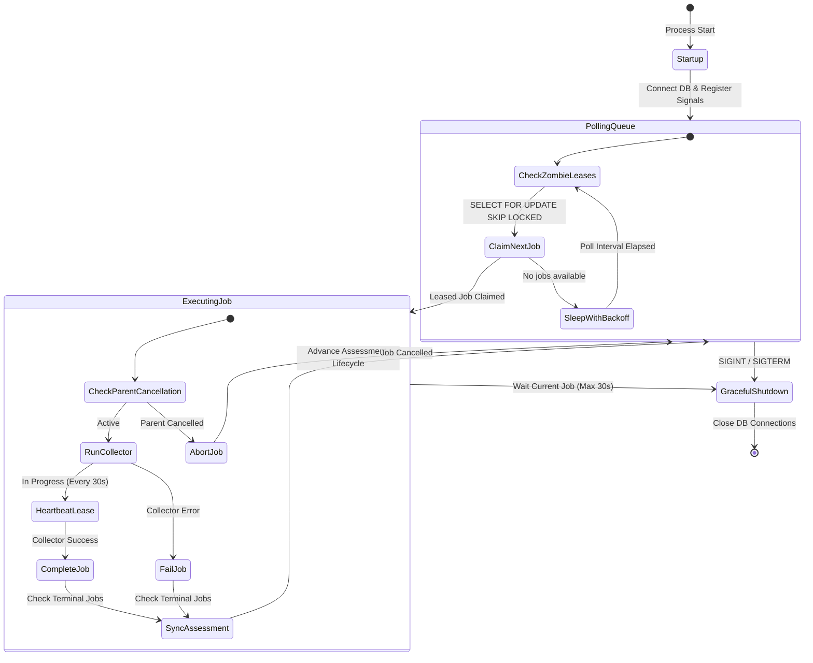
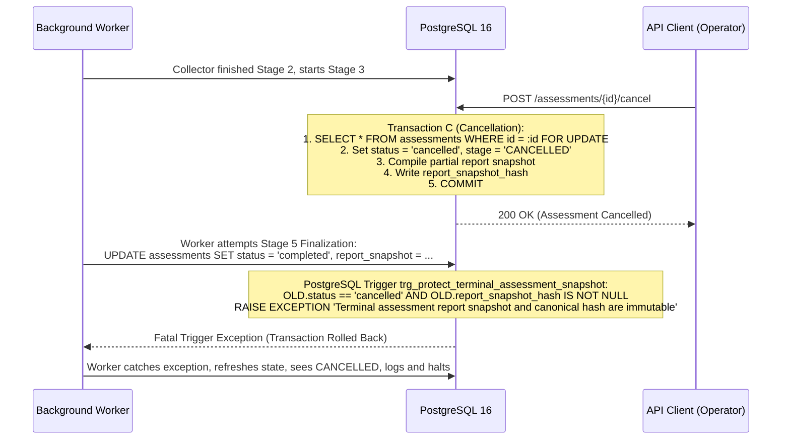

# Quantum Flow — Sprint 3 Step 3 Detailed Implementation Plan (Revised)
## Assessment REST APIs, Pydantic Schemas, and Autonomous Worker Architecture

**Document ID:** QFT-SPRINT-003-PLAN-03-REV2  
**Date:** 3 November 2026  
**Status:** **REVISED — AWAITING FORMAL APPROVAL BEFORE CODING**  
**Author:** Antigravity Engineering Agent  
**Prerequisites:** Sprint 3 Step 1 (Accepted), Sprint 3 Step 2 (Accepted)  

---

## 1. Executive Summary & Architectural Scope

### 1.1 Objective
The objective of **Sprint 3 Step 3** is to build the production control plane REST API and autonomous background execution plane for enterprise post-quantum cryptographic assessments.

This step connects:
1. Client and frontend consumers via strongly typed, sanitized Pydantic v2 schemas.
2. The `AssessmentService` orchestration and lifecycle state machine.
3. The dedicated, independent background worker process (`services/worker/app/worker.py`) using PostgreSQL-backed job queueing (`JobService`).
4. Strict multi-tenant security boundaries, RFC 5737 SSRF guards, and database trigger-enforced report immutability.

### 1.2 Architectural Boundaries & Rules
- **No BackgroundTasks for Execution:** Assessment execution is strictly durable. API routes do not use FastAPI `BackgroundTasks` for execution; all asynchronous jobs are enqueued to PostgreSQL and claimed by dedicated worker processes.
- **Single Queue Architecture:** The platform uses exclusively the PostgreSQL `discovery_jobs` table backed by `SELECT FOR UPDATE SKIP LOCKED`. No secondary queues or duplicate dispatch engines are introduced.
- **Atomic Creation & Dispatch:** `POST /api/v1/assessments` creates the assessment record and enqueues all child discovery jobs in a **single database transaction**.
- **No Public Sync Scanning:** Long-running synchronous scanning is not exposed as a public API mode; public API submissions are asynchronous/durable by default. Synchronous execution is restricted to internal CLI tools (`scripts/enterprise_scanner.py`).
- **Database Schema Freezing:** The Step 1/Step 2 PostgreSQL schema (including composite foreign keys, `ON DELETE RESTRICT` constraints, check constraints, and triggers) is complete and unmodified. No new migrations are required for Step 3.

---

## 2. Dedicated Worker Architecture & Daemon Lifecycle

### 2.1 Autonomous Worker Process (`services/worker/app/worker.py`)
The execution plane operates as an independent OS process or container (`CMD ["python", "-m", "services.worker.app.worker"]`), decoupled from the FastAPI API web servers.



### 2.2 Worker Lifecycle Invariants
1. **Startup & Identification:**
   - On initialization, the worker initializes an async database engine with connection pooling (`pool_pre_ping=True`, pool size 5–10).
   - Generates an immutable instance identifier: `worker_id = f"worker-{socket.gethostname()}-{os.getpid()}-{uuid.uuid4().hex[:6]}"`.
   - Registers OS signal handlers for `SIGINT` and `SIGTERM`.
2. **Polling & Job Claiming (`JobService.claim_next_job`):**
   - Each poll iteration executes:
     ```sql
     SELECT * FROM discovery_jobs 
     WHERE status = 'queued' 
     ORDER BY created_at ASC 
     FOR UPDATE SKIP LOCKED 
     LIMIT 1;
     ```
   - If a job is claimed, sets `status = 'running'`, `worker_id = :worker_id`, `started_at = NOW()`, and `lease_expires_at = NOW() + INTERVAL '60 seconds'`.
   - If no jobs are available, worker sleeps for a jittered poll interval (default 1.0s, backoff up to 5.0s) to eliminate database busy-wait spikes.
3. **Multi-Worker Concurrency:**
   - Multiple worker processes (across separate containers or host nodes) query the identical `discovery_jobs` table simultaneously.
   - `SKIP LOCKED` guarantees that each worker claims a distinct job without blocking peer workers or causing lock escalation.
4. **Lease Renewal & Heartbeats (`JobService.renew_lease`):**
   - During long-running collector execution (e.g. static repository AST analysis or slow TLS handshakes), an asynchronous background task renews the lease every 30 seconds (`lease_expires_at = NOW() + 60s`).
5. **Zombie Detection & Autonomous Recovery (`JobService.recover_zombies`):**
   - Every 60 seconds, the worker daemon queries for expired leases (`status = 'running' AND lease_expires_at < NOW()`).
   - Expired jobs are re-queued (`status = 'queued'`, `worker_id = NULL`, `retry_count += 1`). If `retry_count > max_retries`, marked `status = 'failed'`.
   - Ensures zero orphaned jobs in the event of worker pod crashes or OOM kills.
6. **Graceful Shutdown:**
   - Upon receiving `SIGTERM` or `SIGINT`, the worker sets `shutdown_event`.
   - Halts claiming new jobs from the queue.
   - Allows currently running jobs up to a bounded grace period (default 30 seconds) to complete or safely release their lease.
   - Closes database connection pools cleanly before exiting with code 0.
7. **Session Lifecycle:**
   - Every tick, claim, and collector execution uses an isolated `AsyncSession` context manager (`async with session_factory() as db:`). Sessions are closed immediately after transaction commits, preventing connection leakage.

---

## 3. Assessment Creation & Job Dispatch Architecture

### 3.1 Transaction-Safe Atomic Creation
`POST /api/v1/assessments` creates the assessment AND enqueues all child discovery jobs in a **single atomic database transaction**:

```python
async def create_and_enqueue_assessment(
    db: AsyncSession,
    title: str,
    target_id: uuid.UUID | None,
    discovery_sources: list[str],
    input_payload: dict[str, Any],
    extra_params: dict[str, Any],
) -> Assessment:
    async with db.begin():
        # 1. Validate Target and Authorization
        # 2. Check Active Scope Duplicate (raises 409 Conflict on match)
        # 3. Insert Assessment record (status = 'queued', progress_stage = 'DISPATCHING_COLLECTORS')
        # 4. Insert DiscoveryJob records for each requested source (linked via assessment_id)
        # 5. Commit atomically — if any step fails, entire operation rolls back
```

### 3.2 Removal of Redundant Dispatch Endpoint
- **Architectural Decision:** The previously proposed `POST /assessments/{id}/dispatch` endpoint is **removed**.
- **Justification:** Because `POST /assessments` atomically commits both the assessment and its child discovery jobs to PostgreSQL in `status = 'queued'`, independent worker processes automatically claim the jobs via polling. A separate manual dispatch endpoint is redundant and introduces an unnecessary second state transition.

### 3.3 Duplicate Job Prevention
- **Canonical Scope Hash:** Calculated using RFC 8785 canonical JSON digest over `(target_id, discovery_sources, extra_params)`.
- **Database Partial Unique Index:** `uq_assessments_active_target_scope` enforces that no two active assessments (`pending`, `queued`, `running`) can exist concurrently for the same target and scope.
- **Child Job Constraint:** When creating or retrying jobs, `(assessment_id, job_type)` is unique. Duplicate submission attempts are rejected before enqueueing.

---

## 4. Execution Modes & Boundary Constraints

### 4.1 Public REST API Mode (Strictly Durable)
- All assessments initiated via the public HTTP endpoint `POST /api/v1/assessments` run **exclusively in durable asynchronous mode**.
- The endpoint responds immediately (`201 Created`) with the queued assessment entity and HTTP `Location: /api/v1/assessments/{id}`.
- Long-running scanning inside the HTTP request loop is strictly prohibited in the public API to prevent HTTP connection timeouts, gateway proxy drops (e.g. NGINX 60s timeout), and API worker thread starvation.

### 4.2 Internal Synchronous Mode (Restricted to CLI / Scanners)
- Synchronous in-process execution (`execution_mode="sync"`) is maintained exclusively as an internal method in `AssessmentService` for:
  1. CLI evaluation tools (`scripts/enterprise_scanner.py` and `demo_scan.py`).
  2. Isolated automated test suites.
- It is not accepted as a parameter in `AssessmentCreateRequest`.

### 4.3 Timeouts, Errors & Rollback Semantics
- Each `DiscoveryJob` specifies `timeout_seconds` (default 300s).
- If a collector exceeds its timeout, the socket or subprocess is terminated, and the job transitions to `FAILED`.
- If all child jobs fail, the parent assessment transitions to `FAILED`. If some succeed, it transitions to `PARTIALLY_COMPLETED`.
- Observations and assets already correlated prior to a collector failure are safely retained under `ON DELETE RESTRICT`.

---

## 5. Cancellation & Concurrency Race Defense

### 5.1 Race Condition: Active Collector vs. Concurrent Cancellation
A critical edge case occurs when an operator calls `POST /assessments/{id}/cancel` while a background worker collector is actively executing.



### 5.2 Multi-Layered Protection Strategy
1. **Pessimistic Row Lock on Cancellation:** `cancel_assessment` acquires `SELECT * FROM assessments WHERE id = :id FOR UPDATE`, ensuring no concurrent state update is in flight.
2. **Cooperative Checkpoints:** Before executing Stages 3, 4, and 5, worker code executes `await db.refresh(assessment)`. If `status == 'cancelled'`, it aborts immediately.
3. **Database Trigger Immutability Guarantee:** If a race condition bypasses the application check, the PostgreSQL trigger `trg_protect_terminal_assessment_snapshot` intercepts the SQL `UPDATE` and raises a fatal PL/pgSQL exception, rendering the terminal `CANCELLED` snapshot permanently immutable.
4. **Deterministic Race Integration Tests:** Added to the test suite to simulate an active collector paused mid-flight while cancellation commits.

---

## 6. Retry & Idempotency Specification

### 6.1 State Reset & Provenance Ledger
Retrying an assessment via `POST /api/v1/assessments/{id}/retry`:
1. **Validation:** Checks `status IN ('failed', 'partially_completed')` and `retry_count < max_retries` (default 3). Active or completed assessments are rejected (`400 Bad Request`).
2. **Concurrent Retry Serialization:** Acquires `SELECT FOR UPDATE` on `Assessment`. The first request succeeds; a concurrent second request sees `status == 'queued'` and is rejected (`400 Bad Request`).
3. **Attempt History Ledger:** Appends a historical record to `collector_results["execution_attempts"]`:
   ```json
   {
     "attempt_number": 1,
     "attempted_at": "2026-11-03T00:30:00+00:00",
     "status_before_retry": "partially_completed",
     "error_summary": "Failed collectors: network_tls"
   }
   ```
4. **Child Job Reset:** Queries child `DiscoveryJob` records linked to this assessment. Failed or cancelled jobs are reset to `status = 'queued'`, `worker_id = NULL`, `lease_expires_at = NULL`, `error_message = NULL`, and `progress_percent = 0`. Successfully completed jobs from a partial run are preserved without re-running.
5. **Assessment Entity Reset:** Sets `status = 'queued'`, `progress_stage = 'PENDING'`, `progress_percent = 0`, `report_snapshot = NULL`, `report_snapshot_hash = NULL`, `completed_at = NULL`, and increments `retry_count`.

### 6.2 Evidence Deduplication Guarantee
- Re-running collectors preserves previously discovered assets.
- `AssetCorrelator.get_or_create_asset` queries by deterministic `asset_key` (e.g. `cert:{sha256}` or `endpoint:{host}:{port}`). Existing rows are updated with `last_seen_at = NOW()`; no duplicate `CryptographicAsset` rows are created.
- `_associate_asset_to_assessment` checks existing `assessment_assets` records before insertion, preventing composite primary key collisions.

---

## 7. API Security, Authorization & Tenant Boundaries

### 7.1 Authentication & Principal Injection
All endpoints will depend on an authentication dependency `get_current_identity`:
```python
class SecurityIdentity(BaseModel):
    user_id: str
    tenant_id: str
    roles: list[str]  # e.g. ["analyst", "operator", "admin"]
    permissions: list[str]  # e.g. ["assessment:read", "assessment:create", "assessment:cancel"]
```
- In development/local environments, `get_current_identity` defaults to the local developer principal.
- In production, it extracts and verifies JWT bearer tokens or API keys.

### 7.2 Authorization & Boundary Enforcement
1. **Target Access Control:** When creating an assessment with `target_id`, the system verifies that `target.tenant_id == identity.tenant_id` (or user is system admin). Cross-tenant target references return `404 Not Found` (preventing tenant enumeration).
2. **Assessment Access Control:** Querying, cancelling, or retrying an assessment checks ownership against the caller's tenant. Unauthorized access returns `404 Not Found`.
3. **Scan Eligibility Enforcement:** For any assessment including `network_tls`, the API verifies `target.is_eligible_for_scan == True` (`status == 'verified'` AND `authorisation_status == 'confirmed'`). Ineligible targets return `400 Bad Request`.
4. **RFC 5737 SSRF Defense:** Destination IP resolution uses `SafeDestinationResolver` to strictly prohibit RFC 1918 private IPs, loopback interfaces, cloud metadata services, and multicast ranges.
5. **Sanitized Error Envelopes:** No raw Python tracebacks, database driver errors, or internal worker hostnames are exposed to API consumers.

---

## 8. Report Availability & Cryptographic Verification

### 8.1 Availability Lifecycle
- **`GET /api/v1/assessments/{id}/report`** is accessible **only when the assessment is in a terminal status** (`completed`, `partially_completed`, `failed`, `cancelled`).
- Calling `/report` while an assessment is in `pending`, `queued`, or `running` returns:
  - **`HTTP 409 Conflict`**: `"Report snapshot is not available until assessment execution has reached a terminal status."`

### 8.2 Cryptographic Integrity Verification
The report response explicitly includes integrity validation metrics:
```json
{
  "assessment_id": "3fa85f64-5717-4562-b3fc-2c963f66afa6",
  "status": "completed",
  "methodology_version": "QFT-RISK-v1.0",
  "engine_version": "v1.0.0",
  "report_snapshot": { ... },
  "report_snapshot_hash": "e3b0c44298fc1c149afbf4c8996fb92427ae41e4649b934ca495991b7852b855",
  "is_hash_verified": true,
  "is_immutable": true,
  "completed_at": "2026-11-03T00:35:00+00:00"
}
```
- The endpoint executes `compute_canonical_evidence_sha256(report_snapshot)` on demand and compares it against `report_snapshot_hash`.
- If the hash matches, `is_hash_verified` is returned as `true`.

---

## 9. API Contracts & Pydantic Schemas Specification

### 9.1 Schema Definitions (`services/api/app/schemas/assessment.py`)

```python
from datetime import datetime
from typing import Any, Literal
import uuid
from pydantic import BaseModel, ConfigDict, Field

class AssessmentCreateRequest(BaseModel):
    title: str = Field(..., min_length=1, max_length=255, description="Human-readable title")
    target_id: uuid.UUID | None = Field(default=None, description="Optional target domain ID")
    discovery_sources: list[str] = Field(
        default=["network_tls"],
        description="List of sources: network_tls, static_source, dependency_manifest, config_import"
    )
    input_payload: dict[str, Any] = Field(
        default_factory=dict,
        description="Parameters for collectors (source_dir, dependency_dir, config_content, etc.)"
    )
    extra_params: dict[str, Any] = Field(
        default_factory=dict,
        description="Optional scope qualifiers (environment, tags)"
    )

class AssessmentCancelRequest(BaseModel):
    reason: str = Field(default="User cancellation", max_length=500, description="Reason for cancelling")

class AssessmentResponse(BaseModel):
    model_config = ConfigDict(from_attributes=True)
    id: uuid.UUID
    title: str
    target_id: uuid.UUID | None
    target_snapshot: dict[str, Any]
    scope_hash: str
    status: str
    progress_stage: str
    progress_percent: int
    discovery_sources: list[str]
    collector_results: dict[str, Any]
    coverage_summary: dict[str, Any]
    asset_counts: dict[str, Any]
    risk_summary: dict[str, Any]
    error_summary: str | None
    report_snapshot_hash: str | None
    started_at: datetime | None
    completed_at: datetime | None
    created_at: datetime
    updated_at: datetime

class AssessmentListResponse(BaseModel):
    items: list[AssessmentResponse]
    total: int
    limit: int
    offset: int

class AssessmentReportResponse(BaseModel):
    assessment_id: uuid.UUID
    status: str
    methodology_version: str
    engine_version: str
    report_snapshot: dict[str, Any]
    report_snapshot_hash: str
    is_hash_verified: bool
    is_immutable: bool
    completed_at: datetime | None

class AssessmentJobSummary(BaseModel):
    model_config = ConfigDict(from_attributes=True)
    id: uuid.UUID
    job_type: str
    status: str
    progress_percent: int
    worker_id: str | None
    lease_expires_at: datetime | None
    retry_count: int
    error_message: str | None
    result_summary: dict[str, Any] | None
    created_at: datetime
    completed_at: datetime | None

class AssessmentJobListResponse(BaseModel):
    assessment_id: uuid.UUID
    total_jobs: int
    jobs: list[AssessmentJobSummary]
```

### 9.2 Standard Error Envelope Response
All error responses adhere strictly to the platform foundation envelope:
```json
{
  "success": false,
  "error": {
    "code": "DUPLICATE_ACTIVE_ASSESSMENT",
    "message": "An active assessment '11a9c905...' is already executing for target '63e86d90...' with matching scope",
    "details": null
  }
}
```

---

## 10. Comprehensive Test Strategy

### 10.1 Unit Tests (`tests/unit/test_assessment_api.py`)
1. **Schema Validation:** Validates required fields, rejects unknown sources, and normalizes aliases.
2. **Pagination Boundaries:** Enforces `limit` (1–100) and `offset` (>=0).
3. **Route Handling & Error Mapping:** Verifies correct HTTP status codes:
   - `400 Bad Request` for ineligible targets or invalid lifecycle transitions.
   - `404 Not Found` for nonexistent assessment UUIDs.
   - `409 Conflict` for duplicate scope submissions.
   - `422 Unprocessable Content` for malformed payloads.

### 10.2 Integration Tests (`tests/integration/test_assessment_api_workflow.py` on PostgreSQL 16)
1. **Atomic Creation & Job Queueing:** `POST /api/v1/assessments` creates assessment and inserts linked `discovery_jobs` in a single transaction.
2. **List & Pagination:** Queries assessments with `target_id` and `status` filters, verifying `created_at DESC` ordering.
3. **Status Polling:** `GET /api/v1/assessments/{id}` reflects live progress and stage transitions.
4. **Cancellation Workflow:** `POST /api/v1/assessments/{id}/cancel` halts child jobs and freezes partial report snapshot.
5. **Retry Workflow:** `POST /api/v1/assessments/{id}/retry` re-queues failed jobs and logs previous attempt in `execution_attempts`.
6. **Report Availability & Cryptographic Hash Check:** `GET /api/v1/assessments/{id}/report` returns `409` when active and `200` with `is_hash_verified == true` once terminal.
7. **Job Inspection:** `GET /api/v1/assessments/{id}/jobs` returns child jobs with worker leases and retry counts.

### 10.3 Concurrency & Race Condition Tests (`tests/integration/test_assessment_concurrency.py`)
1. **Concurrent Duplicate Prevention:** Two simultaneous `POST /assessments` requests with identical scope — exactly one succeeds (`201`), the second is rejected (`409`).
2. **Multi-Worker Claiming:** Multiple concurrent workers executing `claim_next_job` simultaneously claim distinct jobs without deadlock or collision.
3. **Active Collector vs. Cancellation Race:** Simulates a collector actively running when cancellation is committed; verifies that the collector fails to overwrite `CANCELLED` and terminal snapshot remains immutable.
4. **Concurrent Retry Serialization:** Two simultaneous retry requests on the same failed assessment — exactly one succeeds, the second returns `400`.
5. **Worker Crash & Recovery:** Simulates worker crash, verifies expired lease recovery by another worker, and successful assessment completion.

### 10.4 Security Tests (`tests/security/test_assessment_api_security.py`)
1. **SSRF Guard:** Submitting loopback or private IP hostnames is rejected.
2. **Scan Eligibility Guard:** Targets with `authorisation_status != 'confirmed'` are rejected for `network_tls` discovery.
3. **Snapshot Immutability:** Verifies that direct SQL updates to frozen report snapshots are blocked by trigger.
4. **Information Disclosure Prevention:** Asserts that error responses never expose internal stack traces or database driver internals.

### 10.5 Backward Compatibility Tests
1. Existing Sprint 0–2 endpoints (`/targets`, `/scans`, `/jobs`, `/assets`, `/risk`) continue to function without regression.
2. Standalone CLI tools (`scripts/enterprise_scanner.py` and `demo_scan.py`) continue to run smoothly in synchronous mode.

---

## 11. Implementation Roadmap & Execution Checklist

| Step | Action | Files |
|---|---|---|
| **Phase 1** | Implement Pydantic Schemas | `services/api/app/schemas/assessment.py`, export in `schemas/__init__.py` |
| **Phase 2** | Implement REST API Endpoints | `services/api/app/api/v1/endpoints/assessments.py`, register in `router.py` |
| **Phase 3** | Implement Autonomous Worker Daemon | `services/worker/app/worker.py` (daemon loop, signal handling, recovery tick) |
| **Phase 4** | Implement Unit & Integration Test Suites | `tests/unit/test_assessment_api.py`, `tests/integration/test_assessment_api_workflow.py`, `tests/integration/test_assessment_concurrency.py` |
| **Phase 5** | Implement Security Test Suite | `tests/security/test_assessment_api_security.py` |
| **Phase 6** | Code Quality & Full Suite Verification | Ruff lint, Ruff format, Mypy typecheck, Full Pytest suite, Frontend test/build |

---

## 12. Final Pre-Implementation Gate

**Strict Execution Boundary:** No source code, models, or test files have been modified. Implementation will commence **only after explicit user approval of this revised plan**.
