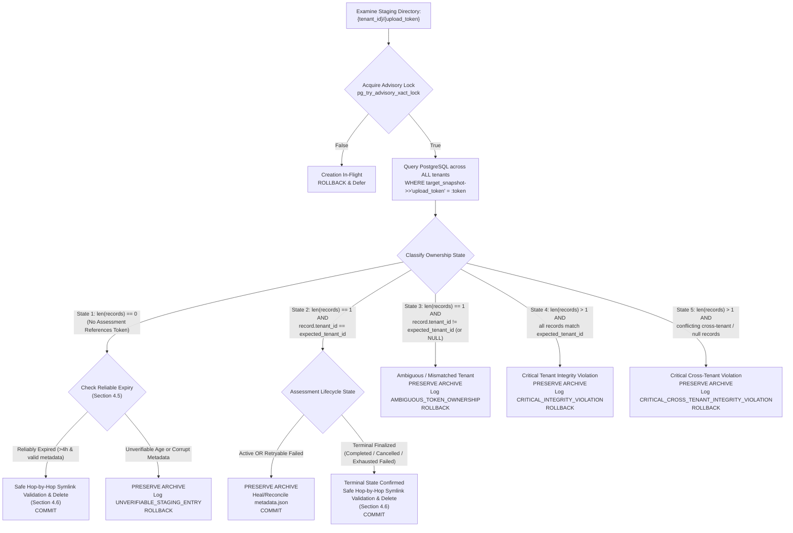

# Quantum Flow — Sprint 3 Step 4 Implementation Plan (Revision 1.7)
## Unified Enterprise Reporting & Frontend Guided Assessment Integration

**Document ID:** QFT-SPRINT-003-STEP-4-PLAN-REV1.7  
**Version:** 1.7 (Final Engineering Clarification Revision)  
**Date:** 3 November 2026  
**Status:** Submitted for Final Engineering Review & Approval (No Implementation Until Approved)  
**Target Milestone:** Sprint 3 Step 4 — Unified Reporting & Frontend Integration  
**Dependencies:** Sprint 3 Step 1 (Schema & DB Integrity), Step 2 (Assessment Orchestrator), Step 3 (REST API & Autonomous Worker) — All Formally Accepted  

---

## 1. Executive Summary & Purpose

Sprint 3 Steps 1 through 3 established the core discovery and risk assessment engine:
- **Step 1:** An immutable, trigger-protected PostgreSQL 16 schema with `RESTRICT` referential integrity, composite foreign keys, canonical scope hashing, and frozen report snapshot triggers.
- **Step 2:** An end-to-end multi-source `AssessmentService` correlating TLS, AST source code, dependency manifests, and TLS configurations into Methodology v1.0 Quantum Vulnerability Index (QVI) evaluations.
- **Step 3:** Production-grade REST API endpoints, fail-closed tenant boundary isolation, and a durable `AutonomousWorker` daemon with `SELECT FOR UPDATE SKIP LOCKED` job claiming and continuous heartbeat renewal.

**Sprint 3 Step 4** delivers the human- and machine-consumable interfaces of the platform:
1. **Unified Enterprise Reporting Subsystem:** Multi-format export engines producing:
   - **CycloneDX 1.6 CBOM JSON:** Validated against the official CycloneDX 1.6 JSON Schema, complete with cryptographic properties (`cryptoProperties`), standard extension properties, and visible dependency graph diagnostics for unresolved references.
   - **RFC 4180 CRLF CSV:** Cryptographic asset inventory formatted with strict CRLF (`\r\n`) record delimiters, RFC 4180 quotation escaping, and rigorous spreadsheet formula-injection mitigation across all columns.
   - **Executive Markdown Summary:** High-level executive audit summary derived directly from the cryptographically verified terminal snapshot, detailing Maximum Asset QVI, risk category distributions, network verification evidence, Shor/Grover threat profiles, and NIST remediation roadmaps.
2. **Frontend Guided Assessment Workflow:** A cohesive React 18 / TypeScript interface in `apps/web` guiding operators from target selection, multi-source configuration, and staged artifact uploads through to live real-time execution tracking, child jobs drawer, findings exploration, cryptographic snapshot verification, and authenticated report downloads.

> [!IMPORTANT]
> **Governance & Scope Guardrails:**
> - This document is exclusively an architectural specification. **No implementation code, frontend modifications, or endpoint additions will be executed until this plan receives explicit approval.**
> - Zero database migrations or schema alterations will be introduced. All storage and deduplication requirements map to existing tables (`assessments`, `discovery_jobs`, `targets`, `cryptographic_assets`), PostgreSQL advisory locks, and the canonical `scope_hash`.
> - Core risk engine mathematics (Methodology v1.0 QVI) and CBOM asset-key generation algorithms remain strictly invariant.
> - Zero Git commits and zero Git pushes will be executed.

---

## 2. Architecture & Data Flow

### 2.1 Subsystem Data Flow

```mermaid
flowchart TD
    subgraph Client["React Frontend (apps/web)"]
        UI_WIZ["AssessmentWizard<br/>(Target, Sources, Staged Uploads, Submit Guard)"]
        UI_PROG["AssessmentProgress<br/>(Live Polling with Backoff & Visibility)"]
        UI_REP["AssessmentReportView<br/>(Hash Verification Badge & Exporters)"]
    end

    subgraph API["FastAPI Control Plane (services/api)"]
        EP_STG["POST /api/v1/assessments/stage-upload<br/>(Atomic Upload Staging)"]
        EP_ASS["POST /api/v1/assessments<br/>(Advisory Lock, Token Claim & Scope Hash)"]
        EP_POLL["GET /api/v1/assessments/{id}<br/>(Status, Stage, Percent)"]
        EP_CANCEL["POST /api/v1/assessments/{id}/cancel<br/>(Cooperative Abort)"]
        EP_CDX["GET /api/v1/assessments/{id}/reports/cyclonedx<br/>(CycloneDX 1.6 CBOM)"]
        EP_CSV["GET /api/v1/assessments/{id}/reports/csv<br/>(RFC 4180 CRLF CSV)"]
        EP_MD["GET /api/v1/assessments/{id}/reports/markdown<br/>(Executive Summary)"]
    end

    subgraph SharedFS["Shared Staging Volume (/var/lib/quantumflow/staging)"]
        STG_DIR["{STAGING_DIR}/{tenant_id}/{upload_token}/<br/>(metadata.json & staged artifact)"]
    end

    subgraph Core["Integrity & Reporting Engine (packages/reports)"]
        VERIFY["verify_and_load_snapshot()<br/>(RFC 8785 Canonical JSON + SHA-256)"]
        EXP_CDX["export_assessment_cyclonedx()<br/>(CycloneDX 1.6 Schema Compliant + Diagnostics)"]
        EXP_CSV["export_assessment_csv()<br/>(RFC 4180 CRLF + Formula Mitigation)"]
        EXP_MD["export_assessment_markdown_report()<br/>(Executive Summary & NIST Roadmap)"]
    end

    subgraph DB["PostgreSQL 16 Storage Layer (Authoritative System of Record)"]
        T_ASS[("assessments<br/>(target_snapshot, scope_hash, terminal trigger)")]
        T_JOBS[("discovery_jobs<br/>(SKIP LOCKED Worker Claiming, input_params)")]
        LOCKS["PostgreSQL Transaction Advisory Locks<br/>(pg_try_advisory_xact_lock)"]
    end

    subgraph Worker["AutonomousWorker Process (services/worker)"]
        W_CLAIM["Claim DiscoveryJob (SKIP LOCKED)"]
        W_EXEC["Execute Scan from SharedFS (Read-Only)"]
        W_CLEAN["Terminal Cleanup (Success / Exhausted Retries)"]
        W_GC["Hourly Garbage Collector (Advisory Locked + 5-State DB Scoped)"]
    end

    UI_WIZ -->|1. Upload Archive/Manifest| EP_STG
    EP_STG -->|Atomic .part -> target rename| STG_DIR
    UI_WIZ -->|2. Create Assessment with upload_token| EP_ASS
    EP_ASS -->|Acquire token advisory lock| LOCKS
    EP_ASS -->|Comprehensive Token Check & Bind| T_ASS
    EP_ASS --> T_JOBS
    EP_ASS -.->|Sync bound state| STG_DIR
    UI_PROG -->|3. Adaptive Polling (Backoff & Visibility)| EP_POLL
    UI_PROG -.->|Optional Cancel| EP_CANCEL

    W_CLAIM --> T_JOBS
    W_CLAIM --> W_EXEC
    W_EXEC -->|Read-Only Concurrent Stream| STG_DIR
    W_EXEC --> T_ASS
    W_CLEAN --> STG_DIR
    W_GC -->|Acquire token advisory lock| LOCKS
    W_GC -->|5-State DB Classification| T_ASS
    W_GC -->|Safe Hop-by-Hop Symlink Validation & Purge| STG_DIR

    UI_REP -->|4. Authenticated Blob Download| EP_CDX
    UI_REP -->|4. Authenticated Blob Download| EP_CSV
    UI_REP -->|4. Authenticated Blob Download| EP_MD

    EP_CDX --> VERIFY
    EP_CSV --> VERIFY
    EP_MD --> VERIFY
    VERIFY -->|Recomputed SHA-256 == Stored Hash| EXP_CDX
    VERIFY -->|Recomputed SHA-256 == Stored Hash| EXP_CSV
    VERIFY -->|Recomputed SHA-256 == Stored Hash| EXP_MD
```

---

## 3. Shared Staging Storage Architecture & Deployment Boundaries

### 3.1 Docker Compose & Host Storage Alignment
The API and Worker run as separate operating system processes and may be deployed in independent Docker containers. Storing uploads in an ephemeral container-local `/tmp` directory fails because the API container's `/tmp` filesystem is isolated from the Worker container.

- **Shared Docker Volume:** A persistent named volume `staging_data` is mounted into both the `api` and `worker` service containers at `/var/lib/quantumflow/staging`.
- **Docker Compose Configuration (`docker-compose.yml`):**
  ```yaml
  services:
    api:
      environment:
        STAGING_DIR: /var/lib/quantumflow/staging
      volumes:
        - staging_data:/var/lib/quantumflow/staging

    worker:
      environment:
        STAGING_DIR: /var/lib/quantumflow/staging
      volumes:
        - staging_data:/var/lib/quantumflow/staging

  volumes:
    postgres_data:
      driver: local
    redis_data:
      driver: local
    staging_data:
      driver: local
  ```
- **Host Development Alignment:** When running locally without containers, both the FastAPI development server and the worker process share the same filesystem directory:
  `STAGING_DIR = Path(os.getenv("STAGING_DIR", "./staging_data"))`.
  Both environments enforce identical path resolution, file permissions, and tenant isolation semantics.

### 3.2 Deployment Boundaries & Multi-Host Qualification
- **Sprint 3 Step 4 Scope (Single-Host Deployment):** Docker named volumes (`staging_data`) and local directories are tailored for single-host deployments (Docker Compose or local bare-metal / developer workstations) where the API and Worker processes share the underlying host storage.
- **Architectural Boundary for Distributed Deployments:** In a multi-host production deployment (e.g., multi-node Kubernetes clusters or distributed virtual machines across availability zones), a local Docker named volume cannot bridge separate container hosts. Such architectures require:
  1. Distributed network-attached storage (e.g., NFS, AWS EFS, Azure Files) mounted at `STAGING_DIR`.
  2. S3-compatible object storage (e.g., AWS S3, Google Cloud Storage, MinIO) with pre-signed upload URLs and worker download streaming.
- **Explicit Sprint Boundary:** Multi-host shared storage drivers and object storage adapters are architectural evolution paths deferred beyond Sprint 3. Single-host shared volume storage completely satisfies all Sprint 3 Step 4 requirements.

---

## 4. Authoritative Database Token Binding, 5-State Classification & Safe Filesystem Operations

### 4.1 Authoritative System of Record Principle
The filesystem (`metadata.json`) is an ephemeral cache; **PostgreSQL is the authoritative single source of truth for token-to-assessment ownership**.
A failure, delay, or crash during filesystem metadata updates must never compromise assessment integrity or result in premature deletion of staged evidence.

### 4.2 Database-Backed Token Claiming Sequence & Concurrency Invariant
When an operator launches an assessment referencing an `upload_token`:
1. **Advisory Lock Key Derivation:**
   `lock_key = int.from_bytes(hashlib.sha256(f"upload_token:{upload_token}".encode()).digest()[:8], byteorder="big", signed=True)`
2. **Exclusive In-Transaction Lock Acquisition:**
   Inside the `async with db.begin()` transaction of `create_and_enqueue_assessment`:
   ```sql
   SELECT pg_try_advisory_xact_lock(:lock_key);
   ```
   - If `False`: Another API transaction or GC routine is actively inspecting/claiming this token. Abort immediately with `HTTP 409 Conflict` ("Upload token claim in-flight").
   - If `True`: The transaction holds an exclusive lock on this token for its entire duration.
3. **Comprehensive Token Uniqueness Verification Across All Tenants:**
   Query PostgreSQL to detect any existing assessment referencing this token across the entire database:
   ```sql
   SELECT id, target_snapshot->>'tenant_id' AS record_tenant_id FROM assessments
   WHERE target_snapshot->>'upload_token' = :upload_token;
   ```
   - **Matching Tenant Match:** If an existing record matches `:tenant_id`, abort and rollback with `HTTP 409 Conflict` ("Upload token has already been bound to assessment {id}").
   - **Cross-Tenant or Missing Tenant Record:** If any record exists under another tenant or with a missing/null tenant ID, abort and rollback with `HTTP 409 Conflict` ("Upload token conflict detected").
   - **Token Invariant:** GC and API must never infer tenant ownership from an upload token alone, and cross-tenant reuse is strictly prohibited.
4. **Atomic Insertion & Enqueue:**
   - Assessment created with `target_snapshot["upload_token"] = upload_token` and `target_snapshot["tenant_id"] = tenant_id`.
   - Child `DiscoveryJob` records created with `input_params["upload_token"] = upload_token`.
   - Transaction commits. PostgreSQL automatically releases the transaction advisory lock upon commit.
5. **Post-Commit Filesystem Synchronization:**
   The API updates `metadata.json` with `assessment_id: str(assessment.id)` and `status: "bound"` via atomic file replacement (`os.replace`).

---

### 4.3 Crash Recovery & Metadata Reconciliation
To resolve the scenario where the database transaction commits but the API process crashes before updating `metadata.json`:
1. **Worker Lazy Reconciliation:**
   When a background worker claims a child discovery job (`JobType.SOURCE_ANALYSIS` or `JobType.DEPENDENCY_SCAN`):
   - The worker locates the archive at `{STAGING_DIR}/{tenant_id}/{upload_token}/{filename}` using `job.input_params["upload_token"]`.
   - The worker reads the archive in **read-only mode**.
   - If `metadata.json` has `assessment_id: null` or is missing, the worker automatically reconciles/creates it:
     `metadata["assessment_id"] = str(job.assessment_id)`
     `metadata["status"] = "bound"`
     writing atomically via temporary file rename.
2. **Post-Commit Metadata Failure Tolerance:**
   If writing `metadata.json` fails completely (e.g., ephemeral disk I/O error):
   - The assessment creation request does **not** fail, because PostgreSQL has already committed the durable assessment and enqueued the durable child jobs.
   - The database remains the authoritative truth. Workers read the archive directly by token path.

---

### 4.4 The 5-State Database Ownership Classification Procedure

The Garbage Collector executes periodically (hourly) within the background worker process. For each staging directory discovered on disk (`{STAGING_DIR}/{tenant_id}/{upload_token}`):

1. **Transaction Boundary & Advisory Lock:**
   GC initiates a database transaction and acquires the 64-bit advisory lock derived from `hash(upload_token)`:
   ```sql
   BEGIN TRANSACTION;
   SELECT pg_try_advisory_xact_lock(:lock_key);
   ```
   If lock acquisition fails (`False`), an assessment creation transaction is currently in flight. GC immediately aborts inspection of this token, rolls back, and defers evaluation.

2. **Database Query Across All Tenant States:**
   GC queries PostgreSQL without a tenant restriction or `LIMIT 1` to retrieve the complete set of referencing records:
   ```sql
   SELECT 
       id, 
       target_snapshot->>'tenant_id' AS record_tenant_id,
       status, 
       retry_count, 
       max_retries,
       created_at
   FROM assessments
   WHERE target_snapshot->>'upload_token' = :upload_token;
   ```
   Let `records = result.fetchall()` and `expected_tenant_id` be the directory's parent folder name.

3. **Classification & Action Matrix (5 Mutually Exclusive States):**



#### Detailed State Invariants:
- **State 1 (No assessment references token):** Confirms zero records exist across the entire database. Proceeds to Section 4.5 for reliable expiry evaluation.
- **State 2 (Exactly one record with exact tenant match):** Confirms authoritative tenant ownership. If active or retryable, the archive is preserved and `metadata.json` is healed. If confirmed terminal, the archive is safely purged.
- **State 3 (Single record with missing, null, or mismatched tenant ID):** Treated as an ambiguous ownership defect. GC **never infers ownership from the token alone**, **never deletes the archive**, rolls back, and logs `AMBIGUOUS_TOKEN_OWNERSHIP` with full record details.
- **State 4 (Multiple records within expected tenant):** Treated as a critical database integrity defect. GC **never arbitrarily selects one record**, **never deletes the archive**, rolls back, and logs `CRITICAL_INTEGRITY_VIOLATION`.
- **State 5 (Multiple or conflicting records across tenants):** Treated as a critical cross-tenant integrity defect. GC **never deletes the archive**, rolls back, and logs `CRITICAL_CROSS_TENANT_INTEGRITY_VIOLATION`.

---

### 4.5 Reliable Upload Expiry Determination

Directory `st_mtime` must **never** be treated as a reliable upload creation timestamp. Directory modification timestamps can be reset or perturbed by antivirus scanners, backup agents, file access operations, or container volume synchronization.

To establish reliable expiry without requiring new database schema migrations:

1. **Durable Timestamp Hierarchy:**
   - **Bound Uploads (State 2):** When an upload is bound to an assessment, PostgreSQL is the durable source of truth. The creation timestamp is `assessments.created_at`, and the lifecycle status is `assessments.status`. Staging directory lifetime is governed strictly by the assessment lifecycle, not filesystem timestamps.
   - **Staged Uploads with Valid Metadata (State 1 Candidate):** When an upload is unbound in PostgreSQL, the durable staging timestamp is stored in `metadata.json` as ISO 8601 UTC timestamps: `created_at` and `expires_at` (`created_at + 4 hours`), written atomically during `POST /stage-upload`.
     - If `now_utc < metadata["expires_at"]`: The upload is active (e.g. an operator actively configuring the assessment wizard). **Preserve the directory.**
     - If `now_utc >= metadata["expires_at"]`: The upload has durably exceeded its 4-hour retention window without being claimed, and PostgreSQL confirms zero assessments reference it. **Safe to purge.**
2. **Conservative Fallback for Missing or Corrupted Metadata (State 1 Unverifiable):**
   - If an unbound directory has a missing, unreadable, or corrupted `metadata.json`, GC **cannot** reliably establish its age or operator intent.
   - **Conservative Rule:** **GC MUST PRESERVE THE ARCHIVE.**
   - GC will **never delete** an archive merely because its directory modification time exceeds 4 hours.
   - The directory is flagged with `status: "UNVERIFIABLE_ORPHAN"`.
   - GC emits a structured operational warning:
     `UNVERIFIABLE_STAGING_ENTRY: Missing or corrupt metadata.json for unbound token {upload_token} in tenant {tenant_id}. Directory preserved. Manual operator review required.`
   - The directory remains intact for manual operator inspection.

---

### 4.6 Safe Hop-by-Hop Symlink Validation & Confinement Deletion Procedure

Resolving a path via `Path.resolve()` before verifying symlinks follows the symlink, rendering subsequent `is_symlink()` calls ineffective at detecting symlinked path components.

The following safe procedure verifies each path segment **without dereferencing symlinks** and enforces strict staging root confinement before any deletion:

#### Step 1: Component Regex & Character Whitelist Validation
Before any filesystem access, path components must pass strict format checks:
- `tenant_id` must match `^[a-zA-Z0-9_-]{1,64}$`.
- `upload_token` must match `^upl_[0-9a-f]{32}$`.
- Explicitly reject null bytes (`\0`), directory separators (`/`, `\`), path traversal tokens (`.`, `..`), and leading/trailing whitespace.

#### Step 2: Unresolved Hop-by-Hop Symlink Inspection
Let `canonical_staging_root = Path(STAGING_DIR).resolve(strict=True)`.
Construct the unresolved paths:
- `tenant_path = canonical_staging_root / tenant_id`
- `token_path = tenant_path / upload_token`

Inspect each segment using `os.lstat()` without following symlinks:
1. **Tenant Directory Check:**
   - Inspect with `st = os.lstat(tenant_path)`.
   - Assert `not os.path.islink(tenant_path)` (not a symbolic link).
   - Assert `stat.S_ISDIR(st.st_mode)` (must be a genuine physical directory).
2. **Token Directory Check:**
   - Inspect with `st = os.lstat(token_path)`.
   - Assert `not os.path.islink(token_path)` (not a symbolic link).
   - Assert `stat.S_ISDIR(st.st_mode)` (must be a genuine physical directory).

> [!CAUTION]
> **Symlink Violation Handling:** If `os.path.islink()` returns `True` for either component, GC immediately aborts deletion, preserves the directory, and logs a structured security alert:
> `SECURITY_VIOLATION_SYMLINK_IN_PATH: Symlink detected in staging path component {path}. Deletion aborted.`

#### Step 3: Staging Root Confinement Verification
Verify strict containment:
- `token_path.parent == tenant_path`
- `tenant_path.parent == canonical_staging_root`
- `os.path.commonpath([canonical_staging_root, os.path.abspath(token_path)]) == str(canonical_staging_root)`
- On Windows systems, verify that neither directory possesses reparse points or directory junctions (`stat.file_attribute & stat.FILE_ATTRIBUTE_REPARSE_POINT == 0`).

#### Step 4: Non-Traversing Recursive Tree Removal
To eliminate risks from malicious symlinks or directory junctions created *inside* the upload directory:
- Tree traversal must **never traverse symlinks outside or inside the upload tree**.
- For every child entry inside `token_path`:
  - Inspect entry using `os.lstat(entry.path)`.
  - If `os.path.islink(entry.path)` (or reparse point/junction on Windows): unlink the symlink node itself using `os.unlink(entry.path)` without entering or traversing into the target.
  - If a genuine subdirectory (`stat.S_ISDIR` and not link): recurse safely with identical confinement checks.
  - If a regular file: unlink via `os.unlink(entry.path)`.
- Remove the empty `token_path` directory using `os.rmdir(token_path)`.
- If `tenant_path` is now completely empty, prune it using `os.rmdir(tenant_path)`.

#### Step 5: Deletion Error Handling
- Wrap all deletion operations in `try ... except OSError as exc:`.
- If an `OSError` or `PermissionError` occurs (e.g. temporary Windows file lock by another process):
  - Log a structured warning: `DELETION_DEFERRED: Failed to delete {token_path}: {exc}. Deferred to next cycle.`
  - Leave remaining files intact.
  - Never crash or interrupt the background worker GC daemon.

---

## 5. Explicit Idempotency & Deduplication Semantics

To ensure complete architectural clarity, the platform formally defines and distinguishes three levels of request protection:

### 5.1 Architecture Comparison Matrix
| Capability | Scope in Sprint 3 Step 4 | Mechanism | Behavior on Duplication |
|---|:---:|---|---|
| **Semantic Duplicate-Assessment Protection** | **Implemented** | Canonical `scope_hash` transaction check in `create_and_enqueue_assessment` | `HTTP 409 Conflict` (`DuplicateActiveAssessmentError`) with active assessment ID |
| **Frontend Duplicate-Submit Protection** | **Implemented** | React state (`isSubmitting = true`) disabling launch button immediately upon click | Disables UI trigger; drops repeated user click events |
| **Full Application-Level HTTP Idempotency-Key Support** | **Deferred (Post-Sprint 3)** | Requires `idempotency_keys` database table, schema migration, request fingerprinting & response caching | Replays cached `HTTP 201 Created` with identical body; rejects reused key with altered payload (`HTTP 422`) |

### 5.2 Semantic Duplicate-Assessment Protection (`scope_hash`)
Step 3 implemented transaction-safe semantic deduplication:
```sql
SELECT id, status FROM assessments
WHERE target_id = :target_id AND scope_hash = :scope_hash
  AND status IN ('pending', 'queued', 'running')
FOR UPDATE;
```
- **Semantic Contract:**
  1. If an assessment with the identical target, discovery sources, and parameters is currently active (`pending`, `queued`, `running`), the server returns `HTTP 409 Conflict` indicating that discovery is already in progress.
  2. Once an assessment enters a terminal state (`completed`, `partially_completed`, `failed`, `cancelled`), subsequent requests with the same scope are permitted to execute a fresh assessment.
- **Distinction from HTTP Idempotency:**
  This is **semantic duplicate-assessment protection**, not full HTTP idempotency: it does not replay cached `201 Created` responses, nor does it store client-provided `Idempotency-Key` headers.

### 5.3 Detailed Behavior Under Full Application-Level HTTP Idempotency (Deferred Architecture)
For future platform evolution, full application-level HTTP idempotency would enforce the following behavioral matrix:
- **Repeated request with SAME key & SAME payload:** Return cached original response (status `201 Created` with identical response body and headers).
- **Concurrent requests using SAME key:** Second request returns `HTTP 409 Conflict` or `HTTP 429 Too Many Requests` ("Request with this idempotency key is currently executing").
- **Reuse of SAME key with DIFFERENT payload:** Reject with `HTTP 422 Unprocessable Content` ("Idempotency-Key reuse with altered request payload").
- **Requests WITHOUT key:** Standard execution guarded solely by semantic `scope_hash` check.

> [!IMPORTANT]
> **Sprint Boundary & Decision:**
> Full application-level HTTP idempotency requires creating a dedicated `idempotency_keys` table and schema migration. Under the strict **no-migration constraint** of Sprint 3, this is explicitly deferred as a post-Sprint 3 architectural initiative. The API in Sprint 3 Step 4 relies on **semantic duplicate-assessment protection (`scope_hash`)**, and the frontend relies on **frontend duplicate-submit protection**.

---

## 6. Source Code Scanning Architecture & Accurate Terminology

### 6.1 Language Parser Specifications
To ensure documentation and architectural clarity, the capabilities of the source discovery engine are explicitly specified:
- **Python (`packages/scanner/source/parsers/python_parser.py`):**
  - **Mechanism:** Native Python AST parsing via `ast.parse` and `ast.NodeVisitor` (`PythonCryptoVisitor`).
  - **Capabilities:** Syntactic inspection of module imports (`hashlib`, `cryptography`, `Crypto`), function call attributes, asymmetric key generation calls (`rsa.generate_private_key`, `ec.generate_private_key`), cipher instances (`AES`, `TripleDES`), and parameter sets.
- **JavaScript / TypeScript (`packages/scanner/source/parsers/js_parser.py`):**
  - **Mechanism:** Heuristic regular expressions and lexical pattern matching (not AST parsing).
  - **Capabilities:** Detects Node.js `node:crypto` imports, `generateKeyPair` (RSA, EC, DH), WebCrypto API invocations (`subtle.generateKey`, `subtle.digest`), and common crypto libraries (`crypto-js`, `jose`, `bcrypt`).
- **Java (`packages/scanner/source/parsers/java_parser.py`):**
  - **Mechanism:** Heuristic regular expressions and token stream pattern matching (not AST parsing).
  - **Capabilities:** Detects Java Cryptography Architecture (JCA/JCE) imports (`java.security.*`, `javax.crypto.*`), `KeyPairGenerator.getInstance("RSA"|"EC")`, `Cipher.getInstance("AES/...")`, and BouncyCastle provider calls.
- **Dependency Manifests (`packages/scanner/dependencies/scanner.py`):**
  - **Mechanism:** Structured format parsing.
  - **Capabilities:** Parses `requirements.txt`, `package.json`, `package-lock.json`, `pom.xml`, `poetry.lock`, and `Pipfile.lock` to extract cryptographic libraries, package versions, and known weak dependencies.

---

## 7. Archive Security Bounds & Extraction Protections

When an archive is processed by the API during staging verification or extracted by a worker into an ephemeral scratch directory, it must strictly satisfy defense-in-depth resource ceilings to eliminate Zip Slip, Zip Bombs, and secret exfiltration.

### 7.1 Explicit Security Ceilings
| Parameter | Limit | Enforcement Point | Violation Consequence |
|---|:---:|---|---|
| **Compressed Upload Ceiling** | **20 MB** (`MAX_ARCHIVE_BYTES`) | API `POST /stage-upload` streaming | Streaming aborted; `HTTP 413 Entity Too Large` |
| **Standalone Manifest Ceiling** | **5 MB** (`MAX_MANIFEST_BYTES`) | API `POST /stage-upload` streaming | Streaming aborted; `HTTP 413 Entity Too Large` |
| **Uncompressed Expanded Ceiling** | **200 MB** (`MAX_UNCOMPRESSED_BYTES`) | API pre-check & Worker extraction | Extraction halted; directory wiped; `ArchiveSecurityError` |
| **Maximum Extracted File Count** | **500 files** (`MAX_FILE_COUNT`) | API infolist check & Worker loop | Extraction halted; directory wiped; `ArchiveSecurityError` |
| **Single File Size Ceiling** | **10 MB** (`MAX_SINGLE_FILE_BYTES`) | Worker extraction per-file check | Oversized file safely skipped or rejected |

### 7.2 Structural Extraction Protections
The extraction logic in [`packages/scanner/source/archive.py`](file:///d:/Desktop/quantum-flow-pqc-platform/packages/scanner/source/archive.py) enforces:
1. **Zip Slip / Path Traversal Defense:**
   - Rejects any archive member with normalized paths starting with `/` or containing `..`.
   - Resolves target destination `(target_dir / member.filename).resolve()` and asserts `destination.is_relative_to(target_dir)`. If false, raises `ArchiveSecurityError`.
2. **Symlink and Hardlink Rejection:**
   - In ZIP archives: skips entries where Unix file attributes indicate symbolic links (`(member.external_attr >> 16) & 0o170000 == 0o120000`).
   - In TAR archives: rejects `tarinfo.issym()` or `tarinfo.islnk()` with `ArchiveSecurityError`.
3. **Nested Archive Recursion Prevention:**
   - Skips nested archive extensions (`.zip`, `.tar`, `.gz`, `.tgz`, `.bz2`, `.xz`, `.7z`) to prevent recursive decompression attacks.
4. **Secret & Private Key Sniffing / Exclusion:**
   - Pre-extraction: skips files with private key extensions (`.key`, `.p12`, `.pfx`, `.pkcs12`, `.jks`, `.keystore`) or names (`id_rsa`, `id_ecdsa`, `id_ed25519`).
   - Post-extraction sniffing: inspects the first 4KB of content for PEM private key headers (`-----BEGIN * PRIVATE KEY-----`). If detected, the file is unlinked immediately and excluded from the scan.
5. **Error Cleanup:**
   - If an `ArchiveSecurityError` or OS error occurs during extraction, the worker executes `shutil.rmtree(scratch_dir, ignore_errors=True)` immediately to prevent disk pollution.

---

## 8. API Contract & Endpoints Specification

### 8.1 New Endpoints Overview
| HTTP Method | Path | Authentication | Description |
|---|---|:---:|---|
| `POST` | `/api/v1/assessments/stage-upload` | Required (Bearer) | Stage source archive or manifest to shared storage |
| `GET` | `/api/v1/assessments/{id}/reports/cyclonedx` | Required (Bearer) | Download CycloneDX 1.6 CBOM JSON report |
| `GET` | `/api/v1/assessments/{id}/reports/csv` | Required (Bearer) | Download RFC 4180 CRLF CSV asset inventory |
| `GET` | `/api/v1/assessments/{id}/reports/markdown` | Required (Bearer) | Download Executive Summary Markdown report |

### 8.2 Staged Upload Contract (`POST /api/v1/assessments/stage-upload`)
- **Request:** `multipart/form-data`
  - `file`: UploadFile (required)
  - `file_type`: string enum (`"archive"` | `"manifest"`, default `"archive"`)
- **Validation Rules:**
  - `file_type == "archive"`: Filename must end with `.zip`, `.tar`, `.tar.gz`, or `.tgz`. Size `<= 20MB`. Validates zip/tar structure without full extraction.
  - `file_type == "manifest"`: Filename must be one of `requirements.txt`, `package.json`, `package-lock.json`, `pom.xml`, `poetry.lock`, `Pipfile.lock`. Size `<= 5MB`.
- **Response (`HTTP 201 Created`):**
  ```json
  {
    "upload_token": "upl_0123456789abcdef0123456789abcdef",
    "filename": "repo_bundle.zip",
    "file_type": "archive",
    "byte_size": 4194304,
    "sha256": "e3b0c44298fc1c149afbf4c8996fb92427ae41e4649b934ca495991b7852b855",
    "expires_at": "2026-11-03T13:00:00Z"
  }
  ```

---

## 9. Reporting Subsystem Specifications

### 9.1 Canonical Snapshot Integrity Verification
Before streaming any report format, the API layer must perform a cryptographic integrity check on the stored snapshot:
1. **Load Entity:** Retrieve `Assessment` by `assessment_id` ensuring tenant isolation.
2. **Lifecycle Gate:** If assessment status is `queued` or `running`, raise `HTTP 409 Conflict` ("Reports cannot be generated for active assessments").
3. **Existence Gate:** If `report_snapshot` is `None` or `report_snapshot_hash` is `None`, raise `HTTP 422 Unprocessable Content` ("Terminal report snapshot is missing").
4. **Canonical Serialization:** Invoke the existing canonical serializer [`compute_canonical_evidence_sha256(assessment.report_snapshot)`](file:///d:/Desktop/quantum-flow-pqc-platform/packages/scanner/safety/canonical.py#L40) which deterministically sorts JSON keys and formats floats/integers per RFC 8785. **Do not create a secondary canonicalization function.**
5. **Constant-Time Comparison:** Compare the computed SHA-256 digest against `assessment.report_snapshot_hash` using `hmac.compare_digest(computed_hash, stored_hash)`.
6. **Tamper Rejection:** If `compare_digest` returns `False`:
   - Log critical security alert: `Snapshot hash mismatch on assessment {assessment_id}`.
   - Raise `HTTP 500 Internal Server Error` with detail `"Terminal assessment report snapshot failed cryptographic integrity verification. Report export aborted."`
7. **Single Source of Truth:** Pass the verified `assessment.report_snapshot` dictionary to the exporter functions. All formats are generated from this identical verified object.

> [!NOTE]
> **Integrity Scope & Cryptographic Boundaries:**
> - **What this verifies:** Guarantees that the data loaded from PostgreSQL has not been modified or corrupted since the terminal snapshot was finalized and locked by the `trg_protect_terminal_assessment_snapshot` database trigger.
> - **What this does NOT represent:** It is **not** an asymmetric digital signature (e.g. RSA-PSS or ECDSA) signed by an external PKI certificate authority. The UI and documentation must clearly state:
>   `Integrity Verification: SHA-256 Snapshot Digest Match Confirmed`
>   and must **never** claim "Digitally Signed by Certificate Authority".

---

### 9.2 CycloneDX 1.6 CBOM Schema Compliance & Visible Graph Diagnostics
The CycloneDX export generates a valid CycloneDX v1.6 document matching the official specification (`bom-1.6.schema.json`).

#### 1. Component Mapping with `cryptoProperties`
Each cryptographic asset maps to a component with `type: "cryptographic-asset"`:
- **Certificates:** Mapped to `cryptoProperties.certificateProperties` (`subjectName`, `issuerName`, `notValidBefore`, `notValidAfter`, `signatureAlgorithmRef`).
- **Algorithms & Keys:** Mapped to `cryptoProperties.algorithmProperties` (`primitive`, `parameterSetIdentifier`, `keyLength`, `curve`).
- **Protocols (TLS):** Mapped to `cryptoProperties.protocolProperties` (`type: "tls"`, `version: "1.3"`, `cipherSuites: [...]`).

#### 2. Standard `properties` for Quantum Flow Extensions
Custom attributes are preserved via the official CycloneDX `properties` array rather than invalid schema fields:
```json
"properties": [
  {"name": "qft:qvi_score", "value": "780"},
  {"name": "qft:risk_category", "value": "HIGH"},
  {"name": "qft:quantum_threat", "value": "Shor Vulnerable"},
  {"name": "qft:evidence_quality", "value": "high"},
  {"name": "qft:classification", "value": "OBSERVED"},
  {"name": "qft:methodology_version", "value": "QFT-RISK-v1.0"}
]
```

#### 3. Visible Dependency Graph Diagnostics
Unresolved dependency relationships will **never be silently discarded**:
- The serializer checks every relationship `(source -> target)`:
  - If both `source` and `target` exist in `components`: emitted in `dependencies`.
  - If either `source` or `target` is missing: the serializer records an explicit diagnostic entry in `metadata.properties`:
    `{"name": "qft:export_diagnostics:unresolved_dependency", "value": "source:{source}->target:{target} (missing component bom-ref)"}`.
- **Visible Identification:**
  - If any unresolved dependencies exist:
    - Sets metadata property: `{"name": "qft:dependency_graph_status", "value": "INCOMPLETE_RELATIONSHIPS_RECORDED"}`.
    - Sets metadata property: `{"name": "qft:warning:incomplete_dependency_graph", "value": "WARNING: {count} cryptographic relationships could not be resolved in the component inventory"}`.
    - Adds top-level CycloneDX comment under `metadata.comment`: `"WARNING: CBOM dependency graph contains {count} unresolved relationships. See qft:export_diagnostics in metadata.properties."`
  - In the **Executive Markdown Report** and **Report View UI**, an explicit alert banner is rendered:  
    `> [!WARNING] Dependency Graph Incomplete: {count} cryptographic relationships could not be linked to inventoried components.`

---

### 9.3 RFC 4180 Compliant CSV Exporter with Formula-Injection Mitigation
- **Record Delimiter:** Must strictly use CRLF (`\r\n`) per RFC 4180 Section 2.1.
- **Field Separator:** Comma (`,`).
- **Quoting Rules:** `csv.QUOTE_MINIMAL` using double quotes (`"`). Internal quotes escaped as `""`.
- **Formula-Injection Mitigation:**
  Spreadsheet applications (Excel, LibreOffice Calc, Google Sheets) execute formulas if a cell starts with formula trigger characters.
  The sanitization function `sanitize_csv_field(val: Any) -> str` enforces:
  1. `val is None` -> returns empty string `""`.
  2. Convert to string `s = str(val)`.
  3. Strip leading ASCII whitespace, tabs, carriage returns, newlines, vertical tabs, form feeds, Unicode whitespace (`\u00a0`, `\u200b`, `\u3000`), Byte Order Mark (`\ufeff`), DEL (`\x7f`), and ASCII control characters (`\x00`–`\x1f`).
  4. If stripped string is not empty and begins with any formula trigger character (`=`, `+`, `-`, `@`, `|`, `%`):
     - Prefix string with a single quote: `return f"'{s}"`.
  5. If the original string `s` begins with raw control characters (`\t`, `\r`, `\n`):
     - Prefix string with a single quote: `return f"'{s}"`.
  6. Otherwise, return `s` unchanged.

> [!NOTE]
> **Database Invariance:** Formula-injection sanitization occurs **strictly during the export generation stream**. Raw evidence values in PostgreSQL (`observations`, `cryptographic_assets`, `report_snapshot`) remain 100% uncorrupted and true to source.

#### Column Schema (16 Standard Columns):
1. `Assessment ID`
2. `Target Hostname`
3. `Asset Key`
4. `Asset Type`
5. `Display Name`
6. `Algorithm Family`
7. `Algorithm Name`
8. `Cryptographic Purpose`
9. `Locator`
10. `Business Criticality`
11. `Classification`
12. `Confidence Score`
13. `QVI Risk Score`
14. `Risk Category`
15. `Quantum Threat Type`
16. `Remediation Priority`

---

### 9.4 Executive Markdown Summary Report & Metric Semantics
1. **Title & Document Control:**
   - Title: `# Quantum Flow — Post-Quantum Cryptographic Assessment Report`
   - Metadata Block: Assessment ID, Target Hostname, Assessment Status, Date/Time (UTC), Methodology Version (`QFT-RISK-v1.0`), Engine Version (`v1.0.0`).
   - Integrity Seal:
     `> [!NOTE]`  
     `> **Integrity Verification:** Canonical Snapshot Digest SHA-256: \`{report_snapshot_hash}\` (Verified)`
2. **Executive Summary & Accurate Metrics:**
   - **Headline Score:** Explicitly labeled as **Maximum Asset QVI** (`max(asset.score)` on 0–1000 scale). No unauthorized "Enterprise Readiness Level" is invented.
   - **Aggregate Distribution:** Explicit table of **Asset Risk Categories** (`CRITICAL`, `HIGH`, `MEDIUM`, `LOW`, `NEGLIGIBLE`) with exact asset counts.
   - **Mean Asset QVI:** Formally labeled as arithmetic mean across assessed assets.
3. **Observation Scope & Network Verification Evidence:**
   - Target Hostname and Domain Verification status.
   - Resolved Pinned Destination IP (with SSRF protection status).
   - Discovery sources executed (`network_tls`, `static_source`, `dependency_manifest`, `config_import`).
   - Collector status summary table (Source, Status, Duration ms, Assets Found).
4. **CBOM Inventory Summary:**
   - Asset distribution by classification (`OBSERVED` vs `INFERRED` vs `IMPORTED`).
   - Discovered primitives table with technical distinction between:
     - Certificate Public-Key Algorithm (e.g. RSA-2048, ECDSA P-256).
     - Certificate Signature Algorithm (e.g. sha256WithRSAEncryption).
     - Negotiated TLS Cipher Suite (e.g. TLS_AES_256_GCM_SHA384).
     - Key-Exchange Mechanism / Group (e.g. ECDHE X25519).
5. **Quantum Threat Analysis (Methodology v1.0):**
   - **Shor Vulnerability Profile:** Exposure of asymmetric primitives to Shor's algorithm (polynomial time factorisation / discrete logarithm).
   - **Grover Theoretical Speedup:** Accurately described as a theoretical quadratic speedup on unstructured search reducing effective security margins (e.g., 128-bit key effectively provides ~64 bits of security margin against an idealized quantum adversary; 256-bit symmetric keys provide 128 bits of security margin under Grover's algorithm).
   - Dimension contribution breakdown (Q, R, L, E, B, M, V).
6. **Prioritised Remediation Roadmap:**
   - Actionable recommendations mapped to NIST standards (FIPS 203 ML-KEM, FIPS 204 ML-DSA, FIPS 205 SLH-DSA).
7. **Coverage Limitations & Partial Execution Notice:**
   - Clearly document any failed or unexamined sources.
   - Standard governance statement: *"Absence of discovery evidence from unexamined sources does NOT constitute proof of post-quantum safety."*

---

## 10. Frontend Architecture & Assessment Workflow

The frontend implementation in `apps/web` delivers a complete operator experience:

### 10.1 Assessment Wizard (`AssessmentWizard.tsx`)
A 3-step guided modal:
- **Step 1: Target Selection & Profile:** Select existing Target, display hostname, environment, business criticality.
- **Step 2: Discovery Sources & Parameters:** Checkboxes for Discovery Sources. When `static_source` or `dependency_manifest` is checked, display upload drag-and-drop zone.
- **Step 3: Confirmation & Launch:**
  - Shows complete execution plan summary.
  - **Duplicate-Submit Protection:** The "Launch Assessment" button is guarded by `isSubmitting = true`, disabling immediately upon click.

### 10.2 Real-Time Progress Tracker (`AssessmentProgress.tsx` & `useAssessmentProgress.ts`)
- **Adaptive Polling:** Polls `GET /api/v1/assessments/{id}` every 2 seconds during active execution.
- **Page Visibility Optimization:** Pauses polling when the browser tab is hidden (`document.hidden`), resuming with immediate refresh upon focus.
- **Exponential Backoff:** If requests fail (e.g., transient network drop), backs off exponentially (2s -> 4s -> 8s -> max 16s).
- **Cleanup:** Automatically clears timer and aborts pending `fetch` requests upon component unmount.
- **Child Jobs Drawer (`ChildJobsDrawer.tsx`):** Slides out to show real-time status of each child `DiscoveryJob`.

### 10.3 Assessment Report View (`AssessmentReportView.tsx`)
- **Integrity Seal (`SnapshotIntegrityBadge.tsx`):** Renders verification badge: `SHA-256 Snapshot Digest Match Confirmed`.
- **Summary Cards:**
  - `RiskDistributionCard.tsx`: Asset count breakdown by risk level and Shor/Grover threats.
  - `CoverageBreakdownCard.tsx`: Collector execution durations and evidence quality.
- **Authenticated Exporters:** One-click downloads for CycloneDX 1.6, RFC 4180 CSV, and Executive Markdown.

### 10.4 Authenticated Download Client (`apps/web/src/services/api.ts`)
Downloads use `fetch()` with the `Authorization: Bearer <token>` header:
```typescript
export async function downloadReport(
  assessmentId: string, 
  format: 'cyclonedx' | 'csv' | 'markdown'
): Promise<void> {
  const token = getAuthToken();
  const response = await fetch(`${API_BASE_URL}/api/v1/assessments/${assessmentId}/reports/${format}`, {
    headers: {
      ...(token ? { 'Authorization': `Bearer ${token}` } : {})
    }
  });

  if (!response.ok) {
    throw new Error(`Report download failed with status ${response.status}`);
  }

  // Parse filename from Content-Disposition header with RFC 5987 safety
  const disposition = response.headers.get('Content-Disposition');
  const filename = parseSafeFilename(disposition, `report-${assessmentId}.${getFileExtension(format)}`);

  const blob = await response.blob();
  const url = window.URL.createObjectURL(blob);
  const link = document.createElement('a');
  link.href = url;
  link.download = filename;
  document.body.appendChild(link);
  link.click();
  document.body.removeChild(link);
  window.URL.revokeObjectURL(url);
}
```

---

## 11. Security Architecture & Threat Model

| Threat / Risk | Countermeasure | Verification |
|---|---|---|
| **Cross-Tenant Archive Theft** | Staged files written to `{STAGING_DIR}/{tenant_id}/{upload_token}/`. Access strictly validated against authenticated JWT `tenant_id`. | Integration tests verify access blocked across tenant tokens. |
| **Ambiguous / Cross-Tenant Token Collision** | GC executes 5-state query across entire database. Ambiguous or multiple records immediately abort deletion and preserve files. | GC test asserts multiple records trigger structured integrity alert and preserve directory. |
| **Path Traversal / Symlink Hijacking** | Hop-by-hop unresolved `os.lstat` checks; whitelist regex validation; strict confinement to `STAGING_DIR`; deletion never traverses symlinks. | Directory validation tests reject symlinked components and escaping paths. |
| **Zip Slip / Zip Bomb Exploits** | Extraction strictly validates destination paths; enforces 20MB compressed, 200MB uncompressed, 500 max files, 10MB single file ceilings. | Tested via malicious archive fixtures. |
| **Formula Injection in CSV** | Sanitizer neutralizes triggers (`=`, `+`, `-`, `@`, `|`, `%`) across all 16 exported columns without modifying raw database values. | Unit test suite covers standard, control character, and Unicode triggers. |
| **Tampered Report Snapshot** | Recomputes canonical RFC 8785 SHA-256; blocks export with HTTP 500 upon hash mismatch. | Snapshot integrity tests verify tamper rejection. |

---

## 12. Dependency Configuration & Lockfile Management

To ensure schema compliance without external network access during tests, `jsonschema` is added to optional dev dependencies:
- **`pyproject.toml`:**
  ```toml
  [project.optional-dependencies]
  dev = [
      "pytest>=8.0.0",
      "pytest-asyncio>=0.23.0",
      "httpx>=0.27.0",
      "ruff>=0.4.0",
      "mypy>=1.9.0",
      "jsonschema>=4.21.0,<5.0.0",
  ]
  ```
- **`requirements-dev.lock`:** Pinned locked dependencies including `jsonschema==4.22.0`, `attrs`, `jsonschema-specifications`, `referencing`, and `rpds-py`.

---

## 13. Comprehensive Testing Strategy

### 13.1 Unit Testing
1. **CSV RFC 4180 & Formula Mitigation (`test_assessment_reports.py`):**
   - Asserts CRLF (`\r\n`) delimiters across all rows.
   - Tests formula neutralization for cells starting with `=`, `+`, `-`, `@`, `|`, `%` preceded by spaces, tabs, newlines, Unicode whitespace (`\u00a0`, `\u200b`, `\u3000`), BOM (`\ufeff`), DEL (`\x7f`), and control characters.
   - Asserts raw PostgreSQL evidence remains uncorrupted.
2. **CycloneDX 1.6 Schema Validation (`test_cyclonedx_schema.py`):**
   - Validates generated JSON against official `bom-1.6.schema.json`.
   - Asserts `cryptoProperties` for certificates, algorithms, and TLS protocols.
   - Asserts visible dependency graph diagnostics for unresolvable relationships.
3. **Snapshot Verification (`test_snapshot_integrity.py`):**
   - Asserts successful generation when recomputed hash matches `report_snapshot_hash`.
   - Asserts `HTTP 500 Internal Server Error` and critical alert when snapshot is altered.

### 13.2 Integration Testing
1. **Report API Streaming (`test_assessment_report_api.py`):**
   - Asserts `HTTP 409 Conflict` during `queued` or `running` state.
   - Asserts `HTTP 401 Unauthorized` when bearer token is omitted.
   - Asserts partial reports generated for `partially_completed` or `cancelled` states.
2. **Staged Upload & Worker Lifecycle (`test_staged_upload.py`):**
   - Tests `POST /api/v1/assessments/stage-upload` creating staged files.
   - Tests transaction-scoped advisory lock serializing token claims.
   - Tests worker reading archive during scan.
   - Tests terminal cleanup upon job success and retry exhaustion.
   - Tests 5-state GC: confirms active archive preservation, heals stale metadata, purges expired unreferenced uploads, and preserves ambiguous/multiple records.
   - Tests safe hop-by-hop symlink validation rejecting symlinks and preventing out-of-root escapes.

### 13.3 Frontend Component Testing
- Tests `AssessmentWizard` step progression, validation, and submit button disabling.
- Tests `AssessmentProgress` polling backoff, tab visibility pausing, and unmount cleanup.
- Tests `SnapshotIntegrityBadge` rendering accurate SHA-256 match text.
- Tests authenticated download triggers and object URL revocation.

---

## 14. Implementation Phases

| Phase | Title | Key Tasks |
|---|---|---|
| **Phase 1** | Reporting Engine Exporters | Implement `packages/reports/exporter.py` (CycloneDX 1.6, CRLF CSV with formula mitigation, Executive Markdown, canonical snapshot verification). Add `jsonschema` to `pyproject.toml` and lockfile. Tests in `test_assessment_reports.py`, `test_cyclonedx_schema.py`, and `test_snapshot_integrity.py`. |
| **Phase 2** | Staging, Config & Worker | Update `docker-compose.yml` (shared volume), `services/api/app/core/config.py` (`staging_dir`), `services/worker/app/worker.py` (archive consumption, terminal cleanup, hourly 5-state database-authoritative advisory-locked GC with hop-by-hop symlink checks), `services/api/app/api/v1/endpoints/assessments.py` (`POST /stage-upload`, `GET /reports/*`), and `services/api/app/schemas/assessment.py`. Database advisory lock claim in `AssessmentService`. Tests in `test_assessment_report_api.py` and `test_staged_upload.py`. |
| **Phase 3** | Frontend Client & Types | Authenticated download functions, typed API methods in `apps/web/src/services/api.ts`, interfaces in `apps/web/src/types/index.ts`, CORS headers in `services/api/app/main.py`. |
| **Phase 4** | Frontend Components | `AssessmentManagement`, `AssessmentWizard`, `AssessmentList`, `AssessmentProgress`, `AssessmentReportView`, `useAssessmentProgress`, and components in `apps/web/src/features/assessments/`. Tests in `AssessmentComponents.test.tsx`. |
| **Phase 5** | Navigation Integration | Update `apps/web/src/components/Sidebar.tsx` and `apps/web/src/app/App.tsx` to mount the workflow. |
| **Phase 6** | Full Verification | Execute complete test matrix: Pytest, Vitest, Ruff, Mypy, TypeScript, ESLint, Vite build. |

---

## 15. Acceptance Criteria Checklist

- [ ] `export_assessment_csv` generates CRLF (`\r\n`) record delimiters conforming strictly to RFC 4180 Section 2.1.
- [ ] Formula injection mitigation neutralizes `=`, `+`, `-`, `@`, `|`, `%` preceded by ASCII whitespace, tabs, newlines, carriage returns, Unicode whitespace (`\u00a0`, `\u200b`, `\u3000`), BOM (`\ufeff`), DEL (`\x7f`), and ASCII control characters across all 16 columns without modifying database values.
- [ ] CycloneDX 1.6 CBOM export validates against official CycloneDX 1.6 schema with zero errors, valid `cryptoProperties`, and visibly records unresolved dependency references as export diagnostics and comment warnings.
- [ ] Cryptographic snapshot verification recomputes canonical SHA-256 and blocks report export upon digest mismatch.
- [ ] UI displays accurate integrity status ("SHA-256 Snapshot Digest Match Confirmed") without falsely claiming external digital signatures.
- [ ] Shared volume storage (`/var/lib/quantumflow/staging`) allows both API and Worker processes to access staged artifacts atomically.
- [ ] Staged uploads enforce 20MB archive limit, 5MB manifest limit (including `poetry.lock`), 200MB uncompressed ceiling, 500 file limit, ZipSlip defense, private key exclusion, shared volume persistence, and worker cleanup upon terminal state.
- [ ] Upload token binding enforces single-assessment ownership via PostgreSQL transaction-scoped advisory locks and comprehensive `target_snapshot` uniqueness queries, rejecting concurrent double-consumption with `409 Conflict`, while allowing concurrent read-only access by multiple child jobs.
- [ ] Garbage collection is database-authoritative and implements the 5-State Ownership Classification Procedure: uses advisory locks, checks PostgreSQL across all tenant states, preserves archives when multiple matches or ambiguous/mismatched records exist, reconciles metadata after API crashes, and purges only truly abandoned or finalized uploads.
- [ ] Staging expiry relies on durable timestamps (`metadata.json` for unbound uploads, PostgreSQL `created_at` for bound uploads). Directories with missing/corrupted metadata are preserved as unverifiable orphans and never deleted based on `st_mtime`.
- [ ] Path validation performs unresolved hop-by-hop `os.lstat` checks, strictly confines all paths to `STAGING_DIR`, rejects symlinked staging components, and uses non-traversing tree deletion to eliminate out-of-root symlink escapes.
- [ ] Server-side deduplication maps to canonical `scope_hash`, and frontend duplicate-submit protection prevents accidental double-click submissions. Full application-level HTTP idempotency-key support is formally documented as deferred post-Sprint 3.
- [ ] Authenticated Blob download utility attaches bearer tokens, fails closed in production, handles HTTP 401/404/409/500, parses RFC 5987 filenames safely, and revokes object URLs.
- [ ] Report endpoints return `409 Conflict` during `queued`/`running` states and generate partial reports with explicit disclaimers for `partially_completed` and `cancelled` states.
- [ ] Network discovery documentation and UI use accurate terminology: Pinned Destination IP, SSRF Guard, TLS SNI, and DNS Challenge Verification.
- [ ] Frontend polling hook implements unmount cleanup, terminal state halting, Page Visibility pausing, and exponential backoff.
- [ ] 100% pass across all quality gates: Pytest backend suite, Ruff linter/formatter, Mypy, Vitest frontend suite, TypeScript typecheck, ESLint, and Vite production build.

---

## 16. Complete and Exact File Inventory

### 16.1 New Implementation Files (16 Files Total)

#### New Backend Test Files (5):
1. `tests/unit/test_assessment_reports.py` (Unit tests for CSV RFC 4180 CRLF, formula mitigation, and Markdown exporter)
2. `tests/unit/test_cyclonedx_schema.py` (Official CycloneDX 1.6 JSON Schema validation with jsonschema and representative fixtures)
3. `tests/unit/test_snapshot_integrity.py` (Snapshot canonical SHA-256 verification and tamper rejection)
4. `tests/integration/test_assessment_report_api.py` (Streaming routes, headers, 401, 404, 409, 500)
5. `tests/integration/test_staged_upload.py` (Staged upload API, shared volume, archive security limits, database-backed advisory lock token binding, worker cleanup, crash-resilient 5-state GC, hop-by-hop symlink validation)

#### New Frontend Files (11):
1. `apps/web/src/features/assessments/AssessmentManagement.tsx` (Top-level view container)
2. `apps/web/src/features/assessments/AssessmentWizard.tsx` (3-step modal)
3. `apps/web/src/features/assessments/AssessmentList.tsx` (Datatable of assessments)
4. `apps/web/src/features/assessments/AssessmentProgress.tsx` (Live execution tracker)
5. `apps/web/src/features/assessments/AssessmentReportView.tsx` (Findings, integrity confirmation & export triggers)
6. `apps/web/src/features/assessments/hooks/useAssessmentProgress.ts` (Polling hook with backoff & cleanup)
7. `apps/web/src/features/assessments/components/SnapshotIntegrityBadge.tsx` (SHA-256 integrity badge)
8. `apps/web/src/features/assessments/components/CoverageBreakdownCard.tsx` (Coverage by source & evidence quality)
9. `apps/web/src/features/assessments/components/RiskDistributionCard.tsx` (QVI distribution & Shor/Grover breakdown)
10. `apps/web/src/features/assessments/components/ChildJobsDrawer.tsx` (Worker tasks drawer)
11. `apps/web/src/features/assessments/__tests__/AssessmentComponents.test.tsx` (Vitest component tests)

---

### 16.2 Existing Files Expected to be Modified (13 Files Total)
1. [`docker-compose.yml`](file:///d:/Desktop/quantum-flow-pqc-platform/docker-compose.yml) (Add `staging_data` volume mount under `api` and `worker`, declare top-level named volume)
2. [`pyproject.toml`](file:///d:/Desktop/quantum-flow-pqc-platform/pyproject.toml) (Add `"jsonschema>=4.21.0,<5.0.0"` to dev optional dependencies)
3. [`requirements-dev.lock`](file:///d:/Desktop/quantum-flow-pqc-platform/requirements-dev.lock) (Add pinned lockfile entries for `jsonschema==4.22.0` and dependencies)
4. [`services/api/app/core/config.py`](file:///d:/Desktop/quantum-flow-pqc-platform/services/api/app/core/config.py) (Add `staging_dir: str = "./staging_data"` to `Settings`)
5. [`services/worker/app/worker.py`](file:///d:/Desktop/quantum-flow-pqc-platform/services/worker/app/worker.py) (Integrate staging directory path, archive consumption, retry preservation, terminal cleanup, and hourly 5-state database-authoritative advisory-locked GC with hop-by-hop symlink checks)
6. [`services/api/app/main.py`](file:///d:/Desktop/quantum-flow-pqc-platform/services/api/app/main.py) (CORS `expose_headers=["Content-Disposition"]`)
7. [`services/api/app/api/v1/endpoints/assessments.py`](file:///d:/Desktop/quantum-flow-pqc-platform/services/api/app/api/v1/endpoints/assessments.py) (Add report streaming routes & stage-upload route)
8. [`services/api/app/schemas/assessment.py`](file:///d:/Desktop/quantum-flow-pqc-platform/services/api/app/schemas/assessment.py) (Add stage upload request/response schemas)
9. [`packages/reports/exporter.py`](file:///d:/Desktop/quantum-flow-pqc-platform/packages/reports/exporter.py) (Add assessment-level CycloneDX with visible diagnostics, CRLF CSV with formula mitigation, and Markdown exporters)
10. [`apps/web/src/services/api.ts`](file:///d:/Desktop/quantum-flow-pqc-platform/apps/web/src/services/api.ts) (Add authenticated download function and assessment API methods)
11. [`apps/web/src/types/index.ts`](file:///d:/Desktop/quantum-flow-pqc-platform/apps/web/src/types/index.ts) (Add assessment TypeScript interfaces)
12. [`apps/web/src/components/Sidebar.tsx`](file:///d:/Desktop/quantum-flow-pqc-platform/apps/web/src/components/Sidebar.tsx) (Activate Plan/Assessments sidebar navigation item)
13. [`apps/web/src/app/App.tsx`](file:///d:/Desktop/quantum-flow-pqc-platform/apps/web/src/app/App.tsx) (Mount AssessmentManagement view)

---

### 16.3 Documentation Deliverables (2 Files Total)
1. `docs/QFT-SPRINT-003-STEP-4-PLAN-REV1.7.md` (The canonical revision document)
2. `docs/SPRINT_3_STEP_4_IMPLEMENTATION_PLAN.md` (Repository mirrored plan)

---

## 17. Resolution Matrix for Review Findings

| Review Finding | Priority | Resolution in Plan Revision 1.7 |
|---|:---:|---|
| **5-State Token Ownership Classification** | **P1** | Section 4.4 defines the complete 5-state ownership classification across all tenant states (no match, exact tenant match, ambiguous/mismatched tenant, tenant-local multiple matches, cross-tenant multiple matches). Exact tenant match is mandatory for confirming ownership. Any ambiguous, mismatched, or multiple records preserve the directory and emit structured alerts. Zero deletions occur under ambiguity. |
| **Hop-by-Hop Symlink & Confinement Validation** | **P1** | Section 4.6 replaces post-resolve `is_symlink()` with unresolved hop-by-hop `os.lstat()` checks. Verifies `tenant_path` and `token_path` independently before resolution. Rejects symlinked path components with structured security alerts. Enforces non-traversing recursive tree removal to eliminate out-of-root escapes. |
| **Reliable Upload Expiry & Orphan Handling** | **P2** | Section 4.5 explicitly rejects `st_mtime` as an authoritative deletion trigger. Relies on durable sources: PostgreSQL for bound uploads, `metadata.json` for staged uploads. In the absence of valid metadata, unreferenced uploads are preserved as `UNVERIFIABLE_ORPHAN` entries for manual review rather than deleted. Requires zero database migrations. |
| **Exact Tenant-Scoped Token Lookup** | **P1** | Section 4.2 & 4.4 strictly enforce exact equality `WHERE target_snapshot->>'upload_token' = :upload_token AND target_snapshot->>'tenant_id' = :tenant_id` for ownership confirmation. Missing or null tenant records are classified as ambiguous and preserved for operator reconciliation. Cross-tenant fallback is completely eliminated. |
| **Multiple-Match Handling & Advisory Lock Invariant** | **P1** | Section 4.4 eliminates `LIMIT 1` and evaluates all matching rows. If `count > 1`, GC treats this as a critical database integrity violation (`CRITICAL_INTEGRITY_VIOLATION`), preserves the archive, rolls back, and emits a structured error. Invariant documented: all creation paths acquire the identical token-derived advisory lock (`pg_try_advisory_xact_lock`), preventing split-brain bindings. |
| **Crash-Resilient GC & Authoritative DB Token Ownership** | **P1** | Section 4 establishes PostgreSQL as the authoritative truth for upload token ownership. GC acquires `pg_try_advisory_xact_lock` to coordinate with assessment creation. GC performs exact tenant-scoped query on `target_snapshot`; preserves archives for active assessments regardless of stale `metadata.json`, and reconciles metadata after API crashes. Workers also lazily reconcile metadata upon job execution. Zero migrations required. |
| **Idempotency Terminology Alignment** | **P1** | Section 5 uses strict standardized terminology: Semantic duplicate-assessment protection (`scope_hash`), Frontend duplicate-submit protection (UI disabled state), and Full application-level HTTP idempotency-key support (formally deferred post-Sprint 3). |
| **Dependency Lockfile** | **P1** | Section 16 includes [`requirements-dev.lock`](file:///d:/Desktop/quantum-flow-pqc-platform/requirements-dev.lock) alongside `pyproject.toml` in the implementation file inventory, preserving exact dependency pinning and reproducible installation. |
| **Upload Token Concurrency** | **P1** | Section 4 specifies PostgreSQL Transaction-Scoped Advisory Locks (`pg_try_advisory_xact_lock`) derived from token hash combined with checking existing token bindings in `target_snapshot`. Rejects concurrent claims with `409 Conflict`. Automatically releases on rollback or crash. Workers read-only access without locks. Requires zero migrations. |
| **Reconciled File Inventory** | **P1** | Section 16 enumerates all 13 existing modified files, 16 new implementation files (5 backend tests + 11 frontend files), and 2 documentation files. Zero implicit files remain. |
| **Archive Extraction Limits** | **P1** | Section 7 restores all Sprint 2 limits: 20MB compressed upload ceiling, 200MB uncompressed expanded ceiling, 500 files limit, 10MB single file ceiling, ZipSlip rejection, symlink/hardlink rejection, nested archive rejection, private key sniffing and exclusion, and immediate atomic scratch cleanup. |
| **Source Scanner Terminology** | **P2** | Section 6 accurately defines Python native AST analysis (`ast.parse` and `ast.NodeVisitor`) vs JavaScript/TypeScript and Java heuristic regex and token pattern matching (not AST parsing), and structured dependency manifest parsing. |
| **Formula-Injection Mitigation & Expanded Tests** | **P2** | Section 9.3 & 13.1 replace "CWE-1236 immune" with "formula-injection mitigation". Expanded test matrix covers triggers preceded by Unicode whitespace (`\u00a0`, `\u200b`, `\u3000`), BOM (`\ufeff`), DEL (`\x7f`), and control characters (`\x00`–`\x1f`), while asserting raw database evidence remains uncorrupted. |
| **CycloneDX 1.6 Schema Validation & Fixtures** | **P2** | Section 9.2 & 13.1 specify official schema validation using `jsonschema` with representative fixtures for certificates, protocols, and algorithms/keys. Explicitly validates that unresolved dependencies emit visible diagnostics and warnings while remaining schema-valid. Distinguishes schema validity from semantic correctness. |
| **Deployment Boundaries for Shared Storage** | **P2** | Section 3 qualifies Docker named volumes and local directories as single-host solutions (Docker Compose / local development). Formally documents that multi-host container clusters require shared network storage (NFS/EFS) or object storage (S3/GCS/MinIO), deferred beyond Sprint 3. |

---

**Plan Revision 1.7 is complete. No implementation work has begun. Awaiting explicit engineering approval.**
